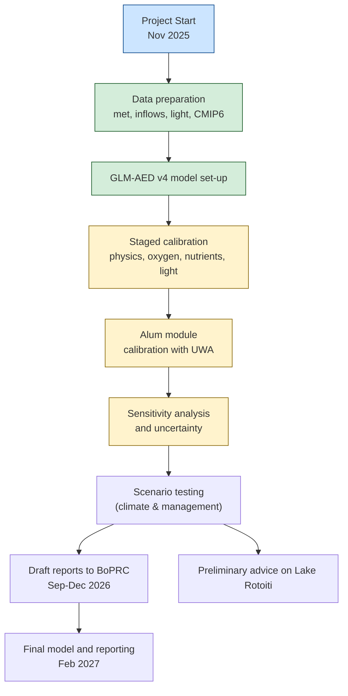

# Rotorua Lake Modelling – PC10 Support

The Lake Rotorua model has been rebuilt in [**GLM-AED**](https://aquatic.science.uwa.edu.au/research/models/AED/) (GLM v4), an open-source hydrodynamic–ecological model that simulates vertical mixing, nutrient cycling and management interventions such as alum dosing under variable climate conditions. The model supports the Bay of Plenty Regional Council's Plan Change 10 (PC10) work on lake nutrient targets.

This site documents the work as it progresses: data preparation, model set-up, calibration, the alum module and climate-change scenarios. Use the navigation bar at the top to move between sections, or the links below.

------------------------------------------------------------------------

## 📍 Where the project is now (November 2026)

-   **Model built:** GLM v4 with AED is configured, running and producing output for 1990 onwards, with inflows, Ōhau weir outflow, light and meteorological forcing in place.
-   **Calibration:** a staged PEST++ calibration (water balance, temperature, oxygen, then nutrients, light and phytoplankton) has produced best-fit parameter sets. Physics and oxygen are well matched (including anoxic duration); phosphorus, particularly the 2021–22 rebound, remains the main misfit.
-   **Alum:** an alum module (`aed_alum`) is running in the model with alum dosed through the two inflows. Work now focuses on the in-stream alum–P reaction and calibrating the alum parameters.
-   **Sensitivity analysis:** Morris screening on the latest setup has been run against the CSPS evaluation metrics.
-   **Next:** finish the alum calibration, re-run scenario and uncertainty analyses with the final parameter sets, then deliver the climate scenarios and the draft report to BoPRC (due 30 Sep – 15 Dec 2026).

See the [GANTT chart and milestones](https://tadhg-moore.github.io/rotorua-pc10/gantt.html) for the full timeline.

------------------------------------------------------------------------

## 🗂️ Site guide

| Section | What you will find | Start here |
|----------------------|-------------------------|-------------------|
| **Project admin** | Timeline and milestones, meeting notes, targets, resources | [GANTT](https://tadhg-moore.github.io/rotorua-pc10/gantt.html), [Meeting notes](https://tadhg-moore.github.io/rotorua-pc10/notes.html), [Targets](https://tadhg-moore.github.io/rotorua-pc10/targets.html), [Resources](https://tadhg-moore.github.io/rotorua-pc10/resources.html) |
| **Data preparation** | Data inputs and requests, met forcing, light, inflows, Ōhau Channel, CMIP6 | [Data inputs](https://tadhg-moore.github.io/rotorua-pc10/data.html), [Met source comparison](https://tadhg-moore.github.io/rotorua-pc10/met-source-comparison.html), [Inflows](https://tadhg-moore.github.io/rotorua-pc10/rotorua-inflows.html), [CMIP6 processing](https://tadhg-moore.github.io/rotorua-pc10/cmip6-processing.html) |
| **Background info** | Literature and earlier reports that inform the model | [Benthic fluxes (Burger 2007)](https://tadhg-moore.github.io/rotorua-pc10/burger-2007-benthic-fluxes.html), [Inflows and alum report summaries](https://tadhg-moore.github.io/rotorua-pc10/rotorua-inflows-alum.html), [Alum dosing thesis notes](https://tadhg-moore.github.io/rotorua-pc10/alum-dosing-sanila-msc-thesis.html) |
| **Model setup & configuration** | GLM v4 configuration, Ōhau weir outflow, latest run, output plots | [GLM config (v4)](https://tadhg-moore.github.io/rotorua-pc10/rotorua-glm-config_v4.html), [Latest run](https://tadhg-moore.github.io/rotorua-pc10/rotorua-glm-latest-run.html), [Ōhau weir](https://tadhg-moore.github.io/rotorua-pc10/ohau-weir-glm-setup.html), [Output plots](https://tadhg-moore.github.io/rotorua-pc10/plot-rotorua.html) |
| **Alum model** | Alum–phosphorus module design, stress tests, calibration design and scenarios | [Alum model](https://tadhg-moore.github.io/rotorua-pc10/alum-model.html), [Simplified alum module](https://tadhg-moore.github.io/rotorua-pc10/aed-alum-module.html), [Stress tests](https://tadhg-moore.github.io/rotorua-pc10/glm-aed-alum-stress-tests.html), [Alum scenarios](https://tadhg-moore.github.io/rotorua-pc10/rotorua-alum-scenarios.html) |
| **Sensitivity analysis & calibration** | Calibration plan, CSPS metrics, staged calibration, sensitivity analysis, calibration report | [Calibration & SA plan](https://tadhg-moore.github.io/rotorua-pc10/aed_calibration_sa_plan.html), [CSPS metrics](https://tadhg-moore.github.io/rotorua-pc10/csps-metrics.html), [Calibration report](https://tadhg-moore.github.io/rotorua-pc10/rotorua-calibration-report.html), [Sensitivity](https://tadhg-moore.github.io/rotorua-pc10/sensitivity-csps.html) |
| **Climate change impacts** | Climate-impact strategy, scenario meteorology workflow, extreme events | [Climate impact strategy](https://tadhg-moore.github.io/rotorua-pc10/climate-impact-strategy.html), [Scenario workflow](https://tadhg-moore.github.io/rotorua-pc10/climate-scenario-workflow.html), [Extreme events](https://tadhg-moore.github.io/rotorua-pc10/climate-extreme-events.html) |
| **Presentations** | Overview talks and team updates | [Research overview](https://tadhg-moore.github.io/rotorua-pc10/research-overview.html), [Modelling updates](https://tadhg-moore.github.io/rotorua-pc10/modelling-updates.html) |

------------------------------------------------------------------------

## 🔍 Overview

Key enhancements over previous Lake Rotorua models:

-   **Dynamic sediment–water feedback** to better represent internal nutrient loading and delayed responses to external inputs.\
-   **Support for climate change scenarios**, enabling projections of lake responses over decadal scales.\
-   **Mechanistic simulation of alum dosing**, which is currently conducted in two inflows on a near-daily basis.\
-   **Active and ongoing development** of model software and related tools, in collaboration with the AED developers at UWA.

------------------------------------------------------------------------

## ⚗️ Alum–Phosphorus Modelling

Previous models did not explicitly simulate alum chemistry or its interaction with phosphorus. Working with the **University of Western Australia (UWA)**, an alum module is now available in the AED libraries and is being tested and calibrated for Lake Rotorua. See the [alum model description](https://tadhg-moore.github.io/rotorua-pc10/alum-model.html) and the [simplified module](https://tadhg-moore.github.io/rotorua-pc10/aed-alum-module.html).

The module represents:

-   Hydrolysis of dosed alum and speciation of aluminium (e.g. *Al³⁺*, *Al(OH)₃*)\
-   pH and temperature dependence of phosphate binding efficiency\
-   Sediment-mediated sorption and variable effectiveness depending on depth, organic content, and redox state\
-   Aging or decay of reactive Al over time to simulate persistence of alum effects\
-   Dosing through inflow boundary conditions, allowing for flexible scenario testing

Current work is described in [Alum calibration stage 1](https://tadhg-moore.github.io/rotorua-pc10/alum-calibration-stage-1.html) and the [stream calibration design](https://tadhg-moore.github.io/rotorua-pc10/rotorua-alum-stream-calibration.html).

------------------------------------------------------------------------

## 📅 Deliverables and Milestones

| Milestone | Target Date | Status | Deliverable |
|------------------|----------------|----------------|----------------------|
| **SWAT-MODFLOW pilot (3 catchments)** | March 2026 | Separate workstream, not tracked on this site | Calibrated sub-catchment models and model evaluation |
| **GLM-AED model upgrade** | March 2026 | Done (GLM v4 configured and running) | Lake model with sediment dynamics ([config](https://tadhg-moore.github.io/rotorua-pc10/rotorua-glm-config_v4.html)) |
| **Lake model calibration** | Oct–Nov 2026 | Under way, first-cut and staged calibration complete | Calibrated parameter sets and report ([report](https://tadhg-moore.github.io/rotorua-pc10/rotorua-calibration-report.html)) |
| **Alum module** | Mid 2026 | Implemented, calibration in progress | Working alum–P module ([alum model](https://tadhg-moore.github.io/rotorua-pc10/alum-model.html)) |
| **Initial climate scenarios for lake** | Late 2026 | Workflow designed, runs pending | Long-term projections under climate change ([strategy](https://tadhg-moore.github.io/rotorua-pc10/climate-impact-strategy.html)) |
| **Preliminary advice re Rotoiti** | Late 2026 – early 2027 | Pending | Advice on potential downstream impacts (if Ōhau Wall is repaired) |
| **Draft reports to BoPRC** | 30 Sep – 15 Dec 2026 | Pending | Draft lake modelling report |
| **Complete lake model and scenario delivery** | February 2027 | Pending | Final outputs, full climate and management scenario set, documentation |

------------------------------------------------------------------------

## 🧭 Other Considerations

The work is **strongly aligned with PC10 implementation**. Council staff have highlighted the need for **early advice on potential changes in nutrient delivery to Lake Rotoiti**, particularly if the Ōhau Wall is repaired. The Ōhau Channel outflow is therefore part of the calibration targets ([Ōhau weir set-up](https://tadhg-moore.github.io/rotorua-pc10/ohau-weir-glm-setup.html), [Ōhau Channel water quality](https://tadhg-moore.github.io/rotorua-pc10/ohau-channel-water-quality.html)).

------------------------------------------------------------------------

## 🧭 Project Workflow Overview

Green = complete, amber = in progress.
