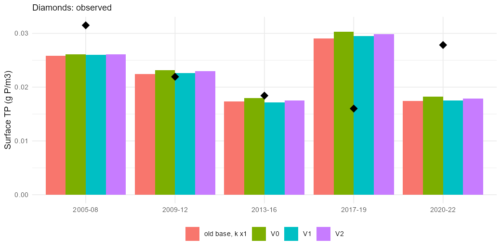
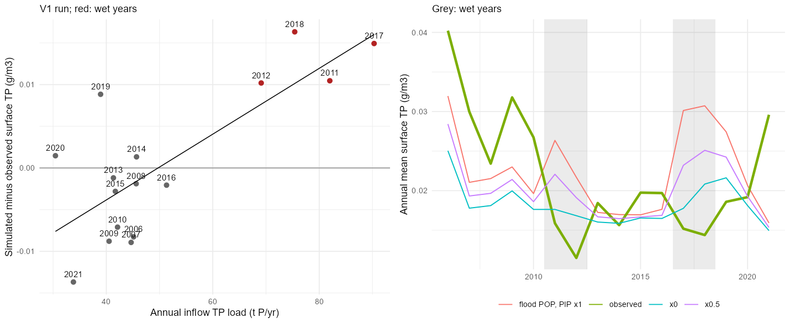

```{r}
#| include: false
#| eval: true
source("scripts/include_img.R")
```

This page keeps the stage-by-stage record that sits behind [the main alum calibration page](alum-calibration-stage-1.qmd): each stage, what misfit it targeted, and why the next one followed. The final result is on the main page.

All runs below are 2005 to 2022, alum on, from the Oxygen-1 member, with surface (0 to 5 m) TP including the refractory DOP offset of 0.0046 g/m³ that the calibration objective adds (the model's TP leaves out that pool).

```{r}
#| eval: true
#| label: tbl-runs
#| tbl-cap: "Mean bias of the surface fit and bottom anoxia for each run."
knitr::kable(read.csv("data/inflows/run_summary.csv"), col.names = c("Run", "TP bias (%)", "FRP bias (%)", "Chlorophyll bias (%)", "Anoxic days", "Observed anoxic days"))
```

## The calibration at a glance {#sec-glance}

@fig-score follows the surface fit and bottom anoxia through every stage, from the Oxygen-1 member on the V1 inflows (the starting point) to the oxygen refit Oxygen-2. The stages are described one by one in the sections below; this table says what each one was designed to fix and why the next followed.

| Stage | Targeted misfit | What it showed | Why the next stage |
|---|---|---|---|
| V1 (start) | Alum module fitted on hybrid inflows | FRP -50%, chlorophyll +16%, TP wet years +66 to +113% | The TP error followed the inflow P load, so the storm particulate P was the first suspect |
| Particulate-P, Particulate-P 2 | Particulate settling and hydrolysis (`w_pom`, `rpop_hydrol`, `w_po4ads`) | Wet-year error fell a little, FRP improved (to -16% in Particulate-P 2), but chlorophyll rose (+29%) | The wet-year excess was mostly dissolved P, so the alum and sediment P were refitted |
| Alum-1, Alum+SedP | Alum parameters, then alum plus sediment P release | Better wet years and year-to-year correlation, but overall TP fell to -19% | Lake parameters could not fix wet years and low years together: halve the flood-day particulate P as an input assumption and refit |
| Half-flood, Final-alum | Same joint refit on the flood × 0.5 base | Best annual TP so far; Final-alum converged | FRP (-34%) and chlorophyll (+25%) had not moved: the phytoplankton P kinetics were untouched since the early biology stages |
| Phyto-P | `K_P`, `X_pmin`, `X_pmax`, `R_resp` (12 parameters) | FRP -6%, chlorophyll +3%, but anoxic days up to 287 | More production meant more oxygen demand: the oxygen parameters were fitted under the old biology |
| Oxygen-2 | Sediment oxygen demand and organic-matter oxygen consumption | Anoxia only 287 to 275, nutrient fit held | The nutrient and oxygen parameters are correlated and were fitted in sequence, so they have to be estimated together, with nitrogen and the thermocline added as targets ([Joint stage](alum-calibration-stage-1.qmd#sec-joint)) |

```{r}
#| eval: true
#| echo: false
#| label: fig-score
#| fig-cap: "Surface (0 to 5 m) fit and bottom anoxia for the best member of each stage, in the order the stages were run. Dashed lines mark a perfect fit."
include_img("images/calibration/scorecard.png")
```

```{r}
#| eval: true
#| echo: false
#| label: fig-phi
#| fig-cap: "Objective by iteration for each stage (best member and ensemble median; free y-axis, so levels are not comparable across stages). Most stages gain little after the first or second iteration; the Phyto-P stage gains most because its prior ensemble was wide."
include_img("images/calibration/objective_trajectories.png")
```

## Efficiency sensitivity (old inflows) {#sec-eff}

The first sensitivity scaled `k_w` and `k_s` on the old (hybrid) inflows. Without the refractory DOP offset it suggested the alum was too efficient (best scale 0.3 to 0.4); that was an artefact. With the offset, the TP bias is -3% at the fitted efficiency and +5% at 0.7, so the fitted efficiency is about right for TP (@fig-eff). Lower scales improve FRP (-51% to -20% from 1 to 0.3) but worsen TP (+25%) and chlorophyll, so FRP and TP pull in different directions.

{#fig-eff}

## In-stream reaction variants {#sec-variants}

V0 (no stream reaction), V1 (full: Puarenga ramp, Utuhina 0.45) and V2 (half) on the no-alum inflows, with `k_w` and `k_s` × 0.85, all fit about equally (@tbl-runs and @fig-period): the stream reaction changes surface TP by 2% or less, because total P is conserved and the lake module already removes the FRP quickly. The suspended alum-bound pool is only about 0.5% of TP, so adding it to the model TP changes nothing. The lake data therefore cannot identify the stream fractions; V1 is kept because it follows the reports. The ALU_alp delivery works: the column and namelist entry survive the run, the lake pool fills, and the bound P load matches the with-alum file (1.15 t P/yr Utuhina, 1.75 t P/yr Puarenga, 2011 to 2017).

{#fig-period}

## Lake TP follows the inflow load, the observations do not {#sec-load}

The variants share a structured TP error. Across 2006 to 2021 the simulated annual TP is positively correlated with the annual inflow TP load (r = 0.56) while the observed TP is negatively correlated (r = -0.52); the error correlates with the load at r = 0.77 (@fig-load2). The four wet years (2011, 2012, 2017, 2018; inflow volume above 580 hm³/yr and TP loads of 69 to 90 t against about 46 t in other years) are overestimated by 66% to 113%, while the observed TP is at its lowest. The extra load in wet years is mostly particulate P (about 37 t PIP and 10 t POP, against 13 and 3.5 t), and flood days (3 to 6% of days) carry 36% to 66% of the particulate P of the gauged streams. The 2021 to 2022 observed TP rebound occurs with low loads and is a separate, unexplained effect.

{#fig-load2}

## Flood-day particulate P sensitivity {#sec-flood}

Scaling the POP and PIP delivered on flood days (the `isFlood` flag of the file) by 0.5 (F50) and 0 (F0) shows the sensitivity:

```{r}
#| eval: true
#| label: tbl-flood
#| tbl-cap: "Annual TP error (sim minus obs, g/m3), 2006 to 2021, with flood-day particulate P scaled."
knitr::kable(read.csv("data/inflows/flood_scaling_summary.csv"), col.names = c("Run", "Wet-year error", "Other-year error", "Annual RMSE", "Year-to-year r", "FRP bias (%)", "Chlorophyll bias (%)", "Anoxic days"))
```

Removing the flood particulate P brings the wet years much closer (error +0.013 to +0.004 g/m³, year-to-year r 0.06 to 0.44) but lowers TP in the other years and worsens FRP (the particulate organic P is a source of FRP through hydrolysis). The fix is therefore how fast the event P leaves the water column, not removing the load. In the calibrated 2O member the particulate organic matter settles at only -0.019 m/d (about 580 days to settle across the mean depth) and these parameters were fixed in earlier stages, so event particulate P stays until the outflow flushes it (about 1.4 years).

## What Particulate-P calibrates {#sec-q}

Particulate-P frees three lake-process parameters, not event-specific ones: the particulate organic matter settling velocity `w_pom` (range -1 to -0.005 m/d, now -0.019), the particulate organic P hydrolysis rate `rpop_hydrol` (0.002 to 0.3 /d, now 0.016) and the settling velocity of adsorbed P `w_po4ads` (-3 to -0.02 m/d, now -0.29). The wet years are where these rates can be identified because that is where the particulate load is large. The objective is the alum-stage objective (TP, FRP, chlorophyll, aluminium, temperature, oxygen guards, with calibration 2006 to 2018 and validation 2018 to 2022) plus two annual-TP terms: the mean wet-year bias (scale 0.005 g/m³) and the year-to-year correlation. The inflow flood scaling is not a free parameter, because it is an input correction that would trade off against settling; it is tested afterwards at fixed values (step 4). Parameters that influence oxygen (`w_pom` also settles the particulate carbon) are guarded by the oxygen and anoxia terms of the objective.

## Particulate-P result {#sec-qresult}

All 48 members ran in every iteration and the objective fell from 1.10 (start) to 0.95 (best). The best member has faster settling and hydrolysis: `w_pom` -0.019 to -0.105 m/d, `rpop_hydrol` 0.016 to 0.10 /d, `w_po4ads` -0.29 to -0.92 m/d. The top quarter of the final ensemble is tight on `w_pom` (-0.13 to -0.06) and `rpop_hydrol` (0.04 to 0.24) and wide on `w_po4ads`.

| Run (2006 to 2021 surface TP, Particulate-P parameters unless stated) | Wet-year error (g/m³) | Other-year error | Year-to-year r | FRP bias | Total N bias (no offset) |
|---|---|---|---|---|---|
| V1, Oxygen-1 parameters | +0.013 | -0.004 | 0.06 | -50% | -38% |
| Particulate-P, flood particulate P × 1 | +0.010 | -0.006 | 0.12 | -37% | -61% |
| Particulate-P, × 0.75 | +0.008 | -0.006 | 0.20 | -43% | -63% |
| Particulate-P, × 0.5 | +0.006 | -0.007 | 0.29 | -50% | -64% |

- **A modest gain.** Faster particulate settling and hydrolysis cut the wet-year error from +0.013 to +0.010 g/m³ and lift the year-to-year correlation from 0.06 to 0.12. Scaling the flood particulate P as well brings it to +0.006 (× 0.5), but the other years then run low (-0.007) and the overall TP bias is about -17%.
- **Total N pays for it.** Faster particulate settling also removes particulate N (`w_pom` settles carbon, nitrogen and phosphorus together), and the total N bias gets worse (the guard term went from -0.19 to -1.01 tolerance units). Chlorophyll is slightly worse and anoxic days are unchanged (243 to 255 against 239).
- **The wet-year excess is mostly dissolved P, not particulate.** In the Particulate-P run the top 5 m pools are higher in the wet years by about 0.0022 g/m³ for FRP (0.0022 to 0.0044), 0.0020 for dissolved organic P (0.0067 to 0.0087) and 0.0010 for diatom internal P, but only 0.0003 for particulate organic P. FRP reaches 0.009 g/m³ in 2017 against an observed 0.0015. Settling the particulates faster does not remove that: the event P is hydrolysed and mineralised to dissolved forms, and the alum capacity per unit of flow is smaller in wet years.

**What this means.** Particulate settling and hydrolysis are not the main lever for the wet-year TP error, and the parameters that help P hurt N. The better targets are the dissolved P pools in the wet years (FRP removal by the alum, DOP mineralisation) and, as an input uncertainty, the flood-day particulate load.

## Refits after Particulate-P {#sec-refit}

Four further stages followed, all on the V1 inflows (no-alum files, in-stream bound P) with 48 members and 4 iterations each. The alum-stage objective is used throughout, with the wet-year TP bias and year-to-year correlation terms added (`S2_TPTERMS=1`).

- **Particulate-P 2.** Intended as a narrower Particulate-P (`w_pom` fixed), but a range helper in `step2_common.R` reset the limits after the freeze and left `w_pom` free, so it is Particulate-P plus `rdom_minerl` (0.5 to 2 ×). Best member: `w_pom` -0.051, `rpop_hydrol` 0.21, `w_po4ads` -0.58, `rdom_minerl` 0.033. Total N is no worse than V1 this time.
- **Alum-1.** The eight alum parameters freed again (wide ranges), holding the Oxygen-1 and Particulate-P 2 members.
- **Stage Alum+SedP.** The alum parameters plus the sediment P release (`fsed_frp` by zone, `ksed_frp`, `theta_sed_frp`). No improvement on Alum-1: objective 0.766 to 0.778.
- **Stages Half-flood and Final-alum.** The same joint refit on the base with flood-day particulate P × 0.5 (the input correction from step 4), so the wet years are handled by the input and the sediment P and alum parameters fit the other years. The objective fell from 0.73 to 0.58 in Half-flood. Final-alum continued from it and changed nothing (0.580 to 0.577), so the ensemble has converged.

| Run (2006 to 2021 surface 0 to 5 m) | Wet-year error (g/m³) | Other-year error | Annual RMSE | Year-to-year r | FRP bias | Chlorophyll bias | Total N bias (no offset) | Anoxic days (obs 239) |
|---|---|---|---|---|---|---|---|---|
| V1, Oxygen-1 | +0.0130 | -0.0036 | 0.0089 | 0.06 | -50% | +16% | -38% | 268 |
| Particulate-P 2 | +0.0102 | -0.0052 | 0.0085 | 0.22 | -16% | +29% | -38% | 245 |
| Alum-1 | +0.0073 | -0.0072 | 0.0086 | 0.29 | -29% | +24% | -45% | 270 |
| Alum+SedP | +0.0068 | -0.0078 | 0.0089 | 0.31 | -32% | +21% | -48% | 245 |
| Half-flood (flood × 0.5) | +0.0050 | -0.0067 | 0.0078 | 0.42 | -36% | +25% | -43% | 250 |
| **Final-alum (flood × 0.5)** | +0.0051 | -0.0067 | **0.0078** | **0.43** | -34% | +25% | -44% | **242** |

```{r}
#| eval: true
#| echo: false
#| label: fig-annual-stage
#| fig-cap: "Annual mean surface TP by year for the Oxygen-1 start member, the particulate stages and the flood × 0.5 refits, against the observations (grey: wet years)."
include_img("images/calibration/annual_tp_by_stage.png")
```

**Why these stages were designed this way.** @fig-annual-stage shows the problem that drove them: in the wet years (2011, 2012, 2017, 2018) the model's annual TP is well above the observations, while in dry years it is slightly low, and the observations fall in wet years. Lake processes alone (Particulate-P, Particulate-P 2, Alum-1, Alum+SedP) reduced the overshoot but pushed the dry years lower. Halving the flood-day particulate P in the inflows (Half-flood, Final-alum) is an input correction that lets the lake parameters fit the dry years while the storm load is damped, which is why the refits were repeated on that base.

**Result.** Final-alum has the lowest annual TP error, the best year-to-year correlation and anoxic days within 3 of the observed 239. It keeps three misfits: surface TP about 17% low overall, FRP about 34% low and chlorophyll about 25% high. Particulate-P 2 fits FRP and the overall TP bias better (-16% and -6%) but at the price of a larger wet-year error and chlorophyll +29%. The two are the candidates for the scenarios; Final-alum is the working choice because the year-to-year behaviour is what drives the scenario contrasts, with Particulate-P 2 kept as a sensitivity member. The Final-alum parameters are in `calibration/step2p4/runs/step2_best.rds`, and the final ensemble is in `step2_ies.rds` in the same folder.

**Caveats.** The Final-alum best member rests on the flood-day particulate P × 0.5 correction, which is an input assumption and not a calibrated quantity; it must be carried into the scenario runs (build with `STR_FLOODSCALE=0.5`, as in `calibration/alum/stream_variant.R`). The alum parameters are poorly constrained across the top quarter of the ensemble (for example `k_res` 0.001 to 0.5 in Alum-1), so the scenario ensemble should draw members rather than use the best member alone. The surface FRP and chlorophyll misfits did not respond to any of these stages, which points at the phytoplankton uptake and the dissolved P cycling and not at the alum.

## Phyto-P stage {#sec-stage-s}

**Why this stage.** After Final-alum converged, the misfits that remain (surface FRP about 34% low, chlorophyll about 25% high, TP about 17% low) did not respond to the alum, sediment P or particulate parameters. The seasonal cycle in @fig-seasonal shows what was wrong: in Final-alum surface FRP is far too low from February to June (it is nearly zero in March and April against 0.003 to 0.006 g/m³ observed), and the summer chlorophyll peak is 5 to 6 µg/L too high (February to March), so the phytoplankton were taking up more P than the lake data allow. The phytoplankton P kinetics have not been touched since the early biology stages, which predate the alum module and the current inflows, so the Phyto-P stage frees them: the half-saturation constant for P uptake `K_P`, the minimum and maximum internal P quotas `X_pmin` and `X_pmax`, and the respiration rate `R_resp`, for each of the cyano, green and diatom groups (12 parameters).

| Parameter | Start (Final-alum; cyano, green, diatom) | Range |
|---|---|---|
| `K_P` (g/m³) | 0.21, 0.29, 0.056 | 0.3 to 3 × start |
| `X_pmin` | 0.0007, 0.001, 0.0012 | 0.5 to 2 × start |
| `X_pmax` | 0.009, 0.005, 0.0038 | 0.5 to 2 × start |
| `R_resp` (/d) | 0.105, 0.25, 0.01 | 0.01 to 0.4 |

The alum, sediment P, particulate and oxygen parameters are held at the Final-alum and earlier members, and the objective is the same as in Final-alum stage (alum-stage objective plus the wet-year TP terms). The green group's `R_resp` sat on its previous upper bound (0.25), so the range is widened. The run uses 48 members and 4 iterations, and the best member is evaluated on the flood × 0.5 base (run name `S1`).

**Result.** The objective fell from 0.58 to 0.48. Surface FRP moved from -34% to -6%, chlorophyll from +25% to +3% and the overall TP bias from -17% to -8%; the annual TP RMSE fell from 0.0078 to 0.0068 g/m³ and the year-to-year correlation rose from 0.43 to 0.52. The cost was bottom oxygen: with more production the model had 287 days below 2 g/m³ against 239 observed (242 for Final-alum). The best member lowers the green group's `R_resp` to its lower bound (0.0102), and the top quarter of the ensemble is wide for `K_P` and `X_pmin`, so these parameters are weakly constrained.

```{r}
#| eval: true
#| echo: false
#| label: fig-seasonal
#| fig-cap: "Mean annual cycle of surface FRP and chlorophyll-a, 2006 to 2021, for Final-alum and Phyto-P against the observations."
include_img("images/calibration/seasonal_frp_chl.png")
```

```{r}
#| eval: true
#| echo: false
#| label: fig-pos
#| fig-cap: "Position of the start member (arrow tail) and best member (point) inside each parameter's allowed range, for the Phyto-P and Oxygen-2 stages. Red points sit at a bound."
include_img("images/calibration/parameter_positions.png")
```

In @fig-seasonal the Phyto-P stage lifts summer FRP back to the observed level (January) and lowers the summer chlorophyll peak, but it still leaves FRP near zero in March to April, over-predicts FRP from August to December (0.005 to 0.008 g/m³ against 0.0025 to 0.004), and under-predicts chlorophyll from June to December. The remaining seasonal errors are one reason for the joint stage ([Joint stage](alum-calibration-stage-1.qmd#sec-joint)).

@fig-pos shows how far the stage moved: most Phyto-P parameters moved by a modest fraction of their range, with the green group's `R_resp` running to its lower bound. Most parameters end well inside their ranges, so the ranges were not what limited the fit.

**Why the next stage.** Stage Phyto-P fixed the nutrient and chlorophyll fit, but more production delivers more organic matter to the bottom, and anoxic days rose from 242 to 287. The oxygen parameters had been fitted when production was lower, so they were refitted next (Oxygen-2).

## Oxygen-2 stage (oxygen refit) {#sec-o3}

Because the Oxygen-1 oxygen parameters were fitted under the earlier, less productive biology, they were refitted on top of the Phyto-P stage member: the four zone `fsed_oxy` values, `ksed_oxy`, `theta_sed_oxy`, `rdom_minerl`, `rpoc_hydrol` and `theta_minerl` (9 parameters), with the calibration window ending 2017-06-30 as in the original Oxygen-1. The concern was equifinality, that the oxygen parameters would restore anoxia by shifting the nutrient fit back. They did not: the best member keeps FRP at -8.5%, chlorophyll at +4.9%, total TP at -6% (annual TP RMSE 0.0067 g/m³, year correlation 0.51) and total N at -34%. Anoxia improved only modestly, to 275 days against 239 observed. Calibration-period anoxia is on target, but the 2018 to 2022 validation period is over-predicted, and the strongest sediment oxygen demand moved to the deep zone 4 (-176 to -296 mg/m²/d). The Oxygen-2 member is the best member of this stage.

```{r}
#| eval: true
#| echo: false
#| label: fig-anox-stage
#| fig-cap: "Days per year with bottom DO (mean of the 17 m and deeper samples) below 2 g/m³, on the sampled days, for the observations and the Final-alum, Phyto-P and Oxygen-2 members."
include_img("images/calibration/anoxic_days_stages.png")
```

@fig-anox-stage shows that the anoxia count hides a timing problem. The observations have most low-oxygen days in 2008 to 2010 (27, 34 and 42 days) and in 2015 (31); the model misses 2008 and 2009 (about 9 and 8 to 16 days) and overshoots 2017 (37 days against 18) and 2018 to 2019. Stage Phyto-P also creates a spurious anoxic year in 2013 (29 days against 4), which Oxygen-2 removes. Since the early years are under-predicted and the late years over-predicted, a single sediment oxygen demand per zone cannot fix it: the oxygen demand and the production supply have to be adjusted together.

**Why a joint stage next.** The oxygen and nutrient parameters are correlated (production supplies the organic matter that the oxygen parameters consume, and sediment P release depends on bottom oxygen), but they were fitted one after the other, so each stage was conditional on the last. The remaining misfits (summer FRP and chlorophyll timing, TN about 34% low, anoxia timing) cross those groups. The next stage therefore frees them together and adds targets that measure them directly ([Joint stage](alum-calibration-stage-1.qmd#sec-joint)).

Two problems cost compute time and are worth recording. A first Oxygen-2 run optimised nothing because the calibration end date (`S2_CALEND`, default 2003) left no data in the window, so every residual was zero. A second attempt was contaminated when a watchdog killed model runs that had stalled while the laptop went into standby; the truncated runs scored zero and looked like perfect members. The ensemble code now treats an all-zero residual vector as a failed run, and sleep was disabled for the long runs.

## Historical ensemble {#sec-hist}

The 20 lowest-objective members of the final Oxygen-2 ensemble were run over 2005 to 2022 on the flood × 0.5 base with the alum module on (`calibration/historical/run_hist.R`). Only the nine oxygen parameters differ between members, so the envelope shows the oxygen uncertainty and not the uncertainty in the phytoplankton or alum parameters.

```{r}
#| eval: true
#| echo: false
include_img("images/historical/envelopes.png")
```

Monthly means of the daily surface (0 to 5 m) and bottom values; the dark band is the interquartile range, the light band the full ensemble, and the points are the observations.

```{r}
#| eval: true
#| echo: false
m <- read.csv("data/historical/member_metrics.csv")
s <- data.frame(Metric = c("Objective", "Surface TP bias (%)", "Surface FRP bias (%)", "Surface chlorophyll bias (%)", "Annual TP RMSE (g/m³)", "Year-to-year TP correlation", "Anoxic days (observed 239)", "Bottom DO bias (g/m³)"),
  Mean = c(mean(m$phi), mean(m$TP_bias), mean(m$FRP_bias), mean(m$chl_bias), mean(m$TP_annual_rmse), mean(m$TP_year_r), mean(m$anoxic_days), mean(m$DO_bottom_bias)),
  Min = c(min(m$phi), min(m$TP_bias), min(m$FRP_bias), min(m$chl_bias), min(m$TP_annual_rmse), min(m$TP_year_r), min(m$anoxic_days), min(m$DO_bottom_bias)),
  Max = c(max(m$phi), max(m$TP_bias), max(m$FRP_bias), max(m$chl_bias), max(m$TP_annual_rmse), max(m$TP_year_r), max(m$anoxic_days), max(m$DO_bottom_bias)))
knitr::kable(s, digits = 3)
```

- **The ensemble brackets the observations for the main variables.** Mean surface TP bias is about -12% (range -22% to +7%), FRP is within ±12% for 16 of the 20 members and chlorophyll is within +11%. The mean number of anoxic days (252) is close to the observed 239, with a wide spread (170 to 337).
- **Known misses.** FRP and TP are too high in 2005 to 2006, which is spin-up and initial-condition influence; the 2017 to 2019 TP peak is over-predicted; and the TP and FRP rebound of 2021 to 2022 is missed by every member. Summer chlorophyll peaks in 2009 and 2018 to 2019 are higher than observed.
- **Bottom DO.** The ensemble follows the seasonal cycle but the deepest observed drawdowns (below 2 g/m³ at times) are not reached in every year, which is what the anoxia comparison by year shows (`images/historical/anoxia_by_year.png`, `data/historical/anoxic_days_by_year.csv`).

```{r}
#| eval: true
#| echo: false
#| label: fig-hist-anox
#| fig-cap: "Days per year with bottom DO below 2 g/m³: the Oxygen-2 ensemble (band: min to max, line: median, all model days) and the observed days (bars, sampled days only, so they are lower bounds)."
include_img("images/historical/anoxia_by_year.png")
```

## Housekeeping

The run and build folders of stages Particulate-P to Final-alum were deleted after the best members and ensembles were saved (about 90 GB). Each stage keeps `step2_best.rds` (best member), `step2_ies.rds` (ensemble history and parameter table) and `step2_table.rds`. The evaluation runs keep `result_*.rds` and `base_*.rds` in `calibration/alum/stream`. The run folders are rebuilt by `step2_build` when a stage is rerun.
