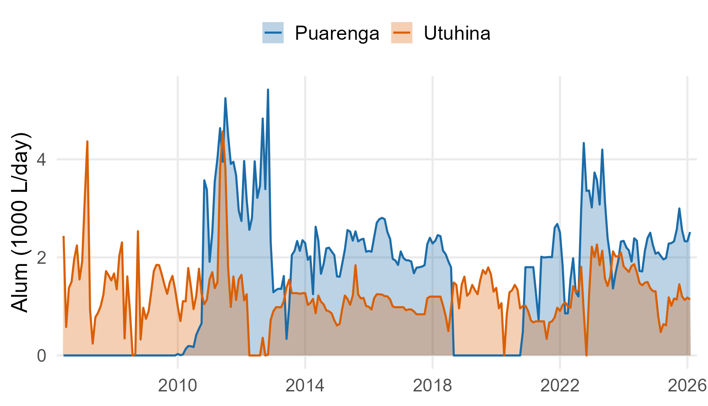
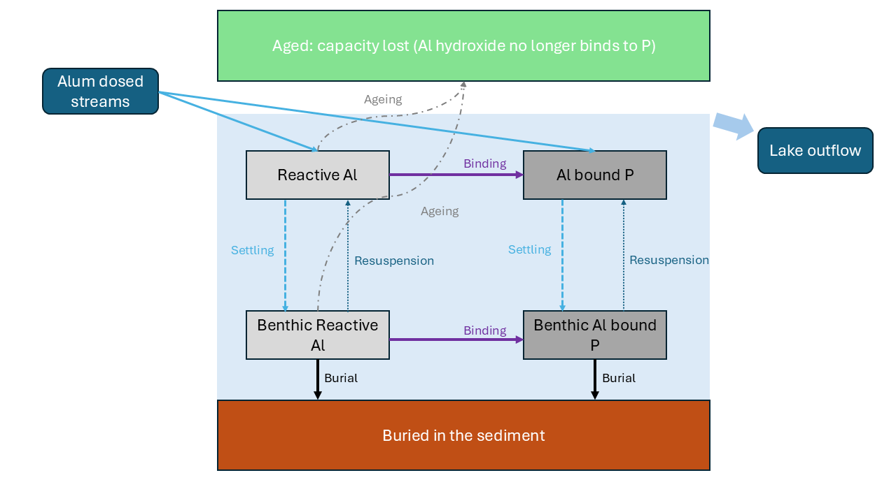
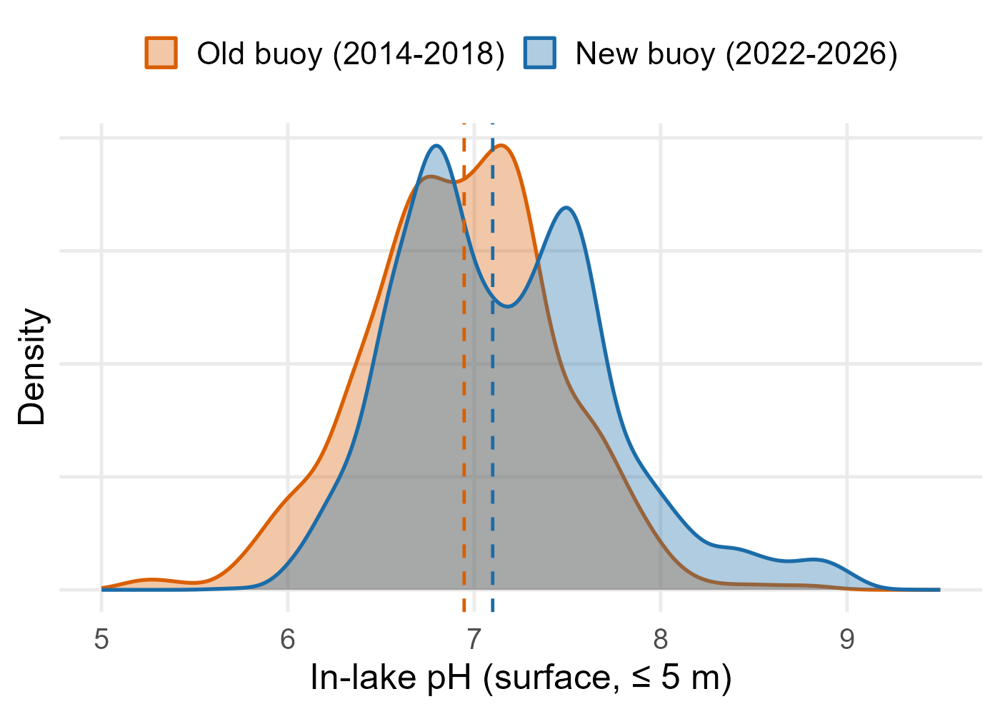
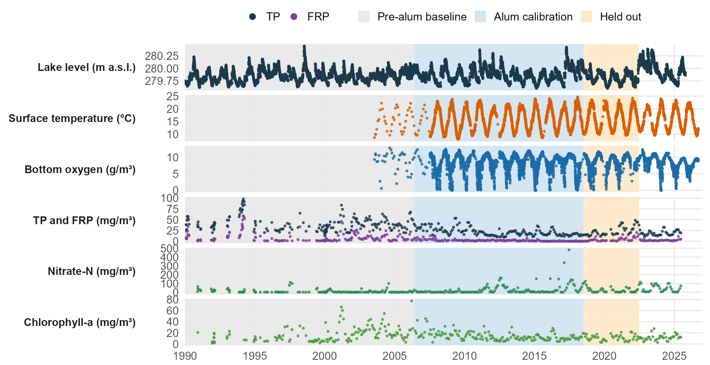
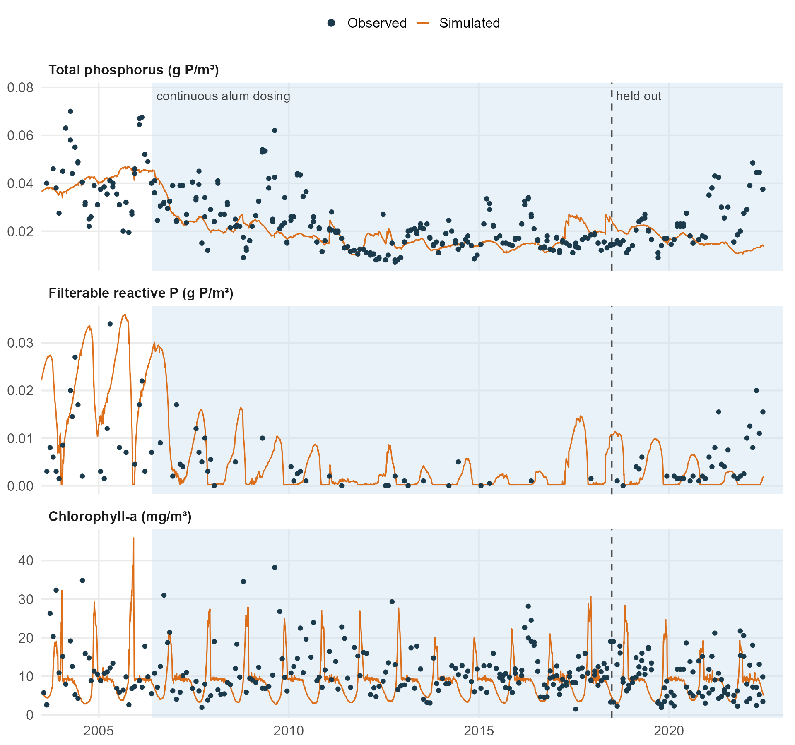
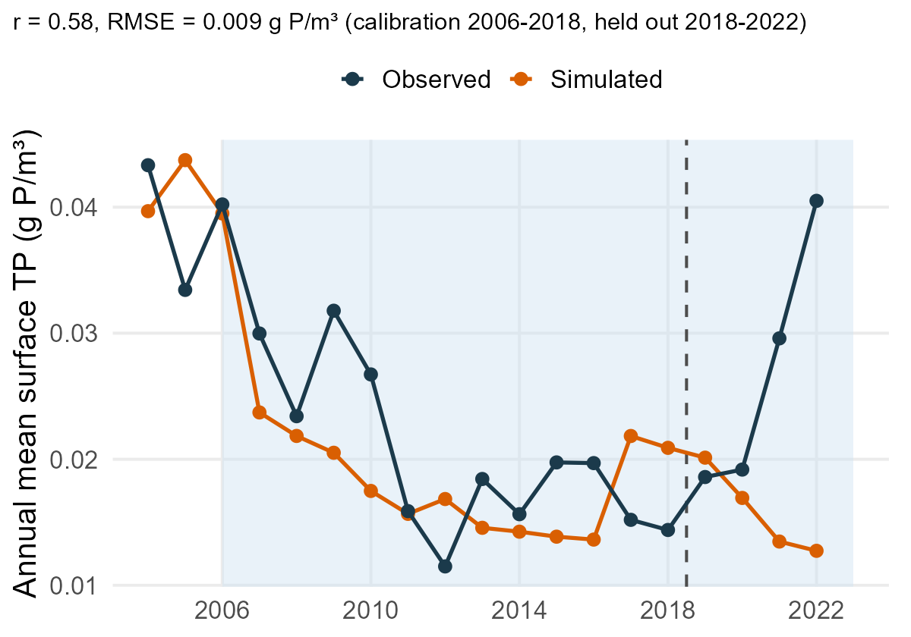
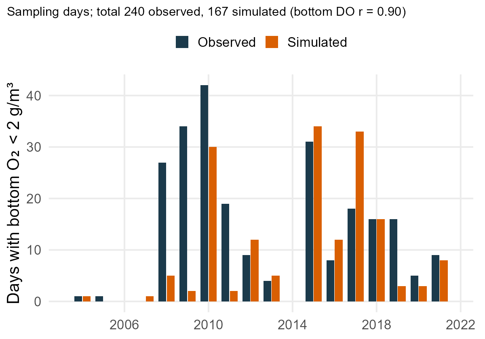
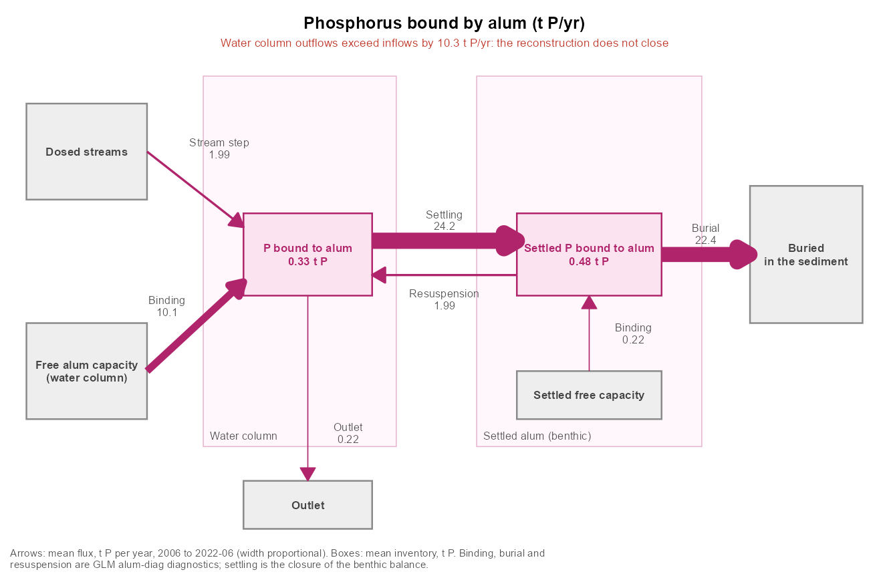
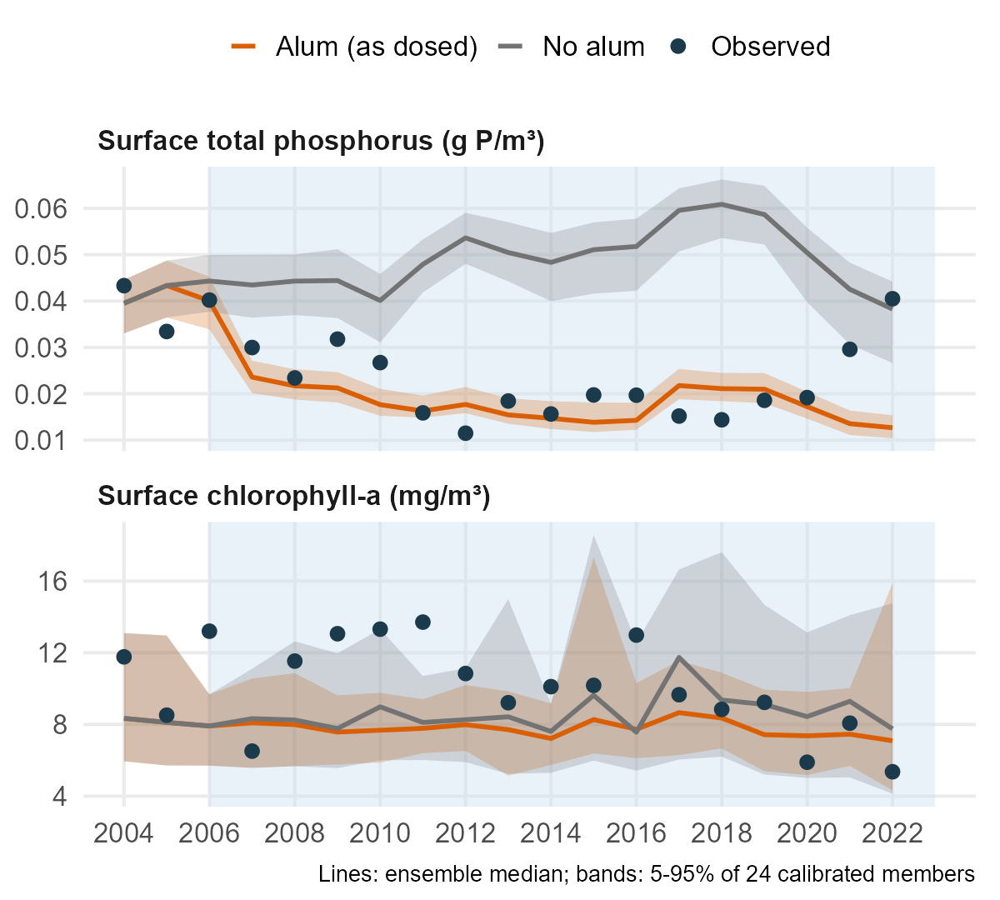
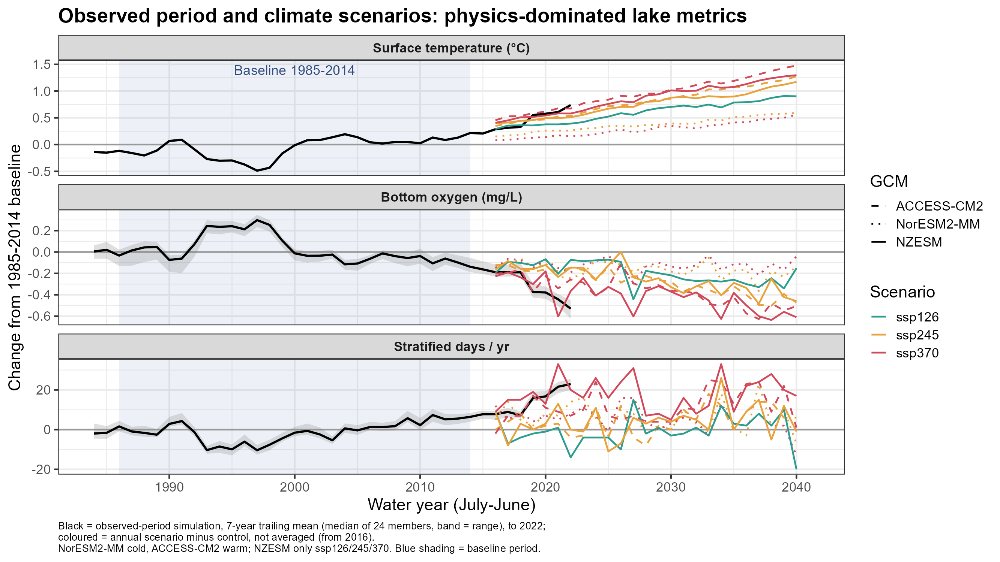

# Why alum, and why a model? {background-color="#1b3a4b"}

## The problem {.smaller}

::: incremental
- Excess phosphorus (P) loading still drives eutrophication in lakes worldwide
- Alum (aluminium sulfate) is widely used to reduce P availability
- The chemistry of Al–P binding is well understood
- **But** dose-to-outcome tools remain largely empirical
:::

::: {.callout-important .fragment}
## The gap

Existing lake models cannot explicitly link *alum dosing strategy* to *lake-scale P dynamics* and *long-term water quality*.
:::

::: notes
Frame the decision problem: managers choose dose, timing, location, not chemistry.
:::

## Lake Rotorua: a rare long record {.smaller}

::::: columns
::: {.column width="42%"}
- Bay of Plenty, Aotearoa New Zealand
- Warm polymictic, eutrophic, history of cyanobacterial blooms and bottom-water anoxia
- **Continuous alum dosing of the Utuhina (since 2006) and Puarenga (since 2010) streams**
- Long monitoring record of lake, streams and outlet
:::

::: {.column width="58%"}
{fig-alt="Monthly mean alum dose to the Utuhina and Puarenga streams, 2006 to 2026" fig-align="center"}
:::
:::::

##  {background-iframe="figures/map_rotorua.html" background-interactive="true"}

::: notes
Interactive map (website/scripts/nzfss/make_nzfss_map.R). Animation plays on arrival: surface catchments, groundwater catchments, dosing points, then the Ohau outflow. Use Replay (top left) to restart; layers can be toggled top right. Dosing in the streams, not the lake, is why we need an inflow-delivery component.
:::

## Question and approach {background-image="figures/catchment_overview.jpg" background-opacity="0.4" background-color="#1b3a4b"}

**Can we build a mechanistic representation of continuous alum treatment inside a full lake model, and use it to inform dosing decisions?**

1.  Develop an alum module for GLM-AED
2.  Calibrate and evaluate on 20+ years of Rotorua dosing
3.  Use it to test treatment scheduling
4.  Scenarios: is alum alone enough?

# The model {background-color="#1b3a4b"}

## The GLM-AED alum module

<!--
Make bigger text
Alum chemistry
Add pictures of dosing plants
Continuous dosing is rare
Add chemistry equation for hydrolysis of Alum
  Can't buld dose Rotorua
    Big lake & buffering
    Acidic
Add MH & KK as co-authors
1-D model 
Remove pH - labels

-->

{fig-align="center"}

::: notes
Five processes from the abstract: delivery from inflows, kinetic uptake in the water column, settling, continued binding at the SWI, ageing.
:::

## Process by process {.smaller}

| Process | Representation |
|------------------------------------|------------------------------------|
| Delivery | Alum dose carried by treated inflows (dose ratio set per stream) |
| Water-column uptake | Second-order kinetics, Al~r~ × PO~4~, temperature (Q~10~) scaling |
| Settling | Gravitational settling of floc to the bed (w~ala~) |
| Sediment binding | Continued P uptake at the sediment–water interface |
| Ageing | First-order loss of reactivity (k~age~, water and sediment) |
| pH modifier | Gaussian efficiency response f(pH), peaks near neutral |

$$R_{bind} = k_{20}\,Q_{10}^{(T-20)/10}\,f(pH)\,Al_r\,PO_4$$

::: notes
Keep equation small. Emphasise: few parameters, each one has a physical meaning, so each can be tested.
:::

## Why pH matters

::::: columns
::: {.column width="42%"}
- Binding efficiency falls away from near-neutral pH
- Rotorua pH varies substantially (summer photosynthesis raises it)
- Module includes a pH modifier; transferable to higher-pH systems
:::

::: {.column width="58%"}
{fig-alt="Distribution of surface pH from the old (2014 to 2018) and new (2022 to 2026) Lake Rotorua buoys, medians near 7.0 and 7.1" fig-align="center"}
:::
:::::

::: notes
Surface pH (\<= 5 m) from the old buoy (2014-2018, n = 1229) and new buoy (2022-2026, n = 13024); figure from website/scripts/nzfss/make_ph_fig.R. Medians 6.95 and 7.10; 5-95% range 6.1-7.7 (old) and 6.4-8.2 (new). New buoy has a longer high-pH tail (summer photosynthesis). Caveat: pH not yet simulated, see Limitations. TODO still open: f(pH) curve overlay.
:::

# Calibration and evaluation {background-color="#1b3a4b"}

## Staged calibration

::::: columns
::: {.column width="50%"}
1.  Physics: water balance, temperature, light, oxygen
2.  Biogeochemistry **before** alum (pre-alum record, \~1990-2005)
3.  Alum parameters, with the pre-alum fit fixed
4.  Oxygen / anoxia re-check with alum on
:::

::: {.column width="50%"}
- Targets: lake TP, FRP, chlorophyll, nitrate, bottom DO and anoxic days
- Pre-alum period gives a clean "no treatment" baseline
:::
:::::

::: notes
Key message: separating alum from biology calibration avoids the alum parameters absorbing biology error.
:::

## What data constrain the model? {.smaller}

{fig-alt="Observed lake level, surface temperature, bottom oxygen, total and filterable reactive phosphorus, nitrate and chlorophyll-a from 1990 to 2026, with the pre-alum, calibration and held-out periods shaded" fig-align="center" width="100%"}

::: {.notes}
Figure: website/scripts/nzfss/make_calib_obs_fig.R. Level from the BOPRC record; nutrients and chl-a are integrated samples at Sites 2 and 5 (about 400 samples each since 1990); temperature (surface <= 3 m) and bottom oxygen (>= 17 m) are daily means from the 2003-2007 profiles, the old buoy and the new buoy. Periods: pre-alum baseline to mid-2006, alum calibration 2006-2018, held out 2018-2022; data after mid-2022 are shown but not simulated. High-frequency data start in 2007, nutrients are sparse (roughly monthly) throughout.
:::

## How well does it reproduce the lake?

::::: columns
::: {.column width="50%"}
{fig-alt="Observed and simulated surface total phosphorus, filterable reactive phosphorus and chlorophyll-a, 2003 to 2022" width="88%" fig-align="center"}
:::

::: {.column width="50%"}
- Calibrated on 2006–2018, evaluated on **2018–2022 (held out)**
- TP tracks the long decline after dosing began; chlorophyll-a is simulated at the right level
- Honest misfit: the 2021–22 TP/FRP rebound is **not** reproduced (suggests event-driven external load or alum-P release)
:::
:::::

::: notes
Figure: calibration/all_stage/nzfss_figs.R (member from calibration/all_stage/out_main/best.rds, updated GLM-AED exe). Be upfront about the rebound; it motivates the next-steps slide. FRP is over-predicted before about 2007.
:::

## Annual TP and bottom-water anoxia {.smaller}

::::: columns
::: {.column width="50%"}
{fig-alt="Annual mean surface TP, observed and simulated"}
:::

::: {.column width="50%"}
{fig-alt="Days per year with bottom oxygen below 2 g per cubic metre, observed and simulated"}
:::
:::::

- Annual TP: r = 0.58, RMSE 0.009 g P/m³; the post-2016 rise and the 2021–22 rebound are missed
- Bottom DO r = 0.90; anoxic sampling days **167 simulated vs 240 observed**, with the wet years 2008–2011 under-predicted

::: notes
Numbers from calibration/all_stage/nzfss_figs.R (printed at the end of the run). The earlier "236 vs 239" was the old-exe O member.
:::

## Where does the alum and P go? {.smaller}

::::: columns
::: {.column width="60%"}
{fig-alt="Fate of alum-bound phosphorus: binding, settling, resuspension, burial and outflow"}
:::

::: {.column width="40%"}
- \~52 t Al yr^-1^ applied, \~12–17 t P yr^-1^ removed
<!-- - \~30 mol Al per mol P in the **streams**, \~5 in the lake, 3.5–5 whole system -->
- \~97% of alum-bound P ends buried

::: callout-warning
## Alum ageing

Most reactive capacity ages out in the water column before reaching the bed

:::

<!-- - New module diagnostics: binding \~10, burial \~22 t P yr^-1^, so the reconstruction does **not** yet close (gap \~10 t P yr^-1^) -->
:::
:::::

::: notes
Treat absolute settling and burial as a range; module flux diagnostics are not yet output (closure issue). Say so.
:::

# Using the model for decisions {background-color="#1b3a4b"}

## What the framework lets us ask

- **Scheduling**: frequency and timing of doses (seasonal, flow-proportional, event-based)
- **Where P is removed**: water column vs sediment-based removal
- **Inflow conditions**: how flow, temperature and pH change treatment outcomes
- **Efficiency**: Al applied per unit P removed

## What does the alum do? On versus off {.smaller}

::::: columns
::: {.column width="55%"}
{fig-alt="Annual mean surface TP and chlorophyll-a with alum as dosed and with no alum, against observations"}
:::

::: {.column width="45%"}
- 24 calibrated ensemble members, each run with the alum dose as applied and set to zero in every inflow
- 2007–2022 mean surface TP: **0.018 vs 0.050 g P/m³**, a **64% reduction** (5–95% range of members: 54–69%)
- Chlorophyll-a: 7.9 vs 9.0 mg/m³, a 10% reduction, but the range spans −36% to +3%, so the effect is **not robust**
- Bottom-water anoxia: no consistent change (members differ by −40 to +25 sampling days over 2004–2022)
- Model-based: the lake was dosed, so the "no alum" run has no observations to check against
:::
:::::

::: notes
S0 vs S1 of rotorua-alum-scenarios.qmd, rerun for the best 24 members of the final one-stage ES-MDA iteration (ranked on calibration score only) on the updated exe: calibration/all_stage/nzfss_ensemble.R, figure in nzfss_figs.R. Bands are the 5-95% range over members, not a full predictive interval (parameter uncertainty only). Anoxia on/off bars are in figures/alum_on_off_anoxia.png if a separate slide is wanted.
:::

## Is alum alone enough?

- Next step: scenarios under alternative management
  - Alum only
  - Alum + catchment load reduction
  - Climate-adjusted conditions
- Compare against lake water quality targets

## Climate Scenarios (preliminary)

{fig-align="center"}

# Take-home {background-color="#1b3a4b"}

<!--
## Limitations and next steps {.smaller}

- pH not yet simulated (fixed efficiency in current runs); a prescribed-pH mode would allow calibrating pH~opt~ and σ~pH~
- Process flux diagnostics (ageing, burial, resuspension) need to be added to the module to close the Al and P budgets
- Late-period P rebound unexplained
- Transfer tests on other coagulant-treated lakes
-->

## Key messages

::: incremental
1.  A process-based alum module in GLM-AED links **dose → floc → P binding → lake outcomes**
2.  20+ years of Rotorua dosing allow calibration and evaluation rarely possible elsewhere
3.  Supports decisions on *when and how much* to dose, and *whether alum alone is enough*
4.  Designed to transfer to any lake considering alum or similar coagulants
:::

## Acknowledgements and contact {background-image="figures/lakeshore.jpg" background-opacity="0.4" background-color="#1b3a4b"}

TODO: funders, partners, Bay of Plenty Regional Council, data providers, co-authors, contact details / QR code to repo or website
