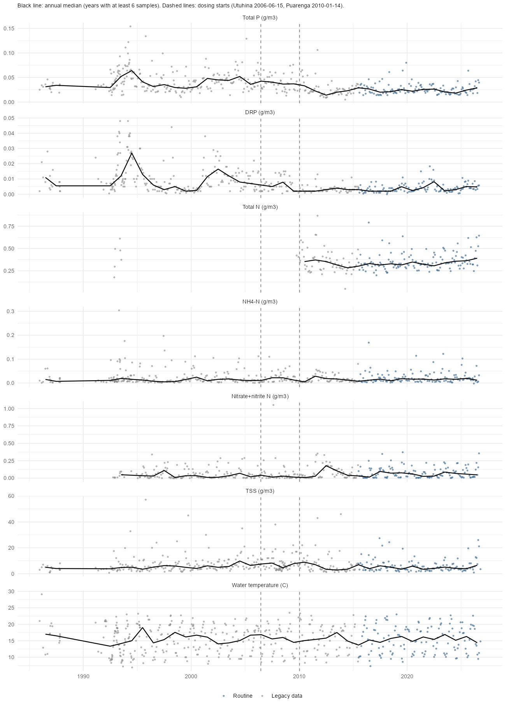
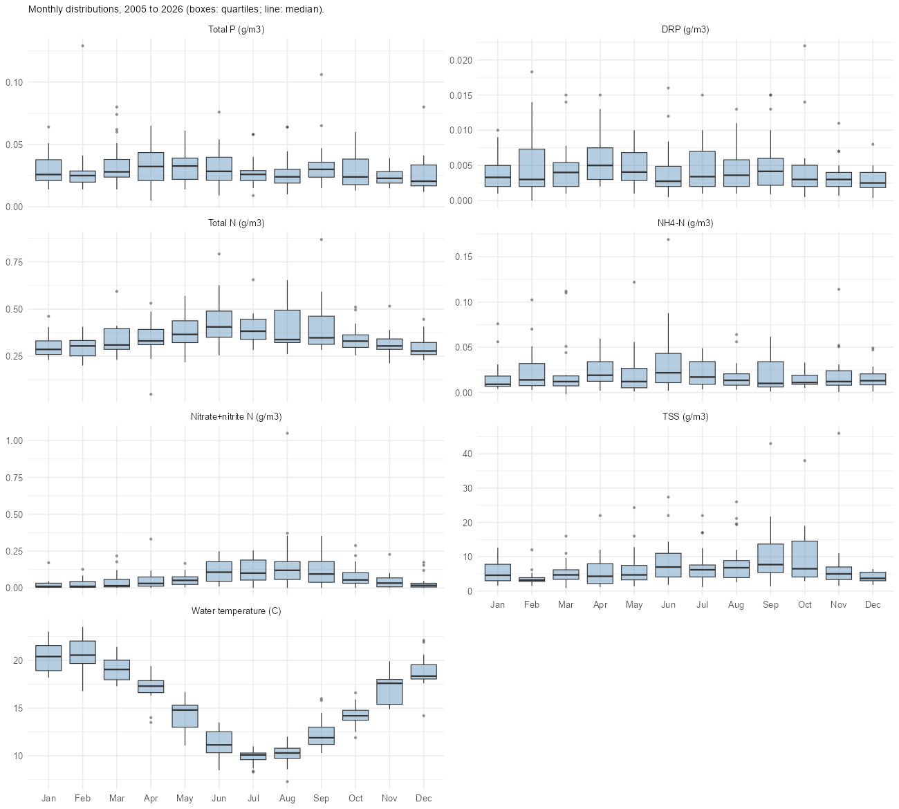
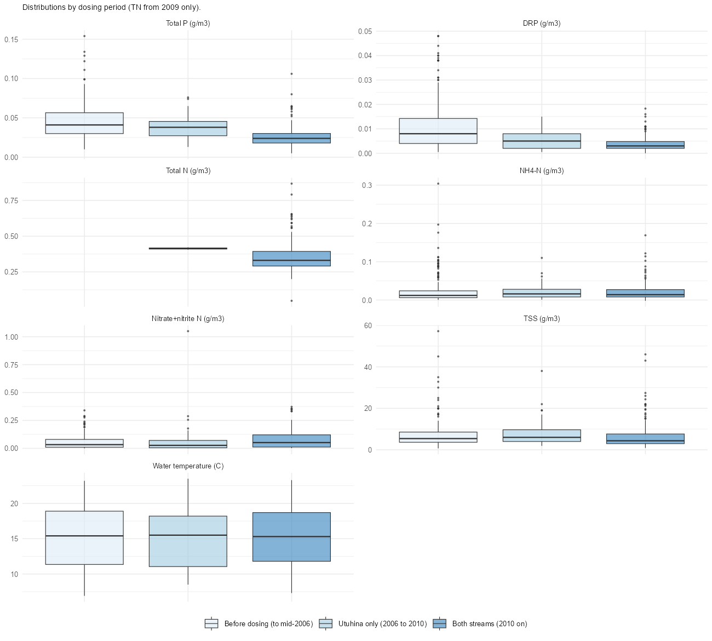
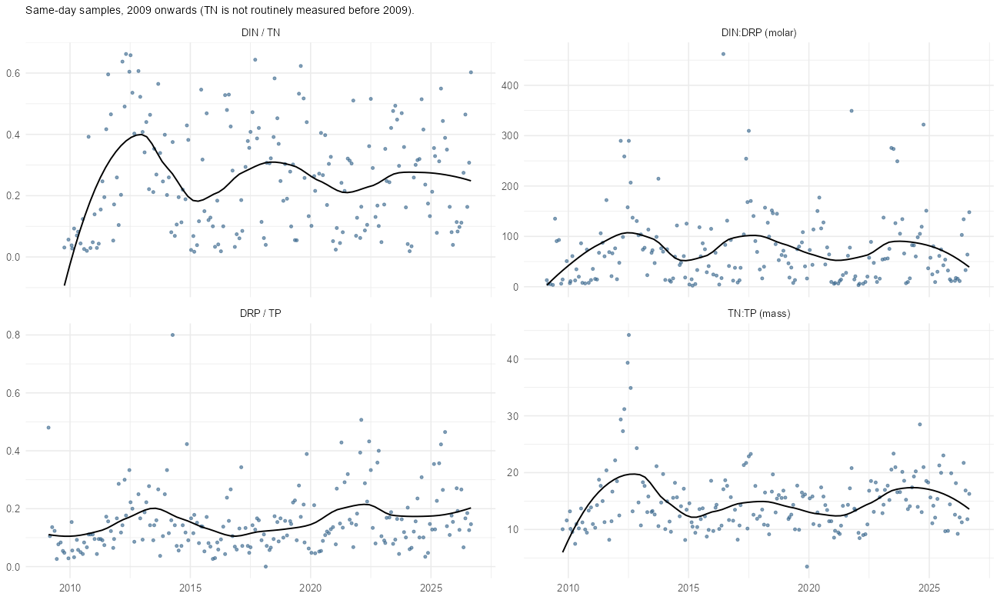
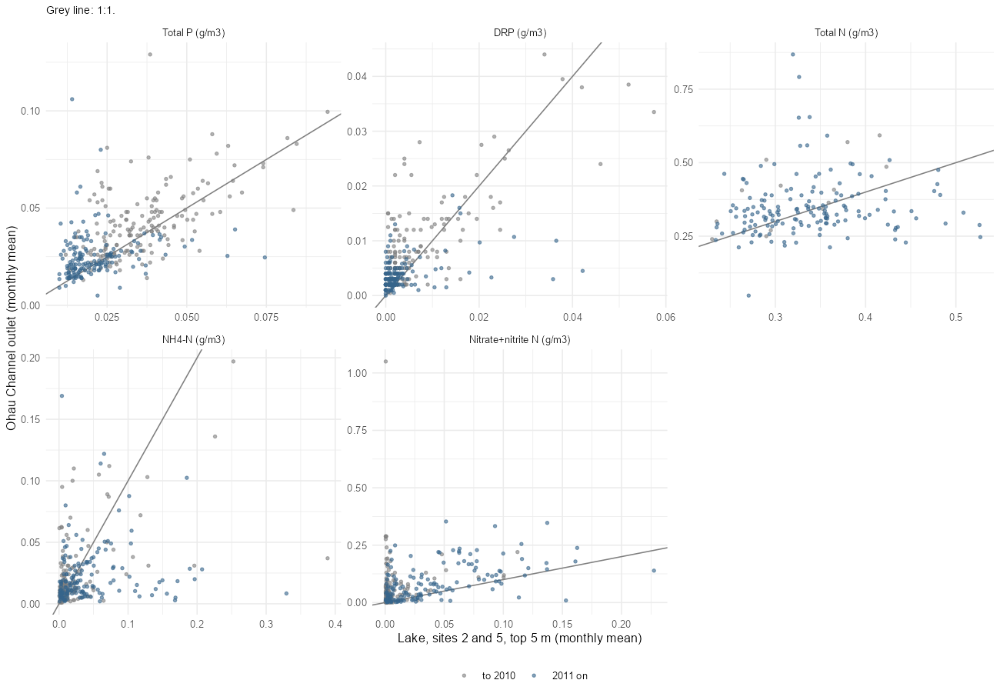
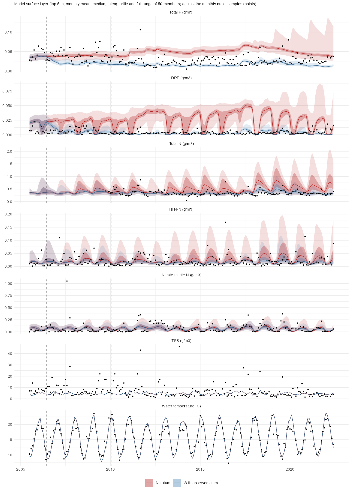

```{r}
#| include: false
rd <- \(f) read.csv(file.path("data/ohau", f), check.names = FALSE)
```

## The data

Bay of Plenty Regional Council's Ōhau Channel at SH33 (site FL230406) is the outlet of Lake Rotorua. The bulk export (`ohau_wq_url`, read by `read_bop_lab_csv_url()` into the `ohau_wq_data` target) has seven lab variables: NH4-N, nitrate plus nitrite N (NNN), total N (TN), dissolved reactive P (DRP), total P (TP), total suspended solids (TSS) and water temperature. All values are approved. The record is 2,925 values, of which 1,993 are legacy (Labstar) results and 932 are routine results since about 2015.

Sampling is nearly monthly from 1992 (12 dates per year in most years). TN is the exception: it was measured only 8 times before 2009 and is monthly from 2009. The outlet is the lake outflow, so these data are a second, independent check of the surface water quality that the model predicts, besides the lake sites 2 and 5.

```{r}
#| tbl-cap: "Inventory of the Ōhau Channel lab data (g/m³; temperature in °C). Values at or below zero and at the lowest reported value are mostly detection-limit results."
i <- rd("ohau_inventory.csv")
knitr::kable(data.frame(Variable = i$variable, n = i$n, `First` = i$first, `Last` = i$last, `Median` = signif(i$median, 3), `95th percentile` = signif(i$p95, 3), `Maximum` = signif(i$max, 3), `Values <= 0` = i$n_le_zero, check.names = FALSE), row.names = FALSE)
```

## Open item: changes in laboratory and method

**To check (Tadhg).** There may have been a change in sampling methodology or laboratory testing somewhere in the record. Nothing in the export documents it, so none of the trends, steps or period comparisons below should be read as real until it is resolved. Two boundaries are visible in the portal metadata:

- **2015-07-05:** the record changes from "Labstar - Legacy Data" to "Routine", for every variable at once (the last legacy sample is 2015-06-15).
- **2020-12 to 2021-01:** the grade codes change from 200 (all data to 2020-12-06) to 400, 500 and 600 (all data from 2021-01-17).

The TP and DRP step in 2011 to 2012 and the 1993 to 1995 peak do not line up with either boundary, so they may be real, or they may come from a change that the metadata does not record (a laboratory, a method, a detection limit or a sampling depth). To find out: the BOPRC data owner for FL230406, the laboratory method history for TP, DRP and TN, any change in reporting limits (many DRP and nitrate values are at or near zero), and the sampling depth and position at SH33. Until then, treat the step as a result that needs this check, in particular where it is used as evidence for the model's early-dosing response.

## Time series

```{r}
#| label: fig-ohau-ts
#| fig-cap: "Ōhau Channel lab results, 1985 to 2026. Grey: legacy data; blue: routine data. Black line: annual median. Dashed lines: the start of dosing on the Utuhina (2006-06-15) and Puarenga (2010-01-14)."
#| out-width: "85%"

```

- **Phosphorus fell, and not at the start of dosing.** The annual median TP stayed near 0.04 g/m³ until 2010 (0.043, 0.041, 0.037, 0.037 and 0.033 g/m³ in 2006 to 2010) and dropped to 0.023 in 2011 and 0.014 in 2012. DRP shows the same step, from a median of 0.008 g/m³ before dosing to 0.003.
- **Nitrogen did not fall.** TN has a median of 0.33 g/m³ from 2009. Nitrate plus nitrite is higher after 2010.
- **Early data are noisy.** The 1993 to 1995 peak in TP, DRP and NH4-N is unexplained. It is worth checking before using the 1990s data as a baseline.

## Seasonality

```{r}
#| label: fig-ohau-seasonal
#| fig-cap: "Monthly distributions of the outlet lab results, 2005 to 2026."
#| out-width: "85%"

```

```{r}
#| tbl-cap: "Seasonal range of the monthly medians, 2005 to 2026."
s <- rd("ohau_seasonality.csv")
knitr::kable(data.frame(Variable = s$variable, `Highest month` = s$peak_month, `Median then` = signif(s$peak, 3), `Lowest month` = s$low_month, `Median then ` = signif(s$low, 3), `Ratio` = round(s$ratio_peak_low, 1), check.names = FALSE), row.names = FALSE)
```

- **Nitrate is strongly seasonal**, about 11 times higher in winter (August median 0.12 g/m³) than in summer (January 0.011), which is consistent with uptake in the growing season and a return with winter mixing.
- **TN peaks in autumn and winter** (0.41 g/m³ in June against 0.28 in December), and NH4-N peaks in June.
- **TP and DRP have only a weak seasonal cycle** (a factor of 1.6 to 2).
- **Temperature** runs from 10 °C in July to 20.5 °C in February.

## Trends

```{r}
#| tbl-cap: "Seasonal Mann-Kendall test and Sen slope on the monthly lab data. Percent per year is the slope as a share of the median over the period."
t <- rd("ohau_trends.csv"); t$sig <- ifelse(t$p < 0.001, "<0.001", sprintf("%.3f", t$p))
knitr::kable(data.frame(Period = t$period, Variable = t$variable, n = t$n, `Slope per year` = signif(t$slope, 2), `% per year` = round(t$pct_per_yr, 1), `p` = t$sig, check.names = FALSE), row.names = FALSE)
```

- **From 2000, TP (-2.8% per year, p < 0.001), DRP (-3.1%) and TSS (-1.6%) fall**, and nitrate rises (+1.3% per year, p = 0.002). The TP median goes from 0.041 to 0.026 g/m³ (2000 to 2002 against 2024 to 2026).
- **From 2011 there is no TP trend** (+1.1% per year, p = 0.14). The reduction is a step in 2011 to 2012 and a plateau since.
- **TN and DRP rise slowly from 2011** (TN +0.9% per year, p = 0.02; DRP +3.6% per year, p = 0.004, but only from 0.003 to 0.004 g/m³, close to the reporting limit).
- **Temperature rises** by 0.02 °C per year since 2000 (p = 0.02) and 0.06 °C per year since 2011 (p = 0.004). That is about 0.9 °C over 15 years, but the samples are single daytime values taken at different times of year, so the sampling time can bias this.

## Before and after dosing

```{r}
#| label: fig-ohau-period
#| fig-cap: "Distributions by dosing period: before dosing (to mid-2006), the Utuhina only (mid-2006 to January 2010), and both streams (2010 on). TN is shown from 2009 because there are almost no earlier samples."
#| out-width: "85%"

```

```{r}
#| tbl-cap: "Change in the median from before dosing to 2010 on, with the 90% bootstrap interval of the change and the Wilcoxon test p-value (TN is not included because it was not measured before 2009)."
c <- rd("ohau_change_after_dosing.csv"); c$sig <- ifelse(c$wilcox_p < 0.001, "<0.001", sprintf("%.3f", c$wilcox_p))
knitr::kable(data.frame(Variable = c$variable, `Change in median` = sprintf("%+.0f%%", c$change_pct), `90% interval` = sprintf("%+.0f to %+.0f%%", c$lo, c$hi), p = c$sig, check.names = FALSE), row.names = FALSE)
```

- **TP is 42% lower and DRP 63% lower after 2010** than before dosing (the TP median falls from 0.041 to 0.024 g/m³). TSS is about 19% lower.
- **Most of the fall came after both streams were dosed.** During the Utuhina-only years the TP median was 0.038 g/m³, only 7% below the pre-dosing 0.041, and the DRP median was 0.005 against 0.008. This is a simple period comparison and not a causal result: the same years include changes in catchment loads, the effluent and the lake's own response.
- **Nitrate is 56% higher** (interval +6% to +175%), while NH4-N and temperature do not change.

## Nutrient ratios

```{r}
#| label: fig-ohau-ratios
#| fig-cap: "Nutrient ratios from same-day samples, 2009 onwards, with a loess smooth."
#| out-width: "85%"

```

```{r}
#| tbl-cap: "Median (interquartile range) of the ratios, 2009 onwards."
r <- rd("ohau_ratios.csv")
knitr::kable(data.frame(Ratio = c("TN:TP (mass)", "DRP / TP", "DIN / TN", "DIN:DRP (molar)"), Median = signif(unlist(r[c("TNTP_median", "DRP_TP_median", "DIN_TN_median", "DINDRP_median")]), 3), `Interquartile range` = sprintf("%.2f to %.2f", unlist(r[c("TNTP_q25", "DRP_TP_q25", "DIN_TN_q25", "DINDRP_q25")]), unlist(r[c("TNTP_q75", "DRP_TP_q75", "DIN_TN_q75", "DINDRP_q75")])), check.names = FALSE), row.names = FALSE)
```

- **TN:TP by mass is 14**, in the range where either nutrient can limit growth. DRP is only 13% of TP, and DIN is 25% of TN, so most of the P and N in the outlet is particulate or organic.
- **The DIN:DRP molar ratio of 60 with a very wide spread** (17 to 100) means dissolved N is usually in excess over dissolved P, but dissolved P is often at the reporting limit, so this ratio is sensitive to the floor used (0.0005 g/m³).

## Outlet against the lake

```{r}
#| label: fig-ohau-lake
#| fig-cap: "Monthly mean outlet value against the monthly mean of the lake sites 2 and 5 (top 5 m) for the same month."
#| out-width: "85%"

```

```{r}
#| tbl-cap: "Outlet against lake, same-month means (g/m³)."
l <- rd("ohau_vs_lake.csv")
knitr::kable(data.frame(Variable = l$variable, Months = l$n, `Outlet median` = signif(l$outlet_median, 3), `Lake median` = signif(l$lake_median, 3), `Ratio` = round(l$ratio_of_medians, 2), `Correlation` = round(l$r, 2), check.names = FALSE), row.names = FALSE)
```

- **TP agrees with the lake within 14%** (correlation 0.59), so the outlet is a good second record of the lake's TP.
- **Nitrate at the outlet is 8 times higher than at the lake sites** (0.040 against 0.005 g/m³), and DRP is twice as high, but both are close to the reporting limits. TN has a similar median but no relation month to month (correlation 0.13), so the TN data from the two places should be treated as separate records.

## The model against the outlet

The 50-member joint ensemble (`j50x`), with the observed alum dosing and with no alum, was sampled on the outlet sampling dates and compared with the outlet results. Model values are for the top 5 m. Model TP and TN include the refractory offsets used in the calibration. The outlet data were not used in the calibration.

```{r}
#| label: fig-ohau-model
#| fig-cap: "The model's surface layer (monthly mean; median, interquartile range and full range of 50 members) with the observed alum dosing (blue) and with no alum (red) against the monthly outlet results (points). Dashed lines mark the start of dosing."
#| out-width: "85%"

```

```{r}
#| tbl-cap: "Ensemble median against the outlet samples: observed and simulated medians, the bias in the mean (%) and the correlation. TN for 2005 to 2010 has only 14 samples."
m <- rd("ohau_vs_model.csv"); m <- m[m$run == "With observed alum", ]; n <- rd("ohau_vs_model.csv"); n <- n[n$run == "No alum", ]
knitr::kable(data.frame(Variable = m$variable, Period = m$period, n = m$n, `Observed median` = signif(m$obs_median, 3), `Model median, alum` = signif(m$sim_median, 3), `Bias, alum` = sprintf("%+.0f%%", m$bias_pct), `Correlation, alum` = round(m$r, 2), `Model median, no alum` = signif(n$sim_median, 3), `Bias, no alum` = sprintf("%+.0f%%", n$bias_pct), check.names = FALSE), row.names = FALSE)
```

- **The model's TP is too low once alum is applied, and the shortfall starts early.** With alum the model TP median is 0.020 g/m³ against 0.038 observed in 2005 to 2010 (-42%), and 0.015 against 0.024 in 2011 to 2022 (-37%). The no-alum run matches the observed TP before 2010 (-4%) and is 98% too high afterwards. The observed outlet TP did not fall during the Utuhina-only years (median 0.038 against 0.041 before), but the model falls to 0.02 within about two years of the first dose.
- **This corrects an earlier statement.** The TP low bias is not confined to 2011 onwards. It is already there in 2006 to 2010, and the lake TLp is 0.39 too low in that period (and 0.30 and 0.33 in 2011 to 2016 and 2017 to 2022). The model response to the first dosing is too fast or too strong, or the observed system had offsetting increases in load that the model lacks.
- **DRP is about right.** With alum the model is +35% (2005 to 2010) and -37% (2011 to 2022) at values of a few mg/m³, whereas without alum the model's median DRP is about 4 times (2005 to 2010) and 10 times (2011 to 2022) the observed value. The observed DRP is therefore a strong case that alum or an equivalent sink is operating.
- **TN is good.** With alum the TN bias is +2% for 2011 to 2022 (0.337 against 0.322 g/m³) and the correlation is 0.31. The no-alum run is 49% too high.
- **NH4-N and nitrate are close in level but not in timing.** The bias is -17% to -30% for NH4-N and about +7% to -27% for nitrate, with correlations of 0.5 for nitrate in 2011 to 2022 and near zero for NH4-N.
- **TSS is 25% to 45% low and uncorrelated** (correlation 0.16 to 0.24). TSS was never a calibration target. Possible causes, not tested here, are missing wind resuspension and particles from storm inflows, which would also fit the model's weak Secchi response in the TLI analysis.
- **Temperature is right.** The correlation is 0.95, the bias in the mean is within 3% and the RMSE is 1.6 °C.
- **Year-to-year and monthly skill is low for the nutrients** (correlations from -0.15 to 0.16 for TP, DRP and NH4-N), so the model reproduces levels and the alum response, but not individual months.

## What this suggests

1. The outlet TP is a stronger test of the alum response than the lake sites alone: it shows no change during the Utuhina-only years and a step to 0.02 g/m³ in 2011 to 2012. The model shows the opposite sequence. A reason to check is whether the Utuhina dosing in 2006 to 2010 is too effective in the model (the in-stream binding fraction, or the alum parameters), or whether other inputs rose then.
2. The outlet TN and DRP data constrain the model well enough to be used as extra calibration data, in particular TN, which the lake record has only occasionally.
3. The nitrate difference between the outlet and the lake sites needs an explanation before either is used as the target for nitrate.
