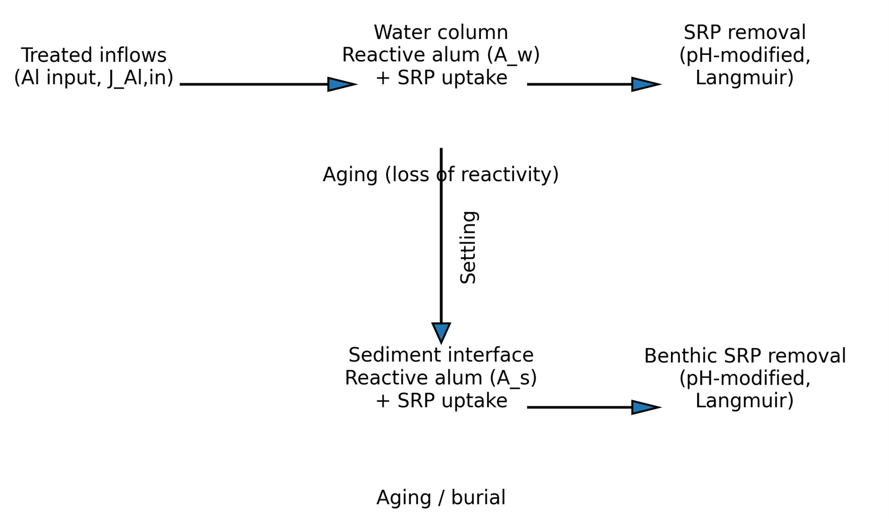
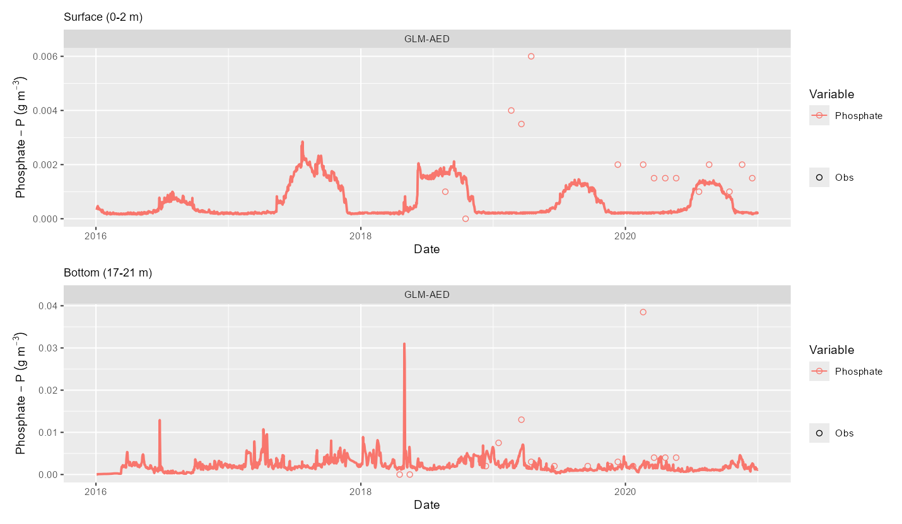

```{r}
#| echo: false
#| label: setup
library(leaflet)
library(htmlwidgets)
library(ggplot2)
library(patchwork)   # for combining panels
library(MASS)        # mvrnorm (ships with R); use MASS::select() if you load dplyr
library(targets)

library(tmap)
library(sf)
tmap_mode("view")

# Load geospatial data

lake_sf  <- tar_read(lake_shape, store = "../_targets") |> st_transform(4326)
sites_sf <- tar_read(chem_sites_sf, store = "../_targets") |> st_transform(4326)
contours <- tar_read(depth_contours, store = "../_targets") |> st_transform(4326)
catch <- tar_read(rotorua_catchment_bbox, store = "../_targets")
if (is.na(st_crs(catch))) catch <- st_set_crs(catch, 4326)


set.seed(42)

# ---- Data (true b = 2, true m = 0.8) ----
n <- 15
bayes_d <- data.frame(x = runif(n, 0, 10))
bayes_d$y <- 2 + 0.8 * bayes_d$x + rnorm(n, sd = 1.5)

# ---- Frequentist: least squares + 95% CI ----
fit   <- lm(y ~ x, data = bayes_d)
ci    <- confint(fit)
sigma <- summary(fit)$sigma

# ---- Bayesian: normal priors, closed-form posterior ----
# (noise sd fixed at the lm estimate to keep the maths simple)
X          <- cbind(1, bayes_d$x)
prior_mean <- c(0, 0)                    # b, m
prior_prec <- diag(1 / c(10, 5)^2)       # weak priors: sd 10 for b, sd 5 for m
post_cov   <- solve(crossprod(X) / sigma^2 + prior_prec)
post_mean  <- post_cov %*% (crossprod(X, bayes_d$y) / sigma^2 + prior_prec %*% prior_mean)

draws <- as.data.frame(MASS::mvrnorm(4000, post_mean, post_cov))
names(draws) <- c("b", "m")

# ---- Plot settings ----
col_f <- "#D55E00"   # frequentist
col_b <- "#0072B2"   # Bayesian

# Sediment zone depth ranges (m below the surface) from the calibrated model
zone_d <- read.csv("data/overview/sed_zone_depths.csv")
zone_lab <- function(z, nl = "\n") {
  sprintf("Zone %d%s%g–%g m", z, nl,
          zone_d$depth_from[match(z, zone_d$zone)],
          zone_d$depth_to[match(z, zone_d$zone)])
}

th <-theme_minimal(base_size = 16) +
  theme(panel.grid.minor = element_blank(),
        plot.title = element_text(face = "bold"))

# Panel 1: one best-fit line with a confidence band
p1 <- ggplot(bayes_d, aes(x, y)) +
  geom_smooth(method = "lm", level = 0.95, colour = col_f, fill = col_f,
              alpha = 0.2, linewidth = 1.5) +
  geom_point(size = 3) +
  labs(title = "Frequentist", subtitle = "One best-fit line + 95% CI") +
  th

# Panel 2: many plausible lines drawn from the posterior
p2 <- ggplot(bayes_d, aes(x, y)) +
  geom_abline(data = draws[1:150, ], aes(intercept = b, slope = m),
              colour = col_b, alpha = 0.12) +
  geom_point(size = 3) +
  labs(title = "Bayesian", subtitle = "150 draws from the posterior") +
  coord_cartesian(ylim = ggplot_build(p1)$layout$panel_params[[1]]$y.range) +
  th

# Panel 3: what each approach reports for the slope
est <- coef(fit)[["x"]]
p3 <- ggplot(draws, aes(m)) +
  geom_density(fill = col_b, colour = col_b, alpha = 0.35) +
  annotate("pointrange", x = est, y = 0, xmin = ci["x", 1], xmax = ci["x", 2],
           colour = col_f, linewidth = 1.2, size = 1) +
  geom_vline(xintercept = 0.8, linetype = "dashed", colour = "grey40") +
  annotate("text", x = 0.8, y = Inf, label = "true value", vjust = 1.5,
           hjust = -0.1, colour = "grey40", size = 4) +
  labs(x = "Slope (m)", y = NULL,
       title = "The slope",
       subtitle = "Orange: estimate + CI.  Blue: full posterior") +
  th + theme(axis.text.y = element_blank())

```


## AI Acknowledgement

I used Claude to assist with this presentation, text, figures, tables and code. I have reviewed and edited the content as needed and take full responsibility for the final version.

## About

- PhD Dundalk Institute of Technology, Ireland. 
  - Thesis on water quality forecasting in lakes, and also climate
  change impacts on lake water temperature globally.

- Post-doc at Virginia Tech, USA, developing teaching modules for Ecological Forecasting.

- Currently a Lake Scientist at Limnotrack working on water quality modelling and management & Post-doc UoW (2-days).

## Where I have worked {#fly-map}

```{r}
#| echo: false
#| fig-width: 11
#| fig-height: 6

stops <- list(
  name = c("Ireland", "USA", "New Zealand"),
  lat  = c(53.946, 37.224, -37.785),
  lng  = c(-9.575, -80.427, -184.709),
  zoom = c(10, 8, 10)
)

leaflet(options = leafletOptions(zoomControl = FALSE)) |>
  addProviderTiles("Esri.WorldImagery") |>
  addMarkers(stops$lng, stops$lat, label = stops$name) |>
  setView(stops$lng[1], stops$lat[1], stops$zoom[1]) |>
  onRender("
    function(el, x, s) {
      var map = this, i = 0, timers = [];

      function fly() {
        i = (i + 1) % s.lat.length;
        map.flyTo([s.lat[i], s.lng[i]], s.zoom[i], {duration: 4});
      }
      function start() {
        timers.forEach(clearTimeout); timers = [];
        i = 0;
        map.invalidateSize();
        map.setView([s.lat[0], s.lng[0]], s.zoom[0], {animate: false});
        timers.push(setTimeout(fly, 2000));
        timers.push(setTimeout(fly, 9000));
      }
      function onThisSlide() {
        return Reveal.getCurrentSlide().contains(el);
      }

      Reveal.on('slidechanged', function() { if (onThisSlide()) start(); });
      if (Reveal.isReady()) { if (onThisSlide()) start(); }
      else Reveal.on('ready', function() { if (onThisSlide()) start(); });

      document.addEventListener('keydown', function(e) {
        if (e.key === 'n' && onThisSlide()) fly();
      });
    }
  ", data = stops)
```

## Short version

Climate change may increase the length and number of stratification
events in Lake Rotorua, driving nutrient loading and algal blooms.

Alum dosing has been shown to reduce phosphorus and could help
mitigate those climate effects.

## Lake Rotorua monitoring sites {#map-sites}

```{r}
#| label: study-map
#| echo: false
#| fig-width: 11
#| fig-height: 6

tm_shape(catch) +
  tm_borders(col = "grey30", lwd = 2, lty = "dashed") +
  tm_shape(lake_sf) +
  tm_polygons(fill = "#0072B2", fill_alpha = 0.4, col = "#0072B2") +
  # tm_shape(contours) +
  # tm_lines(col = "white", lwd = 0.5) +
  tm_shape(sites_sf) +
  tm_dots(fill = "#D55E00", size = 1.2, col = "black",
          popup.vars = c("Site", "LocationName")) +
  tm_basemap("Esri.WorldImagery") +
  tm_view(set_view = c(176.27, -38.08, 11))
```

::: {.credit}

Lake Rotorua (LERNZmp lake 11133), depth contours and BoPRC chemistry sites; dashed = catchment bounding box

:::

# What is Plan Change 10?

## Plan Change 10 {#pc10}

Bay of Plenty Regional Council rules for managing nitrogen loss in the
Lake Rotorua groundwater catchment. Gives effect to the RPS target of a
435 tN/yr sustainable lake nitrogen load by 2032 (needed for a TLI of 4.2).

## PC 10 Lake Modelling

To help answer questions:

- Does 435 tN (and the nominal 37 tP/yr external load) still hold under climate scenarios?

- Alum dosing efficacy and risk under future climate.

- Sensitivity of the N-P balance.

- Model validation.

## How it all fits together {#map}

```{mermaid}
graph LR
  D[Data] --> M[Lake Modelling]
  A[Alum dosing] --> M
  C[Climate change] --> M
  N --> M
  M --> N[Nitrogen loading]
  M --> A
  M --> P[N:P balance]
  P --> N
  M --> V[Model validation]
  D --> V
  M --> S[Scenarios]
  D --> N
  C --> S
  A --> S
```

## Workflows

1. Gather data

2. Synthesise data

3. Model selection

4. Configuration

5. Sensitivity Analysis

6. Calibration

7. Assessment

8. Scenario simulations

9. Synthesis

## Personal Workflow

Key components:

1. R packages & GitHub

2. `targets` pipeline  

3. Project website

## R packages

Developed multiple packages:

- [AEME](https://limnotrack.com/AEME/) - Building and running models

- [aemetools](https://limnotrack.com/aemetools/) - Sensitivity analysis and calibration tools

- [bathytools](https://limnotrack.com/bathytools) - Bathymetry and hypsography tools

- [ltapi](https://limnotrack.com/ltapi/) - Limnotrack API

- [metscale](https://limnotrack.com/metscale/) - Climate data processing and downscaling

## `targets` pipeline  

[`targets`](https://books.ropensci.org/targets/) is an R package for building reproducible pipelines. It tracks dependencies and only reruns steps that need updating.

::: {.columns}
::: {.column width="40%"}
::: {style="font-size:0.75em"}
Each box is a **target**; arrows are labelled with the function that builds the next one.

- <span style="background:#f0f0f0;border:1px solid #555;padding:0 .4em">Grey</span> input data
- <span style="background:#0072B2;color:#fff;padding:0 .4em">Blue</span> intermediate
- <span style="background:#D55E00;color:#fff;padding:0 .4em">Orange</span> output

Change one step and only what is **downstream** reruns.
:::
:::
::: {.column width="60%"}
```{mermaid}
%%{init: {"themeVariables": {"fontSize": "18px"}, "flowchart": {"nodeSpacing": 25, "rankSpacing": 28}}}%%
flowchart TB
  F["ERA5 file"]:::file -->|"read_era5_hourly_met()"| A["era5_hourly_met"]:::tgt
  A -->|"fit_met_bias_correction()"| C["era5_bias_correction"]:::tgt
  BUOY["buoy_met_fit_ref"]:::file --> C
  C -->|"apply_met_bias_correction()"| D["era5_corrected_hourly"]:::out
  D -->|"delta change"| E["scenario_hourly_met"]:::out

  classDef file fill:#f0f0f0,stroke:#555,color:#000;
  classDef tgt fill:#0072B2,stroke:#003d5c,color:#fff;
  classDef out fill:#D55E00,stroke:#7a3500,color:#fff;
```
:::
:::

## What a target looks like {#target-code}

Each step is a **target**: a name, and the code that makes it.

```r
# _targets.R (trimmed)
tar_target(
  era5_bias_correction,
  fit_met_bias_correction(
    era5_hourly_met,
    buoy_met_fit_ref)
),
tar_target(
  era5_corrected_hourly,
  apply_met_bias_correction(
    era5_hourly_met,
    era5_bias_correction)
)
```

`targets` reads the names in the code to work out the dependency graph.


## `targets` pipeline  

Alternative to:

```  
01_gather_data.R
02_synthesise_data.R
03_model_selection.R
03b_fix_model.R
04_configuration.R

```

## Project Website

- Helpful for communicating with collaborators and stakeholders. 
- Built with Quarto and Reveal.js.
- Uses data and `targets` to automatically generate figures and tables.

Website: [https://tadhg-moore.github.io/rotorua-pc10](https://tadhg-moore.github.io/rotorua-pc10)

## Where to next? {#hub}

::: {.hub-grid}
::: {.hub-panel .hub-model}
[Lake Modelling](#model-core){.hublink}

GLM-AED, the Ōhau weir and water balance, heat balance, thermal structure and oxygen
:::

::: {.hub-panel .hub-data}
[Data](#data-core){.hublink}

Lake level, buoy and CTD, chemistry, meteorology, inflows and sediment flux studies
:::

::: {.hub-panel .hub-calib}
[Calibration and uncertainty](#calib-core){.hublink}

Model assessment, Bayes vs frequentist, PEST++ prior to posterior, posterior variation
:::

::: {.hub-panel .hub-alum}
[Alum dosing](#alum-core){.hublink}

How alum is modelled, sediment fluxes, FRP response, and dosing under climate change
:::

::: {.hub-panel .hub-climate}
[Climate change](#climate-core){.hublink}

CMIP6 and SSPs, ERA5 bias correction, delta change, scenario design and lake impacts
:::
:::

[Wrap up: synthesis](#synthesis){.hublink .hub-wrap}

# Lake Modelling

## Where to start {#model-core}

1. What is the question we are trying to answer?

How will Lake Rotorua water quality change under future climate?

To what extent does the stream alum dosing affect water quality?

## Hypothesis Figure

```{r}
#| echo: false
#| fig-width: 10
#| fig-height: 5.5

periods <- list(
  "2015-2040" = c(2015, 2040),
  "2041-2070" = c(2041, 2070),
  "2071-2100" = c(2071, 2100)
)
ssps  <- c("ssp126", "ssp245", "ssp370", "ssp585")
alum  <- c("same", "0.5", "none")

d <- expand.grid(
  period = names(periods),
  ssp    = ssps,
  alum   = alum,
  stringsAsFactors = FALSE
)

# Made-up hypothesis: warming effect grows with forcing and time,
# alum dampens it (and slightly improves on the baseline)
forcing   <- c(ssp126 = 0.2, ssp245 = 0.4, ssp370 = 0.75, ssp585 = 1.2)
time_mult <- c("2015-2040" = 0.3, "2041-2070" = 0.55, "2071-2100" = 1.0)
alum_mult <- c(same = 0.5, "0.5" = 0.7, none = 1.0)
alum_base <- c(same = -0.20, "0.5" = -0.1, none = 0)

d$delta_tli <- with(d,
  1.4 * forcing[ssp] * time_mult[period] * alum_mult[alum] + alum_base[alum]
)

# Factor levels control the order on the plot
d$period <- factor(d$period, levels = names(periods))
d$ssp    <- factor(d$ssp,    levels = ssps)   # ssp126 at the bottom
d$alum   <- factor(d$alum,   levels = alum,
                   labels = c("Alum: current dose",
                              "Alum: half dose",
                              "Alum: none"))

lim <- max(abs(d$delta_tli))

p <- ggplot(d, aes(period, ssp, fill = delta_tli)) +
  geom_tile(colour = "white", linewidth = 1) +
  geom_text(aes(label = sprintf("%+.2f", delta_tli)), size = 4.5) +  # delete for a pure hypothesis
  facet_wrap(~ alum) +
  scale_fill_gradient2(
    low = "#0072B2", mid = "white", high = "#D55E00",
    midpoint = 0, limits = c(-lim, lim),
    name = expression(Delta * "TLI")
  ) +
  scale_y_discrete(labels = c(ssp126 = "SSP1-2.6", ssp245 = "SSP2-4.5",
                              ssp370 = "SSP3-7.0", ssp585 = "SSP5-8.5")) +
  labs(x = NULL, y = NULL,
       title = "Hypothesis (schematic): change in TLI",
       subtitle = "Relative to baseline; orange = worse, blue = better") +
  coord_fixed() +
  theme_minimal(base_size = 16) +
  theme(panel.grid = element_blank(),
        strip.text = element_text(face = "bold"),
        axis.text.x = element_text(angle = 30, hjust = 1),
        plot.title = element_text(face = "bold"),
        legend.position = "right")

p
# ggsave("hypothesis_tile.png", p, width = 12, height = 5, dpi = 300)
```


## GLM


::: {.credit}

Source: [AED](https://aed.see.uwa.edu.au/research/models/GLM/screenshots.html)

:::


## Water Balance

Lake level is controlled by the **Ōhau Channel weir**: inflows and rain in,
evaporation and weir outflow out.

```{r}
#| label: weir-map

tm_shape(catch) +
  tm_borders(col = "grey30", lwd = 2, lty = "dashed") +
  tm_shape(lake_sf) +
  tm_polygons(fill = "#0072B2", fill_alpha = 0.4, col = "#0072B2")
```


## Weir concept {#weir}

```{r}
#| label: weir-concept
#| echo: false
#| fig-width: 11
#| fig-height: 5.5

source("../R/plot_rotorua_weir_profile.R")
plot_rotorua_weir_profile() +
  theme(text = element_text(size = 14))
```

::: {.notes}
Two-level crest (4.6 m low section at 278.17 m, 21.4 m high section at 279.32 m) with
0-3 removable stoplogs. GLM can only represent a single crest, so an equivalent crest
elevation, width and factor are fitted.
:::

## Heat Balance


::: {.credit}

Source: [AED](https://aed.see.uwa.edu.au/research/models/GLM/screenshots.html)

:::

## Thermal structure

- Stratification

```{r}
#| label: heat-compare
#| echo: false
#| fig-width: 12
#| fig-height: 5.5

hm <- function(v) {
  o <- read.csv(sprintf("data/overview/obs_%s.csv", v)); o$src <- "Observed"
  m <- read.csv(sprintf("data/overview/mod_%s.csv", v)); m$src <- "GLM-AED (calibrated)"
  d <- rbind(o, m)
  d$Date <- as.Date(d$Date)
  d$src <- factor(d$src, c("Observed", "GLM-AED (calibrated)"))
  d[d$Date >= as.Date("2016-01-01") & d$Date <= as.Date("2020-12-31"), ]
}
hm_plot <- function(d, lab, opt) {
  ggplot(d, aes(Date, z, fill = value)) +
    geom_tile(width = 1, height = 1) +
    facet_wrap(~src, nrow = 1) +
    scale_y_reverse() +
    scale_fill_viridis_c(option = opt, name = lab, na.value = "grey92") +
    labs(x = NULL, y = "Depth (m)") +
    th + theme(strip.text = element_text(face = "bold"))
}
hm_plot(hm("HYD_temp"), "Temp (°C)", "magma")
```

::: {.notes}
Observed (buoy + CTD) vs the calibrated model, 2016-2020 (observations start
around 2019 for the buoy; earlier CTD profiles are sparse). Lake Rotorua is polymictic:
warm periods stratify for days to weeks and then mix.
:::

## Bottom-water oxygen {#heat-oxy}

```{r}
#| label: heat-oxy
#| echo: false
#| fig-width: 12
#| fig-height: 5.5

hm_plot(hm("CHM_oxy"), "DO (mg/L)", "viridis")
```

::: {.notes}
Short-lived bottom-water anoxia in summer stratified spells drives internal P release.
KGE for oxygen is 0.69.
:::

## Wrap up: Lake Modelling {#model-end}

::: {.arm-end .hub-model}
- GLM-AED is a 1-D model: horizontal variation is assumed negligible
- The water balance is controlled by the Ōhau weir; the heat balance sets stratification
- Lake Rotorua is polymictic: stratified spells last days to weeks and then mix

[↩ Back to hub](#hub){.hub-return}
:::

# Sensitivity Analysis & Calibration {#calib-core}

## Sensitivity analysis: which parameters matter? {#sa-intro}

Before calibrating, ask which parameters each target actually responds to.

```{mermaid}
flowchart LR
  P["121 parameters<br/>wide ranges"]:::a --> S["Morris screening<br/>1,464 model runs"]:::b
  S --> E["Effect size<br/>per target"]:::b
  E --> D["Which to calibrate,<br/>fix, or leave out"]:::c
  D --> C["Staged calibration<br/>PEST++"]:::d

  classDef a fill:#f0f0f0,stroke:#555,color:#000;
  classDef b fill:#0072B2,stroke:#003d5c,color:#fff;
  classDef c fill:#D55E00,stroke:#7a3500,color:#fff;
  classDef d fill:#6A3D9A,stroke:#3b1f5a,color:#fff;
```

- **Morris elementary effects:** change one parameter at a time across its range, repeated along random trajectories
- **Effect size:** in the lake's own tolerance. 1 means the parameter, moved across its range, shifts the metric as much as the lake varies between years
- **Outputs:** 33 process signatures (stratification, anoxia, internal loading, chlorophyll)

::: {.notes}
Source: sensitivity-csps.qmd. Morris screening of 121 GLM-AED parameters with ranges deliberately wider than the calibration bounds, 12 trajectories, 6 levels, 1,464 runs per setup. Daily-forced model with alum.
:::

## Sensitivity results {#sa-results}

```{r}
#| label: sa-results
#| echo: false
#| fig-width: 13
#| fig-height: 5.6

sa_tg <- read.csv("images/staged-calibration/csps_targets.csv")
sa <- read.csv("images/sensitivity/sa_effects_alum.csv")
sa <- sa[sa$output %in% sa_tg$signature, ]
sa$cat <- sub("_.*", "", sa$output)
sa_m <- aggregate(pmin(mu_star_scaled, 20) ~ cat + parameter + theme, sa, mean)
names(sa_m)[4] <- "m"
cat_name <- c(mix = "Stratification", anox = "Bottom oxygen (anoxia)",
              load = "Internal loading", chl = "Chlorophyll-a")
sa_top <- do.call(rbind, lapply(names(cat_name), function(k) {
  x <- sa_m[sa_m$cat == k, ]
  x <- x[order(-x$m), ][1:6, ]
  x$panel <- cat_name[k]
  x
}))
sa_top$panel <- factor(sa_top$panel, cat_name)
sa_top$id <- paste(sa_top$panel, sa_top$parameter)
sa_top$id <- factor(sa_top$id, rev(sa_top$id))
th_col <- c(physics = "#0072B2", sediment = "#009E73", phytoplankton = "#D55E00",
            alum = "#CC79A7", nitrogen = "#E69F00", phosphorus = "#56B4E9",
            `organic matter` = "#999999")

ggplot(sa_top, aes(m, id, fill = theme)) +
  geom_col() +
  geom_vline(xintercept = 1, linetype = "dashed", colour = "grey40") +
  facet_wrap(~panel, scales = "free", nrow = 1) +
  scale_y_discrete(labels = function(x) sub("^.*?(Stratification \\(polymixis\\)|Bottom oxygen \\(anoxia\\)|Internal loading|Chlorophyll-a) ", "", x)) +
  scale_fill_manual(values = th_col, name = "Parameter group") +
  labs(x = "Mean effect (lake tolerances)", y = NULL) +
  th + theme(legend.position = "bottom", strip.text = element_text(face = "bold", size = 12),
             axis.text.y = element_text(size = 12))
```

::: {.notes}
Top six parameters for each target (mean effect across that target's signatures, capped at 20). Dashed = effect of 1 tolerance. Wind and mixing parameters dominate stratification and anoxia; sediment oxygen demand in the deepest zone is the only biogeochemical lever of comparable size for oxygen. Internal loading responds weakly to everything (nothing above about 3). Chlorophyll is driven by the cyanobacteria group and the alum rates. Many chlorophyll effects come from runaway bloom regions of the sampled space.
:::

## How the screening shaped the calibration {#sa-to-calib .smaller}

| What the screening showed | Decision in the calibration |
|---|---|
| **Wind scaling** has the largest single effect on mixing, but wind is measured on the lake | Fix `MET_wndspd` at 1; put the adjustment in mixing and heat-flux coefficients (`coef_wind_stir`, `cd`, `coef_mix_hyp`) |
| Stratification and anoxia respond to the **same mixing parameters** | Calibrate **physics and oxygen first** (stage 1), so later stages inherit a sound mixing regime |
| Deep-zone **sediment oxygen demand** is the one biogeochemical lever for oxygen | Calibrate per-zone oxygen demand in stage 1, with the measured values as the prior and wider bounds |

::: {.notes}
Sources: sensitivity-csps.qmd (findings by target, are the targets reachable), the staged calibration page and the wind and calibration plan memory. The screening used ranges wider than the calibration bounds, so it shows what the model can do, not what is plausible. The calibration then narrows bounds using measured values.
:::

## Model Assessment {#model-assess}

"I know that I know nothing" - Socrates


## Model Assessment 2

Important to relate this to your modelling question

## Time series: model vs observations {#ma-ts}

```{r}
#| label: ma-setup
#| echo: false

prs <- read.csv("data/overview/mod_obs_pairs.csv")
prs$Date <- as.Date(prs$Date)

ma_var <- c(HYD_temp = "Water temperature (°C)", CHM_oxy = "Dissolved oxygen (mg/L)",
            PHY_tchla = "Chlorophyll-a (µg/L)", PHS_tp = "Total P (g/m³)",
            PHS_frp = "FRP (g/m³)", NIT_amm = "Ammonium (g/m³)")
prs <- prs[prs$var %in% names(ma_var), ]
prs$var_lab <- factor(ma_var[prs$var], ma_var)
prs$band <- ifelse(prs$depth <= 2, "Surface (0–2 m)",
                   ifelse(prs$depth >= 17, "Bottom (17 m+)", NA))

# Mean-by-band daily series (observed and simulated at the same depths and days)
bandmean <- function(d) {
  d <- d[!is.na(d$band), ]
  agg <- aggregate(cbind(obs, sim) ~ Date + var_lab + band, data = d, FUN = mean)
  agg[order(agg$Date), ]
}

# Metrics (all depths pooled)
kge <- function(o, s) {
  r <- cor(o, s); a <- sd(s) / sd(o); b <- mean(s) / mean(o)
  1 - sqrt((r - 1)^2 + (a - 1)^2 + (b - 1)^2)
}
mt <- do.call(rbind, lapply(split(prs, prs$var_lab), function(g) {
  data.frame(Variable = as.character(g$var_lab[1]), n = nrow(g),
             Bias = mean(g$sim - g$obs), RMSE = sqrt(mean((g$sim - g$obs)^2)),
             r = cor(g$obs, g$sim), KGE = kge(g$obs, g$sim))
}))
```

```{r}
#| label: ma-ts
#| echo: false
#| fig-width: 12.5
#| fig-height: 6

bm <- bandmean(prs[prs$var %in% c("HYD_temp", "CHM_oxy", "PHY_tchla"), ])
bm$band <- factor(bm$band, c("Surface (0–2 m)", "Bottom (17 m+)"))
bm <- bm[bm$Date >= as.Date("2018-12-01") & bm$Date <= as.Date("2020-12-31") &
           !(bm$var_lab == "Chlorophyll-a (µg/L)" & bm$band != "Surface (0–2 m)"), ]

ggplot(bm, aes(Date)) +
  geom_point(aes(y = obs, shape = "Observed"), colour = "grey35", size = 1.4, alpha = 0.7) +
  geom_line(aes(y = sim, colour = "GLM-AED"), linewidth = 0.9) +
  facet_grid(var_lab ~ band, scales = "free_y",
             labeller = labeller(var_lab = label_wrap_gen(14))) +
  scale_colour_manual(values = c("GLM-AED" = col_b), name = NULL) +
  scale_shape_manual(values = c("Observed" = 16), name = NULL) +
  labs(x = NULL, y = NULL) +
  th + theme(legend.position = "top",
             strip.text.x = element_text(face = "bold", size = 12),
             strip.text.y = element_text(face = "bold", size = 10))
```

::: {.notes}
Source: calibrated final model (alum stage), matched to observations by day and
depth, averaged over the surface (0-2 m) and bottom (17 m+) layers, Dec 2018-2020 when
the buoy profiler gives dense data. Temperature is tight; bottom oxygen captures the
summer drawdown; chl-a gets the level but not every bloom.
:::

## Model vs observed {#ma-scatter}

```{r}
#| label: ma-scatter
#| echo: false
#| fig-width: 12.5
#| fig-height: 6

lim <- aggregate(cbind(obs, sim) ~ var_lab, prs, max)
lim$m <- pmax(lim$obs, lim$sim)
ggplot(prs, aes(obs, sim)) +
  geom_abline(colour = "grey40", linetype = "dashed") +
  geom_point(alpha = 0.25, size = 1, colour = col_b) +
  geom_blank(data = data.frame(var_lab = rep(lim$var_lab, 2),
                               obs = c(rep(0, nrow(lim)), lim$m),
                               sim = c(rep(0, nrow(lim)), lim$m))) +
  facet_wrap(~var_lab, scales = "free", nrow = 2) +
  labs(x = "Observed", y = "Simulated") +
  th + theme(strip.text = element_text(face = "bold", size = 12))
```

::: {.notes}
Every observation paired with the simulated layer closest in depth on the same
day. Dashed = 1:1. Temperature and oxygen sit on the line; chl-a and the nutrients are
scattered and, for FRP and ammonium, biased low because many observations are at the
detection limit.
:::

## Summary of model fit {#ma-kge}

```{r}
#| label: calib-kge
#| echo: false
#| fig-width: 11
#| fig-height: 4.6

perf <- read.csv("images/staged-calibration/performance.csv")
v_lab <- c(HYD_temp = "Water temp", LKE_lvlwtr = "Water level",
           CHM_oxy = "Oxygen", PHY_tchla = "Chl-a",
           PHS_tp = "Total P", PHS_frp = "FRP", NIT_amm = "Ammonium")
pf <- perf[perf$set == "bgc" & perf$var_aeme %in% names(v_lab), ]
pf$var <- factor(v_lab[pf$var_aeme], v_lab)

ggplot(pf, aes(var, kge, fill = kge >= 0.5)) +
  geom_col(width = 0.7) +
  geom_hline(yintercept = 0) +
  geom_text(aes(label = sprintf("%.2f", kge),
                vjust = ifelse(kge >= 0, -0.4, 1.3)), size = 5) +
  scale_fill_manual(values = c("TRUE" = col_b, "FALSE" = "grey60"), guide = "none") +
  labs(x = NULL, y = "KGE", title = "Calibrated model skill by variable",
       subtitle = "Physics and oxygen are good; nutrients are weak") +
  th
```

::: {.notes}
Source: `images/staged-calibration/performance.csv`, bgc set. Skill is strong for
what drives stratification and oxygen but weak for N and P, which is why the alum and
nutrient results are expressed as differences between scenarios.
:::

## Fit metrics {#ma-metrics .smaller}

```{r}
#| label: ma-metrics
#| echo: false

mt_out <- mt
mt_out[, c("Bias", "RMSE")] <- lapply(mt_out[, c("Bias", "RMSE")], signif, 3)
mt_out[, c("r", "KGE")] <- lapply(mt_out[, c("r", "KGE")], round, 2)
rownames(mt_out) <- NULL
knitr::kable(mt_out, align = "lrrrrr")
```

::: {.notes}
Computed from the model-observation pairs, all depths, 2016-2020. KGE combines
correlation, variability ratio and bias; above about 0.5 is useful, below 0 means the
mean of the observations would be a better predictor. Compare the nutrient rows with the
physics rows: this is why scenario results are expressed as differences.
:::

## Posterior variation: time series {#ma-post}

Same model, parameter sets drawn from the calibration posterior (black = best fit).

```{r}
#| label: ma-post
#| echo: false
#| fig-width: 12.5
#| fig-height: 5.6

ens <- read.csv("data/overview/posterior_members_daily.csv")
ens$Date <- as.Date(ens$Date)

p_lev <- c("Bottom oxygen (mg/L)", "Surface chl-a (µg/L)", "Surface total P (g/m³)")
el <- rbind(
  data.frame(ens[c("Date", "member")], y = ens$oxy_bot,  panel = p_lev[1]),
  data.frame(ens[c("Date", "member")], y = ens$chl_surf, panel = p_lev[2]),
  data.frame(ens[c("Date", "member")], y = ens$tp_surf,  panel = p_lev[3]))
el$panel <- factor(el$panel, p_lev)
el <- el[el$Date >= as.Date("2018-12-01"), ]

ob <- bandmean(prs[prs$var %in% c("CHM_oxy", "PHY_tchla", "PHS_tp"), ])
keep <- (ob$var_lab == "Dissolved oxygen (mg/L)" & ob$band == "Bottom (17 m+)") |
  (ob$var_lab == "Chlorophyll-a (µg/L)" & ob$band == "Surface (0–2 m)") |
  (ob$var_lab == "Total P (g/m³)" & ob$band == "Surface (0–2 m)")
ob <- ob[keep, ]
ob$panel <- factor(c("Dissolved oxygen (mg/L)" = p_lev[1],
                     "Chlorophyll-a (µg/L)" = p_lev[2],
                     "Total P (g/m³)" = p_lev[3])[as.character(ob$var_lab)], p_lev)
ob <- ob[ob$Date >= as.Date("2018-12-01"), ]

ggplot() +
  geom_line(data = el[el$member != 0, ], aes(Date, y, group = member),
            colour = col_b, alpha = 0.45, linewidth = 0.6) +
  geom_line(data = el[el$member == 0, ], aes(Date, y), colour = "black", linewidth = 0.9) +
  geom_point(data = ob, aes(Date, obs), colour = col_f, size = 1.6, alpha = 0.8) +
  facet_wrap(~panel, ncol = 1, scales = "free_y") +
  labs(x = NULL, y = NULL,
       subtitle = "Blue = posterior draws, orange = observations") +
  th + theme(strip.text = element_text(face = "bold", size = 12))
```

::: {.notes}
Source: 30-year historical-weather runs of the best (member 0) and three posterior
parameter sets (calibration/uncertainty), cut to the calibration window. Compare how
much the draws differ for bottom oxygen versus chl-a and total P. Only 4 members have
been run so far, so this is a first look at the spread, not a full ensemble.
:::

## Posterior variation: skill by member {#ma-post-skill}

```{r}
#| label: ma-post-skill
#| echo: false
#| fig-width: 12
#| fig-height: 4.8

pairs_ens <- merge(ob[, c("Date", "panel", "obs")], el, by = c("Date", "panel"))
mm <- do.call(rbind, lapply(split(pairs_ens, list(pairs_ens$panel, pairs_ens$member), drop = TRUE),
  function(g) data.frame(panel = g$panel[1], member = g$member[1],
                         RMSE = sqrt(mean((g$y - g$obs)^2)), n = nrow(g))))
mm$member_lab <- ifelse(mm$member == 0, "Best fit", "Posterior draw")

ggplot(mm, aes(factor(member), RMSE, fill = member_lab)) +
  geom_col(width = 0.7) +
  facet_wrap(~panel, scales = "free_y", nrow = 1) +
  scale_fill_manual(values = c("Best fit" = "black", "Posterior draw" = col_b), name = NULL) +
  labs(x = "Ensemble member", y = "RMSE vs observations",
       title = "Ranking of parameter sets changes with the variable") +
  th + theme(legend.position = "top", strip.text = element_text(face = "bold", size = 12))
```

::: {.notes}
RMSE of each member against the observations on days with data. Bottom oxygen is
similar across members (two draws are slightly better than the best fit), chl-a is
equally poor for all, and total P is clearly best for member 0. Different variables
prefer different parameter sets, which is why we carry several members through to
scenario runs.
:::

## Frequentist vs Bayes {#bayes .smaller}

**Frequentist**

- There is one true value of the parameter, and we are trying to estimate it.

**Bayesian**

- There is a distribution of possible values for the parameter, and we are trying to estimate that distribution.

## Bayes' theorem {#bayes-theorem}

$$
\underbrace{\color{#0072B2}{p(\theta \mid \text{data})}}_{\color{#0072B2}{\text{posterior}}}
\;\propto\;
\underbrace{\color{#D55E00}{p(\text{data} \mid \theta)}}_{\color{#D55E00}{\text{likelihood}}}
\;\times\;
\underbrace{\color{#7f7f7f}{p(\theta)}}_{\color{#7f7f7f}{\text{prior}}}
$$

::: {.fragment}
For our regression, $\theta = (m, b)$
:::

::: {.notes}
Full form: posterior = likelihood × prior / evidence, where the evidence p(data)
is just a normalising constant, so the shape of the posterior comes from
likelihood × prior.
:::

## Reading the formula {#bayes-terms}

::: {.incremental}
- [**Prior**]{style="color:#7f7f7f"}: what we believed before the data
- [**Likelihood**]{style="color:#D55E00"}: how well each value explains the data
- [**Posterior**]{style="color:#0072B2"}: our updated belief
:::

::: {.fragment}
The posterior is a compromise between the prior and the data.
:::

::: {.notes}
The evidence term only rescales the result so the posterior integrates to 1.
Spoken version: start with what you believed, weight it by how well each
possibility explains the data, and renormalise.
:::

## Bayes in lake calibration {#bayes-lake .smaller}

*Example parameter: sediment phosphorus release rate*

| | |
|---|---|
| [**Prior**]{style="color:#7f7f7f"} | Measured sediment P flux from [student]'s core incubations |
| [**Likelihood**]{style="color:#D55E00"} | How well simulated TP, chlorophyll-a and bottom oxygen match the lake monitoring data for each value |
| [**Posterior**]{style="color:#0072B2"} | The values consistent with both the experiment and the lake record |

::: {.notes}
Prior: the student's incubation experiment gives a measured release rate, with
replicate-to-replicate spread. We widen it because cores are small, taken at a
few sites, and incubated under controlled temperature and oxygen.
Likelihood: run GLM-AED across candidate values and score the fit to monitoring data.
Posterior: the combination. Do the two sources agree?
:::

## Prior, likelihood and posterior {#bayes-lake-fig}

```{r}
#| echo: false
#| fig-width: 11
#| fig-height: 5
# Insert figure code showing the prior, likelihood and posterior for the sediment phosphorus release rates
library(ggplot2)

col_pr <- "grey50"; col_lik <- "#D55E00"; col_po <- "#0072B2"

# --- Placeholder: replace with the student's replicate fluxes ---
# units: mmol P m-2 d-1 (or whatever AED Fsed_frp uses in your setup)
flux <- c(0.021, 0.034, 0.028, 0.047, 0.030, 0.039)

# Prior from the measurements (lognormal because the flux must be positive).
# Inflate the spread to allow for lab-to-lake differences.
mu_log <- mean(log(flux))
sd_log <- sd(log(flux)) * 2          # inflation factor: judgement call, state it

# --- Placeholder: lake-data-only information, e.g. from your calibration ---
lik_mu_log <- log(0.06)
lik_sd_log <- 0.5

f <- exp(seq(log(0.005), log(0.3), length.out = 600))   # grid of flux values

dens <- data.frame(
  flux       = f,
  Prior      = dlnorm(f, mu_log, sd_log),
  Likelihood = dlnorm(f, lik_mu_log, lik_sd_log)
)
post <- dens$Prior * dens$Likelihood
dens$Posterior <- post / sum(post * c(diff(f), tail(diff(f), 1))) # normalise

long <- tidyr::pivot_longer(dens, -flux, names_to = "curve", values_to = "density")
long$curve <- factor(long$curve, levels = c("Prior", "Likelihood", "Posterior"))

# rescale each curve to the same peak height so the shapes are comparable
long <- do.call(rbind, lapply(split(long, long$curve), function(x) {
  x$density <- x$density / max(x$density); x }))

ggplot(long, aes(flux, density, colour = curve, linetype = curve)) +
  geom_area(data = subset(long, curve == "Posterior"),
            aes(fill = curve), alpha = 0.3, colour = NA) +
  geom_line(linewidth = 1.4) +
  geom_rug(data = data.frame(flux = flux), aes(x = flux), inherit.aes = FALSE,
           sides = "b", colour = col_pr, linewidth = 1) +
  scale_x_log10() +
  scale_colour_manual(values = c(Prior = col_pr, Likelihood = col_lik,
                                 Posterior = col_po)) +
  scale_fill_manual(values = c(Posterior = col_po), guide = "none") +
  scale_linetype_manual(values = c(Prior = "dashed", Likelihood = "solid",
                                   Posterior = "solid")) +
  labs(x = "Sediment P release rate (log scale)", y = NULL,
       colour = NULL, linetype = NULL,
       title = "Experiment + lake data = posterior",
       subtitle = "Ticks: individual incubation measurements (schematic values)") +
  theme_minimal(base_size = 16) +
  theme(axis.text.y = element_blank(), legend.position = "top",
        panel.grid.minor = element_blank(),
        plot.title = element_text(face = "bold"))
```

::: {.notes}
If the lake-only estimate and the experiment agree, we have independent support
for the parameter. If they disagree, either the lab and lake conditions differ
or the model is compensating for something else.
:::

## Example: Linear regression

We have a set of data points (x, y) and we want to fit a linear model y = mx + b.

For the Frequentist approach, we would find the best-fit line that minimizes the
sum of squared errors. We would then report the estimated slope (m) and 
intercept (b) along with confidence intervals.

For the Bayesian approach, we would specify prior distributions for m and b, and
then use the data to update those priors to posterior distributions. We would 
then report the posterior distributions for m and b, which give us a range of 
plausible values for the parameters.


## Frequentist: one best-fit line {#freq-line}

```{r}
#| echo: false
#| fig-width: 11
#| fig-height: 7
(p1 | plot_spacer()) / plot_spacer()
```

## Bayesian: many plausible lines {#bayes-lines}

```{r}
#| echo: false
#| fig-width: 11
#| fig-height: 7
(p1 | p2) / plot_spacer()
```

## What each approach reports {#bayes-slope}

```{r}
#| echo: false
#| fig-width: 11
#| fig-height: 7
(p1 | p2) / p3 + plot_layout(heights = c(2, 1.2))
```

## Example: Linear regression figure 2

```{r}
#| label: prior-posterior
#| fig-width: 11
#| fig-height: 5
# ---- Posterior for the slope under a given prior ----
post_slope <- function(prior_m_mean, prior_m_sd, prior_b_sd = 10) {
  prior_prec <- diag(1 / c(prior_b_sd, prior_m_sd)^2)
  cov  <- solve(crossprod(X) / sigma^2 + prior_prec)
  mean <- cov %*% (crossprod(X, bayes_d$y) / sigma^2 +
                   prior_prec %*% c(0, prior_m_mean))
  list(mean = mean[2], sd = sqrt(cov[2, 2]))
}

# Data-only information about the slope (the likelihood)
lik_mean <- coef(fit)[["x"]]
lik_sd   <- sigma * sqrt(solve(crossprod(X))[2, 2])

scenarios <- list(
  "Weak prior: N(0, 5)"            = c(0,   5),
  "Informative prior: N(0.2, 0.15)" = c(0.2, 0.15)
)

m_grid <- seq(-0.5, 1.5, length.out = 600)

dens <- do.call(rbind, lapply(names(scenarios), function(nm) {
  pr <- scenarios[[nm]]
  po <- post_slope(pr[1], pr[2])
  data.frame(
    scenario  = factor(nm, levels = names(scenarios)),
    m         = m_grid,
    Prior     = dnorm(m_grid, pr[1], pr[2]),
    Likelihood = dnorm(m_grid, lik_mean, lik_sd),
    Posterior = dnorm(m_grid, po$mean, po$sd)
  )
}))

long <- tidyr::pivot_longer(dens, c(Prior, Likelihood, Posterior),
                            names_to = "curve", values_to = "density")
long$curve <- factor(long$curve, levels = c("Prior", "Likelihood", "Posterior"))

p_pp <- ggplot(long, aes(m, density, colour = curve, linetype = curve)) +
  geom_area(data = subset(long, curve == "Posterior"),
            aes(fill = curve), alpha = 0.3, colour = NA) +
  geom_line(linewidth = 1.3) +
  geom_vline(xintercept = 0.8, linetype = "dotted", colour = "grey40") +
  facet_wrap(~ scenario) +
  scale_colour_manual(values = c(Prior = "grey50", Likelihood = col_f,
                                 Posterior = col_b)) +
  scale_fill_manual(values = c(Posterior = col_b), guide = "none") +
  scale_linetype_manual(values = c(Prior = "dashed", Likelihood = "solid",
                                   Posterior = "solid")) +
  labs(x = "Slope (m)", y = NULL, colour = NULL, linetype = NULL,
       title = "Prior + data = posterior",
       subtitle = "Dotted line: true slope (0.8)") +
  th +
  theme(axis.text.y = element_blank(), legend.position = "top",
        strip.text = element_text(face = "bold"))

p_pp
# ggsave("prior_posterior.png", p_pp, width = 11, height = 5, dpi = 300)
```

::: {.notes}
The likelihood is only as good as the data. It describes what the data say, not what is true.
If I redid the experiment, the peak would move. The truth wouldn’t.
The width tells you how much to trust the peak. A narrow curve means the data pin the slope down, and a wide one means they don’t.
:::

## Frequentist vs Bayes (easy version)

{fig-align="centre"}

::: {.credit}

Source: [xkcd #1132](https://xkcd.com/1132/) by Randall Munroe, CC BY-NC 2.5

:::

## Calibrating Lake Models

Use a similar logics

## Prior to posterior: bottom-water oxygen {#pest-oxy}

Sediment oxygen demand by zone, calibrated against bottom-water oxygen and
stratification signatures with `pestpp-ies` (80-member ensemble).

```{r}
#| label: pest-ens-setup
#| echo: false

ies <- read.csv("data/overview/pest_ies_ensembles.csv")
meas <- read.csv("images/staged-calibration/sediment_fluxes.csv")
meas <- unique(meas[meas$flux %in% c("fsed_oxy", "fsed_frp"), c("flux", "zone", "prior")])

ies_stage <- c("Bottom oxygen (sediment O2 demand)",
               "Phosphorus release (sediment FRP flux)")

pp_plot <- function(stage_name, xlab) {
  d <- ies[ies$stage == stage_name, ]
  last_it <- max(d$iteration)
  d <- d[d$iteration %in% c(0, last_it), ]
  d$stage_lab <- factor(ifelse(d$iteration == 0, "Prior",
                               paste0("Posterior (iteration ", last_it, ")")),
                        c("Prior", paste0("Posterior (iteration ", last_it, ")")))
  d$x <- abs(d$value)
  d$zone_lab <- factor(zone_lab(d$zone), zone_lab(sort(unique(d$zone))))
  m <- meas[meas$flux == unique(d$param), ]
  m$x <- abs(m$prior); m$zone_lab <- factor(zone_lab(m$zone), levels(d$zone_lab))
  cols <- setNames(c("grey50", col_b), levels(d$stage_lab))
  ggplot(d, aes(x, fill = stage_lab, colour = stage_lab)) +
    geom_density(alpha = 0.35, linewidth = 1) +
    geom_vline(data = m, aes(xintercept = x), linetype = "dashed", colour = col_f,
               linewidth = 1) +
    facet_wrap(~zone_lab, nrow = 1, scales = "free") +
    scale_x_log10() +
    scale_fill_manual(values = cols, name = NULL) +
    scale_colour_manual(values = cols, name = NULL) +
    labs(x = xlab, y = NULL) +
    th + theme(axis.text.y = element_blank(), legend.position = "top",
               strip.text = element_text(face = "bold"))
}
```

```{r}
#| label: pest-oxy
#| echo: false
#| fig-width: 13
#| fig-height: 4.6

pp_plot(ies_stage[1], "Sediment oxygen demand (mmol m\u207b\u00b2 d\u207b\u00b9, log scale)")
```

::: {.notes}
Real ensembles from calibration step 1 (second pass). Grey = prior (the initial
80-member ensemble across the allowed range); blue = posterior after the final
iteration. Dashed orange = the measured value from the core incubations. The data pull
the deep zones to higher demand than measured (about 2-5x), and the posterior is
much narrower: the data are informative about oxygen demand.
:::

## Prior to posterior: phosphorus release {#pest-frp}

```{r}
#| label: pest-frp
#| echo: false
#| fig-width: 13
#| fig-height: 4.6

pp_plot(ies_stage[2], "Sediment FRP flux (mmol m\u207b\u00b2 d\u207b\u00b9, log scale)")
```

::: {.notes}
Same approach for the P release rate (calibration step 3). Here the posterior is
almost identical to the prior: the lake FRP and TP data (few observations, many near the
detection limit) say little about this parameter, so the measured incubation values
carry the result. This is the Bayesian point: where the data are weak, the prior
dominates, which is why the measured fluxes matter.
:::

## Ensemble and misfit {#pest-phi}

```{r}
#| label: pest-phi
#| echo: false
#| fig-width: 12
#| fig-height: 4.8

phi <- do.call(rbind, lapply(split(ies, list(ies$stage, ies$iteration)), function(g) {
  g <- g[!duplicated(g$member), ]
  data.frame(stage = g$stage[1], iteration = g$iteration[1],
             med = median(g$phi, na.rm = TRUE),
             lo = quantile(g$phi, 0.1, na.rm = TRUE),
             hi = quantile(g$phi, 0.9, na.rm = TRUE))
}))
phi <- phi[!is.na(phi$stage), ]
phi$stage <- factor(phi$stage, ies_stage,
                    c("Bottom oxygen", "Phosphorus release"))

ggplot(phi, aes(iteration, med, colour = stage, fill = stage)) +
  geom_ribbon(aes(ymin = lo, ymax = hi), alpha = 0.2, colour = NA) +
  geom_line(linewidth = 1.4) + geom_point(size = 3) +
  scale_y_log10() +
  scale_colour_manual(values = c("Bottom oxygen" = col_b,
                                 "Phosphorus release" = col_f), name = NULL) +
  scale_fill_manual(values = c("Bottom oxygen" = col_b,
                               "Phosphorus release" = col_f), name = NULL) +
  labs(x = "Iteration", y = "Data misfit (phi, log scale)",
       title = "Both ensembles converge",
       subtitle = "Line = median across members, band = 10th\u201390th percentile") +
  th + theme(legend.position = "top")
```

::: {.notes}
The misfit falls for both, but a falling misfit is not the same as an informed
parameter: the P-release parameter converged without its posterior moving, because
the improvement came from other parameters in the same calibration.
:::

## Calibrated parameters: how much did the data tell us? {#pest-sd}

```{r}
#| label: pest-sd
#| echo: false
#| fig-width: 11
#| fig-height: 5.5

pm <- read.csv("images/step3/params.csv")
pm$constrained <- 1 - pm$sd_ratio

ggplot(pm, aes(position, reorder(parameter, -position))) +
  geom_vline(xintercept = c(0, 1), colour = "grey70") +
  geom_point(aes(size = pmax(constrained, 0)), colour = col_b) +
  scale_size_continuous(range = c(2, 9), name = "Constrained\n(1 − sd ratio)") +
  labs(x = "Best-fit position within prior range (0 = lower, 1 = upper bound)",
       y = NULL, title = "Few parameters are strongly constrained",
       subtitle = "Stage 3 (BGC): posterior vs prior spread") +
  th
```

::: {.notes}
Source: `images/step3/params.csv`. Size shows how much narrower the posterior is than
the prior. Several parameters sit near their bounds, which is a sign of structural
error being absorbed.
:::

## PEST++ {#pestpp}

[← Back to "Go deeper?"](#model-deeper)

## Connections {#model-links}

Feeds into [Alum](#alum-core) via ... and depends on [Data](#data-core) via ...

[← Back to hub](#hub)

## Wrap up: Calibration and uncertainty {#calib-end}

::: {.arm-end .hub-calib}
- Temperature and level are well calibrated and oxygen reasonably; nutrients (FRP, ammonium, TP, chl-a) are weak, so we report **differences** between scenarios
- PEST++ gives a posterior, not a single answer: informative for oxygen demand, not for P release
- Where the data are weak the prior (the measured fluxes) carries the result

[↩ Back to hub](#hub){.hub-return}
:::

# Data

## What, where, when, how and why {#data-core}

## FAIR Data Principles

Data should be:

- Findable
- Accessible
- Interoperable
- Reusable

Read more (here)[https://www.nature.com/articles/sdata201618]

## What data is needed for the Lake Rotorua model?

```{mermaid}
graph TD
  classDef cat fill:#f5f5f5,stroke:#333333,stroke-width:1px;
  classDef model fill:#D55E00,color:#ffffff,stroke:#333333,stroke-width:2px;
  classDef climate fill:#0072B2,color:#ffffff,stroke:#333333,stroke-width:1px;

  OBS["Observations<br/>lake_level, rotorua_inflow,<br/>alum_dosing, buoy and CTD data,<br/>chem_data, light_data"]:::cat
  MET["Meteorology<br/>niwa_met_daily,<br/>niwa_met_hourly_aeme"]:::cat
  SPAT["Spatial<br/>lake shape, lake_meta,<br/>depth_contours"]:::cat
  CFG["Model config<br/>corr_hyps, glm_sed_param,<br/>meas_param, aed_alum_params"]:::cat
  GCM["GCM / CMIP6<br/>cmip6_metadata, gcm_point_data_df"]:::climate

  M["GLM-AED Model"]:::model

  OBS -. calibration and validation .-> M
  MET --> M
  SPAT --> M
  CFG --> M
  GCM -. forcing - see Climate module .-> M

  click GCM "#climate-core" "Go to Climate change module"
```

::: {.credit}

Categories match the `targets` pipeline's data inventory (`data_inventory_html`)

:::

## Observed temperature record {#data-obs-temp}

```{r}
#| label: obs-temp
#| echo: false
#| fig-width: 12
#| fig-height: 5

ot <- read.csv("data/overview/obs_HYD_temp.csv")
ot$Date <- as.Date(ot$Date)
ggplot(ot, aes(Date, z, fill = value)) +
  geom_tile(width = 30, height = 1) +
  scale_y_reverse() +
  scale_fill_viridis_c(option = "magma", name = "Temp (°C)") +
  labs(x = NULL, y = "Depth (m)",
       title = "Observed water temperature, all depths",
       subtitle = "Daily mean by 1 m depth bin (CTD profiles, then buoy profiler)") +
  th
```

## Observed water quality {#data-obs-wq}

```{r}
#| label: obs-wq
#| echo: false
#| fig-width: 12
#| fig-height: 5.5

wq <- read.csv("data/overview/obs_wq.csv")
wq$Date <- as.Date(wq$Date)
wq$var_aeme <- factor(wq$var_aeme,
  c("PHY_tchla", "PHS_tp", "NIT_tn", "RAD_secchi"),
  c("Chl-a (µg/L)", "Total P (g/m³)", "Total N (g/m³)", "Secchi depth (m)"))

ggplot(wq, aes(Date, value)) +
  geom_point(size = 0.8, alpha = 0.6, colour = col_b) +
  geom_smooth(method = "loess", span = 0.2, se = FALSE,
              colour = col_f, linewidth = 1.2) +
  facet_wrap(~var_aeme, scales = "free_y") +
  labs(x = NULL, y = NULL,
       title = "Lake Rotorua monitoring record (0–5 m)") +
  th + theme(strip.text = element_text(face = "bold"))
```

::: {.notes}
Source: observations held in the Aeme object (BoPRC chemistry + buoy). The long
record is what lets us calibrate and validate; note the gaps and detection-limit issues.
:::

## Lake observations {#data-obs}

- **Lake level** — sub-daily, QC-coded · BoPRC hydrometric network
- **Buoy profiler** — temperature, DO, chlorophyll · LERNZMP API
- **Buoy met station** — wind, air temp, humidity, radiation, rain · LERNZMP API
- **CTD depth profiles** — full record · BoPRC
- **Lake chemistry** — nutrients, chl-a, turbidity, Secchi, 1989–2025 · BoPRC

::: {.credit}

Source/access detail: `data.qmd`

:::

## Catchment & climate forcing {#data-catchment}

- **Meteorology** — NIWA station #1770, daily + hourly · [CliFlo](https://cliflo.niwa.co.nz/)
- **Inflows** — tributary flow & water quality, from Chris McBride's prior DYRESM catchment-load modelling
- **Alum dosing records** — daily dose to the Utuhina & Puarenga streams · BoPRC operational records

CMIP6 climate projections feed in here too — covered in the [Climate change](#climate-core) module.

## Spatial & model setup {#data-spatial}

- **Lake polygon, depth contours, hypsography** — LERNZMP API (lake_id 11133)
- **Base AEME model object** — physical configuration, existing parameterisation
- **Sediment zone heights** — derived from bathymetry + observed buoy/CTD temperature

## Student research behind the parameters {#data-student .smaller}

**Kaylee Campbell** — internal loading study (repeat of Bergen 2004)

- Measured sediment O₂/N/P flux rates by depth zone
- Feeds the AED sediment diagenesis module

**Sreya Sanila** (2026) MSc thesis, University of Waikato

- Jar tests & video floc-settling measurements across Lake Rotorua and three other dosed waters
- Directly parameterises the AED alum module: settling velocity, binding stoichiometry, pH response

::: {.credit}

Campbell attribution per code comments, unconfirmed — verify before citing externally

:::

<!-- Go deeper (observation uncertainty), connections -->

## Wrap up: Data {#data-end}

::: {.arm-end .hub-data}
- A long monitoring record (chemistry from 1989, buoy and CTD profiles) is what makes calibration possible
- Student studies (sediment fluxes, alum jar tests) supply the **priors** for key parameters
- Limits: values near detection limits, a short buoy overlap with the meteorology, gaps in deep-water chemistry

[↩ Back to hub](#hub){.hub-return}
:::

# Alum dosing

## Where to start {#alum-core}

<!-- what is it, how it works, modelling and calibration impact -->

Alum (aluminium sulphate) is dosed into the Utuhina and Puarenga streams to bind
phosphorus before it reaches the lake.

## Why is alum added to Lake Rotorua? {#alum-why}

::: {.columns}
::: {.column width="55%"}
- Too much phosphorus drives algal blooms and poor water quality
- Rotorua's two main inflows carry a large share of the P that reaches the lake
- Alum (aluminium sulphate) added to the **Utuhina** and **Puarenga** streams binds P into particles that settle out, before it reaches the lake
- It is one lever, alongside nitrogen reduction under Plan Change 10, for meeting the lake's trophic target

::: {.fragment}
**The management question:** how much does it help, and does that hold up under a warmer climate?
:::
:::
::: {.column width="45%"}
::: {style="font-size:0.85em"}
| | |
|---|---|
| **Utuhina Stream** | dosed since 2006 |
| **Puarenga Stream** | dosed since 2010 |
| **Dose** | about 1 mg Al/L, paced to stream flow |
| **Cumulative Al** | 1,071 t by end 2024 |
:::
:::
:::

::: {.notes}
Dosing history and totals are from the Sanila (2026) MSc thesis notes (alum-dosing-sanila-msc-thesis.qmd). The "why" is general background: alum removes phosphorus in the streams so less reaches the lake; the wording on the share of P load and on alum as one lever alongside nitrogen management is not taken from the repo, so check it against BOPRC material before presenting.
:::

## How alum is represented in the model {#alum-model}

{width=60% fig-align="center"}

## Sediment fluxes through time {#sed-flux-ts}

Daily diffusive flux by sediment zone in the calibrated model (positive = release to the water; negative = uptake).

```{r}
#| label: sed-flux-ts
#| echo: false
#| fig-width: 11
#| fig-height: 6

sf_d <- read.csv("data/overview/sed_flux_daily.csv")
sf_d$Date <- as.Date(sf_d$Date)
sf_d$flux <- factor(sf_d$flux, c("frp", "amm", "oxy"),
                    c("FRP flux", "Ammonium flux", "Oxygen uptake"))

ggplot(sf_d, aes(Date, value, colour = factor(zone))) +
  geom_line(linewidth = 0.5) +
  facet_wrap(~flux, ncol = 1, scales = "free_y") +
  scale_colour_viridis_d(option = "plasma", end = 0.85, name = NULL,
                         labels = function(z) zone_lab(as.integer(z), nl = ": ")) +
  labs(x = NULL, y = "mmol m⁻² d⁻¹") +
  th + theme(legend.position = "top", strip.text = element_text(face = "bold"))
```

::: {.notes}
Source: final calibrated (alum) run, 2016-2020 (dsf variables). Fluxes are the realised rates, so they respond to temperature and
bottom-water oxygen, so they peak in summer stratified spells.
:::

## Sediment fluxes by zone {#sed-fluxes}

Measured sediment flux (grey = range, circle = measured) and calibrated values.

```{r}
#| label: sed-fluxes
#| echo: false
#| fig-width: 11
#| fig-height: 5.2

fl <- read.csv("images/staged-calibration/sediment_fluxes.csv")
flab <- c(fsed_frp = "FRP flux", fsed_amm = "Ammonium flux", fsed_oxy = "Oxygen uptake")
fl <- fl[fl$flux %in% names(flab), ]
fl$flux <- factor(fl$flux, names(flab), flab)
fl_cal <- fl[!is.na(fl$set), ]

ggplot(fl, aes(x = factor(zone))) +
  geom_linerange(aes(ymin = prior_min, ymax = prior_max),
                 colour = "grey60", linewidth = 5, alpha = 0.6) +
  geom_point(aes(y = prior), shape = 1, size = 4) +
  geom_point(data = fl_cal, aes(y = value, colour = set), size = 4,
             position = position_dodge(width = 0.4)) +
  facet_wrap(~flux, scales = "free_y", nrow = 1) +
  scale_colour_manual(values = c("stage 3" = "#009E73", "stage 4" = "#CC79A7"),
                      name = NULL) +
  scale_x_discrete(labels = function(z) {
    z <- as.integer(z)
    sprintf("%d\n%g–%g m", z, zone_d$depth_from[match(z, zone_d$zone)],
            zone_d$depth_to[match(z, zone_d$zone)])
  }) +
  labs(x = "Sediment zone (depth below surface)", y = "mmol m⁻² d⁻¹") +
  th + theme(legend.position = "top",
             axis.text.x = element_text(size = 10),
             strip.text = element_text(face = "bold"))
```

::: {.notes}
Source: `images/staged-calibration/sediment_fluxes.csv` (measured prior from the
internal loading study, calibrated values from PEST++). Oxygen demand needed to go
~2-5x above the measured values to draw bottom water down in the model; FRP and
ammonium stay close to the measured range. This is the prior in the Bayes example.
:::

## Alum had a modest effect on modelled FRP {#alum-frp}

{width=80% fig-align="center"}

::: {.notes}
Calibrated model, 2016-2020. Observed FRP is mostly near the detection limit
(56-73 observations), so it cannot constrain the alum parameters.
:::


## Wrap up: Alum dosing {#alum-end}

::: {.arm-end .hub-alum}
- Alum is a reactive pool in the water column and at the sediment surface that binds FRP
- In the calibrated model the effect on FRP is modest (about 30%) and the data cannot constrain the alum parameters
- Scenario runs show a much larger effect on P and chl-a, so treat the **size** of the alum effect as uncertain

[↩ Back to hub](#hub){.hub-return}
:::

# Climate change {#climate-core}

## Couple Model Intercomparison Project Phase 6 (CMIP6)

CMIP6 will address three broad questions:

1. How does the Earth system respond to forcing?

2. What are the origins and consequences of systematic model biases?

3. How can we assess future climate changes given internal climate variability, predictability, and uncertainties in scenarios?

::: {.notes}
[CMIP6](https://www.wcrp-cmip.org/cmip-phases/cmip6/) is the latest international climate model intercomparison project, providing a suite of global climate model outputs under various future scenarios (SSPs).
:::

## Scenarios: Shared Socioeconomic Pathways (SSPs)

7 downscaled GCMs × 4 SSPs, compared with a 1995–2014 reference.

```{r}
#| label: ssp-warming
#| echo: false
#| fig-width: 11
#| fig-height: 5

tar_store <- "../_targets"
deltas <- tar_read(gcm_monthly_deltas_df, store = tar_store)

ssp_lab <- c(ssp126 = "SSP1-2.6", ssp245 = "SSP2-4.5",
             ssp370 = "SSP3-7.0", ssp585 = "SSP5-8.5")
ssp_col <- c(ssp126 = "#0072B2", ssp245 = "#009E73",
             ssp370 = "#E69F00", ssp585 = "#D55E00")

warm <- deltas |>
  dplyr::filter(variable == "MET_tmpair") |>
  dplyr::group_by(gcm, scenario, window) |>
  dplyr::summarise(dT = mean(delta, na.rm = TRUE), .groups = "drop")
warm_mean <- warm |>
  dplyr::group_by(scenario, window) |>
  dplyr::summarise(dT = mean(dT), .groups = "drop")

ggplot(warm, aes(window, dT, colour = scenario, group = scenario)) +
  geom_line(data = warm_mean, linewidth = 1.5) +
  geom_point(size = 2.5, alpha = 0.5,
             position = position_dodge(width = 0.0)) +
  scale_colour_manual(values = ssp_col, labels = ssp_lab, name = NULL) +
  labs(x = NULL, y = "Annual air temperature change (°C)",
       title = "Warming at Lake Rotorua by pathway",
       subtitle = "Points = individual GCMs, line = GCM mean") +
  th + theme(legend.position = "top")
```

::: {.notes}
Source: `gcm_monthly_deltas_df` target. Annual-mean air temperature delta
per GCM. The spread between GCMs (e.g. +2.8 to +4.6 °C under SSP5-8.5 by 2071-2100)
is comparable to the spread between the lower pathways.
:::

## Raw GCM output is not model-ready {#bc-why}

- Own absolute biases (mean offset, distorted seasonal cycle, wrong wind climatology)
- Daily, coarse grid, no sub-daily information
- Would land straight in simulated stratification and evaporation

::: {.fragment}
**Workflow:** bias-correct ERA5 against the buoy → apply each GCM's monthly
*change* → disaggregate to hourly
:::

```{mermaid}
graph LR
  E[ERA5-Land hourly] --> BC[Bias correction vs buoy]
  B[Lake buoy] --> BC
  BC --> BD[Corrected baseline]
  G[CMIP6 monthly deltas] --> DC[Delta change]
  BD --> DC
  DC --> H[Hourly disaggregation]
  H --> M[GLM-AED]
```

## Bias correction: ERA5 vs the buoy {#bc-skill}

```{r}
#| label: bc-skill
#| echo: false
#| fig-width: 11
#| fig-height: 4.8

bc <- tar_read(era5_bias_correction, store = tar_store)
var_lab <- c(MET_tmpair = "Air temperature", MET_wndspd = "Wind speed",
             MET_radswd = "Shortwave", MET_pprain = "Rainfall")

sk <- bc$skill |>
  dplyr::filter(stage %in% c("cv_raw", "cv_corrected"),
                variable %in% names(var_lab)) |>
  dplyr::mutate(variable = factor(var_lab[variable], var_lab),
                stage = factor(ifelse(stage == "cv_raw", "Raw ERA5", "Bias-corrected"),
                               c("Raw ERA5", "Bias-corrected")))

ggplot(sk, aes(variable, kge, fill = stage)) +
  geom_col(position = position_dodge(width = 0.8), width = 0.7) +
  geom_text(aes(label = sprintf("%.2f", kge)),
            position = position_dodge(width = 0.8), vjust = -0.4, size = 5) +
  scale_fill_manual(values = c("Raw ERA5" = "grey60", "Bias-corrected" = col_b),
                    name = NULL) +
  scale_y_continuous(limits = c(0, 1.05), expand = c(0, 0)) +
  labs(x = NULL, y = "KGE (leave-one-year-out)",
       title = "Out-of-sample skill vs the Rotorua buoy",
       subtitle = "Hourly ERA5-Land, buoy overlap 2022–2026") +
  th + theme(legend.position = "top")
```

::: {.notes}
Source: `era5_bias_correction$skill`, cross-validated stages. Wind is the big win
(KGE 0.18 → 0.71; mean bias -2.9 m/s removed). Pressure is excluded here because of an
unresolved unit issue. Rainfall remains the weakest (r ~0.47) because the buoy gauge
is noisy.
:::

## Bias correction: wind {#bc-wind}

{width=95%}

::: {.notes}
Raw ERA5 (grey) under-predicts wind by ~3 m/s. The corrected series (blue) sits on
the buoy record. Wind is fixed at scale 1 in the model (MET_wndspd) so the measured
wind is not rescaled in calibration.
:::

## Delta change: how far do GCMs disagree? {#delta-spread}

{width=75%}

::: {.credit}

Thin lines: individual GCMs; band: GCM range; thick: GCM mean. 2071–2100.

:::

## Scenario Design {#scenario-design}

::: {.columns}
::: {.column width="45%"}
- **Weather:** 1991–2020 ERA5 baseline, bias-corrected
- **Climate signal:** monthly deltas by GCM × SSP × window
- **30-year time slices** with spin-up
- **Alum:** none (A0) vs present dose (A1)
- **Inflows:** historical, unchanged (lower bound)
:::
::: {.column width="55%"}
```{r}
#| label: scenario-grid
#| echo: false
#| fig-width: 7
#| fig-height: 5

grid <- tar_read(scenario_delta_grid, store = tar_store)
grid$ssp <- factor(grid$scenario, names(ssp_lab), ssp_lab)

ggplot(grid, aes(window, gcm, fill = ssp)) +
  geom_tile(colour = "white", linewidth = 1) +
  facet_wrap(~ssp, nrow = 1) +
  scale_fill_manual(values = setNames(ssp_col, ssp_lab), guide = "none") +
  labs(x = NULL, y = NULL,
       title = paste0(nrow(grid), " GCM × SSP × window runs")) +
  theme_minimal(base_size = 13) +
  theme(panel.grid = element_blank(),
        axis.text.x = element_text(angle = 60, hjust = 1, size = 9),
        strip.text = element_text(face = "bold"),
        plot.title = element_text(face = "bold"))
```
:::
:::

::: {.notes}
Source: `scenario_delta_grid`. Windows only select which delta is applied. Every
window reuses the same 30 weather years, so differences between windows are purely the
climate signal. x2 alum cases = 162 runs plus hindcast. Pilot with a subset first.
:::

## Impact Modelling {#impacts}

*Preliminary: 25-year runs, a subset of GCM/SSP combinations, constant recent alum dose*

```{r}
#| label: impacts
#| echo: false
#| fig-width: 11
#| fig-height: 5.2

chg <- read.csv("images/scenarios30/change_vs_baseline.csv")
m_lab <- c(temp_summer = "Summer surface temp (°C)",
           strat_days  = "Stratified days / yr",
           anoxic_days = "Days bottom DO < 2 mg/L",
           chl_summer  = "Summer chl-a (µg/L)")

chg_s <- chg |>
  dplyr::filter(metric %in% names(m_lab), alum == "recent constant alum") |>
  dplyr::mutate(metric = factor(m_lab[metric], m_lab),
                scenario = sub("_", " ", scenario))

ggplot(chg_s, aes(change, reorder(scenario, change), fill = change > 0)) +
  geom_col() +
  geom_vline(xintercept = 0) +
  facet_wrap(~metric, scales = "free_x", nrow = 1) +
  scale_fill_manual(values = c("TRUE" = col_f, "FALSE" = col_b), guide = "none") +
  labs(x = "Change from historical-weather run", y = NULL,
       title = "Lake response to warming scenarios") +
  th + theme(strip.text = element_text(face = "bold", size = 11),
             axis.text.x = element_text(size = 10))
```

::: {.notes}
Source: `images/scenarios30/change_vs_baseline.csv`. Warmer scenarios lengthen stratified
spells and increase anoxic days and summer chl-a (ACCESS SSP5-8.5: +16 anoxic
days/yr, +3.5 µg/L chl-a). Mid-range pathways are mixed and sit within interannual
variability. Only a handful of GCM/SSP pairs have been run so far.
:::

## Does alum offset the climate effect? {#alum-offset}

```{r}
#| label: alum-effect
#| echo: false
#| fig-width: 11
#| fig-height: 4.8

ae <- read.csv("images/scenarios30/alum_effect.csv")
a_lab <- c(chl_summer = "Summer chl-a", tp_mean = "Total P (annual mean)",
           frp_bot_summer = "Bottom FRP (summer)", anoxic_days = "Anoxic days")

ae_s <- ae |>
  dplyr::filter(metric %in% names(a_lab), scenario != "baseline") |>
  dplyr::mutate(metric = factor(a_lab[metric], a_lab),
                scenario = sub("_", " ", scenario))

ggplot(ae_s, aes(pct, scenario)) +
  geom_col(fill = col_b) +
  geom_vline(xintercept = 0) +
  facet_wrap(~metric, nrow = 1) +
  labs(x = "Effect of alum (% change vs no alum)", y = NULL,
       title = "Alum lowers P and chl-a in every scenario") +
  th + theme(strip.text = element_text(face = "bold", size = 12))
```

::: {.notes}
Source: `images/scenarios30/alum_effect.csv`. Alum lowers TP, bottom FRP and chl-a
by 50-75% in every scenario, with a small effect on temperature and stratification.
Caveat: this is larger than the modest FRP effect seen in the calibration (~30%),
and the calibration fits TP/FRP weakly, so treat the size of the alum effect as
uncertain. Direction and consistency across climates is the robust message.
:::

<!-- CMIP6, methodology and bias correction, impacts -->

## Wrap up: Climate change {#climate-end}

::: {.arm-end .hub-climate}
- Bias-corrected ERA5 plus GCM monthly deltas keeps realistic weather and adds each scenario signal
- GCM choice matters as much as pathway: late-century warming under SSP5-8.5 spans roughly 2.8 to 4.6 °C
- Early runs show longer stratified spells, more anoxia and higher chl-a under the warmest scenarios; alum lowers P and chl-a in all of them (preliminary)

[↩ Back to hub](#hub){.hub-return}
:::

# What can we actually say? {#synthesis}

## Uncertainty is everywhere {#unc-intro}

Every result so far carries uncertainty from at least one source.

```{mermaid}
flowchart LR
  O["Observations<br/>detection limits, sensors, gaps"]:::o --> M["Calibrated model<br/>parameters and structure"]:::m
  M --> R["Scenario results"]:::r
  C["Climate<br/>GCM, pathway, method"]:::c --> R
  A["Alum behaviour<br/>settling, binding, ageing"]:::a --> R

  classDef o fill:#009E73,color:#fff,stroke:#333;
  classDef m fill:#0072B2,color:#fff,stroke:#333;
  classDef c fill:#D55E00,color:#fff,stroke:#333;
  classDef a fill:#CC79A7,color:#fff,stroke:#333;
  classDef r fill:#f0f0f0,color:#000,stroke:#333;
```

## Observation uncertainty {#unc-obs}

- Limits of detection: FRP and ammonium are often near or below detection, so they barely constrain the model
- Sensor measurement accuracy
- Sensor drift and fouling
- Short overlap between the buoy and the meteorological record (2022 to 2026) limits the bias correction

## Climate uncertainty {#unc-climate}

- Multiple GCMs: late-century warming under SSP5-8.5 spans roughly 2.8 to 4.6 °C
- Pathway: about 3.5 °C between SSP1-2.6 and SSP5-8.5
- Method: delta change assumes the bias correction and present variability hold in a future climate
- Only a handful of GCM/SSP combinations have been run through the lake model so far

## Model uncertainty {#unc-model}

- **Parameters:** the posterior is tight for sediment oxygen demand but barely moves for P release
- **Structure:** several parameters sit at their bounds, and nutrients are simulated poorly
- **Alum:** the data cannot constrain the alum parameters, so the size of its effect is uncertain

## Which dominates? {#unc-combined}

| Source | What we know now |
|---|---|
| Observations | Limits what the model can be tested against, especially P and N |
| Climate (GCM, pathway) | Large and quantified at the forcing level; not yet carried through the lake model |
| Model parameters | Four posterior members run so far: oxygen consistent, chl-a and total P vary |
| Alum behaviour | Largest unknown for management questions |

::: {.fragment}
We cannot yet say which dominates the lake response. A **variance partition** across GCM, pathway, parameters and alum needs a larger ensemble.
:::

## So what do we conclude? {#conclude}

::: {.incremental}
1. **Physics and oxygen are well represented**; nutrients are not, so we report *differences* between scenarios
2. **Climate:** warmer scenarios lengthen stratified spells and increase anoxia and chl-a in the early runs
3. **Alum:** lowers P and chl-a in every scenario, but the size of the effect is uncertain
4. **Where the data are weak, the prior carries the result**, so the measured fluxes and jar tests matter
5. These are **preliminary**: the ensemble is small and the nutrient calibration needs work
:::

[↩ Back to hub](#hub){.hub-return-light}

## Potential ideas {#ideas}

::: {.columns}
::: {.column width="33%"}
### 1. Data paper

A data paper summarising the volume and depth of research output on Lake Rotorua and/or the Te Arawa lakes

- Centralise, document and build a data store of the relevant data
:::
::: {.column width="33%"}
### 2. Modelling deep dive

A methods paper examining approaches to calibration and sensitivity analysis

- Staged calibration, PEST++, Morris screening
- Prior to posterior as a diagnostic
:::
::: {.column width="33%"}
### 3. Scenarios and uncertainty

Scenario approaches and uncertainty quantification

- Delta change vs other downscaling
- Variance partition across GCM, pathway, parameters and alum
:::
:::
