## Summary {#sec-summary}

The GLM-AED model has been calibrated with an alum setup that mixes treated and untreated inflow phosphorus (P) and leaves the stream reaction out. This page sets out what to change and in what order. It builds on [the inflow and alum report summaries](rotorua-inflows-alum.qmd), which describe the reports and the inflow files.

**What is wrong with the current setup**

- **Utuhina is already treated.** Its inflow P was measured downstream of the dosing point, but the alum module also acts on it in the lake, so part of the Utuhina removal is counted twice. The Puarenga inflow is untreated (sampled upstream). The "no alum" scenario runs also kept the Utuhina treatment.
- **The stream reaction is missing.** Alum reacts with stream DRP in the 300 m (Puarenga) to 700 m (Utuhina) before the lake. Hamilton et al. (2015) found more than 80% removal in the Puarenga above 75 kg Al/d. The model sends the full upstream DRP into the lake and lets the lake kinetics do all of it.
- **The effect on the lake fit is small.** Steps 1 and 2 (below) show that making the inflows consistent and adding the stream reaction changes surface TP by about 2% or less. The treatment is a fix for physical consistency and for clean scenarios, not for the fit. Once the refractory DOP (0.0046 g/m³, added to the model TP in the calibration objective) is included, the mean TP bias is within 3% for every variant and efficiency scale 0.85 to 1.0. An earlier efficiency sensitivity that left the offset out wrongly suggested a bias of about 23%.
- **The remaining misfit is elsewhere.** Surface FRP is about 50% low (with the high-FRP episodes of 2005 to 2008 and 2020 to 2022 missed), chlorophyll is about 16% high, and TP is about 80% too high in 2017 to 2019 and too low in 2021 to 2022.

**What to do**

1. Use the **no-alum inflow file for both streams**, with the alum module on.
2. Add an **in-stream reaction step** in the inflow preparation: a fraction of the inflow FRP becomes suspended alum-bound P (`ALU_alp`) and the dosed capacity (`ALU_ala`) falls by the same amount.
3. Scale `k_w` and `k_s` by the mean **pH efficiency (0.85)** from the buoy pH record, and refit the rest of the alum parameters on the new inflows.
4. Compare the resulting in-lake removal with the **independent evidence**: the sediment aluminium survey (ERI 178) and the roughly 50% internal-load reduction found by Hamilton et al. and ERI 128.
5. Rerun the **climate scenarios** with the clean alum-on and alum-off inflows.

## Inflow choice {#sec-inflows}

| Question | Decision | Reason |
|---|---|---|
| Which file for calibration and scenarios? | `rotorua_inflows_populated_noalum.csv` for all streams | Puarenga is raw (upstream). Utuhina is the reconstructed untreated series. With the module on, the dose is then the only driver |
| Use the with-alum file anywhere? | Only as an independent check on the stream removal | The Puarenga with-alum series does not conserve P across the speciated columns (about 1.7 t P/yr short) and applies a rule with a 90% cap |
| Do the biology and oxygen stages need redoing? | No | The two files are identical before 2006, and the oxygen and biology stages were fitted on the earlier record |
| What do I need from the file author? | How the Utuhina reconstruction was made | It gives about 14% less untreated DRP than Hamilton's pre-alum monthly DRP:TP method |

## Handling alum {#sec-alum}

### In-stream reaction

Applied each day to the dosed streams before the inflow reaches the lake. With `R` the Al:DRP ratio (dosed capacity over inflow FRP, mol/mol):

| Stream | Reach | Removal fraction `f` | Basis |
|---|---|---|---|
| Puarenga | about 300 m | `0.9 × min(1, R / 23)` | McIntosh paired up- and downstream samples (Hamilton et al. 2015, Fig 20): a ramp to a 90% cap at Al:DRP of about 23 |
| Utuhina | about 700 m | 0.45 (range 0.40 to 0.52) | Measured downstream DRP against the reconstructed untreated DRP, dosed days 2007 onwards; the range reflects the reconstruction uncertainty |

The bound P (`f` times FRP) enters the lake as `ALU_alp`, and the capacity `ALU_ala` is reduced by the same amount. Total P is conserved. The calibration build omits `ALU_alp` from the inflow variables (AEME calls it `ALU_alap`), so the column and the namelist entry are added by hand after the build.

### Alum module in the lake

- **Efficiency.** Scale `k_w` and `k_s` by 0.85, the mean pH efficiency from the buoy record (median pH 7.0, `pH_opt` 7, `sigma_pH` 1: about 0.88 in the water column, 0.77 in the bottom water in summer). A prescribed-pH `fpH` would need a libaed rebuild and changes little on average.
- **Parameters to refit** (priors from the thesis): `w_ala` (settling, 0.3 to 1.5 m/d in the thesis, 2.8 fitted so far), `K_P` (about 0.3), `k_w`, `k_s`, `k_age_w`, `k_age_s`, `k_bur`, `k_res`.
- **Total P in the comparison.** The model's TP leaves out the suspended alum-bound pool, but observed TP includes floc-bound P. Include `ALU_alp` in the model TP when comparing, and test how much of the TP bias this explains.
- **In-lake effects.** Hamilton et al. and ERI 128 both needed an additional effect after 2010: about 50% less sediment P release (about 16 t P/yr) and more flocculation of organic matter. Check whether the module's settled-alum uptake already supplies this. If it does not, free the sediment P flux after dosing as its own stage.

## Alum setup {#sec-alum-setup}

This section sets out how alum enters the model, what the stream step does to the inflow, what each module parameter controls, and how the values compare with the Sanila (2026) thesis ([thesis summary](alum-dosing-sanila-msc-thesis.qmd); the module equations are in the [module description](alum-model.qmd)). The model carries alum as a phosphorus-binding capacity, not as aluminium mass.

### From dose to binding capacity

Only the two dosed streams (Utuhina from 2006, Puarenga from 2010) carry alum. The daily liquid-alum volume `V` (L/d) becomes a capacity concentration in the inflow, `ALU_ala` (mmol P-binding capacity per m³ of inflow), in `calc_alum_inflow()`:

$$
\text{ALU\_ala} = \frac{V \times 1.323\ \text{kg/L} \times 0.04263 \times 10^{6}}{26.98\ \text{g/mol} \times Q}\times r_{Al:P}, \qquad r_{Al:P} = 1
$$

with `Q` the stream flow (m³/d) and 4.263% Al by weight. The capacity ratio `r_Al:P` of 1 means 1 mmol of aluminium can bind 1 mmol of P at most. This is a ceiling, not an efficiency: the thesis gives 0.7:1 in the lake-water jar test and about 7:1 for field dosing in the streams (McDowell and Hawke, 2006), so the real binding is below the ceiling and the module kinetics (`k_w`, `K_P`, ageing) set how much of the capacity is used. The module's direct surface dose `S_ala` is zero; the thesis-equivalent whole-lake dose of about 0.10 mmol P m⁻² d⁻¹ is delivered through the inflows instead.

### Stream fractionation {#sec-fractionation}

Alum reacts with stream DRP in the few hundred metres between the dosing point and the lake (about 300 m on the Puarenga, 700 m on the Utuhina). The model cannot resolve this reach, so the inflow is split into three pools before it enters the lake. Each day, for each dosed stream, a fraction `f` of the inflow FRP is bound to the dosed alum:

| Inflow pool | Before the reaction | After the reaction | Meaning |
|---|---|---|---|
| `PHS_frp` (dissolved reactive P) | `FRP` | `FRP − B` | P still dissolved when it reaches the lake |
| `ALU_ala` (free capacity) | `D` | `D − B` | Dose that did not react in the stream and is still available in the lake |
| `ALU_alp` (alum-bound P) | 0 | `B` | P already bound to floc, delivered as a suspended particulate pool |

Here `D` is the dosed capacity and `B = min(f × FRP, D)` is the bound P, all in mmol m⁻³ of inflow. Total P (`FRP + ALU_alp`) and total capacity (`ALU_ala + ALU_alp`) are both conserved, so the step moves P between pools without adding or removing any. Days with no dose or no FRP have `f = 0`. The removal fraction depends on the Al:DRP ratio of the day, `R = D / FRP` (mol/mol):

| Stream | Removal fraction `f` | What it says |
|---|---|---|
| Puarenga | `0.9 × min(1, R / 23)` | Removal rises in proportion to `R` and reaches a 90% cap at `R = 23` (McIntosh paired up- and downstream samples, Hamilton et al. 2015, Fig 20) |
| Utuhina | `0.45` | Constant, from measured downstream DRP against the reconstructed untreated DRP on dosed days from 2007; the measured removal is nearly flat with dose |

Three points matter when reading the numbers:

- **The reaction is inefficient in capacity terms.** Below `R = 23` the Puarenga rule removes `0.9 R / 23` of the FRP, which uses `D / B = 23 / 0.9 ≈ 26` mol of aluminium per mol of P removed. That is a derived number, not a reported one, and it is well above the roughly 7:1 field ratio and 0.7:1 jar-test ratio in the thesis. Most of the dosed capacity (about 96% at `R = 7`) therefore passes through the stream step unreacted and reaches the lake as `ALU_ala`, where the lake kinetics use it.
- **Variants.** A multiplier `m` on `f` gives the three baseline variants: V0 (`m = 0`, no stream reaction), V1 (`m = 1`, as above) and V2 (`m = 0.5`). The lake data cannot separate them (@sec-sequence, step 2), so V1 is kept on physical grounds. In V1 the bound P load is 1.15 t P/yr (Utuhina) and 1.75 t P/yr (Puarenga) over 2011 to 2017, and the suspended `ALU_alp` pool is only about 0.5% of lake TP.
- **Inflow P is the untreated series for both streams** (the no-alum file; see @sec-inflows). The stream step is therefore the only place where dosing lowers the inflow FRP, and the lake module acts only on what is left.

### Alum in the lake

The module carries four pools: suspended capacity `ala` and suspended bound P `alp` (mmol P m⁻³, every layer), and the settled equivalents `ben_ala` and `ben_alp` (mmol P m⁻², bottom layer). The processes are:

- **Pelagic uptake.** `ala` binds FRP at a rate `k_w × f_pH × ala × FRP / (K_P + FRP)`. The bound P moves from `frp` to `alp`, and the capacity is used one for one.
- **Settling.** Both suspended pools sink at `w_ala` and accumulate in the settled pools of the bottom layer.
- **Benthic uptake.** Settled capacity keeps binding FRP of the bottom layer at `k_s × f_pH × ben_ala × FRP_b / (K_P + FRP_b)`.
- **Ageing.** Capacity (`ala`, `ben_ala`) loses reactivity by first-order decay at `k_age_w` and `k_age_s`.
- **Resuspension and burial.** With `simResuspension` on, settled pools return to the bottom water at `k_res`. Burial at `k_bur` is the only process that removes P from the model for good.
- **pH.** `ads_use_pH` is off, so `f_pH` is not computed. The mean pH efficiency (0.85, from the buoy pH record) is applied as a factor on `k_w` and `k_s` instead, and `pH_opt = 7` and `sigma_pH = 1` are recorded but inactive.

### Parameters, thesis values and fitted values {#sec-alum-params}

```{r}
#| eval: true
#| echo: false
#| label: tbl-alum-params
#| tbl-cap: "The `aed_alum` parameters: meaning, module default, what the Sanila thesis says, the range allowed in the final refit (stage `p4`), the best member, and the final ensemble median with its 10 to 90% range."
a <- read.csv("data/calibration/param_summary_alum.csv"); a <- a[a$parameter %in% c("w_ala", "k_w", "K_P", "k_s", "k_age_w", "k_age_s", "k_bur", "k_res"), ]
g <- function(x) as.character(signif(x, 2))
info <- data.frame(parameter = c("w_ala", "k_w", "K_P", "k_s", "k_age_w", "k_age_s", "k_bur", "k_res"),
  meaning = c("Settling velocity of suspended alum pools (m/d)", "Pelagic uptake coefficient (1/d)", "Half-saturation of FRP uptake (mmol P/m³)", "Benthic uptake coefficient (1/d)", "Pelagic ageing rate (1/d)", "Benthic ageing rate (1/d)", "Burial rate of settled alum (1/d)", "Resuspension rate (1/d)"),
  default = c("0.5", "0.5", "0.3", "0.1", "0.0998", "0.0998", "0.01", "0 (off)"),
  thesis = c("Flocs of 1.5 to 2.5 mm settle at 50 to 80 m/d and the bulk at 20 to 60 m/d in still water; 0.5 m/d suggested, range 0.3 to 1.5, to allow for wind mixing. Settling through the mean depth (10.8 m) takes 0.2 to 0.7 d at the still-water speeds",
             "Fast: pH fell within 5 minutes and most DRP removal was done within 20 minutes of a 3 h jar test. No rate fitted",
             "0.3 not contradicted; low confidence (indirect)", "Not measured", "Not constrained", "Not constrained",
             "Not constrained. Near-shore Al(OH)₃ persists over years, so some retention", "No value; resuspension recommended on (sediment survey: Al concentrated near the stream mouths, not in the basin)"))
t <- merge(info, a, by = "parameter", sort = FALSE); t <- t[match(info$parameter, t$parameter), ]
knitr::kable(data.frame(Parameter = paste0("`", t$parameter, "`"), Meaning = t$meaning, Default = t$default, `Sanila thesis` = t$thesis, `Range in refit` = paste(g(t$prior_min), "to", g(t$prior_max)), Best = g(t$best), `Ensemble median (10 to 90%)` = paste0(g(t$final_median), " (", g(t$final_q10), " to ", g(t$final_q90), ")"), check.names = FALSE))
```

Other thesis results are used outside the module parameters: pH after dosing fell by up to 2.1 units within 10 to 20 minutes in the jar tests but dosing is at the stream mouths, so lake pH stays near ambient (median 7.0 on the buoy), and the thesis suggests `pH_opt` 7.0 and `sigma_pH` 1.0 if the pH modifier is switched on. The floc images (87% of fine particles below 120 µm, fragile flocs that release fine particles under gentle shear) support resuspension being on.

How the fitted values sit against the thesis:

- **`w_ala` (1.84 m/d)** is above the thesis range of 0.3 to 1.5 and about 3.7 times the 0.5 m/d default, but 10 to 30 times slower than the still-water floc speeds, so it describes effective settling in a wind-mixed lake. It would take about 6 days to cross the mean depth. Earlier stages reached 2.8 m/d. The ensemble is wide (0.32 to 4.4 m/d), so the lake data do not pin it down.
- **`k_w` (3.4 d⁻¹)** is an effective lake rate, not a jar-test rate: minutes-scale removal would need tens per day. The ensemble (0.14 to 3.8 d⁻¹) is weakly constrained, and it is the parameter that shrank most (17% less spread) together with `K_P`.
- **`K_P` (0.80 mmol P/m³)** is within a factor of three of the 0.3 default and inside the 0.05 to 1 range of the thesis-informed prior table in `calibration/helpers.R`; the ensemble spans 0.08 to 1.8.
- **`k_age_w` (0.39 d⁻¹)** is four times the default, so unused capacity ages out in days. **`k_bur` (0.13 d⁻¹)** is 13 times the default and sits at 90% of its allowed range. Neither has thesis support. Fast ageing and burial mean settled alum is lost quickly, which fits the ERI 178 finding that alum-derived aluminium does not accumulate in the main basin, but it is a weak check because the data constrain neither parameter.
- **`k_s` (0.029 d⁻¹)** is at the bottom of its range and below the 0.1 default, while the ensemble median is three times higher (0.092 d⁻¹): the best member and the ensemble disagree, so benthic uptake is not identified.
- **`k_res` (0.011 d⁻¹)** is inside the 0.001 to 0.1 range of that table and consistent with the qualitative support for resuspension.

## Calibration sequence {#sec-sequence}

| Step | What | Output | Status |
|---|---|---|---|
| 1 | Test the `ALU_alp` delivery on a short run: the column reaches the inflow files, the lake pool grows, and the P budget closes | Pass or fail, with the patch | **Done.** The column and the namelist entry are in place, the pool fills (top 5 m mean 0.004 to 0.006 mmol P/m³) and the bound P load matches the with-alum file (1.15 t P/yr Utuhina, 1.75 t P/yr Puarenga, 2011 to 2017) |
| 2 | Three baseline variants (2005 to 2022, O member, `k_w` and `k_s` × 0.85): V0 no stream reaction, V1 full reaction, V2 half. Compare TP (with and without `ALU_alp`), FRP, chlorophyll and anoxia against observations and the old base | Preferred in-stream fraction | **Done.** The variants are not distinguishable in the lake data (TP bias +0.2%, -2.2%, -1.1%; FRP -47% to -50%; chlorophyll +16% to +17%; anoxic days 240, 268, 239 against 239 observed). The suspended alum-bound P is only about 0.5% of TP. V1 is kept on physical grounds (the reports) |
| 2b | Check how lake TP follows the inflow P loads, and test the sensitivity to flood-day particulate P (F50, F0) | Cause of the wet-year TP error | **Done** (@sec-results): the TP error follows the load, driven by storm particulate P that the lake holds too long |
| 3 | **Particulate P stage (`q`)**: free `w_pom`, `rpop_hydrol` and `w_po4ads` with the alum objective plus annual-TP terms (wet-year bias, year-to-year correlation); alum parameters fixed (`k_w`, `k_s` × 0.85); 48 members, 4 iterations, V1 inflows | New particulate settling and hydrolysis parameters | **Done** (@sec-qresult): a modest gain in the wet-year TP error, at the cost of total N |
| 4 | Test the flood-day particulate scaling at the stage `q` parameters (× 1, 0.75, 0.5) as discrete runs, not a free parameter | Whether any input correction is still needed | **Done** (@sec-qresult) |
| 5 | Refit the eight alum parameters on V1 and the stage `q` member (calibrate 2006 to 2018, validate 2018 to 2022); keep the top 20 members | Alum parameter ensemble | **Done** (@sec-refit): stages `r`, `p2`, `p3`, `p4`; `p4` is the working member |
| 5b | **Phytoplankton P stage (`s`)**: free `K_P`, `X_pmin`, `X_pmax` and `R_resp` of the three groups (12 parameters) on the flood × 0.5 base, from the `p4` member (@sec-stage-s) | Better surface FRP and chlorophyll | **Done**: FRP -34% to -6%, chlorophyll +25% to +3%; anoxic days rose to 287 |
| 5c | **Oxygen refit (`o3`)** on the stage `s` member (@sec-stage-s) | Anoxia restored without losing the P and chlorophyll fit | **Done**: FRP -8.5%, chlorophyll +4.9%, TP -6%, anoxic days 275 |
| 5d | **Historical ensemble run** (2005 to 2022), top 20 members of the `o3` ensemble (@sec-hist) | Ensemble envelopes against the observations | **Done** |
| 5e | **Joint stage (`j`)**: phytoplankton, oxygen, sediment P and nitrogen parameters (40) freed together, with anoxia, annual TN and thermocline targets added (@sec-joint) | A consistent posterior ensemble | **Done** (@sec-joint-results): FRP -0.3%, chlorophyll -6.0%, TP -4.3%, anoxic days 257; most parameters remain weakly constrained |
| 5f | Historical ensemble from the final `j` ensemble | Envelopes against the observations, with the full parameter uncertainty | **Done** for 20 members (@sec-joint-results) and extended to 50 members with and without alum (@sec-alum-impact) |
| 6 | Recheck bottom anoxia with the new parameters | Anoxia metrics per member | **Partly done.** `o3` gives 275 anoxic days against 239 observed and the timing is wrong in several years (@fig-anox-stage); to be rechecked with the `j` ensemble |
| 7 | Floc-fate and internal-load checks (ERI 178 and Hamilton et al.) | Al exported, settled and bound, and the P removed in the lake | **P side done** (@sec-alum-impact): alum retains 15 t P/yr (members 9 to 23) against about 16 t P/yr in the reports. The aluminium fate (ERI 178) is not checked |
| 8 | Rerun the climate scenarios (baseline, NZESM matrix, ensemble) with clean inflows | Scenario summaries | Not started; to use the `j` ensemble on the flood × 0.5 base (placeholder below) |

::: {.callout-warning title="Placeholder: climate scenarios (step 8, model runs needed)"}
Rerun `calibration/uncertainty2/run_all.R` with the `j` ensemble and the flood × 0.5 base (30-year runs, damped stream temperature, constant recent alum against none; NZESM SSP126, SSP245 and SSP370; windows 2015 to 2040, 2041 to 2070, 2071 to 2100). Figures: surface TP, FRP and chlorophyll and anoxic days by scenario with the ensemble spread, and the alum effect (alum minus no alum) by window.
:::

Time estimates: steps 1 and 2 about an hour, step 3 about two hours, steps 5 and 8 a few hours each at four to six workers.

## Results so far {#sec-results}

All runs below are 2005 to 2022, alum on, from the 2O member, with surface (0 to 5 m) TP including the refractory DOP offset of 0.0046 g/m³ that the calibration objective adds (the model's TP leaves out that pool).

```{r}
#| eval: true
#| label: tbl-runs
#| tbl-cap: "Mean bias of the surface fit and bottom anoxia for each run."
knitr::kable(read.csv("data/inflows/run_summary.csv"), col.names = c("Run", "TP bias (%)", "FRP bias (%)", "Chlorophyll bias (%)", "Anoxic days", "Observed anoxic days"))
```

### The calibration at a glance {#sec-glance}

@fig-score follows the surface fit and bottom anoxia through every stage, from the stage `o` member on the V1 inflows (the starting point) to the oxygen refit `o3`. The stages are described one by one in the sections below; this table says what each one was designed to fix and why the next followed.

| Stage | Targeted misfit | What it showed | Why the next stage |
|---|---|---|---|
| V1 (start) | Alum module fitted on hybrid inflows | FRP -50%, chlorophyll +16%, TP wet years +66 to +113% | The TP error followed the inflow P load, so the storm particulate P was the first suspect |
| `q`, `q2` | Particulate settling and hydrolysis (`w_pom`, `rpop_hydrol`, `w_po4ads`) | Wet-year error fell a little, FRP improved (to -16% in `q2`), but chlorophyll rose (+29%) | The wet-year excess was mostly dissolved P, so the alum and sediment P were refitted |
| `r`, `p2` | Alum parameters, then alum plus sediment P release | Better wet years and year-to-year correlation, but overall TP fell to -19% | Lake parameters could not fix wet years and low years together: halve the flood-day particulate P as an input assumption and refit |
| `p3`, `p4` | Same joint refit on the flood × 0.5 base | Best annual TP so far; `p4` converged | FRP (-34%) and chlorophyll (+25%) had not moved: the phytoplankton P kinetics were untouched since the early biology stages |
| `s` | `K_P`, `X_pmin`, `X_pmax`, `R_resp` (12 parameters) | FRP -6%, chlorophyll +3%, but anoxic days up to 287 | More production meant more oxygen demand: the oxygen parameters were fitted under the old biology |
| `o3` | Sediment oxygen demand and organic-matter oxygen consumption | Anoxia only 287 to 275, nutrient fit held | The nutrient and oxygen parameters are correlated and were fitted in sequence, so they have to be estimated together, with nitrogen and the thermocline added as targets (@sec-joint) |

```{r}
#| eval: true
#| echo: false
#| label: fig-score
#| fig-cap: "Surface (0 to 5 m) fit and bottom anoxia for the best member of each stage, in the order the stages were run. Dashed lines mark a perfect fit."
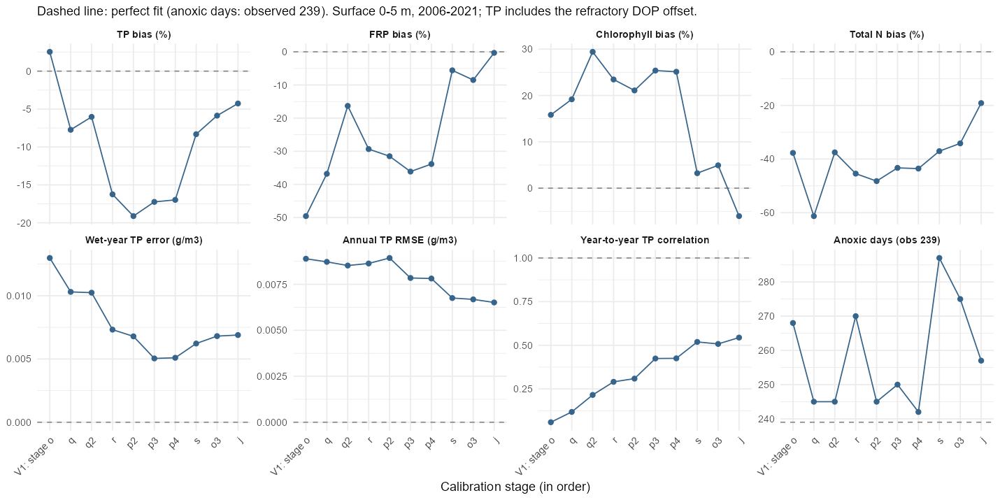
```

```{r}
#| eval: true
#| echo: false
#| label: fig-phi
#| fig-cap: "Objective by iteration for each stage (best member and ensemble median; free y-axis, so levels are not comparable across stages). Most stages gain little after the first or second iteration; stage `s` gains most because its prior ensemble was wide."
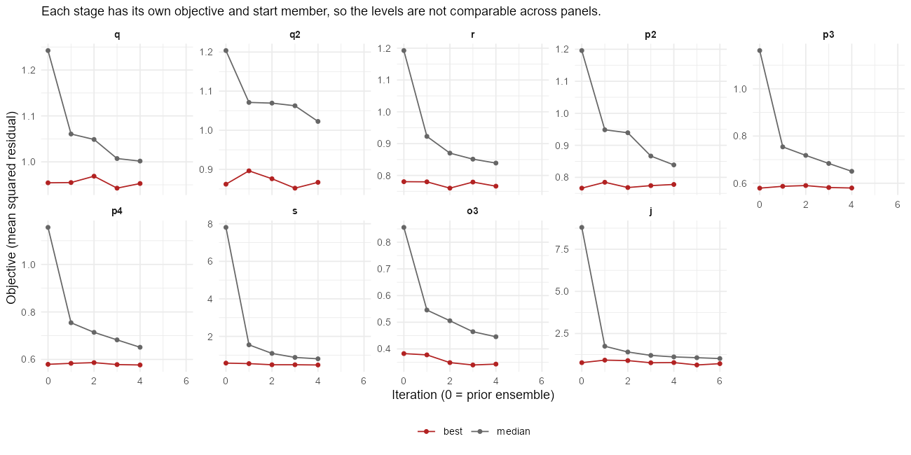
```

### Efficiency sensitivity (old inflows) {#sec-eff}

The first sensitivity scaled `k_w` and `k_s` on the old (hybrid) inflows. Without the refractory DOP offset it suggested the alum was too efficient (best scale 0.3 to 0.4); that was an artefact. With the offset, the TP bias is -3% at the fitted efficiency and +5% at 0.7, so the fitted efficiency is about right for TP (@fig-eff). Lower scales improve FRP (-51% to -20% from 1 to 0.3) but worsen TP (+25%) and chlorophyll, so FRP and TP pull in different directions.

{#fig-eff}

### In-stream reaction variants {#sec-variants}

V0 (no stream reaction), V1 (full: Puarenga ramp, Utuhina 0.45) and V2 (half) on the no-alum inflows, with `k_w` and `k_s` × 0.85, all fit about equally (@tbl-runs and @fig-period): the stream reaction changes surface TP by 2% or less, because total P is conserved and the lake module already removes the FRP quickly. The suspended alum-bound pool is only about 0.5% of TP, so adding it to the model TP changes nothing. The lake data therefore cannot identify the stream fractions; V1 is kept because it follows the reports. The ALU_alp delivery works: the column and namelist entry survive the run, the lake pool fills, and the bound P load matches the with-alum file (1.15 t P/yr Utuhina, 1.75 t P/yr Puarenga, 2011 to 2017).

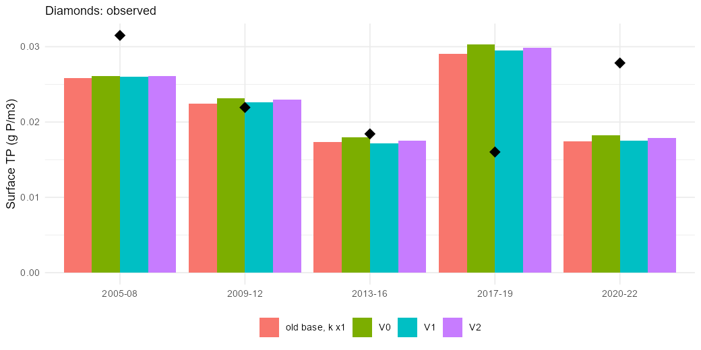{#fig-period}

### Lake TP follows the inflow load, the observations do not {#sec-load}

The variants share a structured TP error. Across 2006 to 2021 the simulated annual TP is positively correlated with the annual inflow TP load (r = 0.56) while the observed TP is negatively correlated (r = -0.52); the error correlates with the load at r = 0.77 (@fig-load2). The four wet years (2011, 2012, 2017, 2018; inflow volume above 580 hm³/yr and TP loads of 69 to 90 t against about 46 t in other years) are overestimated by 66% to 113%, while the observed TP is at its lowest. The extra load in wet years is mostly particulate P (about 37 t PIP and 10 t POP, against 13 and 3.5 t), and flood days (3 to 6% of days) carry 36% to 66% of the particulate P of the gauged streams. The 2021 to 2022 observed TP rebound occurs with low loads and is a separate, unexplained effect.

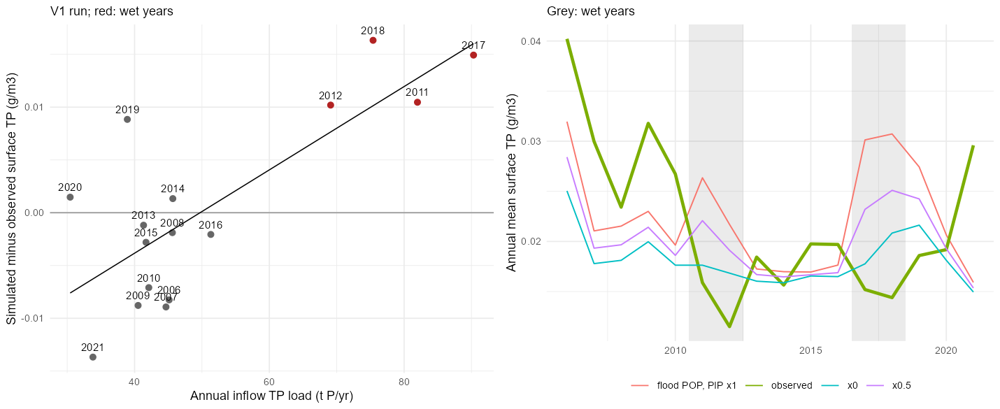{#fig-load2}

### Flood-day particulate P sensitivity {#sec-flood}

Scaling the POP and PIP delivered on flood days (the `isFlood` flag of the file) by 0.5 (F50) and 0 (F0) shows the sensitivity:

```{r}
#| eval: true
#| label: tbl-flood
#| tbl-cap: "Annual TP error (sim minus obs, g/m3), 2006 to 2021, with flood-day particulate P scaled."
knitr::kable(read.csv("data/inflows/flood_scaling_summary.csv"), col.names = c("Run", "Wet-year error", "Other-year error", "Annual RMSE", "Year-to-year r", "FRP bias (%)", "Chlorophyll bias (%)", "Anoxic days"))
```

Removing the flood particulate P brings the wet years much closer (error +0.013 to +0.004 g/m³, year-to-year r 0.06 to 0.44) but lowers TP in the other years and worsens FRP (the particulate organic P is a source of FRP through hydrolysis). The fix is therefore how fast the event P leaves the water column, not removing the load. In the calibrated 2O member the particulate organic matter settles at only -0.019 m/d (about 580 days to settle across the mean depth) and these parameters were fixed in earlier stages, so event particulate P stays until the outflow flushes it (about 1.4 years).

### What stage `q` calibrates {#sec-q}

Stage `q` frees three lake-process parameters, not event-specific ones: the particulate organic matter settling velocity `w_pom` (range -1 to -0.005 m/d, now -0.019), the particulate organic P hydrolysis rate `rpop_hydrol` (0.002 to 0.3 /d, now 0.016) and the settling velocity of adsorbed P `w_po4ads` (-3 to -0.02 m/d, now -0.29). The wet years are where these rates can be identified because that is where the particulate load is large. The objective is the alum-stage objective (TP, FRP, chlorophyll, aluminium, temperature, oxygen guards, with calibration 2006 to 2018 and validation 2018 to 2022) plus two annual-TP terms: the mean wet-year bias (scale 0.005 g/m³) and the year-to-year correlation. The inflow flood scaling is not a free parameter, because it is an input correction that would trade off against settling; it is tested afterwards at fixed values (step 4). Parameters that influence oxygen (`w_pom` also settles the particulate carbon) are guarded by the oxygen and anoxia terms of the objective.

### Stage `q` result {#sec-qresult}

All 48 members ran in every iteration and the objective fell from 1.10 (start) to 0.95 (best). The best member has faster settling and hydrolysis: `w_pom` -0.019 to -0.105 m/d, `rpop_hydrol` 0.016 to 0.10 /d, `w_po4ads` -0.29 to -0.92 m/d. The top quarter of the final ensemble is tight on `w_pom` (-0.13 to -0.06) and `rpop_hydrol` (0.04 to 0.24) and wide on `w_po4ads`.

| Run (2006 to 2021 surface TP, stage `q` parameters unless stated) | Wet-year error (g/m³) | Other-year error | Year-to-year r | FRP bias | Total N bias (no offset) |
|---|---|---|---|---|---|
| V1, stage `o` parameters | +0.013 | -0.004 | 0.06 | -50% | -38% |
| Stage `q`, flood particulate P × 1 | +0.010 | -0.006 | 0.12 | -37% | -61% |
| Stage `q`, × 0.75 | +0.008 | -0.006 | 0.20 | -43% | -63% |
| Stage `q`, × 0.5 | +0.006 | -0.007 | 0.29 | -50% | -64% |

- **A modest gain.** Faster particulate settling and hydrolysis cut the wet-year error from +0.013 to +0.010 g/m³ and lift the year-to-year correlation from 0.06 to 0.12. Scaling the flood particulate P as well brings it to +0.006 (× 0.5), but the other years then run low (-0.007) and the overall TP bias is about -17%.
- **Total N pays for it.** Faster particulate settling also removes particulate N (`w_pom` settles carbon, nitrogen and phosphorus together), and the total N bias gets worse (the guard term went from -0.19 to -1.01 tolerance units). Chlorophyll is slightly worse and anoxic days are unchanged (243 to 255 against 239).
- **The wet-year excess is mostly dissolved P, not particulate.** In the stage `q` run the top 5 m pools are higher in the wet years by about 0.0022 g/m³ for FRP (0.0022 to 0.0044), 0.0020 for dissolved organic P (0.0067 to 0.0087) and 0.0010 for diatom internal P, but only 0.0003 for particulate organic P. FRP reaches 0.009 g/m³ in 2017 against an observed 0.0015. Settling the particulates faster does not remove that: the event P is hydrolysed and mineralised to dissolved forms, and the alum capacity per unit of flow is smaller in wet years.

**What this means.** Particulate settling and hydrolysis are not the main lever for the wet-year TP error, and the parameters that help P hurt N. The better targets are the dissolved P pools in the wet years (FRP removal by the alum, DOP mineralisation) and, as an input uncertainty, the flood-day particulate load.

### Refits after stage `q` {#sec-refit}

Four further stages followed, all on the V1 inflows (no-alum files, in-stream bound P) with 48 members and 4 iterations each. The alum-stage objective is used throughout, with the wet-year TP bias and year-to-year correlation terms added (`S2_TPTERMS=1`).

- **Stage `q2`.** Intended as a narrower stage `q` (`w_pom` fixed), but a range helper in `step2_common.R` reset the limits after the freeze and left `w_pom` free, so it is stage `q` plus `rdom_minerl` (0.5 to 2 ×). Best member: `w_pom` -0.051, `rpop_hydrol` 0.21, `w_po4ads` -0.58, `rdom_minerl` 0.033. Total N is no worse than V1 this time.
- **Stage `r`.** The eight alum parameters freed again (wide ranges), holding the stage `o` and `q2` members.
- **Stage `p2`.** The alum parameters plus the sediment P release (`fsed_frp` by zone, `ksed_frp`, `theta_sed_frp`). No improvement on `r`: objective 0.766 to 0.778.
- **Stages `p3` and `p4`.** The same joint refit on the base with flood-day particulate P × 0.5 (the input correction from step 4), so the wet years are handled by the input and the sediment P and alum parameters fit the other years. The objective fell from 0.73 to 0.58 in `p3`. `p4` continued from it and changed nothing (0.580 to 0.577), so the ensemble has converged.

| Run (2006 to 2021 surface 0 to 5 m) | Wet-year error (g/m³) | Other-year error | Annual RMSE | Year-to-year r | FRP bias | Chlorophyll bias | Total N bias (no offset) | Anoxic days (obs 239) |
|---|---|---|---|---|---|---|---|---|
| V1, stage `o` | +0.0130 | -0.0036 | 0.0089 | 0.06 | -50% | +16% | -38% | 268 |
| `q2` | +0.0102 | -0.0052 | 0.0085 | 0.22 | -16% | +29% | -38% | 245 |
| `r` | +0.0073 | -0.0072 | 0.0086 | 0.29 | -29% | +24% | -45% | 270 |
| `p2` | +0.0068 | -0.0078 | 0.0089 | 0.31 | -32% | +21% | -48% | 245 |
| `p3` (flood × 0.5) | +0.0050 | -0.0067 | 0.0078 | 0.42 | -36% | +25% | -43% | 250 |
| **`p4` (flood × 0.5)** | +0.0051 | -0.0067 | **0.0078** | **0.43** | -34% | +25% | -44% | **242** |

```{r}
#| eval: true
#| echo: false
#| label: fig-annual-stage
#| fig-cap: "Annual mean surface TP by year for the stage `o` start member, the particulate stages and the flood × 0.5 refits, against the observations (grey: wet years)."
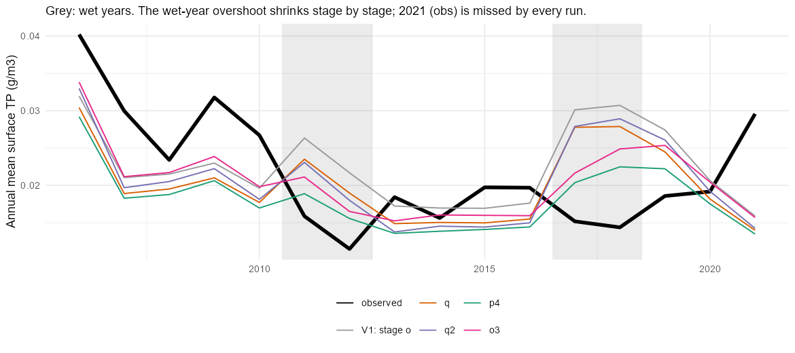
```

**Why these stages were designed this way.** @fig-annual-stage shows the problem that drove them: in the wet years (2011, 2012, 2017, 2018) the model's annual TP is well above the observations, while in dry years it is slightly low, and the observations fall in wet years. Lake processes alone (`q`, `q2`, `r`, `p2`) reduced the overshoot but pushed the dry years lower. Halving the flood-day particulate P in the inflows (`p3`, `p4`) is an input correction that lets the lake parameters fit the dry years while the storm load is damped, which is why the refits were repeated on that base.

**Result.** `p4` has the lowest annual TP error, the best year-to-year correlation and anoxic days within 3 of the observed 239. It keeps three misfits: surface TP about 17% low overall, FRP about 34% low and chlorophyll about 25% high. `q2` fits FRP and the overall TP bias better (-16% and -6%) but at the price of a larger wet-year error and chlorophyll +29%. The two are the candidates for the scenarios; `p4` is the working choice because the year-to-year behaviour is what drives the scenario contrasts, with `q2` kept as a sensitivity member. The `p4` parameters are in `calibration/step2p4/runs/step2_best.rds`, and the final ensemble is in `step2_ies.rds` in the same folder.

**Caveats.** The `p4` best member rests on the flood-day particulate P × 0.5 correction, which is an input assumption and not a calibrated quantity; it must be carried into the scenario runs (build with `STR_FLOODSCALE=0.5`, as in `calibration/alum/stream_variant.R`). The alum parameters are poorly constrained across the top quarter of the ensemble (for example `k_res` 0.001 to 0.5 in stage `r`), so the scenario ensemble should draw members rather than use the best member alone. The surface FRP and chlorophyll misfits did not respond to any of these stages, which points at the phytoplankton uptake and the dissolved P cycling and not at the alum.

### Phytoplankton P stage (`s`) {#sec-stage-s}

**Why this stage.** After `p4` converged, the misfits that remain (surface FRP about 34% low, chlorophyll about 25% high, TP about 17% low) did not respond to the alum, sediment P or particulate parameters. The seasonal cycle in @fig-seasonal shows what was wrong: in `p4` surface FRP is far too low from February to June (it is nearly zero in March and April against 0.003 to 0.006 g/m³ observed), and the summer chlorophyll peak is 5 to 6 µg/L too high (February to March), so the phytoplankton were taking up more P than the lake data allow. The phytoplankton P kinetics have not been touched since the early biology stages, which predate the alum module and the current inflows, so stage `s` frees them: the half-saturation constant for P uptake `K_P`, the minimum and maximum internal P quotas `X_pmin` and `X_pmax`, and the respiration rate `R_resp`, for each of the cyano, green and diatom groups (12 parameters).

| Parameter | Start (`p4`; cyano, green, diatom) | Range |
|---|---|---|
| `K_P` (g/m³) | 0.21, 0.29, 0.056 | 0.3 to 3 × start |
| `X_pmin` | 0.0007, 0.001, 0.0012 | 0.5 to 2 × start |
| `X_pmax` | 0.009, 0.005, 0.0038 | 0.5 to 2 × start |
| `R_resp` (/d) | 0.105, 0.25, 0.01 | 0.01 to 0.4 |

The alum, sediment P, particulate and oxygen parameters are held at the `p4` and earlier members, and the objective is the same as in stage `p4` (alum-stage objective plus the wet-year TP terms). The green group's `R_resp` sat on its previous upper bound (0.25), so the range is widened. The run uses 48 members and 4 iterations, and the best member is evaluated on the flood × 0.5 base (run name `S1`).

**Result.** The objective fell from 0.58 to 0.48. Surface FRP moved from -34% to -6%, chlorophyll from +25% to +3% and the overall TP bias from -17% to -8%; the annual TP RMSE fell from 0.0078 to 0.0068 g/m³ and the year-to-year correlation rose from 0.43 to 0.52. The cost was bottom oxygen: with more production the model had 287 days below 2 g/m³ against 239 observed (242 for `p4`). The best member lowers the green group's `R_resp` to its lower bound (0.0102), and the top quarter of the ensemble is wide for `K_P` and `X_pmin`, so these parameters are weakly constrained.

```{r}
#| eval: true
#| echo: false
#| label: fig-seasonal
#| fig-cap: "Mean annual cycle of surface FRP and chlorophyll-a, 2006 to 2021, for `p4` and `s` against the observations."
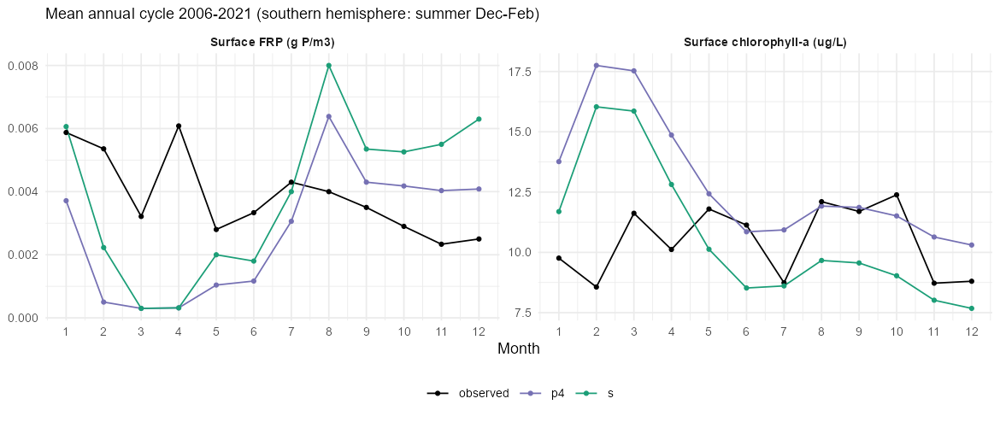
```

```{r}
#| eval: true
#| echo: false
#| label: fig-pos
#| fig-cap: "Position of the start member (arrow tail) and best member (point) inside each parameter's allowed range, for stages `s` and `o3`. Red points sit at a bound."
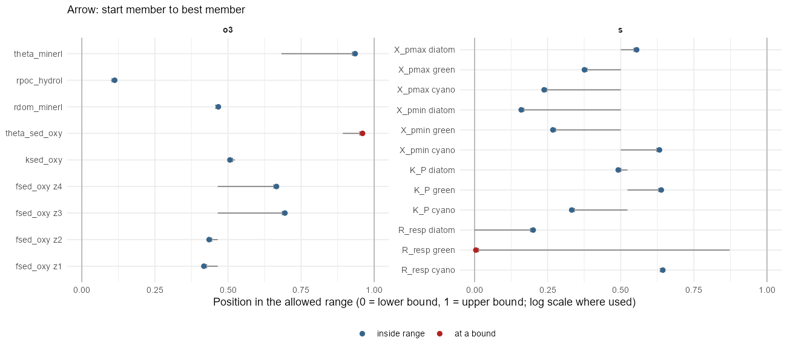
```

In @fig-seasonal stage `s` lifts summer FRP back to the observed level (January) and lowers the summer chlorophyll peak, but it still leaves FRP near zero in March to April, over-predicts FRP from August to December (0.005 to 0.008 g/m³ against 0.0025 to 0.004), and under-predicts chlorophyll from June to December. The remaining seasonal errors are one reason for the joint stage (@sec-joint).

@fig-pos shows how far the stage moved: most `s` parameters moved by a modest fraction of their range, with the green group's `R_resp` running to its lower bound. Most parameters end well inside their ranges, so the ranges were not what limited the fit.

**Why the next stage.** Stage `s` fixed the nutrient and chlorophyll fit, but more production delivers more organic matter to the bottom, and anoxic days rose from 242 to 287. The oxygen parameters had been fitted when production was lower, so they were refitted next (`o3`).

### Oxygen refit (`o3`) {#sec-o3}

Because the stage `o` oxygen parameters were fitted under the earlier, less productive biology, they were refitted on top of the stage `s` member: the four zone `fsed_oxy` values, `ksed_oxy`, `theta_sed_oxy`, `rdom_minerl`, `rpoc_hydrol` and `theta_minerl` (9 parameters), with the calibration window ending 2017-06-30 as in the original stage `o`. The concern was equifinality, that the oxygen parameters would restore anoxia by shifting the nutrient fit back. They did not: the best member keeps FRP at -8.5%, chlorophyll at +4.9%, total TP at -6% (annual TP RMSE 0.0067 g/m³, year correlation 0.51) and total N at -34%. Anoxia improved only modestly, to 275 days against 239 observed. Calibration-period anoxia is on target, but the 2018 to 2022 validation period is over-predicted, and the strongest sediment oxygen demand moved to the deep zone 4 (-176 to -296 mg/m²/d). The `o3` member is the best member of this stage.

```{r}
#| eval: true
#| echo: false
#| label: fig-anox-stage
#| fig-cap: "Days per year with bottom DO (mean of the 17 m and deeper samples) below 2 g/m³, on the sampled days, for the observations and the `p4`, `s` and `o3` members."
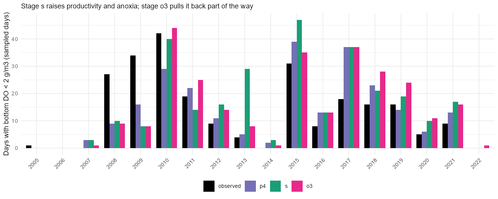
```

@fig-anox-stage shows that the anoxia count hides a timing problem. The observations have most low-oxygen days in 2008 to 2010 (27, 34 and 42 days) and in 2015 (31); the model misses 2008 and 2009 (about 9 and 8 to 16 days) and overshoots 2017 (37 days against 18) and 2018 to 2019. Stage `s` also creates a spurious anoxic year in 2013 (29 days against 4), which `o3` removes. Since the early years are under-predicted and the late years over-predicted, a single sediment oxygen demand per zone cannot fix it: the oxygen demand and the production supply have to be adjusted together.

**Why a joint stage next.** The oxygen and nutrient parameters are correlated (production supplies the organic matter that the oxygen parameters consume, and sediment P release depends on bottom oxygen), but they were fitted one after the other, so each stage was conditional on the last. The remaining misfits (summer FRP and chlorophyll timing, TN about 34% low, anoxia timing) cross those groups. The next stage therefore frees them together and adds targets that measure them directly (@sec-joint).

Two problems cost compute time and are worth recording. A first `o3` run optimised nothing because the calibration end date (`S2_CALEND`, default 2003) left no data in the window, so every residual was zero. A second attempt was contaminated when a watchdog killed model runs that had stalled while the laptop went into standby; the truncated runs scored zero and looked like perfect members. The ensemble code now treats an all-zero residual vector as a failed run, and sleep was disabled for the long runs.

### Historical ensemble {#sec-hist}

The 20 lowest-objective members of the final `o3` ensemble were run over 2005 to 2022 on the flood × 0.5 base with the alum module on (`calibration/historical/run_hist.R`). Only the nine oxygen parameters differ between members, so the envelope shows the oxygen uncertainty and not the uncertainty in the phytoplankton or alum parameters.

```{r}
#| eval: true
#| echo: false
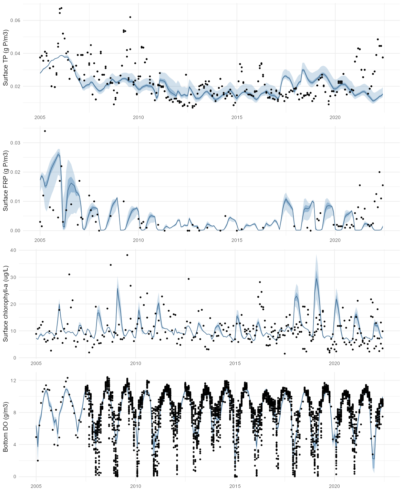
```

Monthly means of the daily surface (0 to 5 m) and bottom values; the dark band is the interquartile range, the light band the full ensemble, and the points are the observations.

```{r}
#| eval: true
#| echo: false
m <- read.csv("data/historical/member_metrics.csv")
s <- data.frame(Metric = c("Objective", "Surface TP bias (%)", "Surface FRP bias (%)", "Surface chlorophyll bias (%)", "Annual TP RMSE (g/m³)", "Year-to-year TP correlation", "Anoxic days (observed 239)", "Bottom DO bias (g/m³)"),
  Mean = c(mean(m$phi), mean(m$TP_bias), mean(m$FRP_bias), mean(m$chl_bias), mean(m$TP_annual_rmse), mean(m$TP_year_r), mean(m$anoxic_days), mean(m$DO_bottom_bias)),
  Min = c(min(m$phi), min(m$TP_bias), min(m$FRP_bias), min(m$chl_bias), min(m$TP_annual_rmse), min(m$TP_year_r), min(m$anoxic_days), min(m$DO_bottom_bias)),
  Max = c(max(m$phi), max(m$TP_bias), max(m$FRP_bias), max(m$chl_bias), max(m$TP_annual_rmse), max(m$TP_year_r), max(m$anoxic_days), max(m$DO_bottom_bias)))
knitr::kable(s, digits = 3)
```

- **The ensemble brackets the observations for the main variables.** Mean surface TP bias is about -12% (range -22% to +7%), FRP is within ±12% for 16 of the 20 members and chlorophyll is within +11%. The mean number of anoxic days (252) is close to the observed 239, with a wide spread (170 to 337).
- **Known misses.** FRP and TP are too high in 2005 to 2006, which is spin-up and initial-condition influence; the 2017 to 2019 TP peak is over-predicted; and the TP and FRP rebound of 2021 to 2022 is missed by every member. Summer chlorophyll peaks in 2009 and 2018 to 2019 are higher than observed.
- **Bottom DO.** The ensemble follows the seasonal cycle but the deepest observed drawdowns (below 2 g/m³ at times) are not reached in every year, which is what the anoxia comparison by year shows (`images/historical/anoxia_by_year.png`, `data/historical/anoxic_days_by_year.csv`).

```{r}
#| eval: true
#| echo: false
#| label: fig-hist-anox
#| fig-cap: "Days per year with bottom DO below 2 g/m³: the `o3` ensemble (band: min to max, line: median, all model days) and the observed days (bars, sampled days only, so they are lower bounds)."
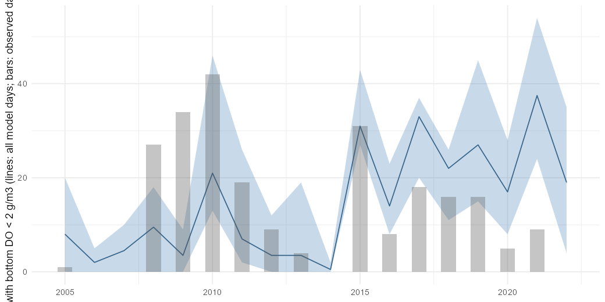
```

### Joint stage (`j`) {#sec-joint}

**Why.** The sequence above fitted production, then particulate P, then alum and sediment P, then oxygen, each conditional on the last, and the remaining errors cross those groups: summer FRP and chlorophyll timing, total N (-34%), the timing of anoxia, and the stratification that controls when it starts (the model's thermocline is about 4 m shallower than observed in the calibration period). An ensemble built by combining the `s` and `o3` ensembles would be invalid, because the two are correlated through the productivity and oxygen-demand trade-off. The ensemble has to be estimated with both groups free.

**Design.** 40 parameters are freed together, starting from the `o3` member on the flood × 0.5 base:

| Group | Parameters | Count |
|---|---|---|
| Phytoplankton P kinetics | `K_P`, `X_pmin`, `X_pmax`, `R_resp` for the cyano, green and diatom groups | 12 |
| Oxygen | `fsed_oxy` by zone, `ksed_oxy`, `theta_sed_oxy`, `rdom_minerl`, `rpoc_hydrol`, `theta_minerl` | 9 |
| Sediment P release | `fsed_frp` by zone, `ksed_frp`, `theta_sed_frp` | 6 |
| Nitrogen | `rdenit`, `fsed_nit` by zone, `fsed_amm` by zone, `K_N` for the three groups, `rpon_hydrol` | 13 |

The alum parameters, the particulate parameters and the physics (`Kw`, mixing, heat flux) stay fixed. Targets are the existing alum-stage objective (surface TP, FRP, chlorophyll, nitrate and ammonium, temperature and oxygen guards, aluminium, wet-year TP and the year-to-year TP correlation) plus bottom DO and anoxia terms (bias, RMSE, anoxic days by water year, annual minimum, Oct to Feb drawdown), annual TN bias and year-to-year correlation, and thermocline depth (bias and RMSE on stratified profiles). The thermocline terms are diagnostic only, because no parameter in this stage controls mixing. The run uses 100 members and 6 iterations (about 4 hours); the code is `S2_JOINT=1` in `calibration/step2/alum_resid.R` and `step2_common.R`, launched by `calibration/step2/run_step2j.ps1`.

At the start (the `o3` member), the new terms are: thermocline bias -4.1 m (calibration) and +1.8 m (validation), annual TN year-to-year correlation negative, and anoxic-day error small in calibration but large in validation.

#### Joint stage results {#sec-joint-results}

All 100 members ran in every one of the seven ensemble evaluations. The ensemble median fell from 8.8 to 1.0, but the best member improved only from 0.771 (the `o3` start member) to 0.712 in the calibration window; the best member of any iteration (0.634) came in iteration 5, so the last update did not improve it. In the validation window the objective did not improve at all (2.79 for the start member, 2.82 for the best). The gain from this stage is therefore modest for a single member, and its value lies in the ensemble and in what the targets say about the parameters (@fig-j-converge to @fig-j-change).

```{r}
#| eval: true
#| echo: false
sc <- read.csv("data/calibration/run_scorecard.csv")
sc <- sc[sc$run %in% c("O3", "J1"), ]
names(sc) <- c("Run", "TP bias (%)", "FRP bias (%)", "Chlorophyll bias (%)", "Total N bias (%, no offset)", "Wet-year TP error (g/m³)", "Annual TP RMSE (g/m³)", "Year-to-year TP correlation", "Anoxic days (obs 239)")
sc$Run <- c("o3 (start)", "j (best member)")
knitr::kable(sc, digits = 3)
```

- **Better in the best member.** FRP bias -8.5% to -0.3%, chlorophyll +4.9% to -6.0%, TP -5.9% to -4.3%, anoxic days 275 to 257 against 239 observed, annual TP RMSE 0.0067 to 0.0065 g/m³ and year-to-year correlation 0.508 to 0.544.
- **Total N needs care.** The scorecard value moves from -34% to -19%, but the objective adds the refractory DON (0.126 g/m³) to the model TN, and with that offset the best member overshoots TN: the scaled TN bias goes from -0.18 to +0.39 in the calibration window and the annual TN bias from -0.32 to +0.84 (@fig-j-change). The year-to-year TN correlation improves (2.38 to 1.60 on the objective scale, where 0 is a perfect correlation) but is still poor. The nitrogen parameters were freed to fix the low TN, but in this run they moved TN past the observations; this is a trade-off to review before using the ensemble for N.
- **Thermocline and temperature unchanged.** The scaled temperature residuals (-0.13 and 0.58) did not change, and the calibration-window thermocline bias moved only from about -4.1 to -4.8 m (the model's thermocline is too shallow; the residual is -1.4 to -1.6 on the objective scale of 3 m), as expected, since no parameter of this stage acts on mixing.
- **Wet-year TP error unchanged** (+0.0069 g/m³): the flood × 0.5 input assumption, not the lake parameters, sets it.

```{r}
#| eval: true
#| echo: false
#| label: fig-j-converge
#| fig-cap: "Ensemble position of each of the 40 parameters by iteration (median and 10 to 90% band, in range units, coloured by group). Iteration 0 is the prior ensemble."
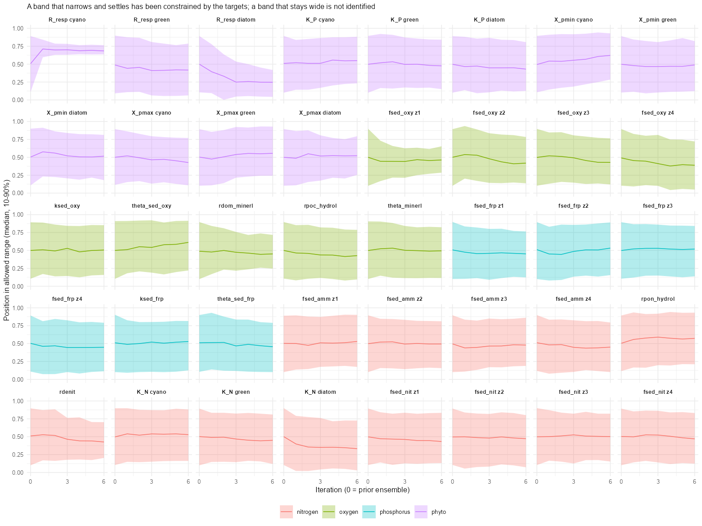
```

**Convergence** (@fig-j-converge, @fig-j-shrink). Most parameters barely narrow: the 10 to 90% band of 33 of the 40 parameters is still more than 80% of the prior width after six updates (median 86%), so they are not identified by this set of targets. The parameters that converge are the ones the targets act on directly: cyano `R_resp` (81% reduction in spread, moving to the upper half of its range), diatom `R_resp` (52%, moving down), the zone 1 sediment oxygen demand (54%), `rdom_minerl` (40%), `rdenit` (32%) and diatom `X_pmax` (28%). The sediment P release and most of the nitrogen parameters stay close to the prior.

```{r}
#| eval: true
#| echo: false
#| label: fig-j-shrink
#| fig-cap: "Reduction in ensemble spread from the prior to the final iteration, by parameter."
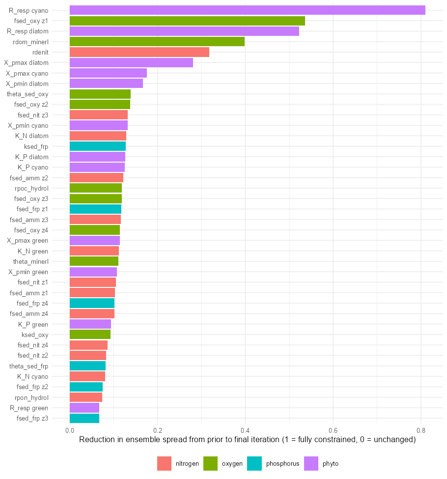
```

```{r}
#| eval: true
#| echo: false
#| label: fig-j-pull
#| fig-cap: "How each target pulls each parameter. For every target, the change in its residual per unit of each parameter is estimated by regression over the first four iterations (about 400 members); the colour is the downhill direction for that target's squared residual at the start member, scaled within each target (blue: asks for a higher parameter value; red: a lower value). Blank cells have no identified link."
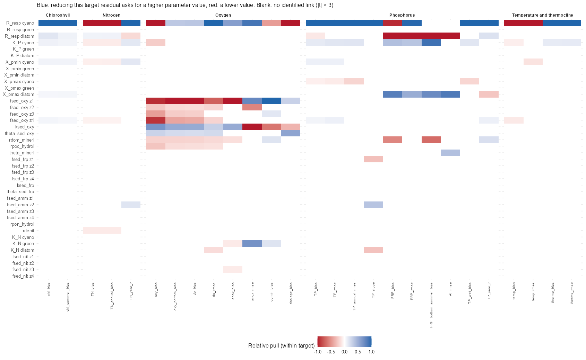
```

**How the targets pulled the parameters** (@fig-j-pull). The links that are identified are few and physically sensible:

- **Cyano `R_resp`** is the dominant lever. It is linked to the chlorophyll, TP (including the wet-year terms), TN and oxygen residuals at once. The chlorophyll, TP, wet-year and year-to-year TP targets ask for a higher value, the two TN bias targets ask for a lower value, and FRP bias asks for a lower value while FRP RMSE asks for a higher one. This is the trade-off between the chlorophyll and phosphorus fit and the nitrogen fit.
- **Oxygen targets** (bottom DO bias, anoxic days, annual minimum, drawdown slope) pull on the zone sediment oxygen demands, `ksed_oxy`, `theta_sed_oxy` and `rdom_minerl`. The zone 1 oxygen demand is pulled towards a weaker demand by the bias terms (the model's bottom DO is too low), and `ksed_oxy` is pulled in the opposite direction on the same targets.
- **FRP targets** pull on `R_resp` and `X_pmax` of the diatom group (in opposite directions) and, for the summer bottom FRP, on `K_P` of the cyano group and `rdom_minerl`.
- **Nitrogen** is only weakly linked to the nitrogen parameters: `rdenit` is the only one with a clear effect on TN, and `fsed_amm` zone 2 on the year-to-year TN correlation.
- **Temperature and thermocline** targets are linked weakly to a few parameters, mainly cyano `R_resp` (through the light climate), and not to the oxygen or nitrogen parameters.

```{r}
#| eval: true
#| echo: false
#| label: fig-j-change
#| fig-cap: "Scaled residual of every target in the calibration window for the start (`o3`) member and the best joint member (0 is a perfect fit; each unit is the target's tolerance). The nitrogen terms move from slightly low to above the observations, while FRP, chlorophyll and the oxygen bias terms improve."
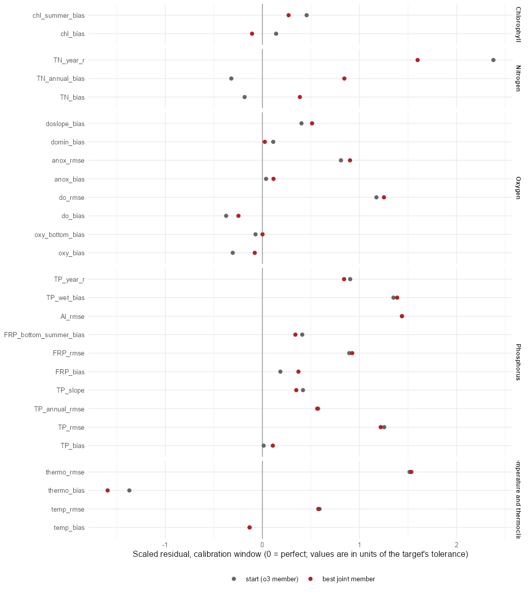
```

**What this means for the next step.** The joint stage keeps the phosphorus and chlorophyll fit and improves oxygen a little, but it cannot be read as a tightly constrained posterior: most parameters remain close to the prior, and the nitrogen targets compete with the phosphorus and chlorophyll targets through cyano `R_resp`. The ensemble from the final iteration is a fair description of that uncertainty, so the historical and scenario ensembles use it directly.

#### Joint historical ensemble {#sec-hist-j}

The 20 lowest-objective members of the final `j` ensemble were run over 2005 to 2022 on the flood × 0.5 base (`HIST_TAG=j`, `calibration/historical/launch_hist.ps1`). Unlike the `o3` ensemble, these members differ in all 40 parameters, so the envelope includes phytoplankton, sediment P, oxygen and nitrogen uncertainty.

```{r}
#| eval: true
#| echo: false
#| label: fig-hist-j
#| fig-cap: "Joint ensemble (20 members) against the observations: monthly means of surface TP, FRP, chlorophyll-a and bottom DO (dark band: interquartile range; light band: full ensemble; points: observations)."
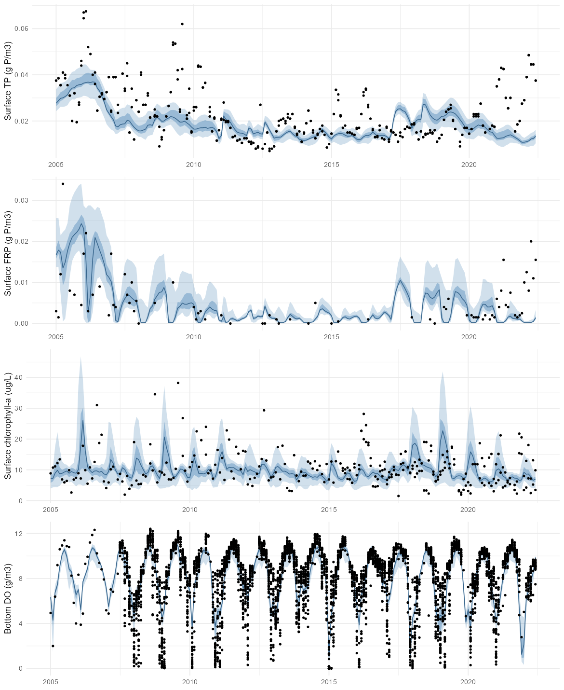
```

```{r}
#| eval: true
#| echo: false
#| tbl-cap: "Member metrics, mean (min to max): the `o3` ensemble (oxygen parameters only vary) and the joint `j` ensemble (all 40 parameters vary)."
f <- function(file, lab) { m <- read.csv(file); g <- function(x, d = 1) sprintf(paste0("%.", d, "f (%.", d, "f to %.", d, "f)"), mean(x), min(x), max(x))
  data.frame(Ensemble = lab, `TP bias (%)` = g(m$TP_bias), `FRP bias (%)` = g(m$FRP_bias), `Chlorophyll bias (%)` = g(m$chl_bias), `Annual TP RMSE (g/m³)` = g(m$TP_annual_rmse, 4), `Year-to-year TP correlation` = g(m$TP_year_r, 2), `Anoxic days (obs 239)` = g(m$anoxic_days, 0), check.names = FALSE) }
knitr::kable(rbind(f("data/historical/member_metrics.csv", "o3 (20 members)"), f("data/historical/member_metrics_j.csv", "j (20 members)")))
```

- **The ensemble is broad.** Individual members range from about -50% to +45% in FRP bias and from -42% to +46% in chlorophyll bias, which is the weak constraint on the phytoplankton parameters showing up as output uncertainty. The ensemble mean is close to the observations for FRP (-0.5%) and chlorophyll (-3.4%) and for the number of anoxic days (237 against 239).
- **TP is lower than in the best member.** The ensemble-mean TP bias is -18.6% (range -33% to -5%), against -12.5% for the `o3` ensemble, so the ensemble as a whole is further from the observed TP than the best member is (-4.3% on annual means; the per-member values in this table use all samples, so they are not exactly comparable with the scorecard). The year-to-year correlation (0.50) is about the same as for `o3` (0.52).
- **Same misses as before.** The 2021 to 2022 TP and FRP rebound, the 2017 to 2019 TP peak and the early (2005 to 2006) FRP and TP overshoot remain, and the monthly ensemble envelope does not reach the deepest observed bottom-DO drawdowns (near 0 g/m³ in 2008 to 2011).
- **Which ensemble to use.** The joint ensemble is the more honest description of the uncertainty because all the parameters that were calibrated vary. Its TP is on the low side, so scenario TP differences should be read as changes relative to the baseline run rather than as absolute values.

::: {.callout-warning title="Placeholder: validation period (2018 to 2022), term by term"}
The total validation objective is reported above (2.79 for the `o3` start member, 2.82 for the best `j` member). Add a figure of the validation-window residuals term by term, next to the calibration residuals in @fig-j-change (`best_Yval` and `baseline_Yval` in `calibration/step2j/runs/step2_best.rds`).
:::

### What alum did to the lake, 2005 to 2022 {#sec-alum-impact}

**Design.** The top 50 members of the final joint (`j`) ensemble were each run twice over 2005 to 2022 on the flood × 0.5 base: once with the observed alum dosing and the in-stream reaction, and once with no alum. For "no alum" the dose (`ALU_ala`) and the stream-bound pool (`ALU_alp`) are set to zero and the bound P is returned to the inflow FRP, so the inflows are the untreated series and the total P load is identical in the two runs. All other parameters are the same, so the difference is the alum effect for each member (`calibration/historical/make_noalum_base.R`, `run_hist.R`, `alum_impact.R`). Dosing starts on 15 June 2006 in the Utuhina and on 14 January 2010 in the Puarenga (first dosed days in the inflow file), and the two runs are identical before the first dose, which is a check on the setup.

```{r}
#| eval: true
#| echo: false
#| tbl-cap: "Effect of alum, 2005 to 2022, mean over 50 members (range across members in brackets). Surface is 0 to 5 m; TP includes the refractory DOP offset."
s <- read.csv("data/historical/alum_impact_summary.csv"); nd <- function(x) ifelse(abs(x) < 0.1, sprintf("%.3f", x), sprintf("%.1f", x))
fm <- function(x) ifelse(abs(x) < 0.1, sprintf("%.4f", x), ifelse(abs(x) < 10, sprintf("%.2f", x), sprintf("%.1f", x)))
knitr::kable(data.frame(Variable = s$metric, `With alum` = fm(s$with), `No alum` = fm(s$without), `Change` = fm(s$diff), `Change (%)` = sprintf("%.1f (%.1f to %.1f)", s$pct, s$pct_min, s$pct_max), check.names = FALSE))
```

```{r}
#| eval: true
#| echo: false
#| label: fig-alum-annual
#| fig-cap: "Annual surface TP, FRP, chlorophyll-a and anoxic days with the observed alum dosing and with no alum (joint ensemble, median and range across members), against the observations."
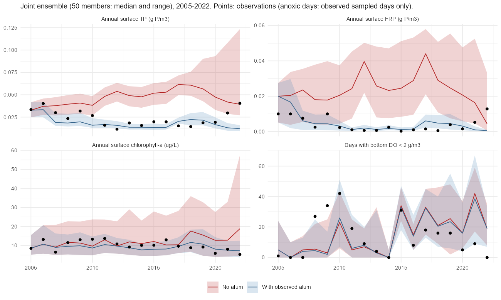
```

- **Phosphorus.** Alum lowers surface TP by 59% on average (members 46% to 69%) and surface FRP by 81% (69% to 88%). Without alum the model TP stays at 0.04 to 0.06 g/m³, near the observed 2005 and 2006 values (before dosing took effect) and well above the observed values from 2007, so the model needs the alum to reproduce the observed TP. The relative effect is 37% in 2005 to 2010, 70% in 2011 to 2016 and 65% in 2017 to 2022.
- **Chlorophyll.** The annual mean falls by 29% on average (from 13.0 to 9.2 µg/L) and the summer (December to March) mean by 43%. The range across members is wide (0% to 52%), because the phytoplankton parameters are weakly constrained.
- **Total N** falls by 38%, presumably through the lower phytoplankton biomass, but I have not checked the mechanism. This is a model result and was not compared with observations (the calibrated TN also overshoots in the best member, see above).
- **Anoxia hardly changes.** Anoxic days fall by 0.5 per year on average (3%), with members ranging from 33% fewer to 23% more, and mean bottom DO is unchanged. Chlorophyll falls by almost a third, so the lower settled algal load does not translate into less bottom oxygen demand. In this model the bottom oxygen demand is evidently dominated by the sediment terms (`fsed_oxy`, `rdom_minerl`) and not by settling algae. I have not tested this by varying those terms. It matters for the scenarios: the model cannot say that alum reduces anoxia.

```{r}
#| eval: true
#| echo: false
#| label: fig-alum-pct
#| fig-cap: "Alum effect as a percentage of the no-alum value, by year (median and range across members)."
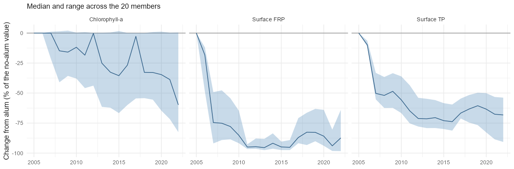
```

**Time series and observed against modelled.** @fig-alum-ts shows the monthly ensemble with and without alum against the observations, and @fig-alum-scatter and the table compare the observations with the ensemble-mean simulation at each sampling date before dosing (to 14 June 2006, identical in the two runs) and after it.

```{r}
#| eval: true
#| echo: false
#| label: fig-alum-ts
#| fig-cap: "Monthly surface TP, FRP, chlorophyll-a and bottom DO from the 50 joint-ensemble members with the observed alum dosing (blue) and with no alum (red), against the observed monthly means (points). Dashed lines: start of dosing in the Utuhina (June 2006) and the Puarenga (January 2010)."
#| fig-height: 9
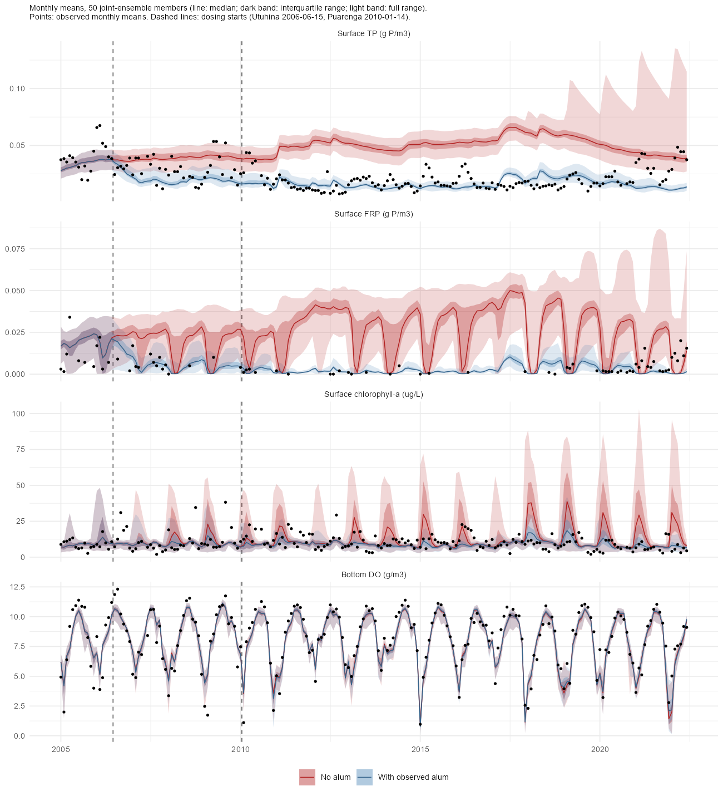
```

```{r}
#| eval: true
#| echo: false
#| label: fig-alum-scatter
#| fig-cap: "Observed against modelled (ensemble mean at each observation) before and after dosing began, with and without alum. Grey line: 1:1."
#| fig-height: 10
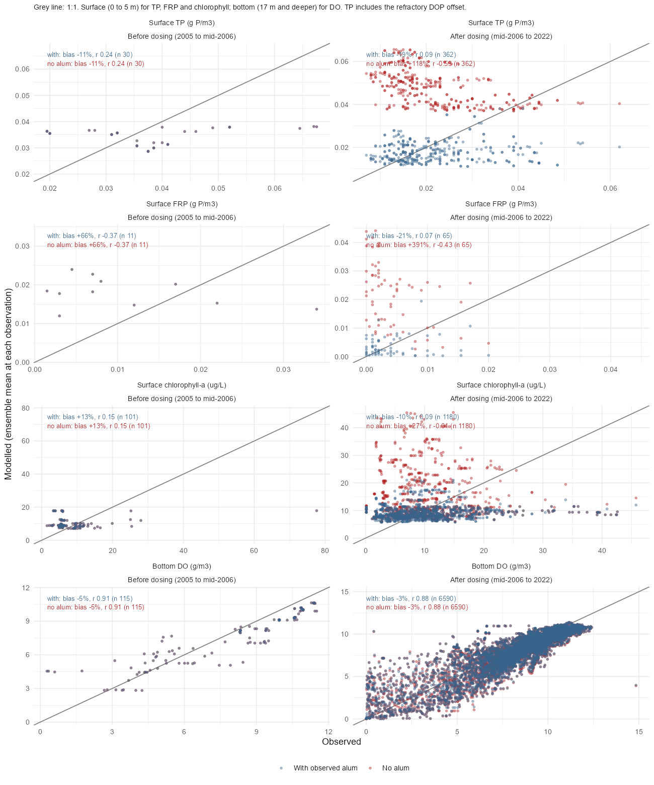
```

```{r}
#| eval: true
#| echo: false
#| tbl-cap: "Model against observations before and after dosing: bias of the ensemble mean (member range in brackets) and correlation of the ensemble-mean simulation with the observations."
s <- read.csv("data/historical/alum_obs_vs_sim_stats.csv"); nm <- c(TP = "Surface TP", FRP = "Surface FRP", chl = "Surface chlorophyll-a", DObot = "Bottom DO")
s <- s[order(match(s$var, names(nm)), s$period != "Before dosing (2005 to mid-2006)", s$run != "With observed alum"), ]
knitr::kable(data.frame(Variable = nm[s$var], Period = sub(" \\(.*", "", s$period), Run = ifelse(s$period == "Before dosing (2005 to mid-2006)", "both (identical)", s$run), n = s$n, `Bias (%)` = sprintf("%+.0f (%+.0f to %+.0f)", s$bias_pct, s$bias_min, s$bias_max), r = sprintf("%.2f", s$r), check.names = FALSE)[!(s$period == "Before dosing (2005 to mid-2006)" & s$run != "With observed alum"), ], row.names = FALSE)
```

- **Before dosing the model is close, apart from FRP.** TP is 11% low, chlorophyll 13% high and bottom DO 5% low, but there are only 30 TP, 101 chlorophyll and 11 FRP samples (about 17 months), and the surface FRP is 66% high on 11 samples, which is too few to say much. The member bias ranges are wide for FRP (-61% to +173%).
- **After dosing the alum run matches the level and the no-alum run does not.** With alum the surface TP bias is -19% (members -36% to +6%), FRP -21% and chlorophyll -10%. With no alum the same members are +118% for TP (+65% to +166%), +391% for FRP and +27% for chlorophyll. Bottom DO is the same with and without alum (bias -3%, r 0.88).
- **The skill is in the level, not in the individual samples.** After dosing, the correlation of the alum run with the observations is at most 0.09 for TP, FRP and chlorophyll, so the model gets the long-term level but not the sample-to-sample or season-to-season variation. With no alum the TP and FRP correlations are negative (-0.53 and -0.43), because the untreated model TP is highest in the years when the observed TP is lowest. Bottom DO is well simulated (r 0.88 to 0.91), but it does not depend on the alum.
- **A reading of the result.** The data before 2006 support the model without alum (the TP is within the observed range) and the data after 2010 support it with alum, so the model needs the alum to explain the fall in the observed TP and FRP. This does not show that the alum parameters are right: the same level could be reached with a different split between alum and other processes.

**Trophic level index.** The NZ TLI (Burns et al.) was calculated from the annual means of chlorophyll-a (TLc), total N (TLn), total P (TLp) and Secchi depth (TLse), with TLI3 the mean of the first three and TLI4 the mean of all four (the AEME formulas). The year runs from July to June and is labelled by the year it ends in. For the model, the top 5 m stands in for the epilimnion; TP and TN include the refractory DOP and DON offsets used in the calibration; and the Secchi depth is 1.7 divided by the model's extinction coefficient (the conversion used in `calibration/light`; AEME's own `LKE_tli4` uses the euphotic depth as the Secchi term, so it would give different values). The observations are the Site 2 and Site 5 samples from the top 5 m, with at least four dates per year (`calibration/historical/tli_alum.R`).

```{r}
#| eval: true
#| echo: false
#| label: fig-tli-annual
#| fig-cap: "Annual TLI components, TLI3 and TLI4 from the 50 joint-ensemble members with the observed alum dosing (blue) and with no alum (red; median, interquartile and full range), and from the observations (black)."
#| fig-height: 9
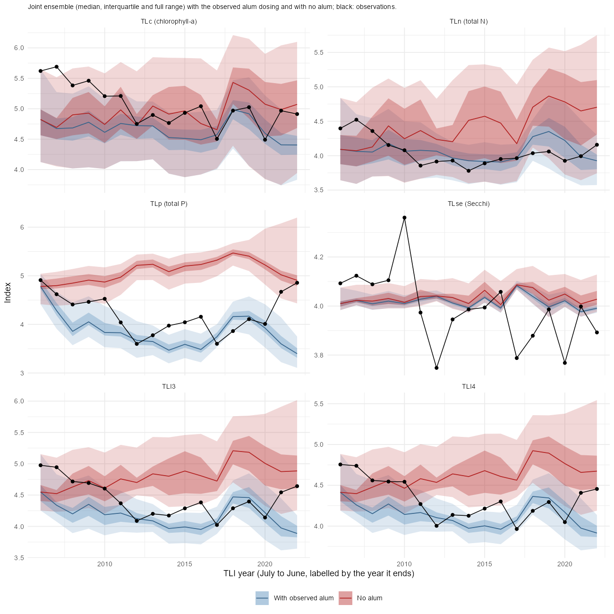
```

```{r}
#| eval: true
#| echo: false
#| tbl-cap: "Mean TLI by period: observed and ensemble mean with and without alum."
t <- read.csv("data/historical/tli_by_period.csv"); t$src <- factor(t$src, c("Observed", "With observed alum", "No alum")); t <- t[order(t$period, t$src), ]
knitr::kable(data.frame(Period = t$period, Source = t$src, TLc = sprintf("%.2f", t$TLc_mean), TLn = sprintf("%.2f", t$TLn_mean), TLp = sprintf("%.2f", t$TLp_mean), TLse = sprintf("%.2f", t$TLse_mean), TLI3 = sprintf("%.2f", t$TLI3_mean), TLI4 = sprintf("%.2f", t$TLI4_mean)), row.names = FALSE)
```

```{r}
#| eval: true
#| echo: false
#| label: fig-tli-divergence
#| fig-cap: "How far the two scenarios diverge: TLI with alum minus TLI without alum for each component, TLI3 and TLI4, by year (median, interquartile range and full range across members). The two runs are identical before the first dose (2006)."
#| fig-height: 8
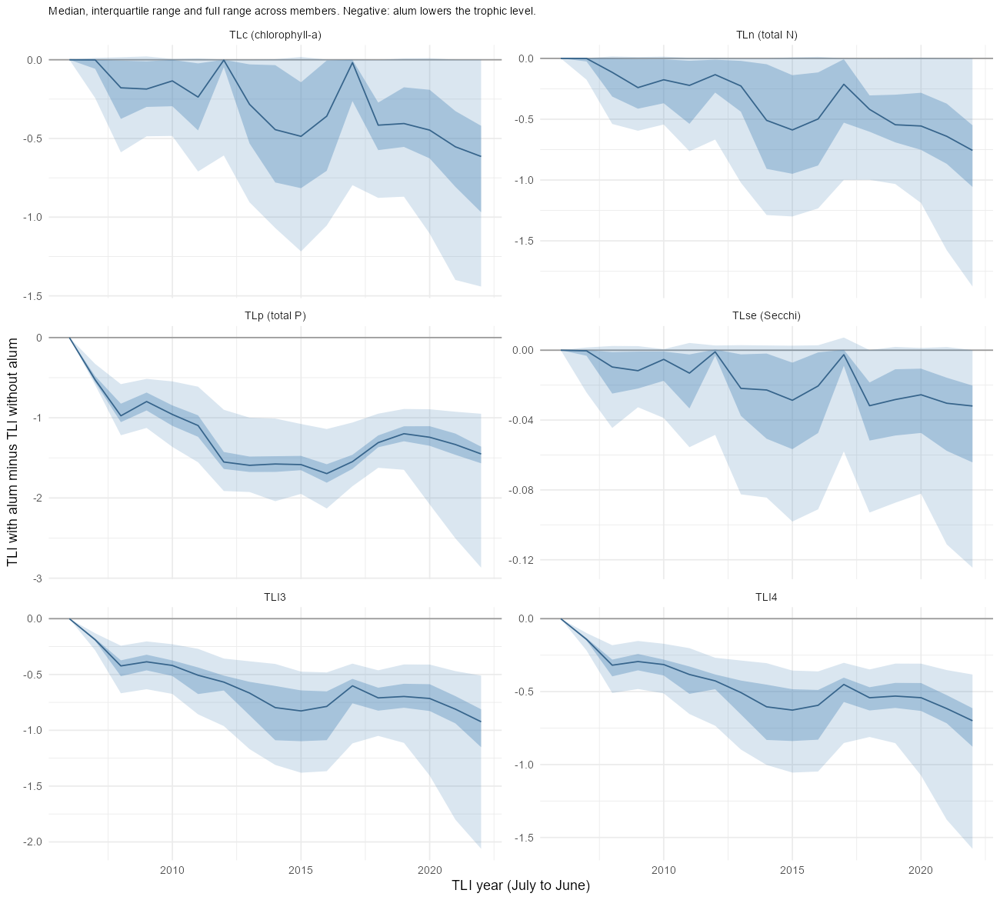
```

```{r}
#| eval: true
#| echo: false
#| tbl-cap: "Divergence between the scenarios (TLI with alum minus TLI without alum), mean by period (member range in brackets)."
d <- read.csv("data/historical/tli_divergence_by_period.csv"); f <- \(v) sprintf("%.2f (%.2f to %.2f)", d[[paste0(v, "_mean")]], d[[paste0(v, "_lo")]], d[[paste0(v, "_hi")]])
knitr::kable(data.frame(Period = d$period, TLc = f("TLc"), TLn = f("TLn"), TLp = f("TLp"), TLse = f("TLse"), TLI3 = f("TLI3"), TLI4 = f("TLI4")), row.names = FALSE)
```

- **Alum lowers TLI4 by about 0.6 units after 2010.** The mean difference is -0.22 in 2006 to 2010, -0.56 in 2011 to 2016 and -0.59 in 2017 to 2022 (members -1.03 to -0.36 in the last period). For TLI3 the difference is -0.77 in 2017 to 2022. Most of it comes from TLp (-1.4 to -1.5 units), then TLn (-0.4 to -0.5) and TLc (-0.3 to -0.4). TLse hardly moves (-0.02 to -0.03).
- **Secchi does not respond in the model.** The simulated Secchi depth changes very little with alum, because the model's light extinction is mostly water and suspended solids, not phytoplankton. So the divergence in TLI4 is a quarter smaller than in TLI3 (the Secchi term is held near 4.0). The observed TLse varies by about ±0.3 from year to year (3.75 to 4.35), which the model does not reproduce. Both are caveats for using TLI4 in the scenarios.
- **Against the observations.** The observed TLI4 is 4.63 in 2006 to 2010 and 4.2 afterwards. The alum ensemble gives 4.25, 4.05 and 4.15, and the no-alum ensemble 4.47, 4.61 and 4.74. The mean TLI4 bias is -0.18 with alum (members -0.40 to +0.07) and +0.29 without (members -0.05 to +0.73). The correlation of the annual TLI4 with the observations is +0.31 with alum (members -0.02 to +0.60) and -0.48 without, so the model without alum has the wrong trend.
- **Where the alum run misses.** TLp is too low in every period (about 0.4 in 2006 to 2010 and 0.3 afterwards, the TP low bias; the outlet data show it starts in the first dosing years, see the Ōhau Channel page), which makes TLI3 and TLI4 too low, and TLc is about 0.8 units too low in 2006 to 2010 (the chlorophyll peaks of those years are missed). Both are in the list of known misses above.
- **Management target.** The strategy page quotes 4.2 as the BOPRC TLI target (to be verified). The observed TLI4 sits close to it in 2011 to 2022. With alum the ensemble is just below it (4.05 to 4.15), and without alum it would be 0.4 to 0.5 units above (4.6 to 4.7).

**How much to trust the observed TLI.** The observed annual values are means of a few snapshots, and the model value is a full-year mean, so we looked at two sources of uncertainty (`calibration/historical/tli_uncertainty.R`). Both use only the dates when each variable was sampled (11 to 13 per TLI year, 8 in 2020; the rule of at least four is never binding).

1. *Sampling error in the model world.* The model was sampled on the observation dates and compared with its own full-year mean (850 member-years per run). This is the effect of the sampling design alone, assuming the model's temporal variability is right (@fig-tli-sampling).
2. *Bootstrap of the observations.* The dates within each TLI year were resampled with replacement (1000 draws) and carried through the TLI formulas. The band in @fig-tli-unc is the 5th to 95th percentile. It reflects the real scatter between sampling dates, so it also tells us how much the sampling pattern could move the annual mean in the real lake.

```{r}
#| eval: true
#| echo: false
#| label: fig-tli-unc
#| fig-cap: "The same comparison as the TLI figure above, with the model sampled on the dates each variable was observed and the observations drawn with their 90% bootstrap interval over sampling dates."
#| out-width: "100%"
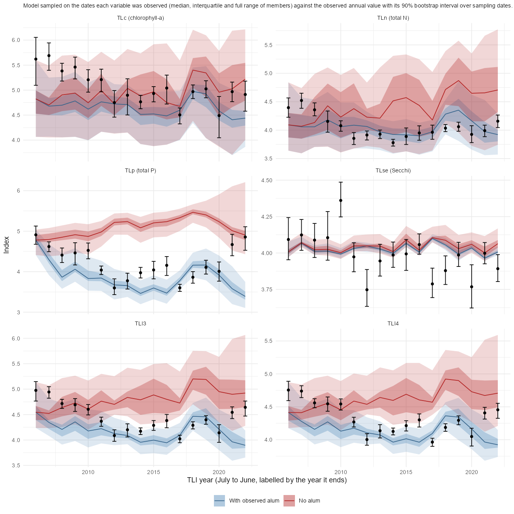
```

```{r}
#| eval: true
#| echo: false
#| label: fig-tli-sampling
#| fig-cap: "Sampling error of the model's annual TLI: the model sampled on the observation dates minus its full-year mean, by year and member."
#| out-width: "85%"
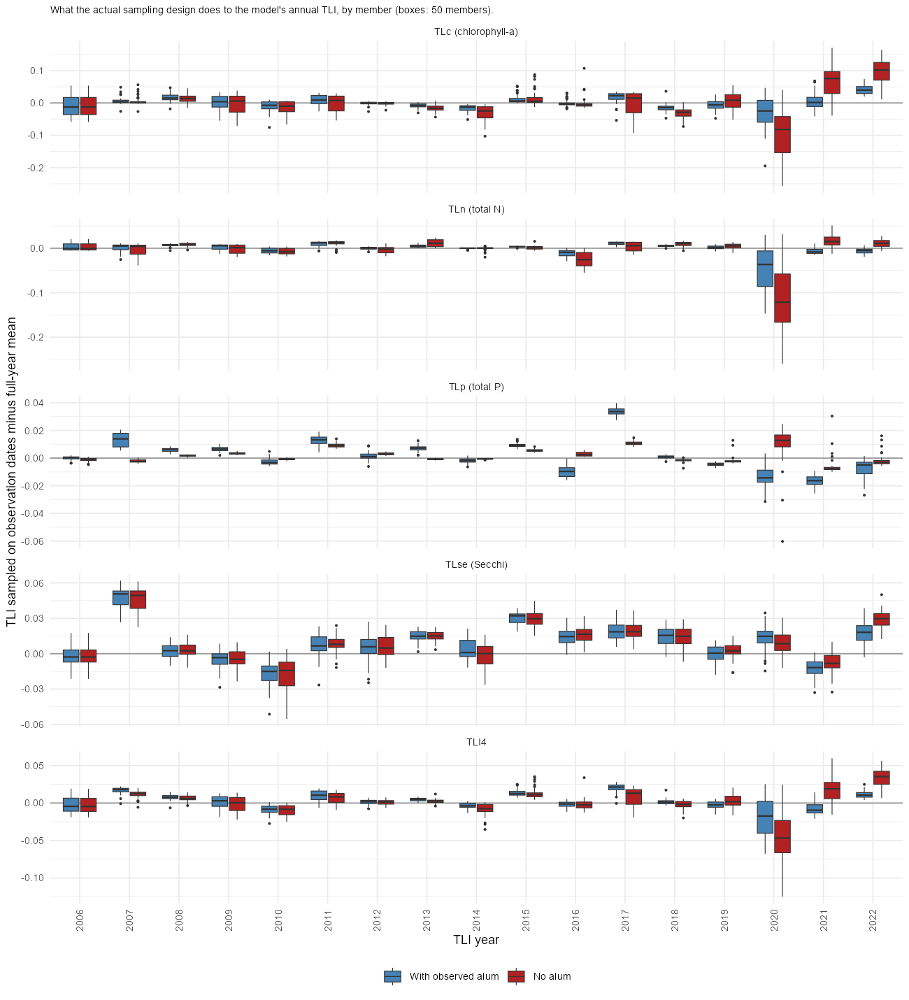
```

```{r}
#| eval: true
#| echo: false
#| tbl-cap: "Uncertainty of the annual TLI: sampling error in the model (sd across member-years) against the sd of the observed annual value from the bootstrap (median across years, and the largest year)."
s <- read.csv("data/historical/tli_sampling_error.csv"); s <- s[s$run == "With observed alum", ]; o <- read.csv("data/historical/tli_obs_bootstrap.csv")
vs <- c("TLc", "TLn", "TLp", "TLse", "TLI3", "TLI4")
knitr::kable(data.frame(Index = vs, `Model sampling error (sd)` = sprintf("%.3f", s$sd_err[match(vs, s$var)]), `Observed bootstrap sd, median` = sprintf("%.3f", sapply(vs, \(v) median(o$sd[o$var == v], na.rm = TRUE))), `Observed bootstrap sd, largest` = sprintf("%.3f", sapply(vs, \(v) max(o$sd[o$var == v], na.rm = TRUE))), check.names = FALSE), row.names = FALSE)
```

```{r}
#| eval: true
#| echo: false
#| tbl-cap: "Bias and correlation of the ensemble median with the observed annual values (17 TLI years, 2006 to 2022), model sampled on the observation dates. Brackets: 5th to 95th percentile over the observation bootstrap."
k <- read.csv("data/historical/tli_skill_intervals.csv"); k <- k[k$basis == "sampled" & k$var %in% c("TLc", "TLp", "TLI3", "TLI4"), ]; k$var <- factor(k$var, c("TLc", "TLp", "TLI3", "TLI4")); k <- k[order(k$run, k$var), ]
knitr::kable(data.frame(Run = k$run, Index = k$var, Bias = sprintf("%.2f (%.2f to %.2f)", k$bias, k$bias_lo, k$bias_hi), Correlation = sprintf("%.2f (%.2f to %.2f)", k$r, k$r_lo, k$r_hi)), row.names = FALSE)
```

- **The sampling design is not the main problem in the model.** The sampling error is 0.01 to 0.03 for TLI3 and TLI4 (0.03 for TLc with alum, 0.05 without), against observed bootstrap sds of 0.05 to 0.07 (TLc 0.14, TLp 0.12). The one clear exception is 2020 (only 8 dates), where the model sampled on those dates is 0.03 to 0.12 low for TLc and TLn (median of members, with alum and without). Comparing the model sampled on the observation dates with the full-year mean changes the bias and correlation by 0.01 to 0.03, so the earlier comparison was not distorted.
- **The observed annual values are uncertain by roughly the size of the smaller model misses.** The bootstrap sd of the observed TLI4 is 0.05 (up to 0.09) and its 90% band is about ±0.1, which is smaller than the bias in TLp (-0.36) and about half the TLI4 bias (-0.19). Sampling is nearly monthly (11 to 13 dates in every year but 2020, which has 8), so the sparse-data worry applies mainly to 2020 and to a single date's weight in any one year. TLc has the widest band (about ±0.2 to ±0.5), so a 0.2 miss in TLc in any one year cannot be called a miss.
- **The conclusions about bias are firm and the correlation is weak.** With alum the TLI4 bias is -0.19 (-0.20 to -0.16 over the bootstrap), so the low bias is not an artefact of the sampling. The correlation of +0.36 (+0.25 to +0.44) looks narrow only because the bootstrap covers the observations alone. With 17 years the correlation itself has a 95% interval of about -0.15 to +0.72, so it does not distinguish the model from no skill. Without alum the correlation is -0.49 (about -0.79 to -0.01), so the wrong trend is borderline significant. These values are for the ensemble median, so they differ slightly from the member averages above.
- **Observed band against the ensemble range.** With alum, the observed 90% band overlaps the range of the sampled ensemble in 82% of years for TLI3 and TLI4 (TLn 100%, TLc 94%, TLp 76%, TLse 71%), and without alum in 59% (TLp 41%). So alum is needed to explain TLp, and the no-alum ensemble rarely reaches the observations. The observed value itself lies inside the ensemble range in only 59% of years for TLI4, and for Secchi in 18%: the observed Secchi swings (3.75 to 4.35) are well outside what the model produces, even allowing for the sampling band.
- **A limit of this check.** The model sampling error assumes the model's variability in time is realistic. The observed bootstrap sds are several times larger than the model sampling errors (TLc 0.14 against 0.03, TLse 0.06 against 0.02), which suggests the real lake varies more between dates than the model does, so the model sampling error is probably an underestimate of the true one. The bootstrap needs no such assumption but is only as good as the 8 to 13 dates per year.

**P retained because of alum.** The two runs have the same P load, so the P kept in the lake by alum is the drop in P exported at the outlet plus the drop in the water-column TP store (@fig-alum-retention). The outlet export is taken as surface TP times the total inflow volume (evaporation and rain assumed to cancel), so this is an approximation, and P in the sediments is not tracked separately.

```{r}
#| eval: true
#| echo: false
#| label: fig-alum-retention
#| fig-cap: "P retained in the lake because of alum (t P per year; median and range across members). Dashed line: the roughly 16 t P/yr of Hamilton et al. (2015) and ERI 128. 2022 is a part year."
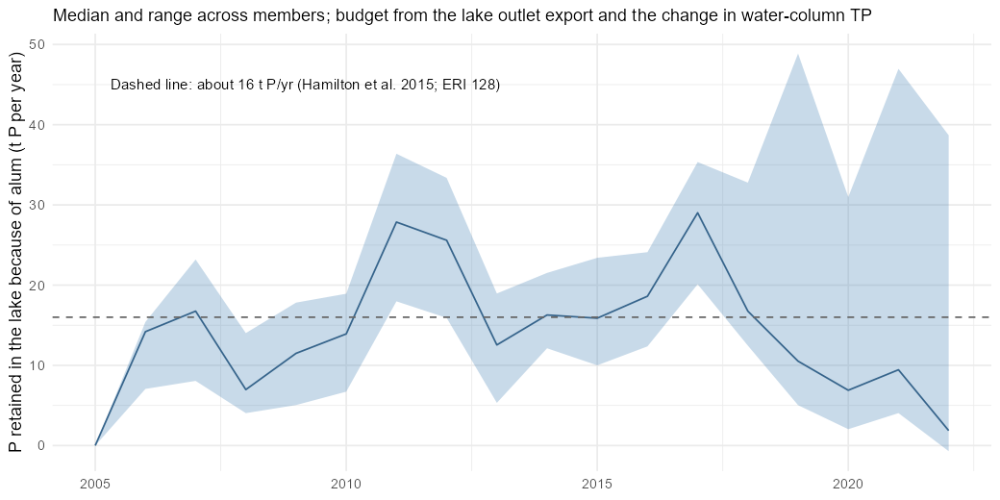
```

- **Retention.** The mean over 2006 to 2022 is 15 t P/yr (members 9 to 23), which agrees with the 16 t P/yr of the reports. Retention peaks in the wet years (28 t in 2011 and 29 t in 2017, medians), when the load is highest, and the median falls in 2019 to 2022 (to 2 t in the part year 2022), with a long upper tail of members. I have not examined why.
- **Where it goes.** About 14 t P/yr of the effect is a lower export through the outlet, and the water-column TP store is 24 t lower by the end (about 12 t instead of 37 t). The model therefore says that alum reduces the P in the water, of which most would otherwise have left through the outlet, and that its main effect is the lower in-lake concentration. This is not an independent check, because the same module and parameters produce both the lake TP and the retention.
- **The late years.** In 2019 to 2022 a few members have no-alum TP up to 0.12 g/m³ (@fig-alum-annual), so the upper end of the alum effect in those years comes from members whose untreated lake keeps accumulating P. The median is more representative.

**Is 50 members enough?** The running mean and the bootstrap interval of the mean effect against the number of members (@fig-alum-conv) show it is for TP and FRP: the mean effect on TP is -59.4% with 20 members and -59.2% with 50, the interval narrows from ±1.7 to ±1.2 percentage points, and FRP is -80.3% and -80.4%. Chlorophyll needs more members (the interval of the mean is -30% to -17% with 20 and -28% to -20% with 50), and the anoxic-day effect is within the noise at any size. (The convergence figure averages the member-level percentage effects, so its chlorophyll mean, -24%, differs slightly from the -29% of the ensemble means in the table.) For the TP and FRP effect, 20 members would have been enough; 50 is needed only to pin down the chlorophyll effect. The members are the best 50 of 100 by objective, so the spread reflects the posterior ensemble and not the alum parameters or the stream binding fractions, which are fixed.

```{r}
#| eval: true
#| echo: false
#| label: fig-alum-conv
#| fig-cap: "Mean alum effect against the number of ensemble members (members ranked by objective): line is the mean of the first n members, band is the 95% bootstrap interval of the mean for n members."
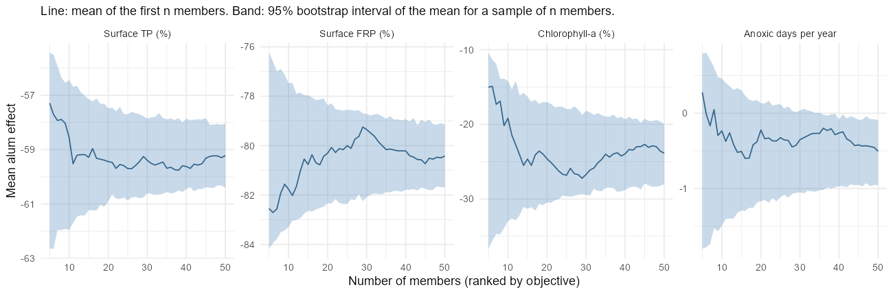
```

### Nutrient budgets and the outflow, alum on and off {#sec-budget-pair}

This section uses the best member of the joint stage (member 46) alone, run for 2003 to 2022 on the updated AEME (0.4.1, `dev`) and GLM-AED, once with the observed alum dosing and once with no alum (`calibration/historical/budget_outflow_pair.R`). It uses the GLM mass balance output in two ways. `AEME:::diag_glm_budget()` and `plot_glm_budget()` give the carbon, nitrogen and phosphorus budget (2005 to 2022; the spin-up is left out). `AEME::aeme_to_inflow()` gives the outflow: the flow and the flow-weighted concentration of the water that left the lake. The outflow is compared with the measured Ōhau Channel discharge (from October 2010) and the Ōhau lab results (see the [Ōhau Channel page](ohau-channel-water-quality.qmd), including its open item on a possible laboratory change). TP and TN include the refractory offsets used in the calibration. Nitrogen and phosphorus only are discussed: the carbon budget does not close because inorganic carbon is outside the pool.

```{r}
#| eval: true
#| echo: false
#| label: fig-budget-pair-boxes
#| fig-cap: "Phosphorus and nitrogen budgets (mean kg per year, 2005 to 2022) of the best member."
#| fig-subcap: ["Phosphorus, with observed alum", "Phosphorus, no alum", "Nitrogen, with observed alum", "Nitrogen, no alum"]
#| layout-ncol: 2
knitr::include_graphics(c("images/budget/glm_budget_P.png", "images/budget/glm_budget_P_noalum.png", "images/budget/glm_budget_N.png", "images/budget/glm_budget_N_noalum.png"))
```

```{r}
#| eval: true
#| echo: false
#| label: fig-budget-pair-closure
#| fig-cap: "Boundary terms of the whole-lake P and N budgets with and without alum."
#| out-width: "90%"
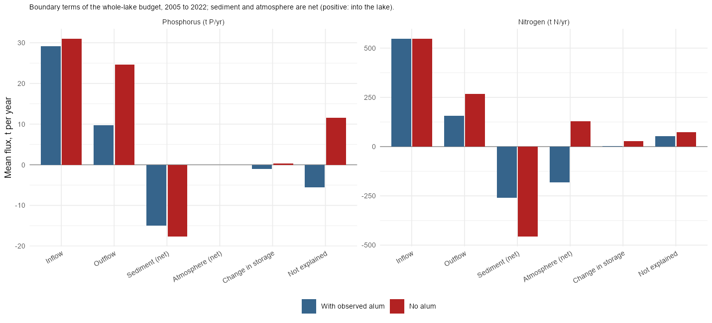
```

```{r}
#| eval: true
#| echo: false
#| tbl-cap: "Boundary terms of the budgets (t per year, 2005 to 2022). 'Not explained' is the part of the change in storage that the diagnostics do not account for."
b <- read.csv("data/budget/budget_closure_pair.csv", check.names = FALSE); b <- b[b$term %in% c("inflow", "outflow", "sediment", "atmosphere", "d_storage", "residual"), ]
tl <- c(inflow = "Inflow", outflow = "Outflow", sediment = "Sediment (net)", atmosphere = "Atmosphere (net)", d_storage = "Change in storage", residual = "Not explained"); b$term <- factor(tl[b$term], tl); b <- b[order(b$element, b$term), ]
knitr::kable(data.frame(Element = b$element, Term = b$term, `With alum` = sprintf("%.1f", b$`With observed alum` / 1000), `No alum` = sprintf("%.1f", b$`No alum` / 1000), Difference = sprintf("%+.1f", b$difference / 1000), check.names = FALSE), row.names = FALSE)
```

```{r}
#| eval: true
#| echo: false
#| label: fig-budget-pair-fluxes
#| fig-cap: "Internal process fluxes of the P and N budgets with and without alum (absolute size)."
#| out-width: "90%"
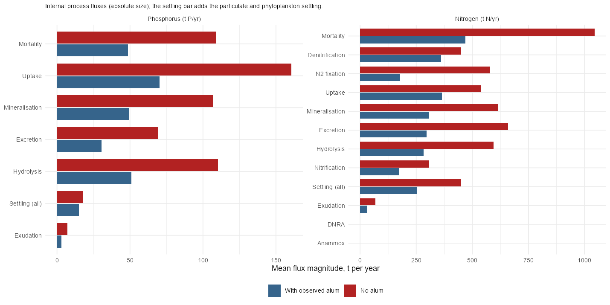
```

- **Alum cuts the P leaving the lake by 61%.** The mean P export is 9.7 t P/yr with alum and 24.6 t P/yr without. Inflow is 29.1 against 31.0 t P/yr: the 1.9 t difference is the P that the in-stream reaction turns into alum-bound P (`ALU_alp`), which the P budget does not count as an inflow. The N export falls by 42% (157 against 269 t N/yr).
- **Internal cycling halves.** P uptake is 70 t P/yr with alum and 161 t without, and mortality, hydrolysis and mineralisation fall in the same proportion. The N cycle is also about half, and N2 fixation is 179 against 580 t N/yr. The atmosphere is a net N sink with alum (-181 t N/yr, denitrification over fixation) and a net source without it (+130 t N/yr), which fits the larger N export in the no-alum run.
- **The budgets do not close, and the gap changes sign for P.** The unexplained P is -5.5 t P/yr with alum and +11.5 t without; for N it is +54 and +74 t N/yr. These are 7 to 8% of the P uptake in both runs, inside the 3 to 13% of gross primary production that the AEME documentation reports as left over by the production terms. The alum module's removal of P into `ALU_alp` is not one of the budget's P pools, which could explain part of the negative value with alum, but this was not tested and does not explain the positive value without alum. Read the budgets to about ±10 t P/yr, not finer.

```{r}
#| eval: true
#| echo: false
#| label: fig-outflow-pair-conc
#| fig-cap: "Flow-weighted outflow concentration from the GLM mass balance, with and without alum (lines), and the Ōhau Channel lab samples (points). Dashed lines: dosing starts."
#| out-width: "85%"
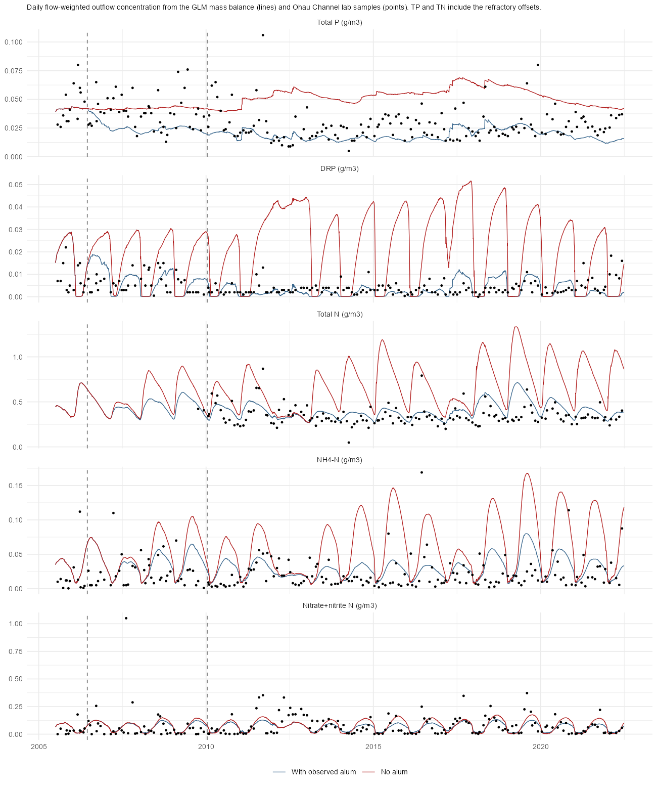
```

```{r}
#| eval: true
#| echo: false
#| tbl-cap: "Modelled outflow concentration against the Ōhau Channel lab samples on the sampling dates: observed and simulated medians, the bias in the mean and the correlation (TN for 2005 to 2010 has 14 samples)."
s <- read.csv("data/budget/outflow_conc_pair.csv", check.names = FALSE); s <- s[s$period != "All" & s$variable != "Water Temp", ]; s$variable <- factor(s$variable, c("TP", "DRP", "TN", "NH4-N", "NNN")); s <- s[order(s$variable, s$period, s$run), ]
a <- s[s$run == "With observed alum", ]; n <- s[s$run == "No alum", ]
knitr::kable(data.frame(Variable = a$variable, Period = a$period, n = a$n, `Observed median` = signif(a$obs_median, 3), `Alum: median` = signif(a$sim_median, 3), `Alum: bias` = sprintf("%+.0f%%", a$bias_pct), `Alum: r` = sprintf("%.2f", a$r), `No alum: median` = signif(n$sim_median, 3), `No alum: bias` = sprintf("%+.0f%%", n$bias_pct), `No alum: r` = sprintf("%.2f", n$r), check.names = FALSE), row.names = FALSE)
```

```{r}
#| eval: true
#| echo: false
#| label: fig-outflow-pair-loads
#| fig-cap: "Annual TP and TN export through the outlet, 2011 to 2021: the model with and without alum, and a rough observed estimate (the lab samples times the same-day measured flow, scaled to a year)."
#| out-width: "85%"
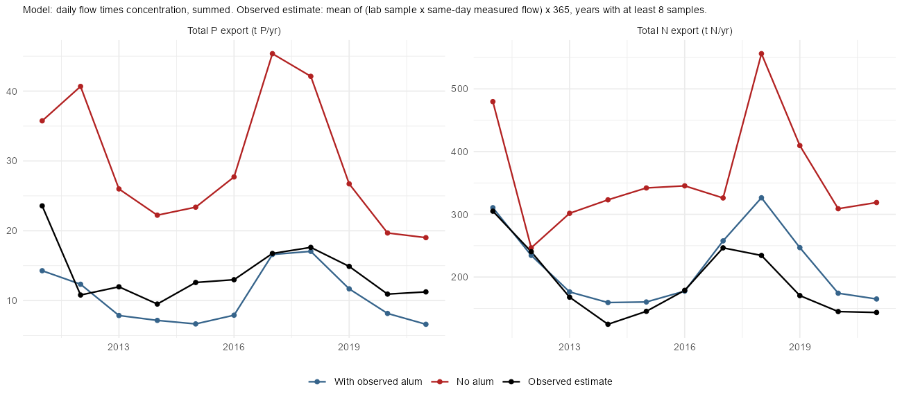
```

```{r}
#| eval: true
#| echo: false
#| tbl-cap: "Mean annual export through the outlet, 2011 to 2021 (t per year)."
l <- read.csv("data/budget/outflow_loads_pair.csv"); m <- aggregate(kg ~ variable + run, l, mean); w <- reshape(m, idvar = "variable", timevar = "run", direction = "wide")
knitr::kable(data.frame(Element = c("Total P", "Total N")[match(w$variable, c("TP", "TN"))], `With alum` = sprintf("%.1f", w$`kg.With observed alum` / 1000), `No alum` = sprintf("%.1f", w$`kg.No alum` / 1000), `Observed estimate` = sprintf("%.1f", w$`kg.Observed estimate` / 1000), check.names = FALSE), row.names = FALSE)
```

- **The outflow volume is right and does not depend on alum.** Against the measured discharge from October 2010 the model has a correlation of 0.97, a bias of -0.6% and a Nash-Sutcliffe efficiency of 0.93 in both runs (the two runs differ by at most 0.05 m³/s). The flow is not tested before 2010.
- **The alum run is much closer to the outlet data than the no-alum run.** Without alum the model's TP is right before 2010 (+5%) but 108% too high afterwards, TN is 106% too high and the mean DRP is almost 6 times the observed mean. With alum the RMSE falls by half or more for TP, DRP, TN and NH4-N in 2011 to 2022 (for example TN from 0.45 to 0.13 g/m³). Nitrate and temperature are similar in the two runs.
- **The annual export agrees with a rough estimate from the data.** From 2011 to 2021 the observed estimate is 13.9 t P/yr and 191 t N/yr. The alum run gives 10.6 t P/yr (24% low) and 217 t N/yr (14% high), and the no-alum run gives 29.9 t P/yr (more than twice the estimate) and 360 t N/yr (88% high). The alum run follows the estimated year-to-year pattern for N and in 2017 to 2018 for P, and it is too low in 2013 to 2016. The estimate itself uses one sample a month, so it is rough.
- **The early-dosing TP shortfall is repeated here.** With alum the outflow TP is 30% below the lab samples in 2005 to 2010, while the no-alum run matches them. This is the result found with the whole ensemble: the model removes P faster than the outlet data show in the first years of dosing.
- **Caveats.** This is one parameter set (the best member), not the ensemble, so the percentages differ a little from the ensemble figures above. The correlations between modelled and sampled values are weak for every nutrient except nitrate (0.4 to 0.5), so the comparison is about levels and not about individual dates.

::: {.callout-warning title="Placeholder: aluminium fate (ERI 178)"}
The P budget above is done, and the simulated alum pools are now summarised (@sec-alum-fate): at the end of the run the settled pools hold about 0.6 t Al in all, and about 0.7 t Al/yr (1.4% of the dose) leaves through the outlet (from the surface-layer concentration). The comparison with the ERI 178 sediment survey (no accumulation in the main basin) still needs the survey's aluminium values for the main basin.
:::

### Alum applied per P removed, and the fate of alum and P {#sec-alum-fate}

This section sets the aluminium applied against the phosphorus it removes, for the streams and for the lake separately, and follows the alum and the bound P through the lake module. It uses the same best member as the budget above (member 46 of the joint stage, new AEME and GLM-AED, alum on, 2006 to 2022-06; `calibration/alum/50_alum_fate.R`). Ratios are mol of aluminium per mol of P unless a mass ratio is stated; the module carries capacity in mmol P, which is mmol Al because the capacity ratio is 1 (@sec-alum-setup).

#### Streams: the dose and what it removed {#sec-alum-fate-streams}

The dose is the capacity concentration of the dosed inflows (`ALU_ala` + `ALU_alp`), and the removal in the stream step is the `ALU_alp` that the step creates (@sec-fractionation). The second estimate is the observed removal: the untreated minus the treated DRP series of the inflow files, which is a measurement for the Utuhina and, for the Puarenga, a series built with the McIntosh ramp and a 90% cap (see @sec-open), so it is not independent there.

```{r}
#| eval: true
#| echo: false
#| label: tbl-fate-streams
#| tbl-cap: "Alum applied and P removed in the stream step on dosed days (Utuhina from 2006, 2006 to 2022; Puarenga from 2010). Fraction: share of the inflow DRP on those days that was removed."
s <- read.csv("data/alumfate/stream_totals.csv")
knitr::kable(data.frame(Stream = s$stream, `Dosed days` = s$days, `Al applied (t)` = sprintf("%.0f", s$Al_t), `Inflow DRP (t P)` = sprintf("%.1f", s$frp_in_t), `P removed, stream rule (t)` = sprintf("%.1f", s$B_t), `P removed, observed (t)` = sprintf("%.1f", s$obs_drp_rem_t), `Fraction removed (rule, observed)` = sprintf("%.0f%%, %.0f%%", 100 * s$f_model, 100 * s$f_obs), `Al:P (rule)` = sprintf("%.0f", s$ratio_model), `Al:P (observed)` = sprintf("%.0f", s$ratio_obs_drp), check.names = FALSE))
```

- **About 30 mol of aluminium were applied for each mol of P removed in the streams.** Over 2006 to 2022 the two streams received 857 t Al (52 t Al/yr) and the stream step removed 32.8 t P (2.0 t P/yr). The ratio is 33 for the Puarenga and 27 for the Utuhina, in the stream rule and in the observed removal alike. In mass, that is about 26 g Al per g P (29 for the Puarenga and 24 for the Utuhina; mol ratio × 26.98 / 30.974).
- **The ratio is far above the thesis values.** The Sanila thesis gives 0.7:1 in the jar test and about 7:1 for field dosing in the streams (@sec-alum-params). The stream ratio is about four times the operational figure and 40 times the jar-test figure. Only the lowest dose days come near it (below).
- **The ratio is set by the dose ratio of the day.** Removal does not rise as fast as the dose, so each extra mol of Al removes less P (@fig-fate-ratio-R). With the Utuhina rule (a constant 45% removed) the ratio is the day's dose ratio divided by 0.45: 2.7 below `R` = 2, 8 at 2 to 5, 17 at 5 to 10, 31 at 10 to 23 and 66 to 150 above that (observed: 2.7, 7.9, 20, 31, 51 and 118). For the Puarenga the rule ramps with `R` up to a 90% cap at `R` = 23, so the ratio is flat at 26 below 23 and rises to 35 and 72 above (observed: 6, 21, 22, 27, 36 and 73).
- **Most of the Al is applied at high dose ratios.** 98% of the Puarenga Al and 74% of the Utuhina Al went out on days with `R` above 10, where the ratio is 27 or more. Only the Utuhina days at `R` of 2 to 5 come near the 7:1 field figure (8), and they carry 3% of its Al.

```{r}
#| eval: true
#| echo: false
#| label: fig-fate-ratio-R
#| fig-cap: "Al applied per P removed in the stream step against the dose ratio of the day (mol Al per mol inflow DRP), by stream: the stream rule (dashed) and the observed removal of the inflow files (solid). Dotted lines: the jar-test and field ratios of the Sanila thesis."
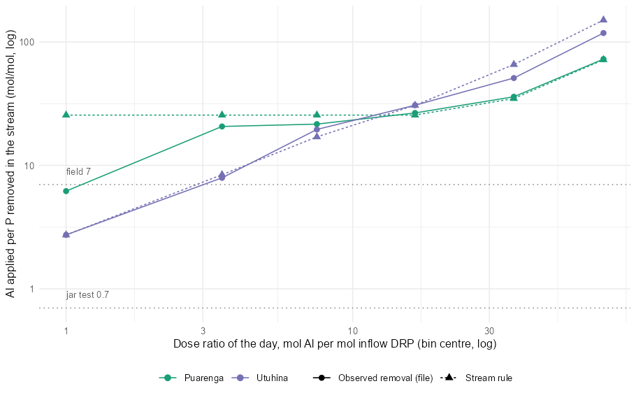
```

```{r}
#| eval: true
#| echo: false
#| label: fig-fate-stream-annual
#| fig-cap: "Alum applied (t Al/yr) and P bound in the stream step (t P/yr) by calendar year and stream. Years with few dosed days (the Puarenga in 2019, none dosed; 2020, 39 days; the Utuhina in 2012, 119 days) are partial."
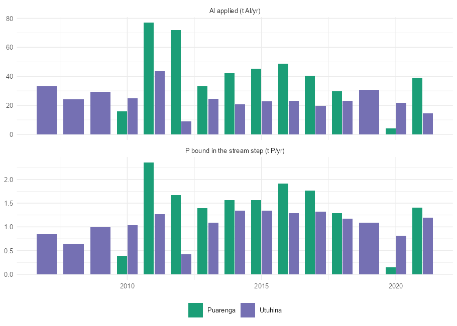
```

#### The lake: ratio and where the alum goes {#sec-alum-fate-lake}

Only part of the dose is used by the streams: the stream step took 28.5 t of the 857 t Al (3%). The other 829 t (50 t Al/yr) reached the lake as free capacity. In the lake the module binds FRP in the water (`ALU_uptake_w`) and at the bed (`ALU_uptake_s`), so the ratio in the lake is the capacity delivered per P those two processes bind.

```{r}
#| eval: true
#| echo: false
#| label: tbl-fate-ratios
#| tbl-cap: "Al applied per P removed, by estimate. The first rows use the model's uptake diagnostics; the last two compare the same Al dose with the P-budget effect of alum (the alum and no-alum runs of the budget section above)."
r <- read.csv("data/alumfate/ratios.csv"); b <- read.csv("data/alumfate/budget_crosscheck.csv")
tb <- data.frame(Basis = c("Streams, stream step (stream rule)", "Lake: free capacity delivered per P bound by uptake", "Whole system: Al applied per P bound (streams + lake)", "Whole system: Al applied per reduction in P export, alum vs no alum", "Whole system: Al applied per difference in unexplained P between the runs"),
  `P removed (t P/yr)` = c(sprintf("%.1f", 32.8 / 16.49), sprintf("%.1f", 10.4), sprintf("%.1f", b$value[2]), sprintf("%.1f", b$value[3]), sprintf("%.1f", b$value[4])),
  `Al:P (mol/mol)` = c(sprintf("%.1f", r$ratio[1]), sprintf("%.1f", r$ratio[3]), sprintf("%.1f", r$ratio[4]), sprintf("%.1f", b$value[6]), sprintf("%.1f", b$value[7])), check.names = FALSE)
knitr::kable(tb)
```

- **In the lake the ratio is about 5.5.** 50 t Al/yr arrive as capacity and the uptake diagnostics bind 10.4 t P/yr (10.2 in the water column and 0.2 at the bed), so 5.5 mol Al per mol P bound. The lake is therefore about five times more efficient than the stream step, per mol of Al.
- **Over the whole system about 3.5 to 5 mol Al go in per mol P removed.** The uptake diagnostics give 4.8 (12.4 t P/yr bound in the streams and the lake), the reduction in P export gives 4.0 (14.9 t P/yr) and the difference in the budget's unexplained P gives 3.5 (17 t P/yr). In mass, 3.1 to 4.2 g Al per g P. This is below the 7:1 field figure of the thesis but far above 0.7:1, and it is about a sixth of the stream-step ratio, because the lake binds most of the P.
- **The three estimates differ by about 40%**, and the uptake diagnostics are the lowest estimate of the P removed (next subsection), so the diagnostic ratio of 4.8 is the upper end of the range.

```{r}
#| eval: true
#| echo: false
#| label: tbl-fate-capacity
#| tbl-cap: "Fate of the alum capacity, 2006 to 2022. Top: what was applied and delivered (t Al per year, per cent of the 52 t Al/yr applied). Bottom: how the water column's losses of capacity divide between routes (rates times pool, from the module source; the losses sum to 22% more than the capacity input, see the text)."
f <- read.csv("data/alumfate/fate_totals.csv"); pc <- read.csv("data/alumfate/pelagic_capacity_fate.csv"); g <- function(q) f$t_per_yr[f$quantity == q]
a <- c(g("Al applied to the dosed streams"), g("Al used in the stream step (bound P)"), g("Al delivered to the lake as free capacity (ALU_ala)"))
tb <- data.frame(Route = c("Applied to the streams", "Bound in the stream step", "Delivered to the lake as free capacity", "Water column losses: ageing (lost reactivity)", "Water column losses: settling to the bed", "Water column losses: binding P (uptake)", "Water column losses: out through the outlet"),
  Amount = c(sprintf("%.1f t Al/yr (100%%)", a[1]), sprintf("%.1f t Al/yr (%.0f%%)", a[2], 100 * a[2] / a[1]), sprintf("%.1f t Al/yr (%.0f%%)", a[3], 100 * a[3] / a[1]), sprintf("%.0f%% of the losses", 100 * pc$share)))
knitr::kable(tb)
```

The module does not output its ageing, settling, burial and resuspension fluxes. The pelagic and benthic uptake are diagnostics. Ageing, burial and resuspension are the rate times the pool (`k_age` x pool and so on, from the module source), and settling is the closure of the benthic balance. @tbl-fate-capacity is that reconstruction.

- **Most of the capacity ages out before it does anything.** In the water column about 57% of the capacity lost leaves by ageing (`k_age_w` = 0.39 d⁻¹, four times the default and not constrained by data), 28% settles to the bed and 14% is used to bind P. About 1% leaves through the outlet.
- **The bed is a sink, not a store.** Settled capacity is lost at 0.063 d⁻¹ by ageing, 0.129 d⁻¹ by burial and 0.011 d⁻¹ by resuspension: of each unit, 63% is buried, 31% ages out and 6% is resuspended. The settled pools are small: at the end of the run 0.20 t Al of capacity and 0.49 t P of bound P (about 0.6 t Al in all), which turn over in days.
- **The fate fractions depend on parameters the data do not pin down.** `k_age_w`, `k_bur` and `w_ala` are the three that set it (10 to 90% of the `p4` ensemble: 0.06 to 0.73 d⁻¹, 0.005 to 0.14 d⁻¹ and 0.3 to 4.4 m/d; @sec-param-alum). The sensitivity screen found `k_age_w` the first driver of the alum in the water (@sec-sens-targets). Read the split as the structure of the best member, not a measurement.

#### Fate of the P that alum binds {#sec-alum-fate-p}

@fig-fate-diagram shows the whole-simulation fate of the alum and of the P it binds, in the style of the nutrient budgets above (@fig-budget-pair-boxes). The binding fluxes are model diagnostics; settling, resuspension, ageing and burial are the reconstruction described below, so the water column arrows do not balance (red note in each panel).

```{r}
#| eval: true
#| echo: false
#| label: fig-fate-diagram
#| fig-cap: "Fate of the alum (member 46, 2006 to 2022-06, mean per year)."
#| fig-subcap: ["Aluminium (t Al/yr)", "Phosphorus bound by alum (t P/yr)"]
#| layout-ncol: 1
knitr::include_graphics(c("images/alumfate/fate_diagram_Al.png", "images/alumfate/fate_diagram_P.png"))
```

```{r}
#| eval: true
#| echo: false
#| label: tbl-fate-p
#| tbl-cap: "Phosphorus bound by alum and where it ends, 2006 to 2022 (t P per year). Uptake is from the module diagnostics; the end states are the inflow, outflow, pool change and the rates of the module."
f <- read.csv("data/alumfate/fate_totals.csv"); p <- read.csv("data/alumfate/pools.csv"); yrs <- 16.49; g <- function(q) f$t_per_yr[f$quantity == q]
bound <- g("P bound in total by alum"); out <- g("Bound P out through the outlet"); stor <- (p$end_t[2] + p$end_t[4]) / yrs; net <- bound - out - stor
tb <- data.frame(Route = c("Bound in the stream step", "Bound in the water column", "Bound at the bed", "Total bound by alum", "Leaves through the outlet", "Held in the lake pools at the end (per year of the run)", "Net buried (the module's only permanent sink)"),
  `t P per year` = sprintf("%.2f", c(g("P bound in the stream step"), g("P bound in the water column"), g("P bound in settled alum (benthic uptake)"), bound, out, stor, net)), `Share of P bound` = sprintf("%.0f%%", 100 * c(g("P bound in the stream step"), g("P bound in the water column"), g("P bound in settled alum (benthic uptake)"), bound, out, stor, net) / bound), check.names = FALSE)
knitr::kable(tb)
```

- **Nearly all the P that alum binds ends buried.** Of 12.4 t P/yr bound, 0.2 t (2%) leaves through the outlet as bound P and under 0.1 t/yr is held in the pools, so about 12.2 t P/yr (97%) is buried. Burial is the only way the module removes P for good; the bound P is never released again.
- **Resuspension recycles a small share.** Each time bound P settles, 92% is buried and 8% is resuspended (`k_bur` 0.129 against `k_res` 0.011 d⁻¹). The rate times the pool gives about 2 t P/yr resuspended, which settles again, so resuspension delays the burial and does not change where the P ends.
- **The lake does most of the binding.** 82% of the bound P is bound in the water column, 16% in the streams and under 2% at the bed. Benthic uptake is small because `k_s` is 0.029 d⁻¹ (against 3.4 d⁻¹ in the water).
- **Where the P goes at the lake scale.** In the GLM P budget (@sec-budget-pair) the alum run takes 29.1 t P/yr in and exports 9.7 t P/yr, against 24.6 t P/yr without alum, so alum cuts the export by 14.9 t P/yr (61%). Total uptake by phytoplankton falls from 161 to 70 t P/yr. The unexplained P of the budget moves from +11.5 to -5.5 t P/yr, a difference of 17 t P/yr, which is the size expected if the alum-bound P buried by the module is not one of the budget's pools. The P removed from the export (14.9 t) is therefore of the same size as the P buried in the alum pools (12 to 17 t/yr), within the precision of the budget (about 10 t P/yr); this was inferred from the two runs and not tested directly.

**The reconstruction does not close, so the burial and settling values above are a range and not a measurement.** If the uptake diagnostics are right, 12.4 t P/yr is bound, yet the pool sizes and the module rates give a burial of 22.9 t P/yr and a settling of 24.7 t P/yr, about twice the supply. The pelagic balance of bound P misses by 85% of its inputs and that of capacity by 22%. Three explanations are possible: the diagnostics are instantaneous values at the output time and undercount the daily uptake; the benthic zones return more bound P than the pelagic cells lose; or the day-to-day pulses of the inflow make a daily sum of the pools too crude. The GLM P budget points at 15 to 17 t P/yr, between the 12 t of the uptake diagnostics and the 23 t of the pools. The conclusions that hold in every case are that the bound P is buried, not released, that resuspension is a small recycling term, and that most of the Al capacity never binds P. The absolute rates need the module to write its fluxes.

**To close it:** add diagnostics for deposition, ageing, burial and resuspension (fluxes in mmol per m² per day) to `aed_alum.F90` (`libaed-dev`), rebuild GLM and rerun the best member. That gives a closed alum and P budget for the lake and settles the three explanations above.

### Housekeeping

The run and build folders of stages `q` to `p4` were deleted after the best members and ensembles were saved (about 90 GB). Each stage keeps `step2_best.rds` (best member), `step2_ies.rds` (ensemble history and parameter table) and `step2_table.rds`. The evaluation runs keep `result_*.rds` and `base_*.rds` in `calibration/alum/stream`. The run folders are rebuilt by `step2_build` when a stage is rerun.

## Parameter calibration summary {#sec-param-summary}

This section collects the calibrated parameters by group: what was freed, where the final values sit, and whether the ensemble converged. The final model has 149 parameters. Of these, 40 were free in the joint stage (`j`), the alum and sediment P parameters were set in the alum refits (`p4`), and the rest are held at the values from the earlier stages. The numbers come from the stage ensembles (`step2_ies.rds`), read by `calibration/alum/40_param_summary.R`.

### How to read convergence here

Each stage is an ensemble smoother (ES-MDA): an ensemble of parameter sets is run, scored against the targets, and updated towards lower objective, several times. Two things can converge, and they do not have to go together:

- **The objective** converges when the ensemble members all score about as well as the best one.
- **The parameters** converge when the ensemble narrows towards one place in the allowed range, which means the targets identify them. If the objective converges but the parameters do not, many different parameter sets fit equally well (equifinality).

In the figures below, the band is the 10 to 90% range of the ensemble by iteration (iteration 0 is the prior), and the red point is the best member at the end. A parameter that is identified shows a band that narrows and a median that settles; a parameter that is not identified keeps a band as wide as the prior.

### Joint stage: all groups {#sec-param-j}

```{r}
#| eval: true
#| echo: false
#| tbl-cap: "Joint stage (`j`) by group: number of parameters, median reduction in ensemble spread from the prior to the last iteration, parameters whose spread fell by more than 30%, and parameters where the best member sits at a bound (within 5% of the end of the range)."
s <- read.csv("data/calibration/param_summary_group.csv")
knitr::kable(data.frame(Group = s$group, Parameters = s$n, `Median spread reduction` = sprintf("%.0f%%", 100 * s$median_shrink), `Reduced by more than 30%` = s$n_shrink_gt_30, `Best member at a bound` = s$n_best_at_bound, check.names = FALSE))
```

```{r}
#| eval: true
#| echo: false
#| label: fig-group-conv
#| fig-cap: "Convergence of the joint stage. Left: ensemble spread by group (median over the group's parameters of the ensemble standard deviation relative to the prior). Right: the calibration-window objective by iteration (log axis): best member and ensemble median with the interquartile band."
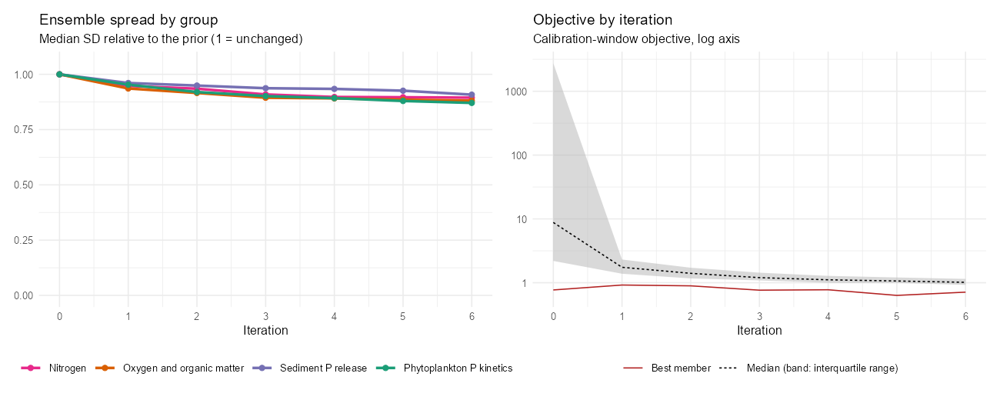
```

- **The objective converges, the parameters do not.** The ensemble median objective fell from 8.8 to 1.0 and the interquartile range from 2.2 to 2700 down to 0.93 to 1.15 (@fig-group-conv), so by the last iteration the middle half of the ensemble scores within about 10 to 15% of the median. The spread of the parameters fell only to 87% (phytoplankton), 88% (oxygen), 89% (nitrogen) and 91% (sediment P) of the prior. The 40 parameters are therefore largely not identified by the targets, and the ensemble is better read as an uncertainty description than as a set of estimates.
- **The best member is one draw, not the centre.** Its objective (0.712) is not the lowest seen (0.634 in iteration 5), and for several parameters it sits away from the ensemble median (for example the oxygen demand of zone 4, at the weak-demand end of its range while the ensemble median is near the middle).
- **Three parameters are at a bound in the best member:** the zone 2 sediment P release (upper), the zone 4 sediment oxygen demand (lower) and the diatom `K_N` (lower). A parameter at a bound means the range is limiting or the parameter is compensating for something else, and these are the ones to look at before widening ranges.

```{r}
#| eval: true
#| echo: false
param_table <- function(g) {
  d <- read.csv("data/calibration/param_summary_j.csv"); d <- d[d$group == g, ]
  desc <- c(R_resp = "Respiration rate (1/d)", K_P = "Half-saturation for P uptake (mmol P/m³)", X_pmin = "Minimum internal P quota (mmol P/mmol C)", X_pmax = "Maximum internal P quota (mmol P/mmol C)",
            fsed_oxy = "Sediment oxygen demand (mmol O₂/m²/d)", ksed_oxy = "Oxygen half-saturation of the sediment demand (mmol O₂/m³)", theta_sed_oxy = "Temperature multiplier, sediment demand", rdom_minerl = "DOM mineralisation rate (1/d)",
            rpoc_hydrol = "POC hydrolysis rate (1/d)", theta_minerl = "Temperature multiplier, mineralisation", fsed_frp = "Sediment FRP release (mmol P/m²/d)", ksed_frp = "Oxygen half-saturation of the FRP release (mmol O₂/m³)",
            theta_sed_frp = "Temperature multiplier, FRP release", rdenit = "Denitrification rate (1/d)", fsed_amm = "Sediment ammonium release (mmol N/m²/d)", fsed_nit = "Sediment nitrate flux (mmol N/m²/d, magnitude)",
            K_N = "Half-saturation for N uptake (mmol N/m³)", rpon_hydrol = "PON hydrolysis rate (1/d)")
  base <- sub(" .*$", "", d$parameter); f <- function(x) as.character(signif(x, 3))
  knitr::kable(data.frame(Parameter = paste0("`", d$parameter, "`"), Meaning = desc[base], Range = paste(f(d$prior_min), "to", f(d$prior_max)), Start = f(d$start), Best = f(d$best),
                          `Ensemble median (10 to 90%)` = paste0(f(d$final_median), " (", f(d$final_q10), " to ", f(d$final_q90), ")"), `Spread reduced` = sprintf("%.0f%%", 100 * d$shrink), `At bound` = ifelse(d$at_bound == "", "", d$at_bound), check.names = FALSE), row.names = FALSE)
}
```

The `Start` column is the `o3` member the joint stage started from (@sec-o3) and the zones z1 to z4 are the four sediment zones of the model.

#### Phytoplankton P kinetics {#sec-param-phyto}

```{r}
#| eval: true
#| echo: false
#| label: tbl-param-phyto
#| tbl-cap: "Phytoplankton parameters (12) of the cyano, green and diatom groups: allowed range, start member, best member and the final ensemble."
param_table("Phytoplankton P kinetics")
```

```{r}
#| eval: true
#| echo: false
#| label: fig-param-phyto
#| fig-cap: "Convergence of the phytoplankton parameters. Band: 10 to 90% of the ensemble; line: median; red point: best member; dashed: start member; dotted: allowed range."
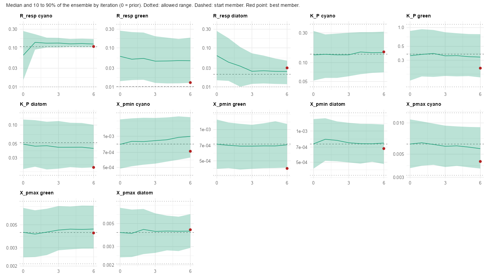
```

Only the respiration rates converge: cyano `R_resp` (81% less spread) moves quickly in the first update and then settles near the start value, diatom `R_resp` (52%) moves down, and diatom `X_pmax` (28%) narrows a little. The half-saturation constants and the minimum P quotas keep a band as wide as the prior. The uptake parameters for P (`K_P`, `X_pmin`) are therefore not identified by the FRP and chlorophyll targets.

#### Oxygen and organic matter {#sec-param-oxygen}

```{r}
#| eval: true
#| echo: false
#| label: tbl-param-oxygen
#| tbl-cap: "Oxygen and organic-matter parameters (9)."
param_table("Oxygen and organic matter")
```

```{r}
#| eval: true
#| echo: false
#| label: fig-param-oxygen
#| fig-cap: "Convergence of the oxygen and organic-matter parameters (as @fig-param-phyto)."
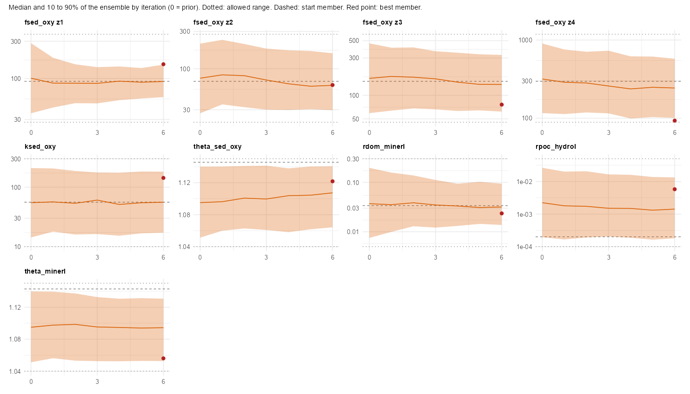
```

The zone 1 sediment oxygen demand (54% less spread) and the DOM mineralisation rate (40%) are constrained,, and the ensemble median of the zone 2 to 4 demands drifts down slowly. The other demands, the oxygen half-saturation, the POC hydrolysis rate and both temperature multipliers keep most of the prior width. The best member sits at the lower bound for the zone 4 demand.

#### Sediment P release {#sec-param-phosphorus}

```{r}
#| eval: true
#| echo: false
#| label: tbl-param-phosphorus
#| tbl-cap: "Sediment P release parameters (6)."
param_table("Sediment P release")
```

```{r}
#| eval: true
#| echo: false
#| label: fig-param-phosphorus
#| fig-cap: "Convergence of the sediment P release parameters (as @fig-param-phyto)."
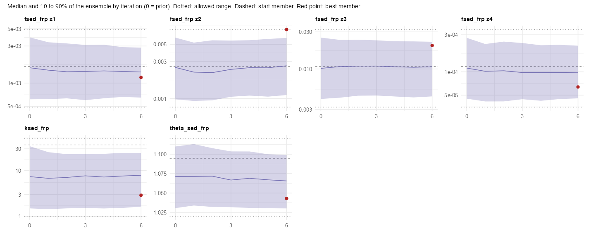
```

None of the six is identified (at most 13% less spread), and the zone 2 release in the best member is at the upper bound of its range. Sediment P release was already fitted in the alum refits, where it also did not narrow (@sec-param-alum), so the sediment P release is poorly constrained by the lake P record in both stages.

#### Nitrogen {#sec-param-nitrogen}

```{r}
#| eval: true
#| echo: false
#| label: tbl-param-nitrogen
#| tbl-cap: "Nitrogen parameters (13)."
param_table("Nitrogen")
```

```{r}
#| eval: true
#| echo: false
#| label: fig-param-nitrogen
#| fig-cap: "Convergence of the nitrogen parameters (as @fig-param-phyto)."
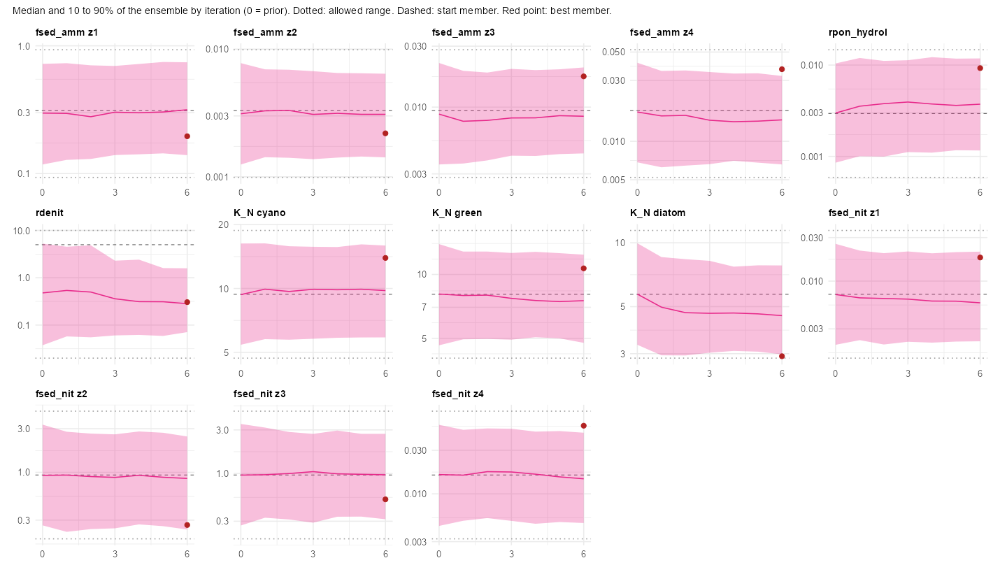
```

Only the denitrification rate narrows (32% less spread), and the best member (0.31 d⁻¹) is far below the start value (5 d⁻¹). The sediment ammonium and nitrate fluxes, `K_N` and PON hydrolysis stay close to the prior. The diatom `K_N` in the best member is at the lower bound. The earlier finding that these parameters moved total N past the observations (@sec-joint-results) fits this picture: they are weakly identified and respond to the cyano `R_resp` trade-off more than to the nitrogen targets.

### Alum stage (`p4`) {#sec-param-alum}

The alum refit freed 14 parameters (the 8 alum parameters and 6 sediment P release parameters) on 48 members for 4 updates, from the stage `q` member with the V1 inflows (@sec-refit). The objective changed little: the best member went from 0.579 to 0.577 and the ensemble median from 1.16 to 0.65.

```{r}
#| eval: true
#| echo: false
#| label: fig-param-alum
#| fig-cap: "Convergence of the alum-stage parameters (stage `p4`; band: 10 to 90% of the ensemble; line: median; red point: best member; dotted: allowed range)."
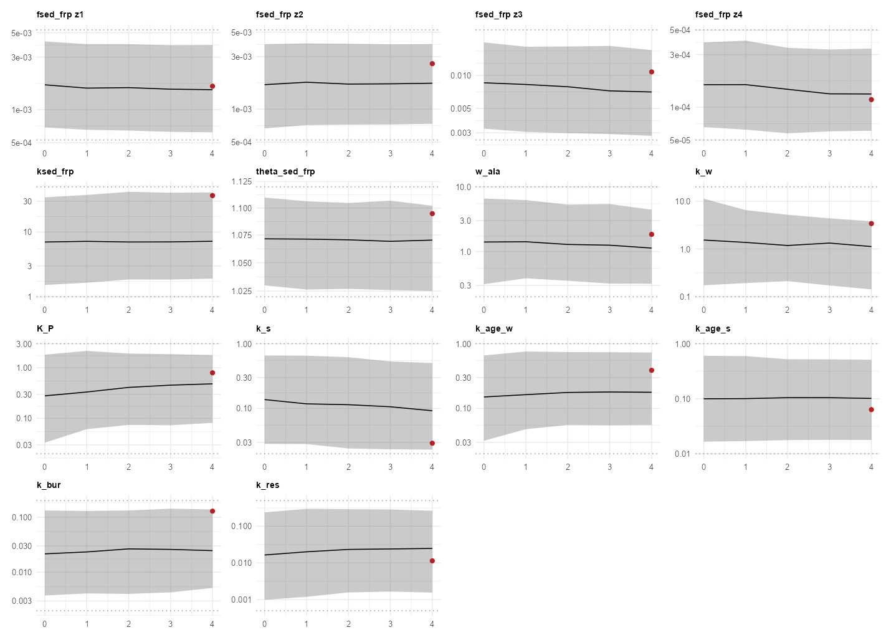
```

No parameter is identified: the largest reductions in spread are 17% (`k_w` and `K_P`) and 11% (`k_age_w`), and all the others are below 6%. The best member sits at 90% of the range for `k_bur` and 92% for `ksed_frp`, and at 10% for `k_s`. The values and their comparison with the thesis are in @tbl-alum-params.

### Parameters held fixed

```{r}
#| eval: true
#| echo: false
#| label: tbl-param-fixed
#| tbl-cap: "Physics and particulate P parameters held fixed through the biogeochemical stages. Wind speed is measured and not scaled (`MET_wndspd` = 1); the heat-flux and mixing coefficients carry the compensation."
f <- read.csv("data/calibration/param_summary_fixed.csv"); f <- f[f$class != "Other biogeochemistry", ]
knitr::kable(data.frame(Group = f$class, Parameter = paste0("`", f$parameter, "`"), Value = as.character(signif(f$value, 4))), row.names = FALSE)
```

The other 65 fixed parameters (the alum parameters of @sec-alum-params, nitrification, sediment kinetics for ammonium and nitrate, remaining phytoplankton traits, suspended-solids settling and similar) are at the values of the earlier stages and the reference configuration.

## Sensitivity analysis on the latest setup {#sec-sens}

The calibration shows which parameters the ensemble could narrow. It does not show which parameters the targets respond to. A Morris screen answers that, so it was rerun on the latest setup after the joint stage. This section reports the result and sets it against the calibration (@sec-param-summary). The scripts are `calibration/sa/sa_latest.R` (the runs), `sa_latest_eval.R` (the outputs of each run), `sa_latest_analyse.R` (the statistics and figures) and `sa_compare.R` (the comparison with the calibration).

### Design

- **Base point.** The joint-stage best member (`step2j`), with the V1 inflows, the flood x 0.5 base, the alum module on, and the same window as the calibration (2005-01 to 2022-06).
- **Parameters.** 142 parameters varied over the ranges of the sensitivity specification (`sa_spec`): 54 phytoplankton, 25 physics, 25 sediment, 13 organic matter, 8 alum, 8 nitrogen, 7 light and 2 phosphorus. This covers every row of the parameter table that can be varied, plus nitrate release (`fsed_nit`), the settling and resuspension parameters of the suspended solids, the weir crest (`crest_elev`, `crest_factor`) and the sediment temperature. Wind speed is varied over 0.8 to 1.35 times the measured value as a diagnostic, although the calibration holds it at 1.
- **Trajectories.** 30 Morris trajectories on 6 levels, 4,290 runs of about 3 minutes each. Two runs failed and are treated as missing. The earlier screens had 4 to 5 trajectories per parameter on an older base.
- **Outputs.** For each run, about 190 outputs with variation: the 27 residuals of the joint-stage objective in the calibration window (2006-06 to 2018-06) and in the held-out window (2018-07 to 2022-06); the CSPS signatures and state errors; and about 40 summaries in physical units (mean and summer TP, FRP, TN, chlorophyll, light attenuation, bottom oxygen, anoxic days, stratification, production, alum pools, year-to-year TP).
- **Statistics.** The elementary effect is the change in an output for a step in one parameter, with parameters on a 0 to 1 scale across their range. `mu*` is the mean absolute effect over the 30 trajectories, with a 95% bootstrap interval over trajectories. `sigma` is the standard deviation of the effects: when it exceeds `mu*`, the effect depends on where the other parameters are (interaction) or is non-linear.
- **The objective.** The raw objective (mean square of the 27 scaled residuals) has a few blow-up runs where phytoplankton collapse gives residuals in the hundreds, and these swamp the ranking. The ranking therefore uses log10 of the objective, so `mu*` is in decades of the objective over the full range of a parameter. The share quoted below is the parameter's `mu*` as a fraction of the sum over all 142 parameters. It is a relative measure and not a fraction of variance.

### Which parameters matter

```{r}
#| eval: true
#| echo: false
#| tbl-cap: "Sensitivity of the calibration objective by parameter group: number of parameters, share of the summed `mu*`, parameters with a share above 1% and parameters with a share below 0.2%."
g <- read.csv("data/sensitivity/morris_groups.csv")
knitr::kable(data.frame(Group = g$theme, Parameters = g$n, Share = sprintf("%.1f%%", 100 * g$share_of_phi), `Above 1%` = g$n_over_1pct, `Below 0.2%` = g$n_negligible, check.names = FALSE))
```

```{r}
#| eval: true
#| echo: false
r <- read.csv("data/sensitivity/morris_ranking.csv"); r$cum <- cumsum(r$phi_share)
```

Sensitivity is concentrated. 16 parameters carry half of the total, 44 carry 80% and 69 carry 90%, and 66 of the 142 have a share below 0.2% each. Phytoplankton parameters hold 48% of the total, physics 23%, organic matter 8%, sediment 7.5%, alum 6.5%, light 4.6%, nitrogen 2% and phosphorus 0.2%.

```{r}
#| eval: true
#| echo: false
#| label: fig-sens-rank
#| fig-cap: "The 40 most influential parameters for the calibration objective (`mu*` of log10 objective, 95% bootstrap interval over 30 trajectories)."
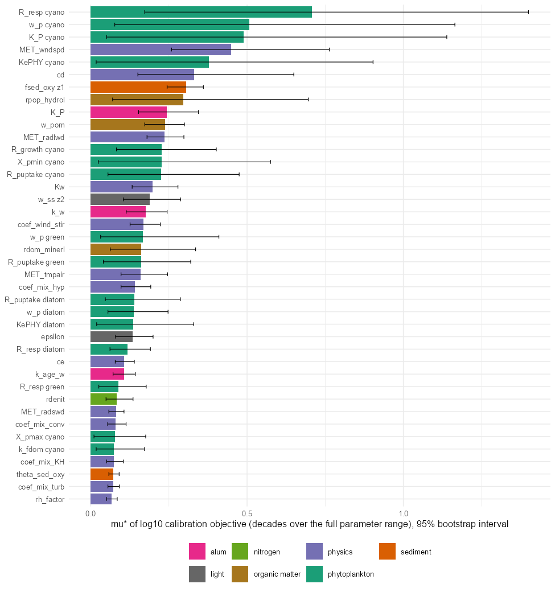
```

```{r}
#| eval: true
#| echo: false
#| label: tbl-sens-top
#| tbl-cap: "The 25 most influential parameters. `mu*` is in decades of the objective over the full range of the parameter. Targets: number of the 27 calibration-window targets that respond strongly (scaled `mu*` above 0.25 with the interval above 0.1). Narrowing: reduction in ensemble spread in the joint stage (blank if the parameter was not free in it)."
j <- read.csv("data/calibration/param_summary_j.csv")
t <- head(r, 25); t$shrink <- j$shrink[match(t$parameter, j$parameter)]
knitr::kable(data.frame(Rank = seq_len(nrow(t)), Parameter = paste0("`", t$parameter, "`"), Group = t$theme, `mu*` = sprintf("%.2f (%.2f to %.2f)", t$phi_mu_star, t$phi_lo, t$phi_hi), Share = sprintf("%.1f%%", 100 * t$phi_share), Targets = t$n_targets_top, Narrowing = ifelse(is.na(t$shrink), "", sprintf("%.0f%%", 100 * t$shrink)), check.names = FALSE))
```

- **Cyanobacteria control the objective.** Seven of the top 14 parameters are cyanobacteria parameters: respiration (`R_resp`), settling (`w_p`), the phosphorus half-saturation (`K_P`), light attenuation by the phytoplankton (`KePHY`), the minimum internal P (`X_pmin`), P uptake (`R_puptake`) and growth (`R_growth`). The diatom and green groups matter far less (the diatom and green `R_resp`, `w_p`, `R_puptake` and `KePHY` are at 0.9 to 1.6% each). The blow-up runs of the raw objective were driven mainly by cyanobacteria settling and the P half-saturation, which is also why the `mu*` intervals of these parameters are wide.
- **Physics is second, and wind is the largest single physical term.** Wind speed (fourth overall), the drag coefficient `cd`, long-wave radiation, the light extinction `Kw`, wind stirring, air temperature, hypolimnetic mixing and the bulk transfer coefficient `ce` all have shares above 1%. They act on temperature, stratification and oxygen (@tbl-sens-targets).
- **Oxygen sensitivity sits in one sediment parameter.** Of the 25 sediment parameters, only zone 1 `fsed_oxy` is above 1% (3.0%). The other three zones' `fsed_oxy` are at about 0.2% each, and the release of ammonium, nitrate and phosphorus are lower still.
- **Alum.** `K_P` (rank 9), `k_w` (17) and `k_age_w` (30) are the alum parameters above 1%. `w_ala`, `k_s`, `k_age_s`, `k_bur` and `k_res` are not, but `k_bur` and `k_res` control the sediment alum pool (@tbl-sens-targets), which the objective does not include.
- **Little sensitivity in sediment P release.** The four `fsed_frp` parameters each have a share of 0.08 to 0.17% (rank 90 to 137), and `ksed_frp` 0.2%. Over its sampled range, the release of phosphorus from the sediment barely moves the objective around this base point. The same holds for the sorption parameters `w_po4ads` (rank 129), which ranked high in the earlier screens on the older base; the likely reason is that the alum module now carries the P binding.
- **Agreement with the earlier screens.** Cyanobacteria `R_resp` and `K_P`, `MET_radlwd`, `cd` and alum `k_w` were also at the top of the earlier screens (ranks 1, 3, 11, 6 and 17 here); `w_po4ads` is the one that dropped.

```{r}
#| eval: true
#| echo: false
#| label: fig-sens-sigma
#| fig-cap: "`mu*` against `sigma` for the calibration objective (log axes). Points above the dashed line have an effect that varies more than it averages."
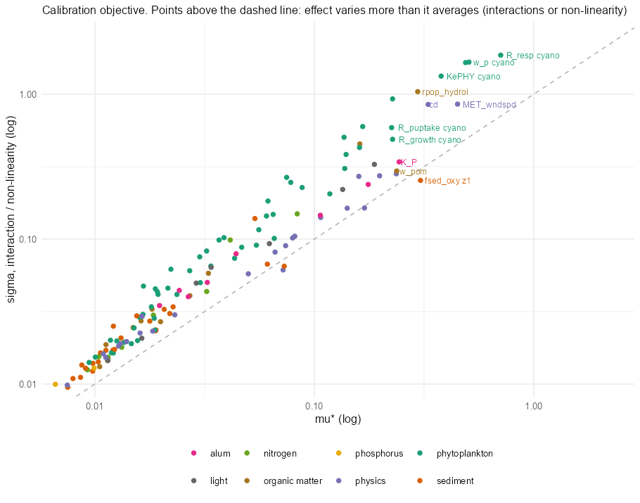
```

For the 30 most influential parameters, `sigma` is a median of 2 times `mu*`; for the seven cyanobacteria parameters among them it is 2 to 4 times, and for the physics and alum parameters about 1.4 times. The responses are therefore strongly non-linear or interacting: the effect of changing cyanobacteria respiration depends on the other settings, especially where the change tips the cyanobacteria into collapse. The physics and alum parameters sit closer to the dashed line and respond more evenly. The ranking says which parameters to look at, and the sizes should be read as relative, not additive.

### Which parameters drive which targets {#sec-sens-targets}

```{r}
#| eval: true
#| echo: false
#| label: fig-sens-heat
#| fig-cap: "Sensitivity of each calibration-window target to the 45 most influential parameters (`mu*` divided by the standard deviation of that output over all runs, capped at 1.5)."
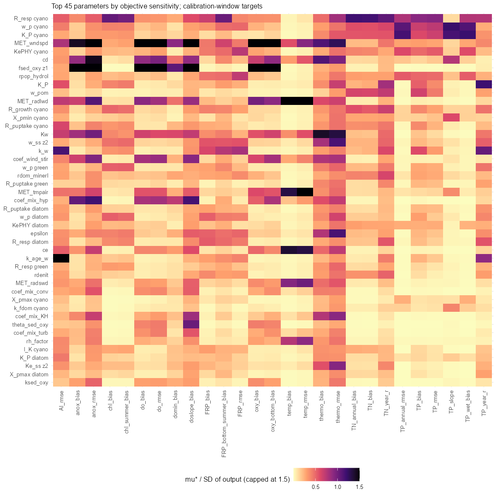
```

```{r}
#| eval: true
#| echo: false
#| label: tbl-sens-targets
#| tbl-cap: "Main drivers of the targets and physical summaries (scaled `mu*` in the figure above; the first three or four parameters are listed)."
knitr::kable(data.frame(
  Output = c("Temperature (bias, RMSE) and bottom temperature", "Thermocline depth", "Bottom oxygen, DO, anoxic days, stratified fraction", "Surface TP (bias, RMSE, annual error, slope)", "TP in wet years", "TN (bias, year-to-year correlation)", "Chlorophyll (mean and summer bias), cyanobacteria fraction", "FRP (bias, RMSE) and bottom summer FRP", "Year-to-year TP correlation", "Aluminium", "Alum pools (water column; sediment)", "TP trend and wet minus dry TP"),
  `Main drivers` = c("`MET_radlwd`, `ce`, `MET_tmpair`, `MET_radswd`", "`Kw`, `MET_wndspd`, `cd`, `epsilon`", "`MET_wndspd`, `fsed_oxy` z1, `cd`, `coef_mix_hyp`, `MET_radlwd`", "cyanobacteria `R_resp`, `w_p`, `K_P`, `KePHY`", "cyanobacteria `K_P`, `w_p`, `R_resp`", "cyanobacteria `R_resp`, `w_pom`, `w_p`, `K_P`", "cyanobacteria `R_resp`, `Xcc`, `w_p`; diatom and green `w_p`", "`k_w`, cyanobacteria `R_resp` and `KePHY`, `rpop_hydrol`, `w_ss` z2", "alum `K_P`, `k_w`, `k_age_w`; cyanobacteria `R_resp`", "`k_age_w`, `k_w`, `w_ala`, `MET_wndspd`", "`k_age_w`, `w_ala`, `k_w`; `k_res`, `k_bur`, `w_ala`", "`X_pmin` cyano, `cd`, `K_P` cyano; `rpop_hydrol` (wet minus dry)"), check.names = FALSE))
```

- **Temperature is set by the heat budget.** Long-wave radiation, the bulk transfer coefficient `ce` and air temperature dominate, ahead of mixing.
- **Oxygen and stratification are set by wind and sediment oxygen demand together.** Wind speed, zone 1 `fsed_oxy` and `cd` are the top three for bottom oxygen and anoxic days, and wind speed, `cd` and the stirring coefficient for the stratified fraction. The calibration holds wind at the measured value, so the anoxia targets are tied to the wind forcing and to the compensation placed in `cd`, the stirring coefficient and the mixing coefficients (@tbl-param-fixed).
- **Nutrients and chlorophyll respond to the cyanobacteria.** Surface TP, TN and chlorophyll all respond most to cyanobacteria respiration, settling and the P half-saturation. Cyanobacteria `R_resp` is first for TN, chlorophyll and the cyanobacteria fraction. A change in how many cyanobacteria the lake supports shifts all three together.
- **FRP and the year-to-year TP pattern depend on alum.** `k_w` is the first or second driver of FRP and of the year-to-year TP correlation, and `k_age_w` of the aluminium and of the year-to-year correlation. The alum parameters therefore matter for the targets that the alum stage is meant to fit, even though they carry only 6.5% of the objective.
- **Wet-year TP depends on particulate organic P.** `rpop_hydrol` is the main driver of the difference between wet and dry years in TP, consistent with the wet-year misfit traced to storm particulate P in @sec-flood.

136 of the 142 parameters have at least one target they affect strongly. A parameter with a small share of the objective is not necessarily irrelevant: the objective averages 27 terms, and some parameters matter for a single one.

The parameter ranking is the same in the held-out window. The Spearman correlation between the sensitivities of the calibration and held-out objectives is 0.91.

### Against what the calibration identified {#sec-sens-calib}

```{r}
#| eval: true
#| echo: false
#| label: fig-sens-shrink
#| fig-cap: "Sensitivity of the objective against the narrowing of the joint-stage ensemble, for the 40 free parameters. A parameter can only be identified if the objective responds to it, but responding does not guarantee it."
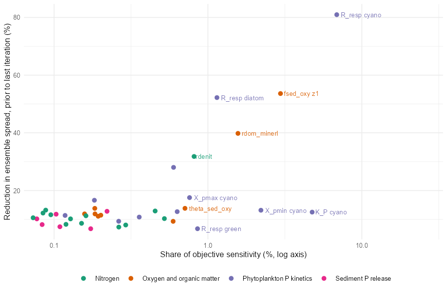
```

- **Sensitivity is needed but is not enough to identify a parameter.** Every parameter whose spread fell by more than 30% in the joint stage ranks in the top 32 for sensitivity (@fig-sens-shrink); none of the insensitive parameters narrowed. Several highly sensitive parameters did not narrow: cyanobacteria `K_P` (rank 3, spread reduced by 12%) and `X_pmin` (rank 13, 13%). They respond strongly but with sign and size depending on the rest of the set (the large `sigma` above), which is the case where an ensemble smoother is least able to pin a single value.
- **The joint stage freed mostly parameters the objective barely responds to.** 30 of its 40 parameters rank below 40, among them `fsed_frp` (all zones), `ksed_frp`, `fsed_amm`, `K_N` and most of the other sediment and nitrogen parameters. That is consistent with the weak narrowing in those groups (9 to 13% median). Only six of the 40 have a share above 1% and were free: cyanobacteria `R_resp`, `K_P` and `X_pmin`, zone 1 `fsed_oxy`, `rdom_minerl` and diatom `R_resp` (ranks 1, 3, 13, 7, 20 and 28).
- **Most of the sensitive parameters were not free.** 24 parameters have a share above 1% and are not in the joint stage. Three of them, the alum `K_P`, `k_w` and `k_age_w`, were calibrated in the alum refit (`p4`), where none narrowed by more than 17% (@sec-param-alum). The other 21 were held at the values of the earlier stages: wind speed and seven physics parameters (`cd`, `MET_radlwd`, `Kw`, `coef_wind_stir`, `MET_tmpair`, `coef_mix_hyp`, `ce`), nine phytoplankton parameters (cyanobacteria `w_p`, `KePHY`, `R_growth` and `R_puptake`, and `w_p`, `R_puptake` and `KePHY` of the other groups), `rpop_hydrol`, `w_pom`, and the light parameters `w_ss` z2 and `epsilon`.
- **What this means for the fit.** The objective has fallen to about 1 while the parameters remain largely unidentified, which is consistent with a large share of the response being carried by parameters that were not adjusted in the last stage. That is not a defect of the ensemble. It means that remaining misfit (FRP low, chlorophyll high, wet-year TP) may be reached more directly through the sensitive parameters than through the 30 insensitive ones that the joint stage spent its freedom on.

### Suggested next calibration set {#sec-sens-next}

These are suggestions from the screen, not decisions.

- **Free these** (16 parameters carrying 45% of the sensitivity): the cyanobacteria set `R_resp`, `w_p`, `K_P`, `KePHY`, `X_pmin`, `R_growth` and `R_puptake`; `fsed_oxy` zone 1, `rdom_minerl`, `rpop_hydrol` and `w_pom`; the alum `K_P`, `k_w` and `k_age_w`; and the light parameters `w_ss` zone 2 and `epsilon`. The cyanobacteria group needs a tighter prior on respiration and settling or a bound that rules out the collapse runs, because the wide intervals and large `sigma` come from collapse.
- **Physics and wind.** Wind speed, `cd`, `MET_radlwd`, `Kw`, `coef_wind_stir`, `MET_tmpair`, `coef_mix_hyp` and `ce` have 17% of the sensitivity, and they are the compensation for holding wind at 1. They were fixed after the physics stage. Whether to reopen them is a decision about the wind policy, since freeing `MET_wndspd` itself is excluded by the standing choice to use the measured wind. The screen shows that oxygen and anoxia respond as strongly to wind and `cd` as to sediment oxygen demand.
- **Fix these:** the 66 parameters with a share below 0.2% (18 of 25 sediment, 20 of 54 phytoplankton, 8 of 13 organic matter, 10 of 25 physics, 5 of 8 nitrogen, 2 of 2 phosphorus, 2 of 7 light, and one alum parameter). Holding them at their present values removes 46% of the 142 dimensions and about 8% of the summed sensitivity.
- **Keep for specific checks:** `k_bur`, `k_res` and `w_ala` determine the sediment alum pool and the alum in the water, which the objective does not penalise. Keep them if the alum pools matter for the scenario results.
- **Sediment P release stays an open problem.** If `fsed_frp` and `ksed_frp` do not move the objective, the targets cannot calibrate them, and the zone values need to come from the measured fluxes (Burger et al. 2007) with a tight prior.

### Limits of the screen

- **One base point.** The effects are measured around the joint-stage best member. With strong interactions, they would differ at another point in the parameter space, so the ranking holds for this region.
- **Interval widths.** The cyanobacteria `mu*` intervals are wide. Their ranks within the top 5 are not reliable; the ranking of the group as a whole is. The rank agreement of 25 trajectories with the full 30 is 0.98 and 9 of the top 10 are shared, so the set of influential parameters is stable but the order within it is not (@tbl-sens-conv).
- **What is not varied.** The stream-fractionation multiplier, the inflow and flood scaling and the structural switches are not in the design.
- **Wind range.** Wind is varied between 0.8 and 1.35 times the measured value, which sets how large its `mu*` appears. Another range would give a different size, not a different sign.

```{r}
#| eval: true
#| echo: false
#| label: tbl-sens-conv
#| tbl-cap: "Convergence of the screen: rank agreement (Spearman) with the full 30 trajectories for the objective and on average over the 27 targets, and how many of the top 10 parameters are shared."
cv <- read.csv("data/sensitivity/morris_convergence.csv")
knitr::kable(data.frame(Trajectories = cv$trajectories, `Rank agreement, objective` = sprintf("%.2f", cv$rho_phi), `Top 10 shared` = cv$top10_overlap_phi, `Rank agreement, targets` = sprintf("%.2f", cv$rho_targets), check.names = FALSE))
```

## Checks that decide the next step {#sec-checks}

- **Step 2.** If V1 or V2 fit total P, FRP and chlorophyll better than the old base and the efficiency scale moves towards 1, the in-stream step is doing its job. If V0 fits best, the lake kinetics are absorbing the stream reaction and the step needs a different form.
- **Step 3.** Parameters at their prior bounds (for example `w_ala` well above the thesis range) mean the module is compensating for something missing, and the cause should be sought before the scenarios are rerun.
- **Step 5.** Settled alum in the main basin should be small (ERI 178 found no accumulation there), and the in-lake P removal should be of the same order as the 16 t P/yr implied by the reports.

## Open questions {#sec-open}

- **Provenance of the files.** How the Puarenga with-alum series (the 90% cap, the unassigned DRP) and the Utuhina untreated reconstruction were produced.
- **Utuhina dose dependence.** Hamilton et al. show the downstream DRP:TP falling with dose; the files show a nearly flat removal. A dose-dependent Utuhina rule could be tested if the paired data exist.
- **Puarenga DRP.** Part of its decline after 2009 may come from wastewater treatment changes, so the upstream series is not purely untreated stream P.
- **Late-record TP.** The 2020 to 2022 TP rebound has not been reproduced; it may reflect event loads or alum ageing, not the inflow handling.
