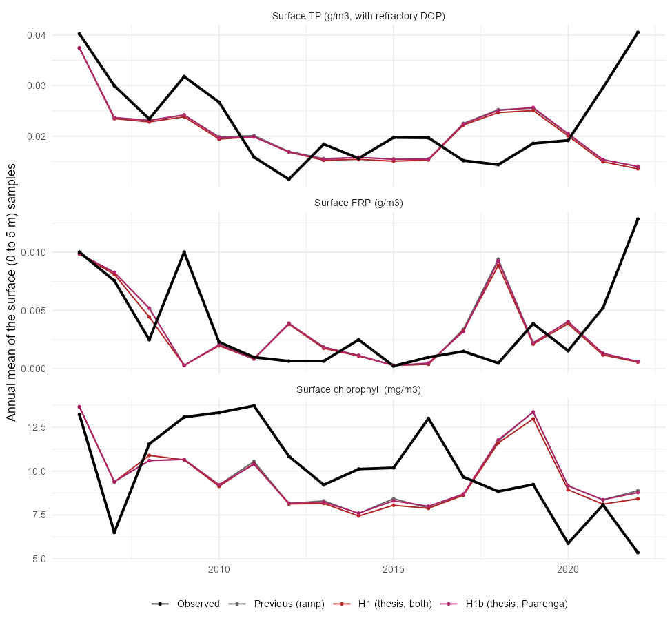

## Summary {#sec-summary}

The alum calibration so far treated the reaction between alum and stream phosphorus (P) before the lake with two rules taken from field data: a ramp to a 90% cap at 23 mol Al per mol DRP for the Puarenga, and a flat 45% removal for the Utuhina (@sec-previous). Together they used about 30 mol of aluminium per mol of P removed in the streams, and 5.5 in the lake (see "Alum applied per P removed, and the fate of alum and P" on the [next-steps page](rotorua-alum-next-steps.qmd#sec-alum-fate)). The thesis (Sanila) gives a different picture, which this page turns into a calibration design.

- **The thesis finding.** Alum reduced DRP in all waters, and the Al:P molar ratios ranged from 0.7:1 to 15.1:1. Where DRP stayed measurable after treatment, the ratio was near 1:1 (Lake Rotorua 0.7:1, Puarenga Stream 0.98:1). Where DRP fell below detection, the dose was in surplus and a minimum effective dose could not be determined.
- **What that means for the comparison.** Only days where DRP stays measurable carry a ratio. Most of the Al in the model goes out on surplus days (98% of the Puarenga Al at a dose ratio above 10, see the next-steps page), so the earlier comparison with the thesis (ratio of 30 against about 1) mixed both kinds of day. The ramp also spends 26 mol Al per mol P on the days the thesis says 1:1, so the two disagree even on the days that can be compared.
- **The design.** Three stream-step hypotheses on the same lake: the previous rule (H0), the thesis stoichiometry in both streams (H1), and the thesis in the Puarenga with the measured Utuhina removal kept (H1b). A calibrated efficiency (H2) follows if H1 does not settle it (@sec-design).
- **First result.** H1 and H1b have been run on the best member of the joint stage (@sec-h1).

## What was used before {#sec-previous}

```{r}
#| label: setup
library(dplyr); library(readr); library(knitr)
rules <- read_csv("data/h1/stream_rules.csv", show_col_types = FALSE)
```

The stream step moves a fraction `f` of the inflow FRP into suspended alum-bound P (`ALU_alp`) and removes the same amount of capacity from the free pool (`ALU_ala`) before the inflow enters the lake. The dose ratio is `R` = (`ALU_ala` + `ALU_alp`) / FRP, in mol Al per mol P (the capacity ratio of the module is 1, so a mole of capacity is a mole of Al).

| Stream | Distance to the lake | Rule | Source |
|---|---|---|---|
| Puarenga | about 300 m | `f = 0.9 × min(1, R / 23)` | McIntosh paired up- and downstream samples (Hamilton et al. 2015, Fig 20) |
| Utuhina | about 700 m | `f = 0.45` | Measured downstream DRP against the reconstructed untreated DRP (Hamilton et al. 2015) |

Below `R` = 23 the Puarenga rule binds `0.9 R / 23` of the FRP, which spends 23 / 0.9 ≈ 26 mol Al per mol P removed. Applied to the dosed days of 2006 to 2022-06 (@tbl-previous), this gives about 30 mol/mol across both streams.

```{r}
#| label: tbl-previous
#| tbl-cap: "Stream step of the previous setup on the dosed days, 2006 to 2022-06 (best member inflows). Ratios in mol Al per mol P bound. 'Capped' is the share of dosed days (or of the Al) on which the rule has reached its cap."
p <- rules |> filter(run == "Q50 (previous)")
kable(data.frame(Stream = p$stream, `Al applied (t)` = sprintf("%.0f", p$Al_t), `P bound (t)` = sprintf("%.1f", p$P_bound_t), `Al:P (mol/mol)` = sprintf("%.1f", p$ratio_molmol), `FRP removed` = sprintf("%.0f%%", 100 * p$frac_FRP_removed), check.names = FALSE))
```

The Puarenga series in the with-alum inflow file is built with the same ramp and cap, so it is not an independent check on this rule. The Utuhina downstream series is a measurement.

## What the thesis gives {#sec-thesis}

The thesis result, as stated by the author:

> Alum reduced DRP across all waters, but the Al:P molar ratios, ranging from 0.7:1 to 15.1:1 and post-treatment pH values ranging from 6.9 to 7.9, indicate that alum dose requirements varied with differing water chemistry. Where post-treatment DRP remained measurable, Al:P molar ratios were near 1:1 (Lake Rotorua 0.7:1; Puarenga Stream 0.98:1). Where DRP fell below detection, results indicated surplus alum (aluminium) dosing, and a minimum effective dose could not be determined.

Three consequences for the model:

1. **The stoichiometric rate is about 1 mol Al per mol P** when P is limiting, for both the Puarenga and the lake water. The module's capacity ratio of 1 matches this. The 26:1 of the stream ramp does not.
2. **Surplus doses cannot give a ratio.** If DRP is removed to below detection, the ratio is an upper bound on the dose needed, not a measurement. The model ratio should be compared on days when the model leaves measurable DRP (unsaturated days), and the share of Al applied on saturated days should be reported with it.
3. **The data are from jar tests** with hours of contact in mixed samples. The stream reaches are 300 to 700 m, with minutes of contact, so the thesis gives the efficiency of the chemistry, which the reach can only equal or fall short of. This is the reason to keep an efficiency parameter (H2) and not fix it at the thesis value.

The thesis range also includes surplus-dose ratios up to 15.1:1. The thesis also cites an operational field ratio of about 7:1 for the Utuhina and Puarenga inflows (McDowell and Hawke, 2006), which it attributes to turbulence, short flocculation contact times and hydrodynamic losses in the stream. That is a dose-over-removal figure for real dosing, so it includes surplus days. Its jar-test value for Lake Rotorua (0.7:1, a 1.0 mg Al/L dose removing 1.60 of 1.62 mg DRP/L) is the best-case chemistry.

## Design {#sec-design}

### Hypotheses for the stream step {#sec-hypotheses}

The stream step binds `B` mmol P per m³ of inflow, taken from the free capacity.

| Run | Stream step | Free parameters |
|---|---|---|
| H0 (previous) | Puarenga `0.9·min(1, R/23)`, Utuhina flat 0.45 | none, reference |
| H1 (thesis stoichiometry) | both streams: `B = min(f_max · FRP, ε · dose)`, ε = 1 mol P per mol Al | none (`f_max` = 0.9, as the old cap) |
| H1b (thesis, Puarenga only) | Puarenga as H1, Utuhina as H0 | none |
| H2 (calibrated) | as H1 with ε free per stream | ε (Puarenga), ε (Utuhina), `f_max` |

H1b is there because H1 contradicts a measurement for the Utuhina (@sec-h1). Priors for H2: ε between 0.04 (the ramp) and 1 (the thesis), `f_max` between 0.7 and 1.

### Lake side, the same for all runs {#sec-lake}

- **Stoichiometry.** The module has no stoichiometry parameter: capacity is used one for one (`aed_alum.F90`). The thesis lake ratio of 0.7:1 (1.4 mol P per mol Al) would need a new parameter. It is not part of H1, which only changes the stream step.
- **Rates.** Refit `w_ala` (thesis 0.3 to 1.5 m/d), `K_P` (about 0.3), `k_w`, `k_s`, `k_age_w`, `k_age_s`, `k_bur`, `k_res` as in stage `p4`, from the member of the joint stage. The sensitivity screen found the alum parameters carry 6.5% of the objective, and `k_age_w` is the first driver of the alum in the water.

### Targets {#sec-targets}

- **Streams.** The measured Utuhina downstream DRP, and the McIntosh Puarenga paired up- and downstream samples used directly. The Puarenga series in the inflow file cannot be used because it is built from the ramp.
- **Lake.** The existing calibration and held-out targets of the joint stage (TP, FRP, chlorophyll, oxygen), and the ERI 178 aluminium survey once the values are in hand.

### What to compare across runs {#sec-compare}

1. The objective on the calibration and held-out windows, and the surface TP, FRP and chlorophyll bias.
2. Al:P on unsaturated days for the streams, the lake and the whole system, against about 1.
3. The share of Al applied on saturated (surplus) days for each stream.
4. The reduction in P export with alum (14.9 t P/yr in the previous setup).
5. Whether the new parameters narrow under the ensemble, and whether ε and `k_w` trade off (both set how fast P is removed).

### Stages {#sec-stages}

1. **H1 and H1b on the best member** (this page, @sec-h1): one run each, no refit. Shows what the thesis rule does before any calibration.
2. **H2 ensemble**: ε and `f_max` free together with the lake alum parameters, ES-MDA as in stage `p4`.
3. **Compare** H0, H1b and H2 on the criteria above, and decide the stream rule.

## First result: H1 and H1b on the best member {#sec-h1}

Both runs use member 46 of stage `j` with the alum parameters unchanged. Only the stream step differs. The base is the previous (flood × 0.5) base with the untreated FRP and the dose rebuilt from it, so every other inflow variable is the same; the rebuild reproduces the previous bound P to machine precision (`calibration/alum/60_h1_base.R`). Both runs cover 2005-01 to 2022-06 (`calibration/historical/run_hist.R`, `calibration/alum/61_h1_compare.R`).

### The stream step

```{r}
#| label: tbl-h1-stream
#| tbl-cap: "Stream step under each rule on the dosed days, 2006 to 2022-06. Al:P is mol Al applied per mol P bound in the stream step. 'At cap' is the share of dosed days on which the rule has removed the maximum (90% of the FRP for H1), and 'uncapped Al:P' is the ratio on the other days."
r <- rules |> mutate(run = factor(run, c("Q50 (previous)", "H1", "H1b")), stream = factor(stream, c("Puarenga", "Utuhina"))) |> arrange(stream, run)
kable(data.frame(Stream = r$stream, Rule = c(`Q50 (previous)` = "Previous (ramp / 0.45)", H1 = "H1 (thesis)", H1b = "H1b (thesis in Puarenga only)")[as.character(r$run)], `P bound (t)` = sprintf("%.1f", r$P_bound_t), `FRP removed` = sprintf("%.0f%%", 100 * r$frac_FRP_removed), `Al:P` = sprintf("%.1f", r$ratio_molmol), `Days at cap` = sprintf("%.1f%%", 100 * r$days_at_cap), `Al:P uncapped` = ifelse(r$days_at_cap > 0.995, "1.0 (0.4% of days)", ifelse(r$days_at_cap == 0, "no cap", sprintf("%.1f", r$ratio_molmol_uncapped))), check.names = FALSE))
```

With the thesis rule the 90% cap is reached on 99.6% of the dosed days in both streams, and the dose is in surplus on virtually all of them. The ratio is 1.0 only on the 0.4% of days where the dose is below the FRP. This is the situation the thesis describes for the surplus case: the field doses cannot show what the minimum effective ratio is. Over all dosed days the ratio is 27 (Puarenga) and 13.5 (Utuhina) under H1, close to the previous Puarenga value (33) because the dose is large either way. In that sense the previous ramp and the thesis rule agree on the Puarenga: both remove most of the FRP when the dose is large, and the Al:P over all days is mainly the dose.

The rule changes the removal most at low doses. For the Puarenga the P bound rises from 16.0 to 19.7 t (+23%). For the Utuhina, H1 would double the removal (16.7 to 33.4 t, 90% of the FRP), which contradicts the measured downstream DRP: the observed removal there is 16.4 t, 44% of the FRP (@tbl-previous). H1 is therefore rejected for the Utuhina, and H1b is the version to carry forward.

### The lake and the whole system

```{r}
#| label: tbl-h1-lake
#| tbl-cap: "Best member (member 46) with each stream rule: P bound by alum in the streams, the lake water and the bed, Al:P ratios (mol/mol), and the modelled P export 2011 to 2021."
h <- read_csv("data/h1/h1_compare.csv", show_col_types = FALSE)
kable(data.frame(Run = h$run, `Stream P bound (t P/yr)` = sprintf("%.2f", h$P_bound_stream_t_yr), `Lake water (t P/yr)` = sprintf("%.1f", h$P_bound_lake_water_t_yr), `Lake bed (t P/yr)` = sprintf("%.2f", h$P_bound_lake_bed_t_yr), `Total (t P/yr)` = sprintf("%.1f", h$P_bound_total_t_yr),
  `Al:P streams` = sprintf("%.1f", h$AlP_stream), `Al:P lake` = sprintf("%.1f", h$AlP_lake), `Al:P whole` = sprintf("%.2f", h$AlP_whole), `Export (t P/yr)` = sprintf("%.1f", h$export_2011_21_t_yr), check.names = FALSE))
```

The lake takes up what the streams leave. When the stream step binds 1.2 t P/yr more (H1), the lake water binds 0.4 t P/yr less, so the total moves by only 0.8 t P/yr (6%) and the whole-system ratio from 4.8 to 4.5 (H1) or 4.75 (H1b). The modelled export, 10.6 t P/yr in the previous setup, changes by 0.1 to 0.2 t P/yr. The stream step as a whole is therefore a weak control on the lake, in line with the earlier finding that the stream reaction variants are indistinguishable in the lake data.

```{r}
#| label: tbl-h1-fit
#| tbl-cap: "Fit of the surface (0 to 5 m) samples, 2006 to 2022-06: bias of the mean (simulated minus observed, in per cent), RMSE and correlation. TP includes the refractory DOP offset."
f <- read_csv("data/h1/h1_fit.csv", show_col_types = FALSE) |> mutate(variable = c(PHS_tp = "TP", PHS_frp = "FRP", PHY_tchla = "Chlorophyll")[variable])
kable(data.frame(Run = f$run, Variable = f$variable, n = f$n, `Bias (%)` = sprintf("%.1f", f$bias_pct), RMSE = signif(f$rmse, 3), r = sprintf("%.2f", f$r), check.names = FALSE))
```

```{r}
#| label: fig-h1-fit
#| fig-cap: "Annual means of the surface samples against the simulations under each stream rule."
#| out-width: "80%"

```

The fit does not distinguish the rules. H1b is within 0.2 percentage points of the previous bias for TP and chlorophyll. H1 is slightly worse (TP -8.9% against -7.5%, FRP -24% against -21%), because binding more P in the streams leaves less FRP in the lake, and surface FRP is already low in the best member.

### What this shows

- **The thesis and the ramp agree where it matters.** Both give near-complete removal at large doses. They differ only at low doses, which are a small part of the Al applied.
- **The thesis 1:1 cannot be tested against the field doses.** On 99.6% of the dosed days the thesis rule saturates, so the data cannot show an efficiency. The thesis says this too ("a minimum effective dose could not be determined").
- **H1 fails for the Utuhina** because the measured downstream DRP shows only 44% removal at the same doses. The Utuhina reach therefore does not reach the jar-test efficiency, which supports a calibrated ε (H2) at least for that stream.
- **The lake data do not respond to the stream rule**, so the choice should rest on the stream measurements and on physical grounds, not on the lake fit.

This is one member with its parameters unchanged, not a calibration. The lake alum parameters (`k_w`, `K_P`, `w_ala`, ageing and burial) were fitted under the previous rule and the lake already compensates for the difference, so a refit is the proper test of whether the thesis stoichiometry changes the lake parameters.

## Next steps {#sec-next}

1. **H2 on the stream data first.** Fit ε and `f_max` per stream to the stream observations alone (the measured Utuhina downstream DRP and the McIntosh paired Puarenga samples, digitised from Hamilton et al. 2015 Fig 20), before the lake. This is cheap and needs no model run. If the Utuhina reach gives ε well below 1, the jar-test efficiency does not hold in the stream.
2. **Refit the lake alum parameters** with the chosen stream rule, as in stage `p4`, and compare the parameter values and their spread with the previous fit. The comparison to make is whether `k_w`, `K_P` and the ageing rates move towards the thesis priors.
3. **Add a stoichiometry parameter** to `aed_alum.F90` if the lake is to use the thesis 0.7:1 (1.4 mol P per mol Al). At present capacity is used one for one.
4. **Report the surplus share** with every ratio, so that the comparison with the thesis uses only the unsaturated days.

The code is in `calibration/alum/60_h1_base.R` (builds the H1 and H1b inflows from the previous base), `calibration/alum/61_h1_compare.R` (the comparison) and `calibration/historical/run_hist.R` (the member run, with `HIST_BASE` set to the new base).
