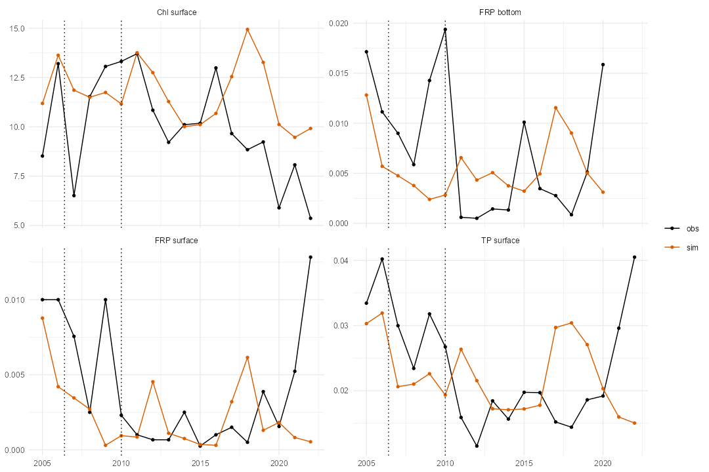
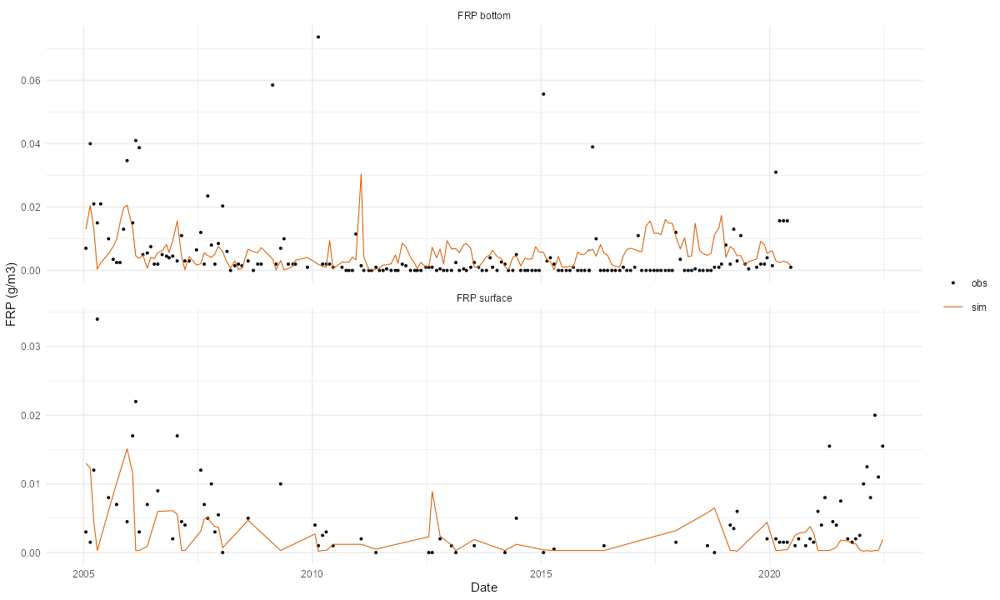
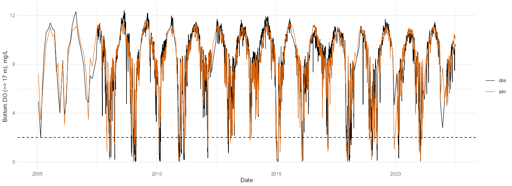
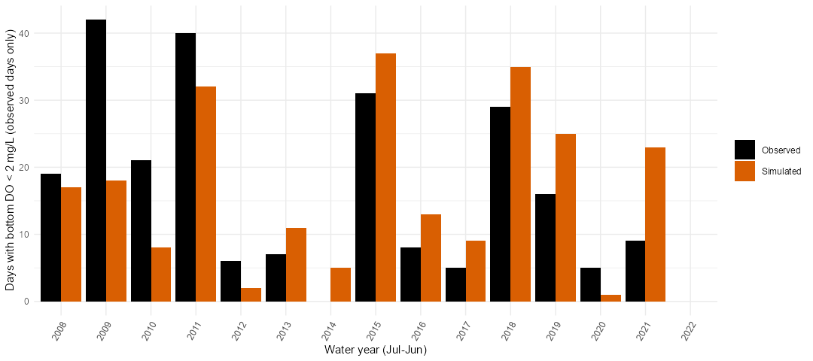

## Summary {#sec-summary}

This page documents the calibration work done on the Lake Rotorua GLM-AED model after the first biogeochemistry (step 2b) and alum (step 3) fits. Everything below was run on the project machine with the scripts in `calibration/` (see @sec-repro); the figures come from `website/images/`. The page does not execute any code, so it renders without the model outputs.

**What was done, in order**

1. Reviewed why total N and total P and the nutrient species were still poorly fitted after step 2b, built budget tools (`R/nutrient_budget_helpers.R`), and tried three variants of the nutrient calibration (2c, 2d, 2e).
2. Read the AED source (`libaed-water`) and found structural reasons for the misfit: no sediment nitrate sink, inert P sorption, inert particulate organic matter, and sediment fluxes that are applied with an oxygen and temperature factor.
3. Found that the model was **light-limited because its suspended solids were about 7 times too high** (34 g/m³ against a few g/m³), with attenuation of 2.3 m⁻¹ against 0.8 observed. The biology had been tuned to a dark lake.
4. Calibrated the light and solids parameters (stage `l`), then recalibrated the phytoplankton and nutrients under the corrected light (`f`), then added diatoms with a silica supply and seasonal-cycle terms (`g`).
5. Switched the alum module on and calibrated the alum parameters to FRP and total P (`alum`), then tuned bottom-water oxygen and anoxia with alum on (`o`). Two further rounds (`p`, `l2`, `o2`) tested a joint FRP stage and a second light and oxygen fit.

**Where the model stands** (2007-2022 means, alum on; observed in brackets)

| | O member | O2 member | Observed |
|---|---|---|---|
| Anoxic days (bottom DO < 2 mg/L) on observed days | 236 | 288 | 239 |
| Year-to-year correlation of anoxic days | 0.74 | 0.65 | |
| Bottom DO (≥ 17 m): correlation / bias (mg/L) | 0.91 / -0.08 | 0.91 / -0.08 | |
| Chlorophyll (µg/L) | 11.6 (+17%) | 10.6 (+7%) | 9.9 |
| Total P surface (g/m³) | 0.0212 (-3%) | 0.0208 (-5%) | 0.0219 |
| FRP surface (g/m³) | 0.0018 (-46%) | 0.0019 (-44%) | 0.0034 |
| FRP bottom (g/m³) | 0.0050 (-22%) | 0.0054 (-16%) | 0.0065 |

Pre-alum (1990-2009, alum off) the O member gives: nitrate 0.0130 (observed 0.0131), total P 0.0390 (0.0384), FRP 0.0124 (0.0118), chlorophyll 13.1 µg/L (11.6).

**Main limitations:** surface FRP is about 45% low (high-FRP episodes are missed), the 2021-22 total P rebound is not reproduced, and there is no month-to-month skill for chlorophyll, total P or FRP (@sec-limits).

## Set-up common to the stages {#sec-setup}

### Model and data

-   **Model:** GLM v4 with AED. AED modules in the build: sedflux (constant 2D, four sediment zones), noncohesive solids, oxygen, silica, nitrogen, phosphorus, organic matter (with refractory pools), phytoplankton (cyanobacteria, greens, diatoms), totals and alum.
-   **Forcing:** hourly bias-corrected ERA5 (wind unscaled), 14 inflows including rainfall, geothermal and the wastewater plant, and the Ōhau weir outflow file.
-   **Spin-up:** 540 days in every run.
-   **Two bases.** The pre-alum base `calibration/step2/aeme_base_1990_v2.rds` has **no alum dose in its inflows**; the alum base `calibration/step3/aeme_base_2005_alum.rds` does (Utuhina from 2006-06, Puarenga from 2010 with a gap in 2019). Any alum calibration has to use the alum base. A first attempt on the pre-alum base gave 80 identical members because no alum entered the lake.
-   **Observations:** lake chemistry at two sites since 1990 (about 25 samples a year), buoy and sensor oxygen and temperature (dense from 2007), Secchi depth, the visible-light extinction coefficient (VLEC, 1996-2017), PAR profiles and turbidity.

### Calibration method

-   **Ensemble smoother with multiple data assimilation (ES-MDA)** in `calibration/step2/step2_ies.R`: an ensemble of 60 to 120 parameter sets, 5 or 6 assimilation steps, parameters on a [0,1] scale (log where the range spans orders of magnitude), run in parallel. The final best member is the lowest-phi member of the last ensemble.
-   **Residuals** are in units of a stated tolerance, so each counts equally. The score phi is the mean squared residual. The standard nutrient score has bias and RMSE of log ratios for chlorophyll, total P, FRP, total N, nitrate and ammonium in the surface 0-5 m, five chlorophyll signature terms, and a temperature and oxygen guard. Later stages added terms (@tbl-stages).
-   **Stage switches** are in `calibration/step2/step2_common.R` and chosen with the environment variable `S2_STAGE`. Each stage starts from the previous best member and fixes everything it does not free.
-   **Unattended chains:** `calibration/step2/pipeline*.sh` run a stage, then a 20- or 17-year forward run and the diagnostics, writing progress to `calibration/logs/pipeline.status`.

### Diagnostic tools written

| Tool | Purpose |
|---|---|
| `R/nutrient_budget_helpers.R` | `nutrient_budget()`, `budget_table()`, `plot_nutrient_budget()`: N and P budgets (t/yr) from the GLM mass-balance csv (inflow, outflow, stock change) and `output.nc` (denitrification, uptake, sediment fluxes) |
| `R/phyto_limitation_helpers.R` | `phyto_limitation()`, `plot_phyto_limitation()`: share of growth limited by light, N, P or silica, by month or hour |
| `calibration/step2/run_forward.R` | one forward run of a stage's best member, with the mass balance written |
| `calibration/anoxia/01_bottom_anoxia.R` | observed against simulated bottom DO and anoxic days per water year |
| `calibration/alum/01_alum_fit.R` | FRP, total P and chlorophyll by year for an alum-on run |
| `calibration/light/*.R` | light data audit, model light check, resuspension sensitivity |

## What was done, stage by stage {#sec-stages}

| Stage | What was freed or changed | Window | Result |
|---|---|---|---|
| 2b | phytoplankton, N, P, sediment fluxes (pre-alum) | 1990-2006 | start point; best phi 0.70 (held-out 1.48) |
| 2c | sediment NH4 and FRP anchored to zone estimates | 1990-2006 | no gain (0.76; FRP and ammonium worse) |
| 2d | kpo4p and w_po4ads fixed; sediment fluxes within ×4 of 2b | 1990-2006 | no gain (0.69; held-out 1.61) |
| 2e | per-zone sediment nitrate flux, Ksed, capped rdenit, POM rates | 1990-2006 | cal 0.59, held-out 2.06; chlorophyll 16 µg/L |
| l | resuspension, solids settling, Kw, Ke_ss, KePHY | 1990-2006 | 0.51 → 0.34; Kd 2.3 → 0.7 m⁻¹ |
| f | biology and nutrients under corrected light | 1990-2006 | ties 2b (0.70) |
| g | diatom parameters, silica supply, seasonal terms | 1990-2006 | best biology; held-out 1.32 |
| alum | 8 alum parameters, alum on | 2005-2022 | 1.14 → 0.51 |
| o | sediment O2 demand, Ksed_oxy, DOM and POC oxygen use | 2005-2022 | anoxia matched |
| p | alum plus sediment P release | 2005-2022 | no gain (0.52) |
| l2, o2 | light and oxygen refitted on the final biology | 2005-2022 | chlorophyll better, anoxia +20% |

: Stages, what each changed, and the outcome. {#tbl-stages}

### Why the nutrient fit stalled (2c-2d) {#sec-nutrients-diagnosis}

Step 2b left total N and P well fitted but the species poorly fitted (FRP and ammonium too low, nitrate too high). Variant 2c anchored the sediment FRP and ammonium release to zone values that had been derived from zone-median summer concentrations. These are **not measured fluxes**, which I should have flagged. The result was worse: the release was recycled by the phytoplankton and settled out again (@tbl-2c).

| 20-year surface mean (g/m³; chlorophyll µg/L) | Observed | 2b | 2c |
|---|---|---|---|
| Chlorophyll | 11.6 | 14.0 | 16.3 |
| FRP | 0.0118 | 0.0028 | 0.0058 |
| Ammonium | 0.0282 | 0.0056 | 0.0055 |

: Surface means from 20-year forward runs, 1990-2009. {#tbl-2c}

The budgets showed why (@fig-budget). In 2b the lake lost 355 t N/yr internally (71% of 502 t/yr inflow), of which 192 t/yr was water-column denitrification, and 11.6 t P/yr of a 29.4 t/yr input. In 2c the sediment ammonium release was 1,732 t N/yr and the FRP release 57 t P/yr (twice the external P load), yet the internal loss barely changed: the extra nutrient was taken up and lost again.

{#fig-budget}

### What the AED source showed {#sec-aed-source}

Reading `libaed-water` (and the alum module in `AED_Tools_Private/libaed-dev`) gave structural explanations, each confirmed against the model output:

-   **No sediment nitrate sink.** `fsed_nit = 0` in all four sediment zones, and the linked `SDF_Fsed_nit` overrides `aed_nitrogen`'s own value. The only large N sink was water-column denitrification `NIT_nit × Rdenit × Kdenit/(Kdenit+O2) × fT × NO3/(5+NO3)`, which the calibration pushed high even in oxic water.
-   **Sediment fluxes are not the parameter value.** The realised ammonium flux is `Fsed_amm × Ksed_amm/(Ksed_amm+O2) × fT`; with oxic bottom water this is about 12-14% of the parameter in summer.
-   **P sorption was inert.** `ads_use_external_tss = .true.` makes the module read an empty global `tss` instead of the simulated solids, so adsorbed P was about 2% of FRP and the sorption parameters `kpo4p` and `w_po4ads` had no effect. A test with the switch off (@tbl-sorption) showed that real sorption removes more P and worsens FRP, so it was left off.
-   **Particulate organic matter was nearly inert.** `w_pom` ended at -0.006 m/d, PON and POP hydrolysis rates imply timescales of years, resuspension is off and the sediment organic pools do not evolve; settled material is simply lost.
-   **Alum pH efficiency is off.** `ads_use_pH = .false.`, so the alum factor `fpH` is 1; there is also no carbon module to supply pH.

| Case (1998-2003, 2b member) | Adsorbed P / FRP | Surface FRP (g/m³; obs 0.0117) | Surface TP (obs 0.041) |
|---|---|---|---|
| as built (external TSS) | 0.03 | 0.0022 | 0.039 |
| solids on, kpo4p 11.4 | 8.4 | 0.0003 | 0.009 |
| solids on, kpo4p 0.5 | 0.83 | 0.0007 | 0.029 |
| solids on, kpo4p 0.1 | 0.22 | 0.0015 | 0.035 |

: P sorption test. Changing the switch has to be written into the model file with `write_configuration()`; `run_aeme_param()` only edits parameters. {#tbl-sorption}

### Variant 2e: structural fixes

2e added a per-zone sediment nitrate flux (with `Fsed_nit_model = 2`), made `Ksed_amm` and `Ksed_nit` free, capped `rdenit` at 5, and widened the settling and hydrolysis ranges for POM. The calibration score fell to 0.59 (2b: 0.70) but the held-out score rose to 2.06 (2b: 1.48), so it overfitted. Sediment nitrate uptake became a large sink (288 t N/yr), chlorophyll was 16.1 µg/L and nitrate 2.4 times observed. The next diagnostic explained why.

### Light limitation was the real problem {#sec-light}

In AED the growth rate is `R_growth × fT × min(fI, fNit, fPho, fSil)`. The growth-limitation function showed the light factor was the smallest for 80-90% of the biomass in every season (@fig-limit), even with the daily output sampled at midday. Hourly output (`nsave = 1`, one year) confirmed this: the model output is in UTC, so the daily samples at 00:00 UTC were midday in New Zealand, and in daylight (PAR > 1) cyano was 70% light-limited and 30% P-limited, green 79% light, 15% N and 6% P.

{#fig-limit}

The light data audit (`calibration/light/01_light_data.R`) gave priors for the attenuation:

| Source | n | Result |
|---|---|---|
| VLEC against Secchi | 210 | VLEC = 1.85 / Secchi, r = 0.81 |
| PAR-profile Kd against Secchi | 142 | k = 2.07, r = 0.39 (noisy; only a secondary target) |
| Kd = Kw + a × chl + b × turbidity (VLEC) | 186 | Kw 0.37 m⁻¹, a = 0.0076 m⁻¹ per mg/m³ chl, b = 0.093 m⁻¹ per NTU |
| same, 1.7 / Secchi | 290 | Kw 0.36, a = 0.0058, b = 0.078 |

: Observed light attenuation. {#tbl-lightdata}

The model, in contrast, had **mean TSS of 34 g/m³ in the upper 5 m** (almost all in the second solids class, from resuspension at `epsilon = 3e-4`), giving 2.36 m⁻¹ against 0.79 observed (the model's own water term was 0.45, phytoplankton 0.03, solids 2.05). Simulated Kd did not track the observations (r = -0.03). A sensitivity test of the resuspension rate (@tbl-resus) showed that cutting `epsilon` tenfold brings attenuation to the observed value but sends chlorophyll to 46 µg/L, confirming that the biology had been tuned to a dark lake.

| Case (1998-2002, 2e member) | TSS (g/m³) | Attenuation (m⁻¹) | Chlorophyll (µg/L) | Cyano limited by light |
|---|---|---|---|---|
| base (`epsilon` 3e-4) | 32.7 | 2.28 | 15.6 | 80% |
| `epsilon` ÷ 10 | 5.8 | 0.85 | 46.5 | 4% |
| `epsilon` ÷ 100 | 3.1 | 0.71 | 50.9 | 2% |
| `tau_0` × 3 | 29.1 | 2.09 | 18.6 | 73% |

: Resuspension sensitivity (observed Kd 0.83 m⁻¹). {#tbl-resus}

### The light stage and the biology refit {#sec-l-f-g}

-   **l (10 parameters):** `epsilon`, `tau_0` and `w_ss` for both solids classes, `Ke_ss`, `Kw` and `KePHY` against Kd (VLEC or 1.85 / Secchi), TSS against 1.5 × turbidity, and a temperature guard. Score 0.51 → 0.34: mean TSS 4.8 g/m³ and Kd 0.62-0.72 m⁻¹ against 0.79 observed. Timing of resuspension was not captured (r about 0.1). Chlorophyll then rose to about 50 µg/L with P as the limiting factor, as expected.
-   **f:** biology and nutrients recalibrated with the light fixed. It tied 2b (score 0.70) and chlorophyll returned to 14.7 µg/L, but the seasonal cycle was wrong: model chlorophyll peaked in January-March (24-31 µg/L against 10-13 observed) and was about half the observed in July-October, so nitrate piled up in winter (0.07-0.11 against 0.02-0.035).
-   **Silica.** Silica was 1 mmol/m³ everywhere, so diatoms were always limited. With 150-300 mmol/m³, a September-October diatom bloom appeared (chlorophyll 10-14 µg/L against 5 µg/L) and October nitrate fell from 0.095 to 0.012-0.044 g/m³ (@tbl-silica). AEME multiplies large `SIL_rsi` inputs by 16.64 (a g/m³ to mmol/m³ conversion applied above an unknown threshold), so the concentration is written directly into the built inflow files.
-   **g:** freed seven diatom parameters, set silica to 200 mmol/m³ (an assumption; no stream silica measurement was available) and added monthly-climatology terms for chlorophyll, nitrate, ammonium, FRP and total P to the score. This is the best biology so far: on the shared metrics the calibration score is 0.61 and held-out 1.32 (2b: 1.48).

| Silica supply (mmol/m³) | Mean chlorophyll (µg/L) | Sep chlorophyll | Oct chlorophyll | Oct nitrate (g/m³) | Diatom C |
|---|---|---|---|---|---|
| 1 | 14.8 | 4.7 | 5.0 | 0.095 | 0.03 |
| 50 | 15.2 | 6.7 | 5.9 | 0.079 | 1.1 |
| 150 | 15.8 | 10.2 | 8.4 | 0.044 | 3.4 |
| 300 | 16.2 | 13.0 | 13.9 | 0.012 | 6.5 |

: Silica test with the 2f member (1998-2003). {#tbl-silica}

20-year surface means for the 2g member (observed in brackets): chlorophyll 13.6 µg/L (11.6), total P 0.0375 (0.0384), FRP 0.0143 (0.0118), nitrate 0.0132 (0.0131), ammonium 0.0166 (0.0282), total N 0.413 (0.434).

### Alum calibration {#sec-alum}

With alum on (step 3 alum base, 2005-2022, pools accumulating), the 2g member with the old step 3 alum values removed too much P (total P and FRP biased low). Eight alum parameters (`w_ala`, `k_w`, `K_P`, `k_s`, `k_age_w`, `k_age_s`, `k_bur`, `k_res`) were calibrated to FRP, total P, chlorophyll, nitrogen and aluminium, with tighter FRP scales than step 3.

| Residual (calibration 2006-06 to 2018-06) | Start | Best |
|---|---|---|
| Total P bias | -2.26 | -0.08 |
| FRP bias | -1.45 | -0.36 |
| Bottom summer FRP bias | -0.24 | +0.23 |
| Chlorophyll bias | 0.25 | 0.42 |
| Aluminium RMSE | 1.41 | 1.43 |

: Alum round 1 (tolerance units). Score 1.14 → 0.51; held-out 3.84 → 2.89. {#tbl-alum}

The held-out years showed the weakness: observed total P rose from 0.014 g/m³ (2018) to 0.030 (2021) and 0.040 (2022), while the simulation stayed at 0.014-0.018. The dose record itself reproduces the Puarenga gap in 2019 (dose 0), so the model sees the dosing change. Round 2 widened the ranges and moved the calibration window to 2020-06; the best score was unchanged (0.50) and the full-period fit was slightly worse, so round 1 was kept. A joint stage (`p`) freeing the alum parameters and the sediment P release also gave no gain (best score stayed 0.52). The missing piece is probably an event-driven external P load in 2021-22 (the inflow P concentrations are nearly constant in the file) or alum-bound P release; a pH-dependent alum efficiency (`fpH`) would need a pH series and the carbon module (lake pH median 6.85, 5-95% range 6.06-7.82).





### Bottom anoxia {#sec-anoxia}

The 2g member (alum off) reproduced the daily bottom oxygen at 17 m and deeper (r = 0.90, bias +0.25 mg/L) but underestimated anoxia: 96 anoxic days against 240 observed on the observed days, and none at all in 2008, 2009, 2012 and 2020. The depletion rate of bottom DO in October-February was also about half the observed in several years.

Stage `o` (alum on) freed the sediment oxygen demand in four zones, `Ksed_oxy`, `theta_sed_oxy`, `rdom_minerl`, `rpoc_hydrol` and `theta_minerl`, with the score extended by bottom-DO bias and RMSE, anoxic days and annual minimum per water year, and the depletion rate. Results over 2005-2022 are in @tbl-anoxia.

| | 2g (alum off) | O member | O2 member | Observed |
|---|---|---|---|---|
| Anoxic days on observed days (< 2 mg/L) | 96 | 236 | 288 | 239 |
| Hits / misses / false alarms | 78 / 162 / 18 | 128 / 111 / 108 | 146 / 93 / 142 | |
| Mean anoxic days per water year (15 years) | 6 | 16 | 19 | 16 |
| Year-to-year correlation | 0.58 | 0.74 | 0.65 | |
| Bottom DO: correlation / bias / RMSE (mg/L) | 0.90 / +0.25 / 1.25 | 0.91 / -0.08 / 1.18 | 0.91 / -0.08 / 1.19 | |

: Bottom anoxia (bottom ≥ 17 m, daily means on observed days). {#tbl-anoxia}





## Bugs and quirks found in the toolchain {#sec-quirks}

-   **AEME `get_var()`** now returns the simulated column named `value`, not `sim`; `csps_pair()` was updated.
-   **Weir fit:** the newer AEME fits a GLM weir by default, which breaks the nml check; `glm_weir = FALSE` is needed in the build to keep the outflow file.
-   **`wq_init_vals`** are about 1000 times too low (oxygen 0.32 against `oxy_initial` 312.5); the effect fades within about 1.5 years (differences below 5% after 1990), so the 540-day spin-up covers it.
-   **Silica:** inputs above an unknown threshold are multiplied by 16.64 on build.
-   **No `inflow_param()`**, and `LKE_photich` and `RAD_secchi` are not available as model output for `glm_aed` (naming entries only). Simulated Secchi is not available, so the light stage compares the extinction coefficient to the observed Kd.
-   **Configuration switches** (structural nml settings) must be written with `write_configuration()`; `run_aeme_param()` only edits parameters in an existing nml. R scripts must not be edited while a run is reading them.
-   **Disk:** the alum-on runs write about 6 GB per worker; eight workers filled the drive once. Use six workers and delete `*/runs/work` and forward `build` folders after use.

## Known limitations and next steps {#sec-limits}

-   **FRP:** surface FRP is about 45% low in the 2007-2022 mean. The model matches most years (observed values are often near detection) but misses episodes such as 2009 and the 2021-22 rebound.
-   **Total P rebound** in 2021-22 is not reproduced; an event-driven external load or alum-bound P release is the likely cause.
-   **Timing:** month-to-month correlation is about zero for chlorophyll, total P and FRP, and the light and solids timing (Kd r about 0.1) is not captured.
-   **Alum pH efficiency** (`fpH`) is off. Calibrating `pH_opt` and `sigma_pH` needs a prescribed pH series (the `ph_mode` option in `aed_carbon`).
-   **Silica** (200 mmol/m³) is an assumption; a stream measurement would replace it.
-   **Choose the final member** (O for anoxia, O2 for chlorophyll and bottom FRP) and rerun the NZESM scenarios and the alum/no-alum comparison with it. The scenario and uncertainty runs in `calibration/scenarios30` and `calibration/uncertainty` were made with the earlier 2b and step 3 members and have not been rerun.

## Reproducing the work {#sec-repro}

All stage scripts are in `calibration/step2/`, `calibration/light/`, `calibration/anoxia/` and `calibration/alum/`. The parameter tables of the final members are in `calibration/final/` (`params_step2o_best.csv`, `params_step2o2_best.csv`, plus the light round 2 and 2g members) with a README.

```bash
# one stage (example: the alum stage), 80 members x 6 iterations, 6 workers
powershell -File calibration/step2/run_step2alum.ps1

# forward run of a stage's best member (20 years, alum on)
S2_BASE=calibration/step3/aeme_base_2005_alum.rds FWD_STAGE=o FWD_ALUM=1 \
  FWD_START=2005-01-01 FWD_STOP=2022-06-29 Rscript calibration/step2/run_forward.R

# diagnostics
ANOX_RUN=o Rscript calibration/anoxia/01_bottom_anoxia.R
ALUM_RUN=o Rscript calibration/alum/01_alum_fit.R
FWD_STAGES=o Rscript calibration/step2/run_limitation.R
```

None of the new calibration folders (`calibration/`, `R/phyto_limitation_helpers.R`, `R/nutrient_budget_helpers.R`) and none of the new figure folders under `website/images/` has been committed to git yet.
