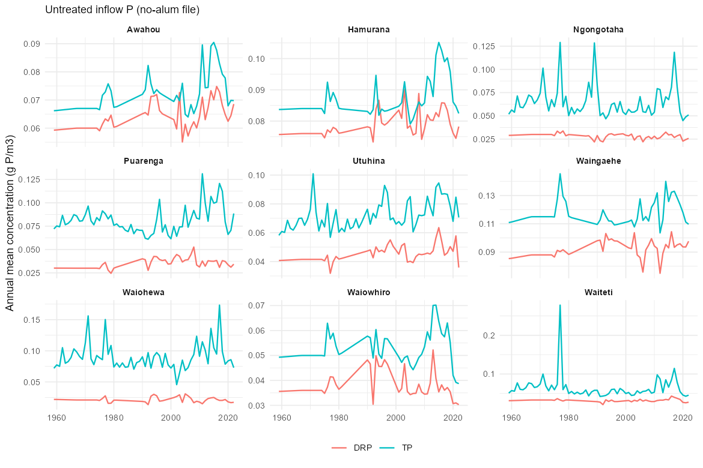
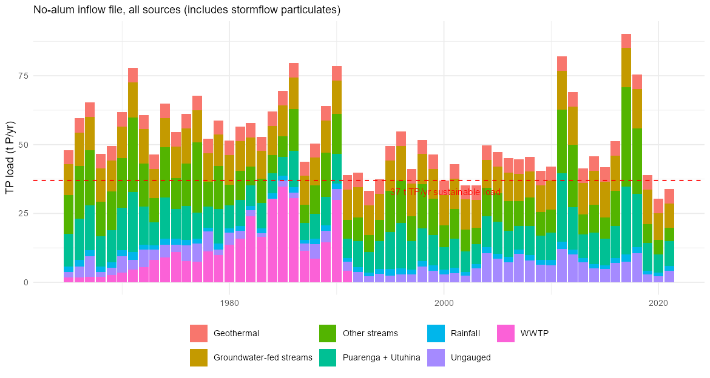
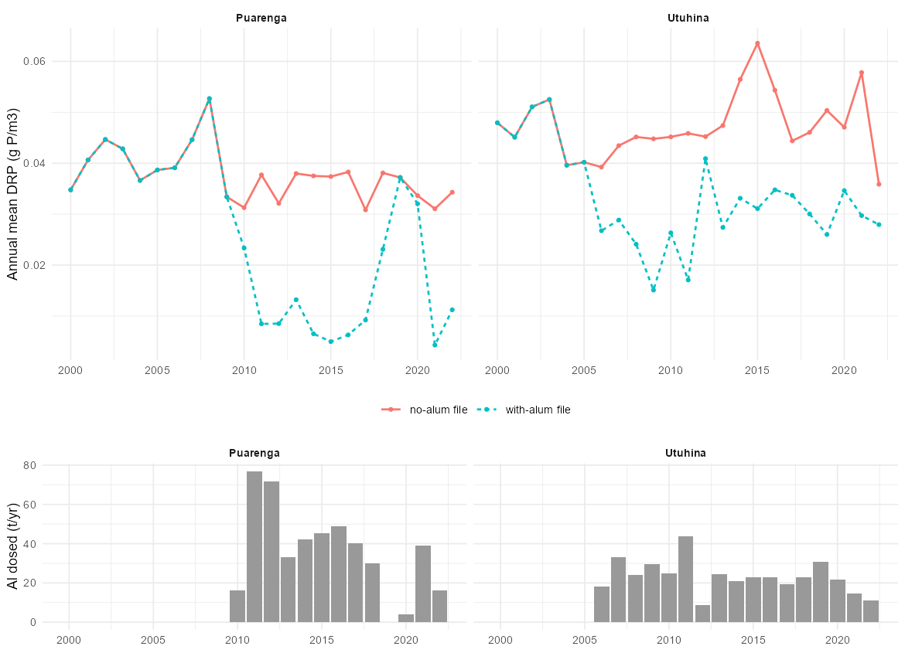
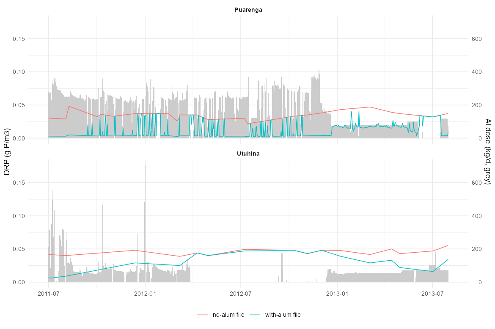
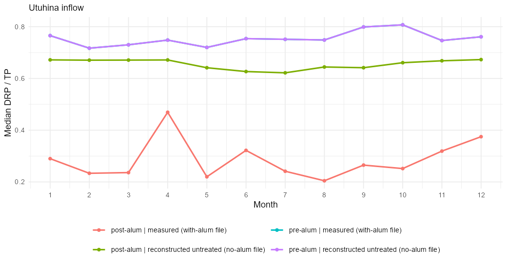
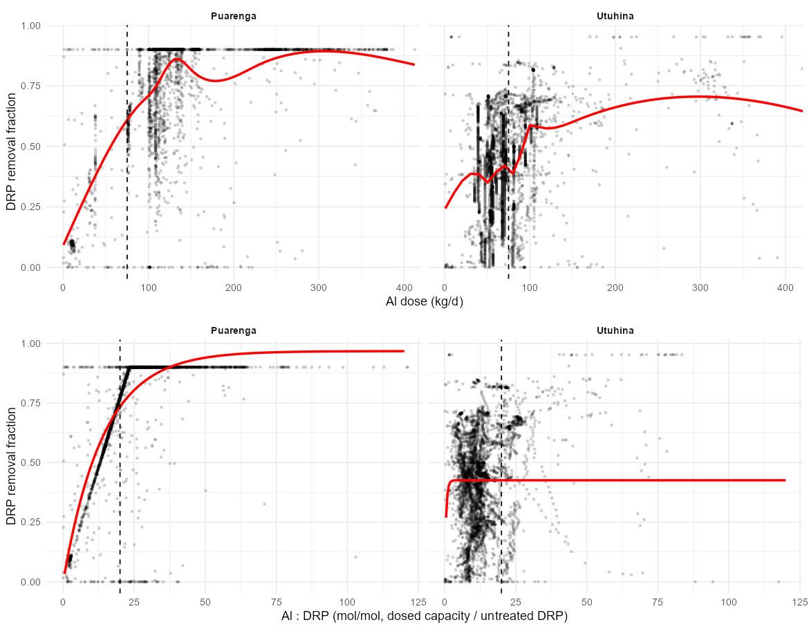
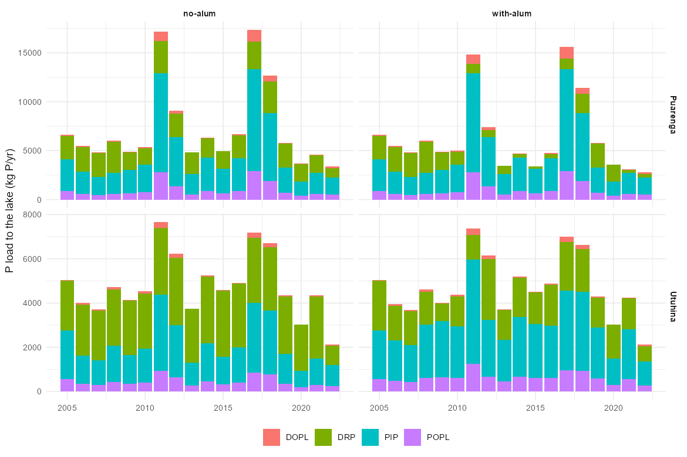

## Summary {#sec-summary}

The Lake Rotorua inflow files used by the model come from the University of Waikato catchment-load and lake-modelling work for Bay of Plenty Regional Council (BoPRC). This page summarises three of those reports, describes how the daily inflow series are constructed, and explains why the alum-dosed streams need special handling.

**Key points**

1. **The inflows are reconstructed, not measured.** Daily flow comes from a lake water balance plus gauged and synthetic stream flows. Daily concentrations come from linear interpolation of monthly baseflow samples, plus regressions on discharge for stormflow particulate nutrients (ERI 123).
2. **The two dosed streams are sampled on opposite sides of the dosing point.** Utuhina is monitored *downstream* of dosing, so its measured DRP is already treated. Puarenga is monitored *upstream*, so its measured DRP is untreated (ERI 123, Hamilton et al. 2015).
3. **Hamilton et al. (2015, pp. 36 to 38) fixed this in opposite directions for the two streams.** For Utuhina they rebuilt the untreated DRP from pre-alum monthly DRP:TP ratios. For Puarenga they estimated the treated DRP from a dose-response fitted to paired up- and downstream samples.
4. **Whichever scenario is run, one stream must be adjusted.** An alum-explicit lake model needs *untreated* inflows for both streams. A model with no alum module needs *treated* inflows for both. Mixing the two double counts alum in one stream.
5. **Total P hardly changes in the stream; the form of P does.** Alum converts dissolved P to particulate P in the stream while TP stays much the same. Hamilton et al. attribute this to turbulence keeping the adsorbed P in suspension.
6. **Two new files hold both versions** (`rotorua_inflows_populated_noalum.csv` and `..._withalum.csv`). They differ only in DRP and the particulate or sorbed P of the Utuhina, the Puarenga and the ungauged quick-flow inflow. This page compares them (@sec-files).

## The reports {#sec-reports}

| Report | Authors, date | Purpose | Model |
|---|---|---|---|
| **ERI 49**, *Assessing the effects of alum dosing of two inflows to Lake Rotorua against external nutrient load reductions: model simulations for 2001-2012* | Hamilton, McBride & Jones, Feb 2015 | Effect of alum on lake water quality compared with external load reductions | DYRESM-CAEDYM |
| **ERI 123**, *Long-term nutrient loads and water quality for Lake Rotorua: 1965 to 2017* | McBride, Abell & Hamilton, Feb 2019 (PC10 Module 5) | Daily water balance and nutrient loads by inflow; long-term lake water quality | Water balance and load calculation |
| **ERI 128**, *Assessing the effects of nutrient load reductions to Lake Rotorua: model simulations for 2001-2015* | McBride, Allan & Hamilton, Feb 2019 (PC10 Module 5) | 36 N and P load scenarios and the in-lake effect of alum | DYRESM-CAEDYM |

### Hamilton et al. (2015), ERI 49 {#sec-hamilton}

**Question.** Did alum dosing of the Utuhina and Puarenga streams improve the lake beyond what the external load reductions would explain?

**Method.** The previously calibrated and validated DYRESM-CAEDYM model (calibration July 2004 to June 2007, validation July 2001 to June 2004) was run for 2007 to 2012 with the observed inflows. The authors analysed stream and lake monitoring data, built a dose-response for stream DRP (pp. 36 to 38), and then ran scenarios with and without alum effects.

**Key findings**

- **Dosing history.** Utuhina dosing began in 2006. The report gives 2009 for the Puarenga (the later reports and BoPRC records give 2010, see @sec-open). Daily doses were very variable; the one-month combined mean reached about 400 kg Al/d, with doses consistently higher from 2011 to 2012.
- **Stream effect.** Dosing was highly effective at locking up DRP above threshold doses of about 100 kg Al/d (Utuhina) and 75 kg Al/d (Puarenga), giving very low DRP and low DRP:TP below the dosing point. TP stayed largely unchanged, which the authors attribute to turbulence keeping the adsorbed P in suspension.
- **Puarenga paired data.** John McIntosh (BoPRC) sampled above and below the dosing point from July 2011. A dose above 75 kg Al/d typically reduced dissolved P by more than 80%, and at an Al:DRP ratio above 20 most dissolved P became particulate. The observed ratio reached about 90, so free aluminium may have reached the lake.
- **In-lake effect.** With the stream effect alone, the model stayed well above the observed trophic state in 2009 to 2012. Matching it needed higher sedimentation of particulate organic matter (flocculation) and a lowered sediment phosphate release (about 50%). The authors estimated that these effects might last 2 to 3 years after dosing.
- **Scenarios.** Without any alum effect the simulated TLI was about 0.5 units higher. Meeting the TLI target at the current nitrogen load needed, in the modelling, a 25% cut to catchment P plus alum transferring about half the DRP load to particulate form.
- **Caveat.** The alum effects were fixed model parameters, not simulated alum, so year-to-year variation was not captured.
- **Puarenga confound.** The Puarenga DRP showed a clear decline from about 2009 with little change in TP. The authors attribute at least part of it to changes at the Rotorua wastewater treatment plant, so the raw upstream series is not free of other influences.

### McBride, Abell & Hamilton (2019), ERI 123 {#sec-eri123}

**Question.** What were the daily water and nutrient loads to Lake Rotorua from 1965 to 2017, and how do they compare with the sustainable-load targets (435 t TN/yr and 37 t TP/yr)?

**Method**

- **Water balance.** Daily balance for July 1964 to June 2017 from the Ōhau Channel outflow, lake level change, evaporation and rainfall (airport rainfall multiplied by 1.19 for the lake surface). The residual is split into ungauged slow flow (30%, groundwater) and quick flow (70%, minor streams).
- **Stream flow.** Nine major inflows. Gaps in the gauged records are filled by synthetic models (symbolic regression or LOESS). Hamurana is interpolated from monthly spot gaugings. Geothermal inflow is a constant 0.5 m³/s.
- **Concentrations.** Daily DIN and PO4-P are linear interpolations of monthly BoPRC baseflow samples (samples above 120% of baseflow are excluded). Earlier years use the Fish (1975) means for 1967 to 1969 and reference concentrations for about 1900. Total nutrients add a stormflow particulate term from log-log regressions on discharge.
- **Other sources.** Geothermal concentrations are volume-weighted spring means (1992 to 1994). Slow and quick flow take average concentrations of the groundwater-fed and quick-response streams. Atmospheric deposition comes from Verburg et al. (2015). Wastewater to 1991 was interpolated from Hoare and council data; after 1991 the land treatment system is captured in the Puarenga data.

**Key findings**

- **Targets.** Annual N loads have risen steadily from below the target in the 1960s, up to about 300 t N/yr above it in wet years. P loads met the target after the 1991 land treatment system but have exceeded it in medium and wet years recently.
- **Stream P.** Concentrations were fairly stable from 1970 to 2010, with increases in several streams since 2010. Hamurana and Awahou (groundwater, high-phosphate ignimbrite) supply the largest share of dissolved P.
- **Alum.** The estimated external loads do not explain the improvement in lake P since about 2010, so the authors infer the improvement comes mostly from alum dosing and its in-lake effects, possibly with some exhaustion of the legacy wastewater P in the sediments.
- **Sampling sites (p. 33).** *Utuhina* PO4-P is measured downstream of the dosing site, so it reflects the alum. *Puarenga* is monitored upstream, so the post-dosing PO4-P was estimated by the Hamilton et al. (2015) method.

### McBride, Allan & Hamilton (2019), ERI 128 {#sec-eri128}

**Question.** What N and P load reductions are needed to reach the TLI target of 4.2, and how much has alum changed the lake's internal loading?

**Method.** DYRESM-CAEDYM with an hourly internal step, driven by the daily inflow loads of ERI 123. It was calibrated for July 2001 to June 2004 and validated for July 2005 to June 2007, before alum could confound the fit. The authors ran 36 catchment N and P load combinations over 2001 to 2007, then ran the model through 2001 to 2017 with no alum treatment as a baseline.

**Key findings**

- **Load reductions.** Cutting both N and P in the catchment could take the TLI from about 4.8 (2001 to 2007) to about 4.3, close to the target, without alum. N or P reductions alone were not enough.
- **Alum.** The no-alum baseline greatly overestimated nutrients and chlorophyll after 2006. Reducing modelled sediment release by about 50% (about 16 t P/yr) reproduced the post-2010 lake, so the in-lake effect of alum was similar in size to halving the internal load. Chlorophyll would not fall to post-2010 levels without a 50 to 75% reduction in internal N and P loading.
- **Mechanism.** The authors propose that flocculation increases sedimentation of particulates, lowers organic matter in the sediment and reduces anoxia, with direct adsorption of DRP in the water column where the dose exceeds stream DRP.

### Related: Tempero (2026), ERI 178, and Sanila (2026) {#sec-related}

These are not inflow reports but constrain the alum fate. ERI 178 (sediment aluminium survey, 2024) found no accumulation of alum-derived aluminium in the main basin (about 5 g Al/kg, as before dosing) and attributes it to nearshore deposition (under 10 m), storm resuspension and export through the Ōhau Channel; 993 t Al had been dosed by the end of 2023. The Sanila thesis (jar tests) gives an Al:P of 0.7:1 in the lake water but about 7:1 operationally in the streams, fast binding (most within 20 minutes), floc settling mostly 20 to 60 m/d, and a pH window of 6 to 8 for efficient binding.

## How the daily inflow series are created {#sec-build}

```{mermaid}
flowchart TD
  A[Monthly BoPRC stream samples<br/>PO4-P, NH4-N, NO3-N, TP, TN] --> C[Baseflow concentrations:<br/>linear interpolation<br/>flood-flow samples excluded]
  B[Gauged and synthetic<br/>stream flow + water balance] --> D[Daily flow<br/>9 streams + geothermal<br/>+ ungauged slow and quick]
  C --> E[Stormflow particulates:<br/>log-log regression on discharge]
  E --> F[Daily concentrations by form<br/>DRP, DOP, POP, PIP, NH4, NO3, ...]
  D --> F
  F --> G{Dosed stream?}
  G -->|Utuhina: sampled downstream| H[Measured DRP is already treated.<br/>Reconstruct untreated DRP from<br/>pre-alum monthly DRP:TP]
  G -->|Puarenga: sampled upstream| I[Measured DRP is untreated.<br/>Estimate treated DRP from the<br/>McIntosh dose-response]
  H --> J[no-alum file / with-alum file]
  I --> J
  J --> K[format_dyresm_inflow:<br/>rename to AEME variables]
  K --> L[calc_alum_inflow:<br/>add ALU_ala from daily dose<br/>and flow]
  L --> M[AEME / GLM-AED inflow csv files<br/>g/m3 converted to mmol/m3 at build]
```

### Flow

Daily flow for each major stream is the gauged value where it exists and a synthetic model elsewhere (ERI 123). The ungauged residual of the lake water balance is split into slow and quick flow and smoothed with 15-day and 2-day rolling means. The geothermal inflow is constant. The model files hold flow in m³/d.

### Concentrations

Monthly baseflow samples are linearly interpolated to daily. Stormflow samples (flow above 120% of baseflow) are excluded from the interpolation and instead handled with a particulate-nutrient regression on discharge. The resulting annual mean concentrations of the nine major streams are in @fig-annual: P in most streams was fairly stable between 1970 and 2010, with increases after 2010 in several.

{#fig-annual}

### Load

Adding flow and concentration gives the external P load. @fig-load shows the total TP load to the lake in the no-alum file by source group, with the 37 t TP/yr sustainable load, and @tbl-load the period means. These include stormflow particulates, so they are not directly comparable with the target (ERI 123).

{#fig-load}

```{r}
#| label: tbl-load
#| tbl-cap: "Mean annual TP load (t P/yr) by period and source group (no-alum file; includes stormflow particulates)."
knitr::kable(read.csv("data/inflows/tp_load_by_period.csv", check.names = FALSE))
```

### Conversion to model variables

The DYRESM-format file is renamed to AEME variable names by `format_dyresm_inflow()` (DRP to `PHS_frp`, DOPL to `PHS_dop`, POPL to `PHS_pop`, PIP to `PHS_pip`, and so on). The two dosed streams get an `ALU_ala` column from the daily alum volume, computed by `calc_alum_inflow()` with 4.263% Al and a density of 1.323 kg/L and a molar Al:P ratio of 1 (the `ratio_al_p` target). Phosphorus enters the model file in g/m³ and AEME converts it to mmol/m³ at build, but `ALU_ala` stays in mmol/m³.

## Alum and the monitoring sites {#sec-alum}

### What alum does to the stream P

Alum in the stream converts dissolved reactive P to particulate P. @fig-dosed shows the annual DRP of the two dosed streams in the two files, with the aluminium dosed each year. The with-alum file drops at the start of dosing in the Utuhina (2006) and the Puarenga (2010), and the no-alum file does not.

{#fig-dosed}

@fig-daily is the equivalent of Hamilton et al. Fig 19 for July 2011 to July 2013, when the paired Puarenga data were collected.

{#fig-daily}

### Utuhina: reconstructing the untreated DRP

Hamilton et al. (p. 36) calculated the mean monthly DRP:TP for 2001 to 2006 (pre-alum) and applied it to the TP measured after 2006 to estimate the DRP without alum. @fig-utuhina compares the monthly DRP:TP of the pre-alum record, the measured post-alum record and the reconstruction in the no-alum file. The mean pre-alum ratio is 0.70 (monthly medians 0.72 to 0.81); the measured post-alum ratio falls to 0.37; the no-alum file's reconstruction is 0.64 (monthly medians 0.62 to 0.67), a little *below* the pre-alum ratio. A strict application of Hamilton's method (pre-alum monthly ratio times the measured TP) gives a mean untreated DRP of 0.051 g/m³ for mid-2006 to 2012, against 0.044 in the file, so the file's untreated DRP is about 14% lower. Using Hamilton's value, the stream removal would be about 0.52 instead of 0.45 for that period.

{#fig-utuhina}

```{r}
#| label: tbl-utuhina
#| tbl-cap: "Utuhina median DRP:TP by month."
knitr::kable(read.csv("data/inflows/utuhina_drp_tp_monthly.csv", check.names = FALSE))
```

### Puarenga: estimating the treated DRP

For the upstream-sampled Puarenga, the treated DRP comes from a dose-response fitted to McIntosh's paired samples (Hamilton et al., Fig 20). @fig-removal shows the removal fraction implied by the with-alum file against the Al dose and against the Al:DRP ratio. It matches the report: removal is about 65% at 75 to 100 kg Al/d, about 80% above 100 kg Al/d, and rises with Al:DRP towards a maximum. The Utuhina is much flatter, at about 40 to 50% whatever the dose.

{#fig-removal}

The Puarenga with-alum series follows an almost straight ramp from zero removal up to a 90% cap at an Al:DRP of about 23 (the tight line in the lower left panel of @fig-removal). It is therefore a dose-response rule applied to the daily dose, not a smoothed measurement, and the 90% cap is part of the rule. An exponential saturation, `f = fmax (1 - exp(-R / R0))` with `R` the Al:DRP ratio, approximates both streams (@tbl-fit). The Puarenga has a high maximum and a clear dose dependence; the Utuhina saturates at about 0.43 immediately (`R0` hits its lower bound).

```{r}
#| label: tbl-fit
#| tbl-cap: "Fitted in-stream DRP removal, dosed days from 2007 (Al:DRP uses the untreated DRP)."
knitr::kable(read.csv("data/inflows/stream_removal_fit.csv"), col.names = c("Stream", "fmax", "R0 (mol/mol)", "Dosed days", "Mean removal"))
```

### The two files compared {#sec-files}

Only DRP and the particulate or sorbed P forms differ between the files (flow, temperature, N, solids and carbon are identical; the files are also identical before 2006). @tbl-diff gives the change from no-alum to with-alum for 2000 to 2022.

```{r}
#| label: tbl-diff
#| tbl-cap: "Change in total load from the no-alum to the with-alum file, 2000 to 2022 (%)."
knitr::kable(read.csv("data/inflows/files_difference.csv"), col.names = c("Inflow", "DRP", "PIP", "TP"))
```

@fig-forms shows the forms of P delivered by the two dosed streams. In the Utuhina, the removed DRP reappears as POP and PIP, so TP is conserved (the speciated forms sum to TP). **In the Puarenga with-alum file the removed DRP is not assigned to any other form**: the DRP is reduced but PIP and POP are unchanged, so the forms no longer sum to TP (by about 0.03 g/m³, or roughly 1.7 t P/yr in 2011 to 2017). A model driven by the speciated columns would lose that P, so the with-alum Puarenga series should be checked with its author before use.

{#fig-forms}

## What this means for the model {#sec-model}

### Which file goes with which model

| Model setup | Utuhina | Puarenga | Alum module |
|---|---|---|---|
| **Alum-explicit lake model** (the dose drives everything) | Untreated: no-alum file (reconstructed) | Untreated: raw upstream = no-alum file | On, with an in-stream reaction step |
| **No alum module** (observed inflows reproduce the effect) | Treated: measured = with-alum file | Treated: estimated = with-alum file (once its mass is closed) | Off |
| *Used so far in the GLM-AED calibration* | *Treated (with-alum values)* | *Untreated (raw)* | *On* |

The last row is the inconsistent case: the Utuhina stream removal was in the inflow data **and** the alum module acted on the same P in the lake, while the Puarenga had only the module. The calibrated alum efficiency may therefore have absorbed part of the Utuhina stream effect (a first test found the effect on lake TP small, within about 3%; see [the next-steps page](rotorua-alum-next-steps.qmd)), and the scenario runs labelled "no alum" still contained the Utuhina stream treatment (about 30% less DRP).

### Recommended handling

1. **Use the no-alum file for all streams** with the alum module on, so the dose is the only driver and the with/without alum scenarios are clean.
2. **Add an in-stream reaction step** before the lake: the Puarenga (about 680 m) and Utuhina (about 1360 m) reaches react a fraction of the DRP with the dosed alum. Move that fraction of FRP into the suspended alum-bound pool (`ALU_alp`) and reduce `ALU_ala` by the same amount. Use `fmax` and `R0` from @tbl-fit, with the Utuhina range (about 0.4 to 0.52) reflecting the reconstruction uncertainty.
3. **Treat the in-lake effects separately.** Hamilton et al. and ERI 128 both needed an additional in-lake effect (about 50% less sediment P release, more flocculation). The module's settled-alum uptake and the sediment P flux parameters should be checked against that, once the inflows are consistent.
4. **Keep the free-aluminium point in view.** At Al:DRP well above 20 most of the dosed Al is not used in the stream and reaches the lake; this excess is what the lake-side module acts on.

## Open questions {#sec-open}

- **Dosing start dates differ between sources.** Utuhina is 2006 in all of them. Puarenga is 2009 (Hamilton et al. 2015), 2010 (ERI 178, ERI 128 intro and the BoPRC dose record used in the model); two other passages swap the streams. The model uses the dose record.
- **Provenance of the two files.** The method that made the with-alum Puarenga series (the cap of about 90% removal, the unassigned DRP), and the untreated Utuhina reconstruction (a DRP:TP about 14% below what Hamilton's pre-alum monthly ratios give), should be confirmed with whoever produced them.
- **Puarenga DRP before alum.** Hamilton et al. link part of the post-2009 DRP decline to wastewater treatment changes, so the upstream series is not purely untreated stream P.
- **Dose dependence in the Utuhina.** Hamilton et al. show DRP:TP falling with dose below the Utuhina sampling site (their Fig 17); the file's removal is nearly flat. Monthly spot samples against a variable daily dose make this hard to resolve.
- **Timing.** Monthly samples are matched to a daily dose, so short high-dose events are not captured.

## Reproducing this page {#sec-repro}

The figures and tables are made by `calibration/alum/20_inflow_doc_figs.R` from the two inflow files in `data/raw/flows/` and the step 3 base model (for the dose). The page itself reads only the small summaries in `website/data/inflows/`. The report text extracts used for this summary are in `calibration/alum/ref/`.
