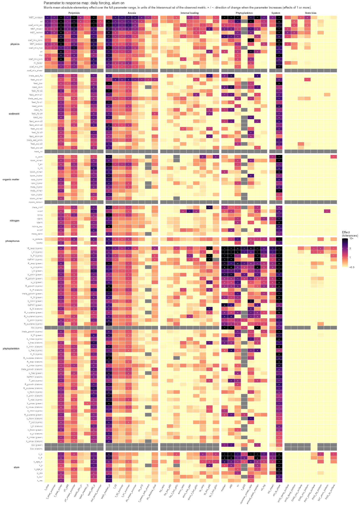
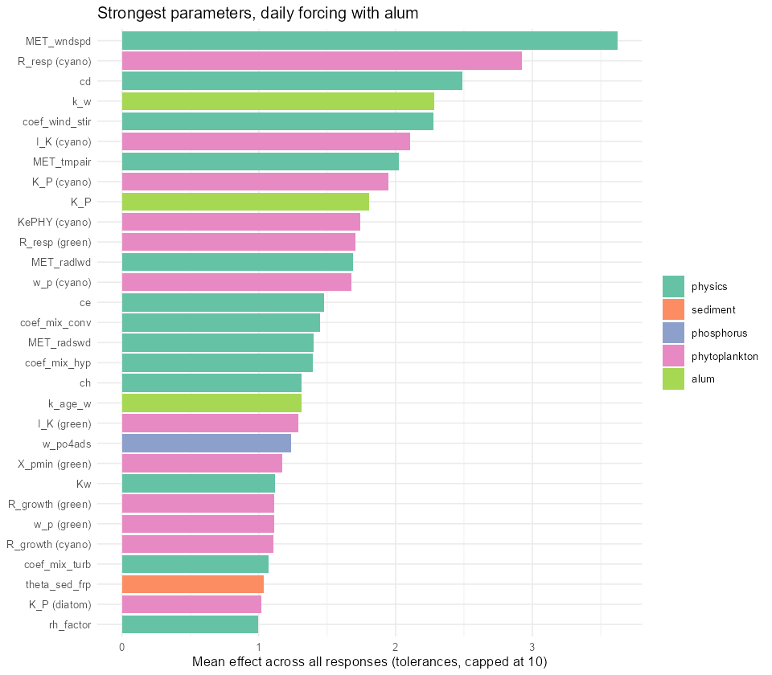
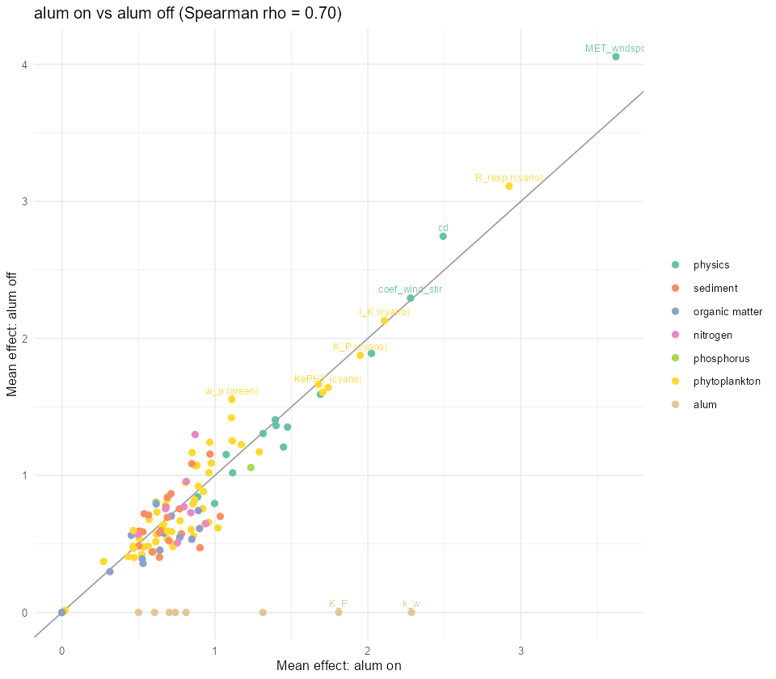
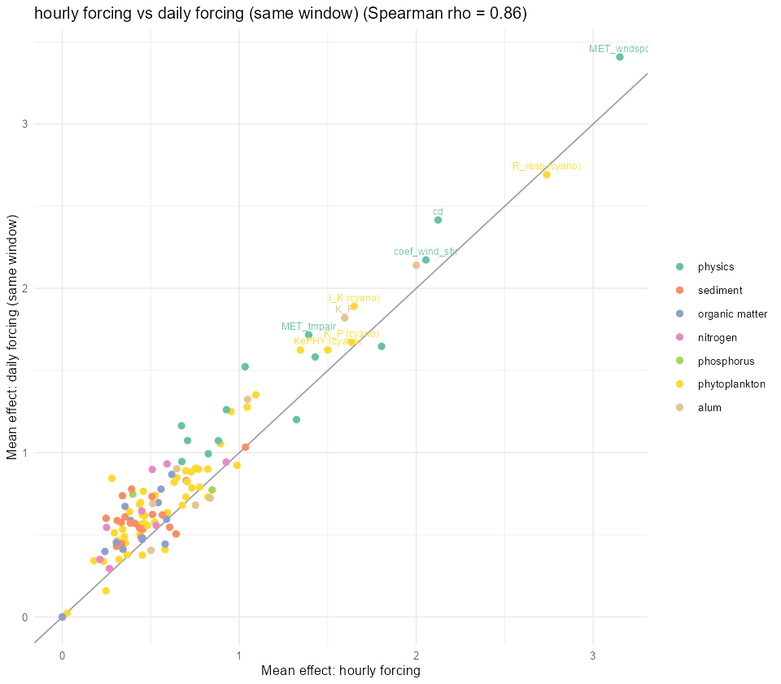

```{r}
library(dplyr)
library(tidyr)
library(knitr)
library(kableExtra)
img <- "images/sensitivity"
kab <- function(x, ...) kable(x, ...) |> kable_styling(full_width = FALSE, bootstrap_options = c("striped", "condensed"))
tg <- read.csv("images/staged-calibration/csps_targets.csv")
have <- function(v) file.exists(file.path(img, paste0("sa_effects_", v, ".csv")))
eff <- function(v) read.csv(file.path(img, paste0("sa_effects_", v, ".csv")))
runs <- function(v) read.csv(file.path(img, paste0("sa_runs_", v, ".csv")))
sig <- tg$signature
cat_of <- function(o) sub("_.*", "", o)
cat_name <- c(mix = "Polymixis", anox = "Anoxia", load = "Internal loading", chl = "Phytoplankton", sys = "System")
```

## Purpose

Before calibrating against the CSPS metrics ([evaluation framework](csps-metrics.qmd)), I asked which parameters each metric responds to, so that the calibration only adjusts parameters that can change the targets and does not trade them against each other. This page reports a Morris screening of the GLM-AED model with the CSPS signatures as outputs.

## Design

-   **Model:** GLM-AED for Lake Rotorua (weir outflow, calibrated water balance, `hyps_no_hole`), full AED suite with alum, 13 inflows.
-   **Parameters:** 121 varied, read from the AED source (`libaed-water`) and the GLM namelist, with ranges deliberately wider than the calibration bounds so the analysis shows what the model can do.

```{r}
tab <- readRDS("images/sensitivity/sa_table.rds")
tab <- tab[tab$min < tab$max, ]
tab$theme <- factor(tab$theme, c("physics", "sediment", "organic matter", "nitrogen", "phosphorus", "phytoplankton", "alum"))
tt <- tab |> group_by(Group = theme) |> summarise(Parameters = n(), Examples = paste(head(unique(sub("^.*/", "", name)), 6), collapse = ", "))
kab(tt, caption = "Parameter groups varied in the screening.")
```

-   **Method:** Morris elementary effects, 6 levels, 12 trajectories, so 1,464 model runs per setup. Rate parameters are sampled on a log scale. Because the same sampling design is used for every setup, runs can be compared pairwise.
-   **Outputs:** the 33 process and system signatures of the CSPS framework, plus bias and RMSE by variable and layer.
-   **Effect size:** the mean absolute elementary effect, expressed in the lake's own tolerance: one unit is a change in the metric equal to its standard deviation between observed years. An effect of 1 means the parameter, moved across its whole range, shifts the metric by as much as the lake varies between years.
-   **Setups:**

| Setup | Forcing | Window | Alum |
|----|----|----|----|
| Daily, alum | daily ERA5 (hourly record aggregated to days from 2011; extended before 2011) | 2010-07 to 2013-06 | on |
| Daily, no alum | as above | as above | dose set to zero |
| Hourly, alum | hourly bias-corrected ERA5 | 2012-07 to 2015-06 | on |
| Daily, same window | hourly series aggregated to days | 2012-07 to 2015-06 | on |

The last two are identical except for the time resolution of the meteorology.

## Parameter to response map

Each row is a parameter and each column a response. Colour is the effect size on a log scale (white to pale means under 0.3 tolerances, which is within the noise of the experiment), and the sign shows the direction of change when the parameter increases (shown for effects of 1 or more).

{#fig-heatmap}

```{r}
#| eval: !expr have("alum")
e <- eff("alum") |> filter(output %in% sig) |> mutate(cat = cat_name[cat_of(output)])
top <- e |> group_by(cat, parameter) |> summarise(m = mean(pmin(mu_star_scaled, 20), na.rm = TRUE), .groups = "drop") |>
  group_by(cat) |> arrange(desc(m), .by_group = TRUE) |> slice_head(n = 6) |>
  summarise(`Most influential parameters (mean effect in tolerances)` = paste0(parameter, " (", round(m, 1), ")", collapse = ", "))
kab(top, caption = "Strongest parameters for each target, daily forcing with alum.")
```

{width="70%"}

## Findings by target

### Polymixis

Stratification is controlled by the **wind and mixing parameters**: wind scaling, `coef_wind_stir`, the drag coefficient `cd`, the hypolimnetic mixing coefficient and the radiation scalings (heat input). More wind, stirring and drag reduce stratification; more long-wave radiation and warmer air increase it. Biogeochemical parameters have no meaningful effect on any mixing metric. `coef_mix_shear` is inert.

The wind scaling has the largest single effect, which is the reason it must not be used as a free parameter (the wind is measured on the lake): the mixing coefficients (`coef_wind_stir`, `cd`) have comparable leverage over the same metrics and are the right place for the adjustment.

### Anoxia

Bottom-water oxygen and anoxic days are driven by **the same mixing parameters** as stratification, because the length of a stratified spell sets how long the bottom water can be drawn down. The only biogeochemical lever of comparable size is the **sediment oxygen demand in the deepest zone** (`fsed_oxy` zone 1), which also controls whether the model has anoxic years at all. The rate of oxygen decline during stratified spells (a process-level measure of oxygen demand) responds to cyanobacteria respiration and to the zone-1 oxygen demand.

### Internal loading

This is the **least well-controlled target**. No parameter moves any loading metric by more than about 3 tolerances. Bottom-water ammonium responds to nitrification (`rnitrif`) and, less, to wind and the cyanobacteria nitrogen uptake. Sediment ammonium flux has a smaller effect than expected. The bottom FRP and TP gradients respond to almost nothing, including the sediment FRP flux and the P adsorption parameters.

### Phytoplankton

Chlorophyll-a is controlled by the **cyanobacteria group** (respiration `R_resp`, light `I_K`, phosphorus half-saturation `K_P`, `KePHY`, buoyancy `w_p`), and by the alum rates when alum is on. A large part of the sampled space produces runaway cyanobacteria blooms (the median chlorophyll-a spans 0 to over 1,000 mg/m^3^), so the effect sizes for chlorophyll are dominated by those regions and overstate the sensitivity in the realistic range.

## Influence by parameter group

```{r}
#| eval: !expr have("alum")
g <- eff("alum") |> filter(output %in% sig) |> group_by(parameter, theme) |>
  summarise(m = mean(pmin(mu_star_scaled, 20), na.rm = TRUE), mx = max(pmin(mu_star_scaled, 20), na.rm = TRUE), .groups = "drop")
gt <- g |> group_by(Group = theme) |> summarise(Parameters = n(), `Mean effect` = round(mean(m), 2), `Strongest single effect` = round(max(m), 2), `Not influential (<0.3 everywhere)` = sum(mx < 0.3))
kab(gt, caption = "Mean effect on the CSPS signatures, by parameter group.")
```

The screening is highly interacting: the spread of the elementary effects is larger than their mean for every target (median sigma/mu\* 1.4 to 2.1), so effects are nonlinear and depend on the other parameters. The ranking tells us which parameters to adjust, not by how much.

## Are the targets reachable?

For each signature the table shows the range produced by the 1,464 sampled parameter sets, and the share of them that land within the observed tolerance.

```{r}
#| eval: !expr have("alum")
r <- runs("alum")
rg <- do.call(rbind, lapply(tg$signature, function(s) {
  x <- r[[s]]; o <- tg$observed[tg$signature == s]; tl <- tg$tolerance[tg$signature == s]
  data.frame(Target = cat_name[cat_of(s)], Signature = s, Observed = signif(o, 3), Tolerance = signif(tl, 2),
             `5th to 95th percentile of runs` = paste(signif(quantile(x, .05, na.rm = TRUE), 3), "to", signif(quantile(x, .95, na.rm = TRUE), 3)),
             `Runs within tolerance (%)` = round(100 * mean(abs(x - o) <= tl, na.rm = TRUE)), check.names = FALSE)
}))
kab(rg, caption = "Range of each signature across the sampled parameter sets (daily forcing, alum).")
```

-   **Stratification can be brought to the observed value** by the mixing parameters, but only a small share of the random parameter sets do so; the calibrated baseline (hourly physics under daily forcing) was far too stratified.
-   **Bottom FRP and TP concentrations are not reachable**: the observed 90th percentiles lie above essentially every simulated run (under 1% within tolerance). This is a structural gap (see the ammonium and sediment-flux sections of the [staged calibration](rotorua-calibration-staged.qmd)), not a tuning problem.
-   **Bottom ammonium and anoxia are reachable.**
-   **Chlorophyll-a is only reachable within a narrow part of the cyanobacteria parameter space** (1 to 3% of runs).

## Effect of alum

The same parameter sets were run with the alum dose set to zero. The paired difference (alum minus no alum) at identical parameters shows what alum does to each metric.

```{r}
#| eval: !expr have("alum") && have("noalum")
a <- runs("alum"); n <- runs("noalum")
d <- do.call(rbind, lapply(sig, function(s) {
  dd <- (a[[s]] - n[[s]]) / tg$tolerance[tg$signature == s]
  data.frame(Target = cat_name[cat_of(s)], Signature = s,
             `Mean with alum` = signif(mean(a[[s]], na.rm = TRUE), 3), `Mean without alum` = signif(mean(n[[s]], na.rm = TRUE), 3),
             `Median change (tolerances)` = round(median(dd, na.rm = TRUE), 2),
             `Runs changed by more than half a tolerance (%)` = round(100 * mean(abs(dd) > 0.5, na.rm = TRUE)), check.names = FALSE)
}))
kab(d, caption = "Paired effect of alum on each signature.")
```

-   **Physics and oxygen are unchanged on average** (means agree to 3 figures). Individual paired runs do scatter by up to about a tolerance for some mixing metrics; this is a noise floor of the experiment (small differences amplified near stratification thresholds), so effects under one tolerance on those metrics should not be interpreted.
-   **Phosphorus responds as expected:** the 90th percentile of bottom FRP falls by about 60% and bottom TP by about 25%, and the mean simulated TLI3 is lower by about 0.8 units.
-   **Chlorophyll-a** is lower with alum in the bloom-prone parameter sets and unchanged in typical runs.
-   **Bottom to surface contrast is larger with alum** (alum removes surface phosphorus more than bottom), so the internal-loading signatures read stronger in a dosed lake.

{width="70%"}

Parameter rankings are broadly the same (Spearman 0.69), but with alum the alum rate `k_w`, `K_P`, `k_age_w`, `k_s` and `w_ala` become influential for chlorophyll and phosphorus and compete with the phytoplankton and sediment parameters. This is the case for calibrating phosphorus and phytoplankton parameters with the alum module off, on years without dosing, and the alum parameters afterwards.

## Hourly against daily forcing

```{r}
#| eval: !expr have("hourly") && have("dailyw2")
rho <- readRDS("images/sensitivity/rank_correlations.rds")
cat("Spearman rank correlation of overall parameter influence, hourly vs daily forcing on the same window:", round(rho$forcing, 2), "\n")
```

```{r}
#| eval: !expr have("hourly") && have("dailyw2")
h <- runs("hourly"); dd <- runs("dailyw2")
fc <- do.call(rbind, lapply(sig, function(s) {
  tl <- tg$tolerance[tg$signature == s]; o <- tg$observed[tg$signature == s]
  data.frame(Target = cat_name[cat_of(s)], Signature = s,
             `Mean, hourly` = signif(mean(h[[s]], na.rm = TRUE), 3), `Mean, daily` = signif(mean(dd[[s]], na.rm = TRUE), 3),
             `Median change hourly minus daily (tolerances)` = round(median((h[[s]] - dd[[s]]) / tl, na.rm = TRUE), 2),
             `Correlation across the 1,464 parameter sets` = round(cor(h[[s]], dd[[s]], use = "complete.obs"), 2),
             `Runs within tolerance, hourly (%)` = round(100 * mean(abs(h[[s]] - o) <= tl, na.rm = TRUE)),
             `Runs within tolerance, daily (%)` = round(100 * mean(abs(dd[[s]] - o) <= tl, na.rm = TRUE)), check.names = FALSE)
}))
kab(fc, caption = "The same 1,464 parameter sets run with hourly forcing and with the hourly record aggregated to daily (2012-07 to 2015-06, alum on).")
```

{width="70%"}

The two forcings give the **same picture of which parameters matter**, but **different absolute behaviour**:

-   **Rankings agree.** The overall rank correlation of parameter influence is 0.86, no lower than the 0.85 between the two daily windows (2010 to 2013 and 2012 to 2015), so changing from hourly to daily forcing alters the rankings no more than changing the years. The same parameters lead each target in both: wind scaling, `coef_wind_stir`, `cd` and `fsed_oxy` zone 1 for anoxia and mixing, and the cyanobacteria respiration, light and phosphorus parameters (and the alum rates) for chlorophyll.
-   **Response to the parameters agrees.** For identical parameter sets the outputs correlate at 0.93 to 0.98 for the main stratification and anoxia metrics (the spell-length metrics are noisier, 0.25 to 0.84) and 0.99 for chlorophyll-a, so a parameter set that is better under one forcing is better under the other.
-   **But daily forcing is systematically more stratified.** For the same parameters the daily-forced model is stratified on 48% of days against 37% with hourly forcing (a difference of about 1.8 tolerances, almost all of it in winter), has a bottom temperature 1.7 °C lower in the stratified season, and has more anoxic days (14% against 9%). Averaging the wind over a day removes the short windy periods that break stratification, so the daily-forced model has less mixing energy for the same parameters.
-   **The mixing parameters matter somewhat more under daily forcing** (physics group mean effect 2.1 against 1.6; wind scaling 5.6 against 4.1): with less mixing energy built in, the model leans harder on them, which is also why daily forcing is more likely to produce a compensating wind scaling.
-   **The observed stratification is easier to reach with hourly forcing**: 19% of sampled parameter sets land within tolerance for the stratified fraction, against 8% with daily.
-   **Internal loading and phosphorus targets are unreachable under both** (bottom FRP and TP 90th percentiles within tolerance in 0% of runs).

What this means: the **sensitivity conclusions are transferable between forcings, but fitted parameter values are not**. Mixing coefficients calibrated to daily forcing would absorb the missing sub-daily wind and would be too strong when used with hourly forcing, such as the climate scenarios disaggregated to hourly. The physics should be calibrated with hourly forcing, and daily forcing is acceptable for ranking parameters and for screening.

## Implications for the calibration

1.  **Fix wind at 1** (it is measured). Calibrate stratification, mixing and anoxia with `coef_wind_stir`, `cd`, `ce`/`ch`, the hypolimnetic and other mixing coefficients, the radiation scalings (kept narrow), and the deep-zone oxygen demand.
2.  **Hold `coef_mix_shear`, `ksed_nit` and `rcpom_bdown` fixed**: they do not affect any target.
3.  **Calibrate phosphorus and chlorophyll parameters with alum off**, on years without dosing, because `k_w`, `K_P` and the other alum rates otherwise compete with the cyanobacteria and sediment parameters for the same data. Use narrow cyanobacteria ranges to avoid the runaway-bloom region.
4.  **Do not use bottom FRP and TP concentration as targets** in the current structure; they cannot be reached.
5.  **Use the ensemble smoother with the CSPS residuals**, not a single best parameter set, because the response is strongly interacting.

## Limitations

-   Morris screening with 12 trajectories ranks parameters but does not give variance shares; interactions are large, so a variance-based analysis (Sobol) on the 15 to 20 parameters chosen for calibration would be the next step.
-   Some phytoplankton temperature parameters (`theta_growth`, `T_std`, `T_opt`, `T_max`) were restricted to the region where AED's temperature-function solver converges; outside it the model stops with "Cannot solve for fT".
-   Three years are scored per run, so the signatures that depend on rare events (anoxic years, long spells) are noisy.
-   The daily-forced window before 2011 uses an extension of the raw daily ERA5 that correlates poorly with the hourly record (wind r = 0.45, rain r = 0.42), which affects the spin-up of the first setup only.
